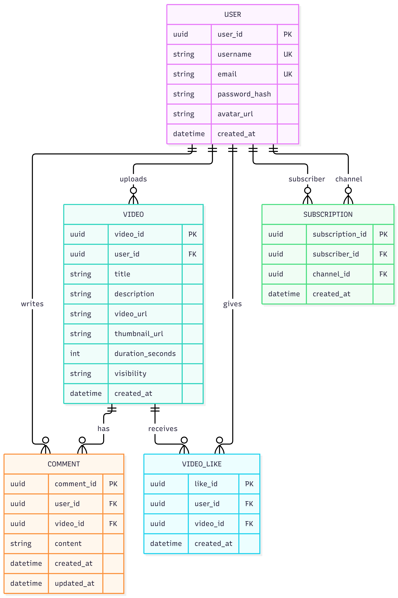

<div style="text-align: center; font-size: 22px; margin-top: 60px;">

Міністерство освіти і науки України

Національний технічний університет України

«Київський політехнічний інститут імені Ігоря Сікорського»

Факультет інформатики та обчислювальної техніки

Кафедра обчислювальної техніки

</div>

<div style="text-align: center; margin-top: 120px;">

<h1 style="font-size: 30px;">Лабораторна робота №1</h1>

<h2 style="font-size: 24px;">з дисципліни «Бази даних»</h2>

</div>

<div style="text-align: right; margin-top: 120px; font-size: 18px;">

<strong>Виконав:</strong><br>
Чакун Олександр<br>
студент групи ІМ-о51<br>
номер у списку групи: 18<br><br>

<strong>Перевірив:</strong><br>
Русінов В.В.

</div>

<div style="text-align: center; margin-top: 120px; font-size: 22px;">

Київ 2026

</div>

---

## Тема та мета роботи

**Тема:** збір вимог та розробка концептуальної ER-моделі для відеохостингової платформи VideoHub.

**Мета роботи:** визначити основні вимоги до предметної області, виділити сутності, їх атрибути та зв'язки, побудувати ER-діаграму, а також представити модель у вигляді C#-класів. Отримана концептуальна модель надалі може бути використана як основа для побудови фізичної структури бази даних у PostgreSQL.

---

## Короткий виклад вимог

VideoHub — навчальна відеохостингова платформа, яка моделює базові можливості сервісів на кшталт YouTube.

Система повинна дозволяти користувачам:

- створювати облікові записи;
- завантажувати власні відео;
- переглядати інформацію про відео;
- залишати коментарі;
- ставити вподобання відео;
- підписуватися на інших користувачів.

Для реалізації цих можливостей у базі даних необхідно зберігати інформацію про користувачів, відео, коментарі, вподобання та підписки.

Основними сутностями системи є:

- `User`;
- `Video`;
- `Comment`;
- `VideoLike`;
- `Subscription`.

Основні бізнес-правила:

1. Один користувач може завантажити багато відео.
2. Кожне відео має одного автора.
3. Один користувач може залишити багато коментарів.
4. Одне відео може містити багато коментарів.
5. Один користувач може поставити одному відео не більше одного вподобання.
6. Один користувач може бути підписаний на багатьох інших користувачів.
7. На одного користувача можуть бути підписані багато інших користувачів.
8. Дубльовані підписки не допускаються.
9. Користувач не повинен мати можливості підписатися на самого себе.

---

## ER-діаграма

Нижче наведено концептуальну ER-діаграму бази даних VideoHub.



Діаграма містить п'ять основних сутностей. Сутності `VideoLike` та `Subscription` виконують роль асоціативних сутностей і використовуються для реалізації зв'язків між іншими об'єктами системи.

---

## Сутність User

Сутність `User` представляє зареєстрованого користувача платформи VideoHub.

Атрибути:

- **user_id** — унікальний ідентифікатор користувача та первинний ключ.
- **username** — публічне ім'я користувача. Значення повинно бути унікальним.
- **email** — електронна адреса користувача. Також повинна бути унікальною.
- **password_hash** — хеш пароля користувача. Пароль у відкритому вигляді не зберігається.
- **avatar_url** — адреса зображення профілю. Поле може бути порожнім.
- **created_at** — дата та час створення облікового запису.

У C# ця сутність представлена класом `User`.

Клас також містить колекції `Videos`, `Comments`, `Likes`, `Subscriptions` та `Subscribers`, які відображають зв'язки користувача з іншими сутностями системи.

---

## Сутність Video

Сутність `Video` представляє відеоматеріал, який користувач завантажує на платформу.

Атрибути:

- **video_id** — унікальний ідентифікатор відео та первинний ключ.
- **user_id** — зовнішній ключ, який вказує на автора відео.
- **title** — назва відео.
- **description** — опис відео. Поле може бути порожнім.
- **video_url** — адреса або шлях до відеофайлу.
- **thumbnail_url** — адреса зображення попереднього перегляду.
- **duration_seconds** — тривалість відео у секундах.
- **visibility** — рівень доступу до відео, наприклад `public`, `unlisted` або `private`.
- **created_at** — дата та час створення запису про відео.

У C# сутність представлена класом `Video`.

Властивість `Author` зберігає посилання на користувача-автора, а колекції `Comments` та `Likes` представляють пов'язані коментарі та вподобання.

---

## Сутність Comment

Сутність `Comment` використовується для зберігання коментарів користувачів до відео.

Атрибути:

- **comment_id** — унікальний ідентифікатор коментаря та первинний ключ.
- **user_id** — зовнішній ключ, який визначає автора коментаря.
- **video_id** — зовнішній ключ, який визначає відео.
- **content** — текст коментаря.
- **created_at** — дата та час створення коментаря.
- **updated_at** — дата та час останнього редагування коментаря. Поле може бути порожнім, якщо коментар не редагувався.

Кожен коментар пов'язаний одночасно з одним користувачем та одним відео.

---

## Сутність VideoLike

Сутність `VideoLike` фіксує факт встановлення вподобання користувачем для певного відео.

Атрибути:

- **like_id** — унікальний ідентифікатор вподобання та первинний ключ.
- **user_id** — зовнішній ключ на користувача.
- **video_id** — зовнішній ключ на відео.
- **created_at** — дата та час встановлення вподобання.

Ця сутність реалізує логічний зв'язок багато-до-багатьох між `User` та `Video`.

У майбутній фізичній схемі бази даних для пари `user_id + video_id` доцільно встановити обмеження унікальності, щоб один користувач не міг поставити одному відео декілька однакових вподобань.

---

## Сутність Subscription

Сутність `Subscription` представляє підписку одного користувача на іншого.

Атрибути:

- **subscription_id** — унікальний ідентифікатор підписки та первинний ключ.
- **subscriber_id** — зовнішній ключ на користувача, який оформлює підписку.
- **channel_id** — зовнішній ключ на користувача, на якого оформлюється підписка.
- **created_at** — дата та час створення підписки.

Обидва зовнішні ключі посилаються на сутність `User`, але мають різне логічне значення.

Для пари `subscriber_id + channel_id` повинно діяти обмеження унікальності.

Також `subscriber_id` не повинен дорівнювати `channel_id`, оскільки користувач не повинен мати можливість підписатися сам на себе.

---

## Пояснення зв'язків

**User → Video — 1:N.**

Один користувач може завантажити багато відео. Кожне відео має тільки одного автора. Зв'язок реалізується за допомогою атрибута `user_id` у сутності `Video`.

**User → Comment — 1:N.**

Один користувач може створити багато коментарів. Кожен коментар має тільки одного автора.

**Video → Comment — 1:N.**

Одне відео може містити багато коментарів. Кожен коментар належить тільки одному відео.

**User ↔ Video через VideoLike — M:N.**

Один користувач може поставити вподобання багатьом відео, а одне відео може отримати вподобання від багатьох користувачів. Для реалізації цього зв'язку використовується асоціативна сутність `VideoLike`.

**User ↔ User через Subscription — M:N.**

Один користувач може бути підписаний на багато каналів. Водночас на одного користувача можуть бути підписані багато інших користувачів.

Сутність `Subscription` містить два зовнішні ключі на таблицю користувачів:

- `subscriber_id`;
- `channel_id`.

Таким чином реалізується рекурсивний зв'язок між користувачами.

---

## Представлення моделі мовою C#

Для демонстрації структури предметної області сутності ER-моделі також представлені у вигляді C#-класів.

Наприклад, клас `Video`:

```csharp
public class Video
{
    public Guid VideoId { get; set; } = Guid.NewGuid();
    public Guid UserId { get; set; }

    public string Title { get; set; } = string.Empty;
    public string? Description { get; set; }
    public string VideoUrl { get; set; } = string.Empty;
    public string? ThumbnailUrl { get; set; }
    public int DurationSeconds { get; set; }
    public string Visibility { get; set; } = "public";
    public DateTime CreatedAt { get; set; } = DateTime.UtcNow;

    public User? Author { get; set; }
    public List<Comment> Comments { get; set; } = new();
    public List<VideoLike> Likes { get; set; } = new();
}
```

Властивість `UserId` відповідає майбутньому зовнішньому ключу у базі даних.

Властивість `Author` представляє пов'язаний об'єкт користувача.

Колекції `Comments` та `Likes` представляють зв'язки один-до-багатьох з відповідними сутностями.

Повна C#-реалізація моделі знаходиться у файлі:

`src/Program.cs`

У методі `Main()` створюються демонстраційні об'єкти користувачів, відео, коментаря, вподобання та підписки. Це дозволяє на простому прикладі показати взаємодію об'єктів між собою.

---

## Припущення та обмеження

Під час побудови моделі були прийняті такі припущення:

1. Кожен користувач має унікальні `username` та `email`.
2. Для ідентифікаторів використовується тип `Guid`, який у PostgreSQL може бути представлений типом `UUID`.
3. Пароль не зберігається у відкритому вигляді.
4. Одне відео має тільки одного автора.
5. Тривалість відео повинна бути більшою за нуль.
6. Один користувач може поставити одному відео лише одне вподобання.
7. Дубльовані підписки не допускаються.
8. Користувач не може підписуватися на самого себе.
9. Відеофайли та зображення не зберігаються безпосередньо у реляційній базі даних. У базі зберігаються лише їх URL або шляхи.
10. Плейлисти, історія переглядів, монетизація, теги та інші додаткові можливості не включені до поточної моделі, оскільки вони не є необхідними для базової навчальної реалізації.

---

## Висновок

У ході лабораторної роботи було сформульовано вимоги до відеохостингової платформи VideoHub та побудовано концептуальну ER-модель.

Було визначено п'ять основних сутностей: `User`, `Video`, `Comment`, `VideoLike` та `Subscription`.

Для кожної сутності визначено основні атрибути, первинні та майбутні зовнішні ключі, а також встановлено типи зв'язків між сутностями.

Додатково модель була представлена за допомогою класів C#, що дозволяє показати відповідність між об'єктною структурою програми та структурою майбутньої бази даних.

Отримана модель може бути використана як основа для наступної лабораторної роботи, у якій буде створено фізичну схему бази даних у PostgreSQL.
