<div style="text-align: center; font-size: 22px; margin-top: 60px;">

Міністерство освіти і науки України

Національний технічний університет України

«Київський політехнічний інститут імені Ігоря Сікорського»

Факультет інформатики та обчислювальної техніки

Кафедра обчислювальної техніки

</div>

<div style="text-align: center; margin-top: 120px;">

<h1 style="font-size: 30px;">Лабораторна робота №2</h1>

<h2 style="font-size: 24px;">з дисципліни «Бази даних»</h2>

</div>

<div style="text-align: right; margin-top: 120px; font-size: 18px;">

<strong>Виконав:</strong><br>
Степаненко Денис<br>
студент групи ІМ-051<br>
номер у списку групи: 16<br><br>

<strong>Перевірив:</strong><br>
Хмельницький Арсеній Андрійович

</div>

<div style="text-align: center; margin-top: 120px; font-size: 22px;">

Київ 2026

</div>

---

## Короткий виклад вимог

**Завдання:**

На основі концептуальної моделі з Lab 1 (ER-діаграми VideoHub) потрібно створити фізичну схему бази даних у PostgreSQL за допомогою DDL-команд (CREATE TABLE) та заповнити таблиці тестовими даними за допомогою DML-команд (INSERT INTO).

**Порядок створення таблиць:**

Спочатку створюються батьківські таблиці (без зовнішніх ключів), потім дочірні (з зовнішніми ключами, що посилаються на батьківські). Це необхідно тому, що PostgreSQL перевіряє існування таблиці, на яку посилається FOREIGN KEY, на момент створення.

1. `User` — без зовнішніх ключів (батьківська таблиця)
2. `Video` — FK author_id → User(id)
3. `Comment` — FK user_id → User(id), FK video_id → Video(id)
4. `Like` — FK user_id → User(id), FK video_id → Video(id)
5. `Subscription` — FK subscriber_id → User(id), FK channel_id → User(id)

---

## Що змінено після першої здачі

Після першого захисту я переглянув схему ще раз і знайшов кілька слабких місць, які виправив у поточній версії:

1. **Композитний первинний ключ у `Like`.** Раніше було `id UUID PRIMARY KEY` + окреме `UNIQUE(user_id, video_id)` — сурогатний id, на який ніхто не посилався, і другий індекс для унікальності пари. Тепер `PRIMARY KEY (user_id, video_id)` — сама пара і є ключем: менше колонок, один індекс, унікальність гарантує структура ключа.
2. **Композитний первинний ключ у `Subscription`.** Та сама зміна: замість `id` + `UNIQUE(subscriber_id, channel_id)` тепер `PRIMARY KEY (subscriber_id, channel_id)`.
3. **Перевірка способу входу в `User`.** Раніше `password` і `google_id` могли бути NULL одночасно — можна було створити користувача, в якого неможливо залогінитись. Додано `CHECK (password IS NOT NULL OR google_id IS NOT NULL)` — email і так `NOT NULL`, тож тепер у кожного юзера є ідентифікатор і хоча б один спосіб авторизації.
4. **Перевірка `views >= 0` у `Video`.** Лічильник переглядів не може бути від'ємним — додано CHECK-обмеження.
5. **Діаграми «до/після».** Побудовано два варіанти схеми — старий (`er_schema_old.mmd`, з сурогатними id) і новий (`er_schema_new.mmd`, з композитними ключами) — вони показані в кінці звіту для порівняння.
6. **`created_at` у `Like`.** Дата створення була в усіх таблицях, крім `Like` — дрібна неузгодженість: підписка зберігає момент, а лайк ні. Додано `created_at` — тепер кожен запис у базі має дату створення.
7. **`TIMESTAMPTZ` замість `TIMESTAMP` для всіх `created_at`.** `TIMESTAMP` зберігає «голий» час без зони: на хостингу в іншій зоні користувач бачив би серверний час як є. `TIMESTAMPTZ` зберігає абсолютний момент (усередині UTC) і при читанні конвертує під часову зону сесії — правильний вибір для будь-якого глобального сервісу.

Порівняння старої та нової схеми візуально — у розділі «Діаграма схеми — до та після рефакторингу» нижче.

---

## DDL: CREATE TABLE

Підключення розширення для генерації UUID:

```sql
CREATE EXTENSION IF NOT EXISTS "uuid-ossp";
```

Таблиця **User** — користувач платформи:

```sql
CREATE TABLE "User" (
    id          UUID PRIMARY KEY DEFAULT uuid_generate_v4(),
    email       VARCHAR(255) UNIQUE NOT NULL,
    username    VARCHAR(100) UNIQUE NOT NULL,
    password    VARCHAR(255),
    google_id   VARCHAR(255) UNIQUE,
    avatar      VARCHAR(500),
    banner      VARCHAR(500),
    description TEXT,
    created_at  TIMESTAMPTZ NOT NULL DEFAULT now(),
    CONSTRAINT check_auth_method CHECK (password IS NOT NULL OR google_id IS NOT NULL)
);
```

Таблиця **Video** — відео, завантажене користувачем:

```sql
CREATE TABLE "Video" (
    id          UUID PRIMARY KEY DEFAULT uuid_generate_v4(),
    title       VARCHAR(255) NOT NULL,
    description TEXT,
    url         VARCHAR(500) NOT NULL,
    thumbnail   VARCHAR(500),
    views       INTEGER NOT NULL DEFAULT 0 CHECK (views >= 0),
    created_at  TIMESTAMPTZ NOT NULL DEFAULT now(),
    author_id   UUID NOT NULL REFERENCES "User"(id) ON DELETE CASCADE
);
```

Таблиця **Comment** — коментар користувача до відео:

```sql
CREATE TABLE "Comment" (
    id          UUID PRIMARY KEY DEFAULT uuid_generate_v4(),
    text        TEXT NOT NULL,
    created_at  TIMESTAMPTZ NOT NULL DEFAULT now(),
    user_id     UUID NOT NULL REFERENCES "User"(id) ON DELETE CASCADE,
    video_id    UUID NOT NULL REFERENCES "Video"(id) ON DELETE CASCADE
);
```

Таблиця **Like** — лайк користувача на відео (композитний первинний ключ — пара юзер+відео унікальна сама по собі, окремий сурогатний `id` не потрібен):

```sql
CREATE TABLE "Like" (
    user_id     UUID NOT NULL REFERENCES "User"(id) ON DELETE CASCADE,
    video_id    UUID NOT NULL REFERENCES "Video"(id) ON DELETE CASCADE,
    created_at  TIMESTAMPTZ NOT NULL DEFAULT now(),
    PRIMARY KEY (user_id, video_id)
);
```

Таблиця **Subscription** — підписка одного користувача на іншого (композитний PK + CHECK на самопідписку):

```sql
CREATE TABLE "Subscription" (
    subscriber_id UUID NOT NULL REFERENCES "User"(id) ON DELETE CASCADE,
    channel_id    UUID NOT NULL REFERENCES "User"(id) ON DELETE CASCADE,
    created_at    TIMESTAMPTZ NOT NULL DEFAULT now(),
    PRIMARY KEY (subscriber_id, channel_id),
    CONSTRAINT check_no_self_subscribe CHECK (subscriber_id <> channel_id)
);
```

---

## Опис обмежень

**PRIMARY KEY** — у `User`, `Video`, `Comment` первинний ключ `id` типу UUID, генерується автоматично через `DEFAULT uuid_generate_v4()`. UUID — 128-бітний унікальний ідентифікатор, що гарантує глобальну унікальність навіть при об'єднанні даних з різних баз. У таблицях-зв'язках `Like` і `Subscription` використано **композитний первинний ключ**: `PRIMARY KEY (user_id, video_id)` і `PRIMARY KEY (subscriber_id, channel_id)`. Сама пара FK колонок і є ключем — окремий сурогатний `id` там був би «мертвим» (на нього ніхто не посилається) і дублював би унікальність другим індексом. Композитний PK дає унікальність безкоштовно: менше колонок, один індекс, чистіша модель.

**FOREIGN KEY** — зовнішні ключі забезпечують посилальну цілісність (referential integrity). Кожен FK вказує на первинний ключ батьківської таблиці. Обмеження `ON DELETE CASCADE` означає, що при видаленні запису в батьківській таблиці автоматично видаляються всі пов'язані записи в дочірній. Наприклад, при видаленні користувача видаляються всі його відео, коментарі, лайки та підписки.

**UNIQUE** — обмеження унікальності. На таблиці `User` поля `email` та `username` мають UNIQUE — два користувачі не можуть мати однаковий email або нікнейм. Поле `google_id` також UNIQUE, але може бути NULL (користувачі з паролем мають google_id = NULL). У `Like` і `Subscription` унікальність пари забезпечує безпосередньо композитний первинний ключ — окреме UNIQUE-обмеження не потрібне.

**CHECK** — обмеження перевірки:
- `User`: `CHECK (password IS NOT NULL OR google_id IS NOT NULL)` — користувач має мати хоча б один спосіб входу: пароль або Google OAuth. Без цього можна було б вставити «недоступного» користувача (email NOT NULL гарантується окремим обмеженням).
- `Video`: `CHECK (views >= 0)` — лічильник переглядів не може бути від'ємним.
- `Subscription`: `CHECK(subscriber_id <> channel_id)` — заборона підписки на самого себе.

**DEFAULT** — значення за замовчуванням. Поле `views` у таблиці `Video` має `DEFAULT 0` — нове відео стартує з нульовою кількістю переглядів. Поле `created_at` у всіх таблицях має тип `TIMESTAMPTZ` і `DEFAULT now()` — абсолютний час із зоною (усередині UTC, на виході конвертується під зону сесії), встановлюється автоматично при вставці запису.

**NOT NULL** — обов'язкові поля. `email` та `username` в User, `title` та `url` в Video, `text` в Comment, всі FK-поля — не можуть бути порожніми. Поле `password` може бути NULL (для користувачів з Google OAuth).

---

## DML: INSERT — тестові дані

**Користувачі (5 рядків):**

```sql
INSERT INTO "User" (id, email, username, password, google_id, avatar, banner, description) VALUES
    ('a1b2c3d4-0001-0000-0000-000000000001', 'denys@example.com', 'denys_dev', 'hashed_pass_1', NULL, 'https://cdn.videohub.com/avatars/denys.png', 'https://cdn.videohub.com/banners/denys.png', 'Full-stack developer. Uploading coding tutorials.'),
    ('a1b2c3d4-0002-0000-0000-000000000002', 'maria@example.com', 'maria_gaming', 'hashed_pass_2', NULL, 'https://cdn.videohub.com/avatars/maria.png', NULL, 'Gaming streamer. Love RPGs and indie games.'),
    ('a1b2c3d4-0003-0000-0000-000000000003', 'oleg@example.com', 'oleg_cook', NULL, 'google_oauth_id_3', 'https://cdn.videohub.com/avatars/oleg.png', 'https://cdn.videohub.com/banners/oleg.png', 'Chef sharing recipes and cooking tips.'),
    ('a1b2c3d4-0004-0000-0000-000000000004', 'anna@example.com', 'anna_travel', 'hashed_pass_4', NULL, NULL, NULL, 'Traveling the world, one video at a time.'),
    ('a1b2c3d4-0005-0000-0000-000000000005', 'max@example.com', 'max_music', NULL, 'google_oauth_id_5', 'https://cdn.videohub.com/avatars/max.png', 'https://cdn.videohub.com/banners/max.png', 'Musician. Covers, original songs, and tutorials.');
```

**Відео (5 рядків):**

```sql
INSERT INTO "Video" (id, title, description, url, thumbnail, views, author_id) VALUES
    ('b2c3d4e5-0001-0000-0000-000000000001', 'PostgreSQL Tutorial for Beginners', 'Learn the basics of PostgreSQL in 30 minutes.', 'https://cdn.videohub.com/videos/vid1.mp4', 'https://cdn.videohub.com/thumbs/vid1.jpg', 15420, 'a1b2c3d4-0001-0000-0000-000000000001'),
    ('b2c3d4e5-0002-0000-0000-000000000002', 'Elden Ring — Final Boss Fight', 'Epic battle against the final boss.', 'https://cdn.videohub.com/videos/vid2.mp4', 'https://cdn.videohub.com/thumbs/vid2.jpg', 89300, 'a1b2c3d4-0002-0000-0000-000000000002'),
    ('b2c3d4e5-0003-0000-0000-000000000003', 'How to Make Perfect Pasta Carbonara', 'Simple and delicious Italian recipe.', 'https://cdn.videohub.com/videos/vid3.mp4', 'https://cdn.videohub.com/thumbs/vid3.jpg', 5230, 'a1b2c3d4-0003-0000-0000-000000000003'),
    ('b2c3d4e5-0004-0000-0000-000000000004', 'Exploring Tokyo — Shibuya at Night', 'Walking through the neon streets of Shibuya.', 'https://cdn.videohub.com/videos/vid4.mp4', 'https://cdn.videohub.com/thumbs/vid4.jpg', 32100, 'a1b2c3d4-0004-0000-0000-000000000004'),
    ('b2c3d4e5-0005-0000-0000-000000000005', 'Acoustic Guitar Cover — Wonderwall', 'My acoustic cover of Oasis Wonderwall.', 'https://cdn.videohub.com/videos/vid5.mp4', 'https://cdn.videohub.com/thumbs/vid5.jpg', 12750, 'a1b2c3d4-0005-0000-0000-000000000005');
```

**Коментарі (5 рядків):**

```sql
INSERT INTO "Comment" (id, text, user_id, video_id) VALUES
    ('c3d4e5f6-0001-0000-0000-000000000001', 'Great tutorial, finally understood JOINs!', 'a1b2c3d4-0002-0000-0000-000000000002', 'b2c3d4e5-0001-0000-0000-000000000001'),
    ('c3d4e5f6-0002-0000-0000-000000000002', 'That boss fight was insane!', 'a1b2c3d4-0001-0000-0000-000000000001', 'b2c3d4e5-0002-0000-0000-000000000002'),
    ('c3d4e5f6-0003-0000-0000-000000000003', 'Tried this recipe, turned out amazing!', 'a1b2c3d4-0004-0000-0000-000000000004', 'b2c3d4e5-0003-0000-0000-000000000003'),
    ('c3d4e5f6-0004-0000-0000-000000000004', 'Tokyo is on my bucket list now.', 'a1b2c3d4-0005-0000-0000-000000000005', 'b2c3d4e5-0004-0000-0000-000000000004'),
    ('c3d4e5f6-0005-0000-0000-000000000005', 'Best cover of this song I have heard.', 'a1b2c3d4-0003-0000-0000-000000000003', 'b2c3d4e5-0005-0000-0000-000000000005');
```

**Лайки (5 рядків):**

```sql
INSERT INTO "Like" (user_id, video_id) VALUES
    ('a1b2c3d4-0002-0000-0000-000000000002', 'b2c3d4e5-0001-0000-0000-000000000001'),
    ('a1b2c3d4-0001-0000-0000-000000000001', 'b2c3d4e5-0002-0000-0000-000000000002'),
    ('a1b2c3d4-0004-0000-0000-000000000004', 'b2c3d4e5-0003-0000-0000-000000000003'),
    ('a1b2c3d4-0005-0000-0000-000000000005', 'b2c3d4e5-0004-0000-0000-000000000004'),
    ('a1b2c3d4-0003-0000-0000-000000000003', 'b2c3d4e5-0005-0000-0000-000000000005');
```

**Підписки (5 рядків):**

```sql
INSERT INTO "Subscription" (subscriber_id, channel_id) VALUES
    ('a1b2c3d4-0002-0000-0000-000000000002', 'a1b2c3d4-0001-0000-0000-000000000001'),
    ('a1b2c3d4-0001-0000-0000-000000000001', 'a1b2c3d4-0002-0000-0000-000000000002'),
    ('a1b2c3d4-0004-0000-0000-000000000004', 'a1b2c3d4-0003-0000-0000-000000000003'),
    ('a1b2c3d4-0005-0000-0000-000000000005', 'a1b2c3d4-0004-0000-0000-000000000004'),
    ('a1b2c3d4-0003-0000-0000-000000000003', 'a1b2c3d4-0005-0000-0000-000000000005');
```

---

## Скріншоти

Створення таблиці User — виконання CREATE TABLE без помилок:

<div style="text-align: center;">

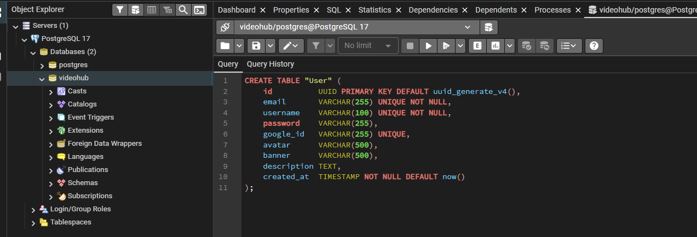

</div>

Створення таблиці Video — виконання CREATE TABLE без помилок:

<div style="text-align: center;">

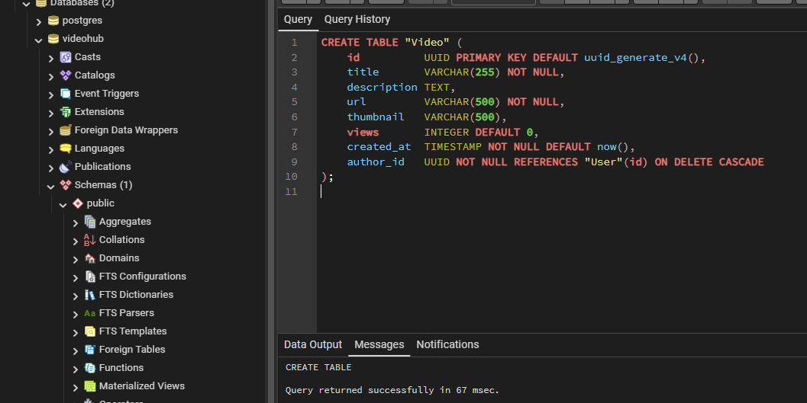

</div>

Створення таблиці Like — виконання CREATE TABLE без помилок:

<div style="text-align: center;">

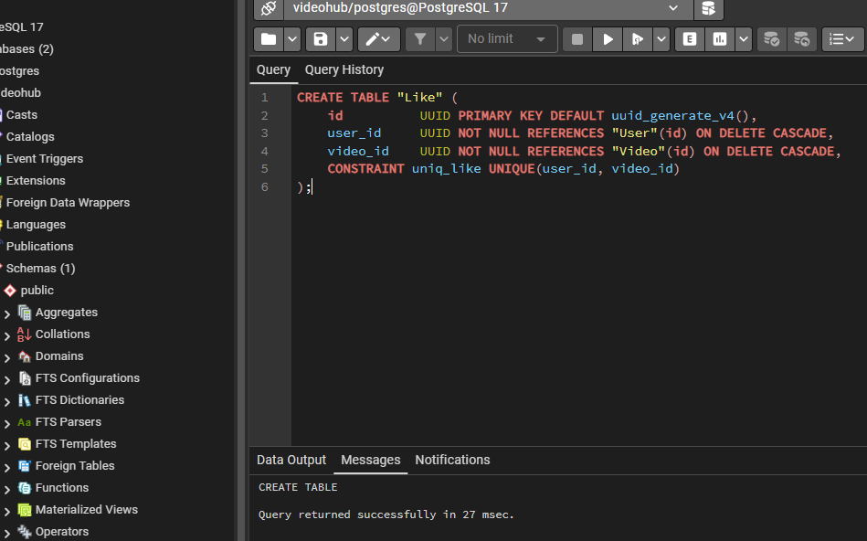

</div>

Створення таблиці Subscription — виконання CREATE TABLE без помилок:

<div style="text-align: center;">

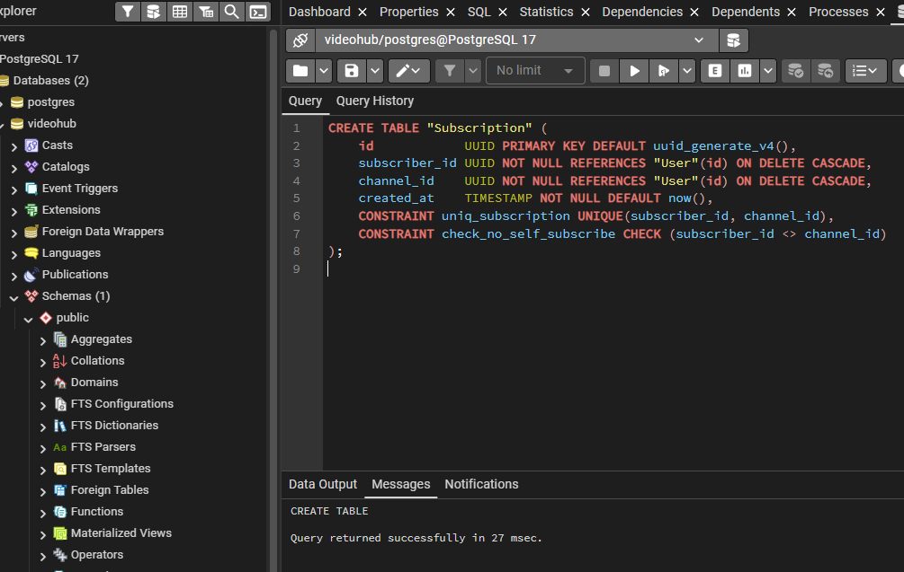

</div>

Заповнення всіх таблиць тестовими даними — виконання INSERT без помилок:

<div style="text-align: center;">

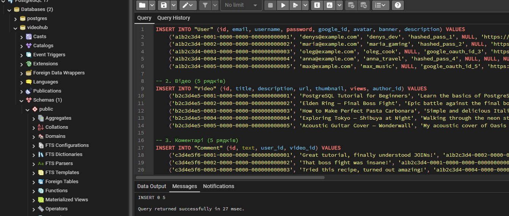

</div>

Перевірка даних — `SELECT *` з кожної таблиці окремо (по 5 рядків). На скріншотах видно композитні первинні ключі у `Like` та `Subscription` (пара FK сама є ключем — окремого `id` немає) і тип `created_at` — `timestamp with time zone`:

**User:**

<div style="text-align: center;">

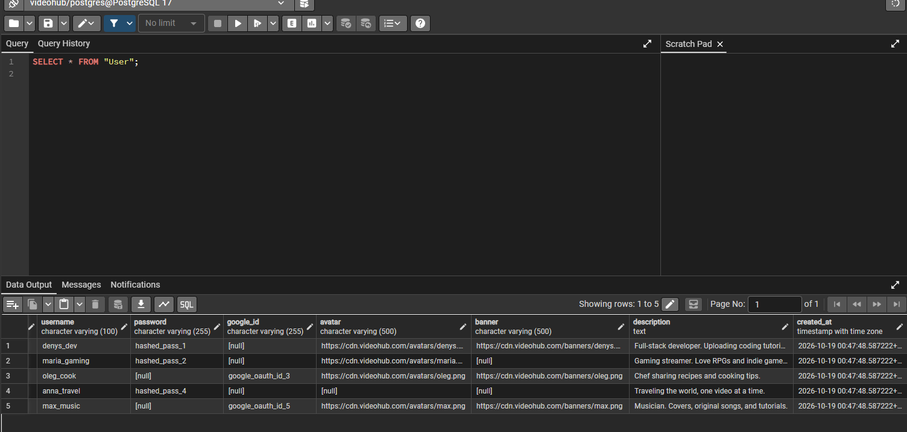

</div>

**Video:**

<div style="text-align: center;">

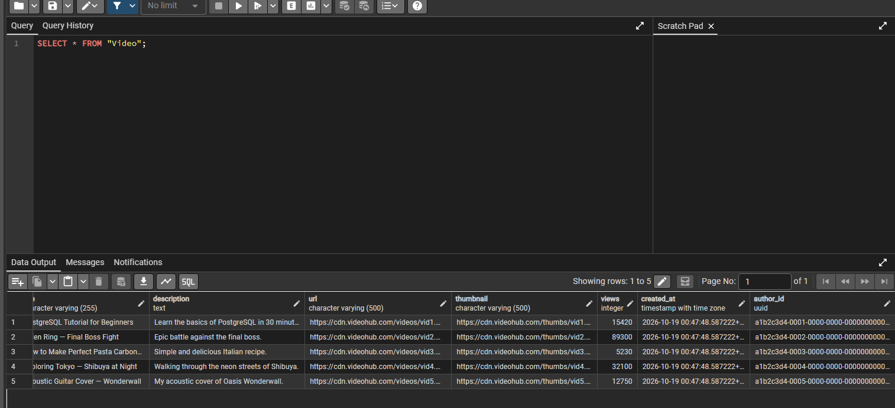

</div>

**Comment:**

<div style="text-align: center;">

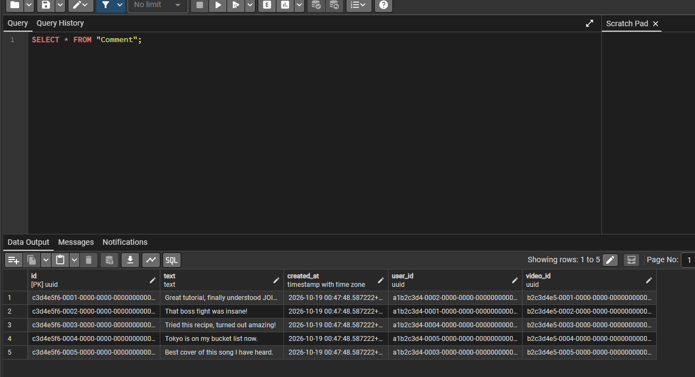

</div>

**Like:**

<div style="text-align: center;">

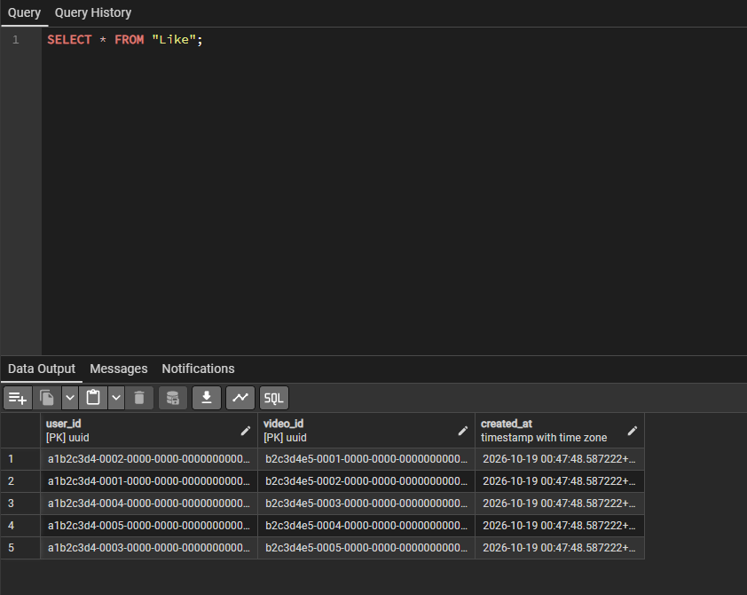

</div>

**Subscription:**

<div style="text-align: center;">

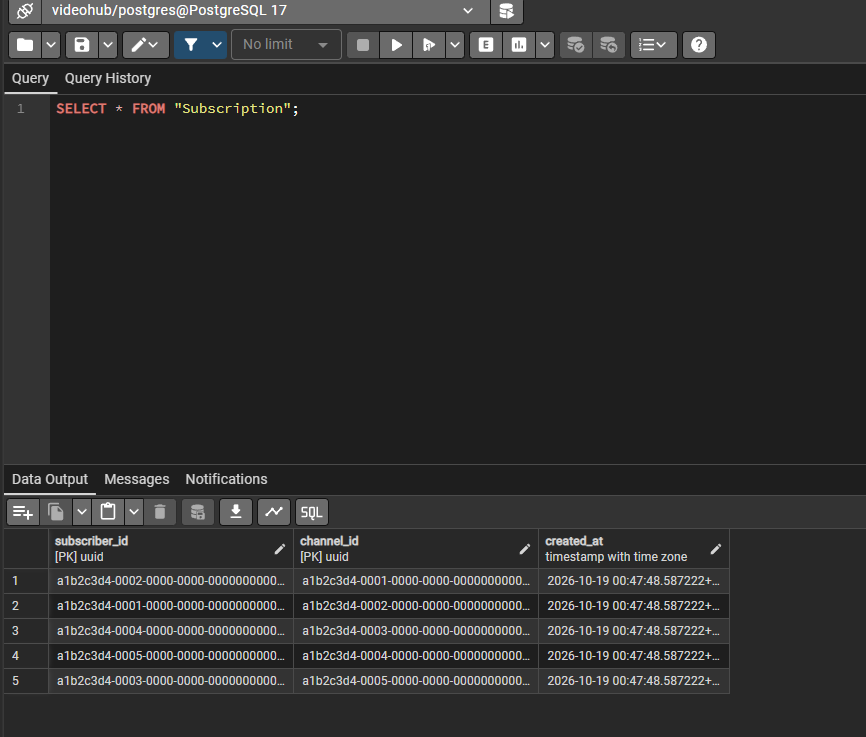

</div>

---

## Діаграма схеми — до та після рефакторингу

**Старий варіант** (сурогатні `id` + `UNIQUE` у Like/Subscription):

<div style="text-align: center;">

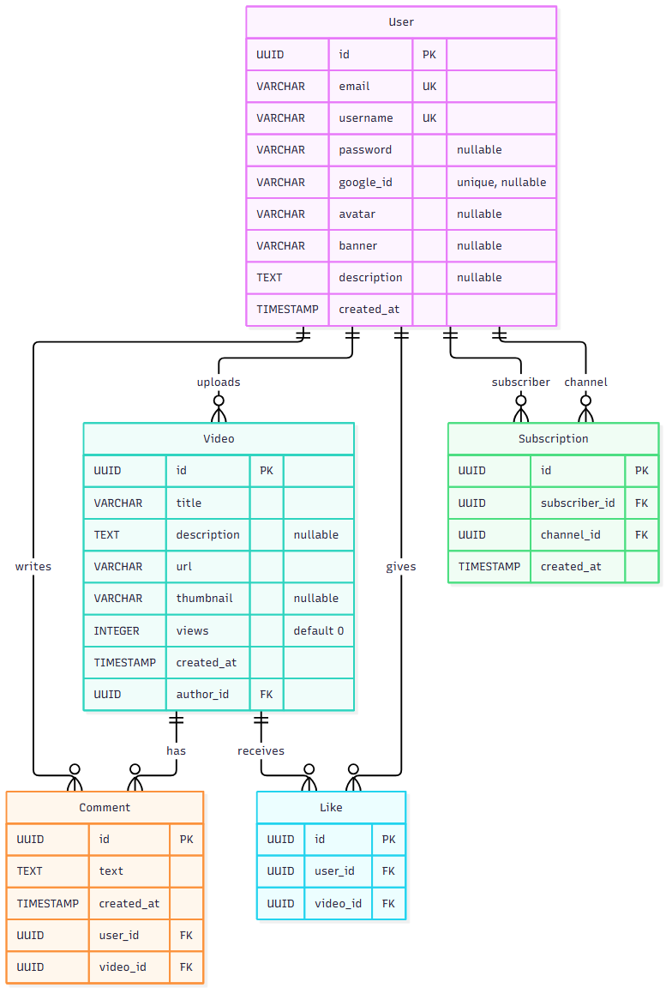

</div>

**Новий варіант** (композитні первинні ключі у Like/Subscription + CHECK на спосіб входу та views):

<div style="text-align: center;">

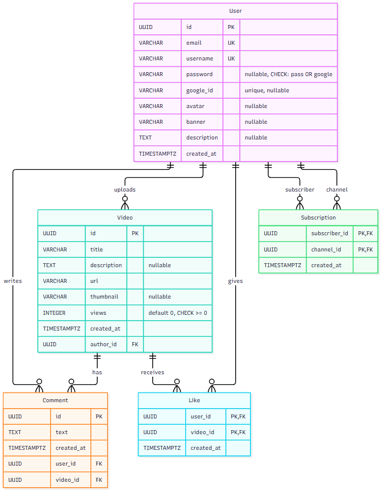

</div>

Різниця: у таблиць-зв'язок `Like` і `Subscription` прибрано сурогатний `id` — пара зовнішніх ключів сама є первинним ключем. У `User` додано перевірку способу входу (CHECK: пароль або google_id), у `Video` — перевірку `views >= 0`.

---

## Будь які припущення чи обмеження

- Імена таблиць взято в подвійні лапки: `User` та `Like` — зарезервовані слова SQL (`USER`, `LIKE`), тому лапки для них обов'язкові; `Video`, `Comment`, `Subscription` — в лапках для однорідності стилю. Подвійні лапки зберігають регістр і роблять імена case-sensitive.

- Використовується розширення `uuid-ossp` для генерації UUID через функцію `uuid_generate_v4()`. Альтернатива — `gen_random_uuid()` з модуля `pgcrypto`, але `uuid-ossp` є стандартним і добре документованим.

- Усі зовнішні ключі використовують `ON DELETE CASCADE` — при видаленні батьківського запису автоматично видаляються всі дочірні. Це логічно для VideoHub: видаляємо користувача — видаляються його відео, коментарі, лайки, підписки.

- Таблиці-зв'язки `Like` та `Subscription` використовують **композитний первинний ключ** замість сурогатного `id` + окремого `UNIQUE`. Причина: на ці таблиці ніхто не посилається ззовні, а сама пара зовнішніх ключів вже має бути унікальною. Це прибирає «мертву» колонку і зайвий індекс — унікальність гарантує сама структура ключа. Початковий варіант (з `id UUID` + `UNIQUE`) зберігся для порівняння: `er_schema_old.mmd` (стара схема) і `er_schema_new.mmd` (поточна, з композитними ключами).

- `CHECK (password IS NOT NULL OR google_id IS NOT NULL)` у `User` гарантує, що користувач має хоча б один спосіб авторизації. Без цього обмеження можна було б вставити запис, яким неможливо увійти.

- `CHECK (views >= 0)` у `Video` — лічильник переглядів не може бути від'ємним.

- Паролі зберігаються як хеші (VARCHAR(255)), а не у відкритому вигляді. У реальному проєкті використовується bcrypt або argon2.

- Google OAuth ID зберігається як VARCHAR(255) — це рядок, що повертається Google при авторизації через OAuth 2.0.

- URL-адреси (avatar, banner, thumbnail, url відео) зберігаються як VARCHAR(500) — достатня довжина для URL з параметрами.

- Лічильник переглядів (views) — INTEGER, починається з 0. У реальному проєкті міг би бути BIGINT для дуже популярних відео.

- Дата створення (created_at) — TIMESTAMPTZ: зберігає абсолютний момент (усередині UTC), при читанні конвертується під часову зону сесії; точність до мікросекунд; встановлюється автоматично через DEFAULT now().

- Тестові дані використовують фіксовані UUID (a1b2c3d4-...) для передбачуваності зв'язків між таблицями. У реальному проєкті UUID генерувались би автоматично.
