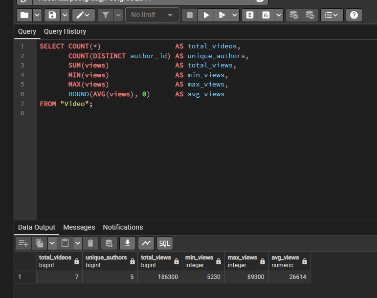
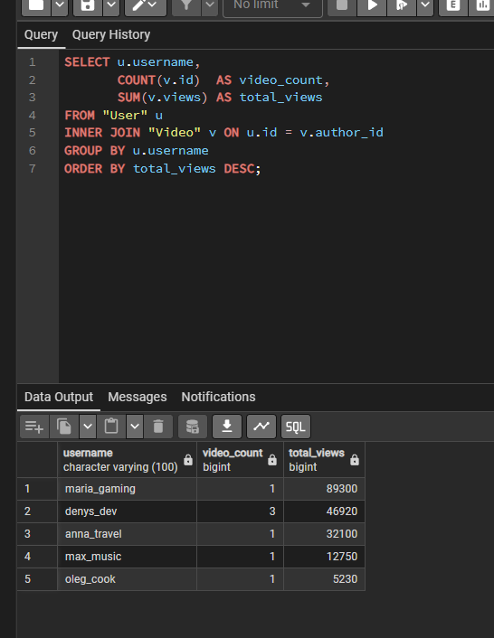
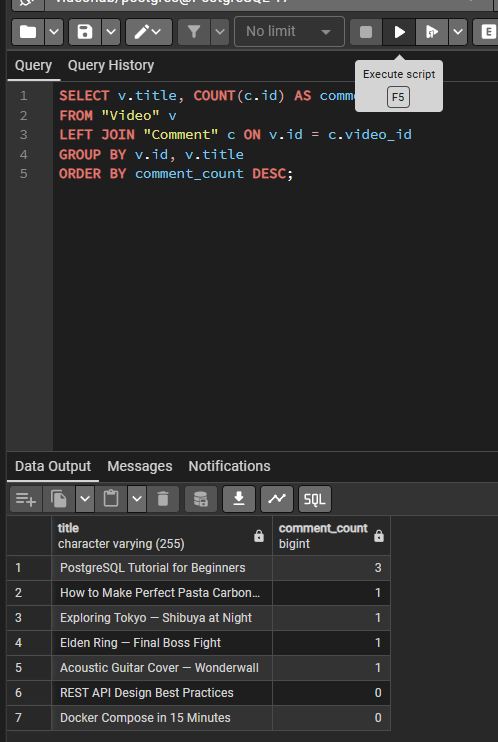
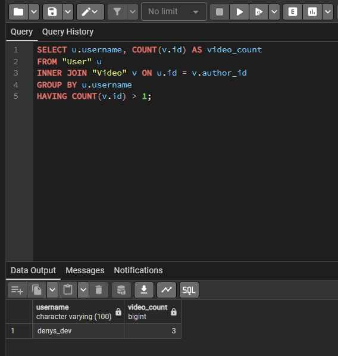
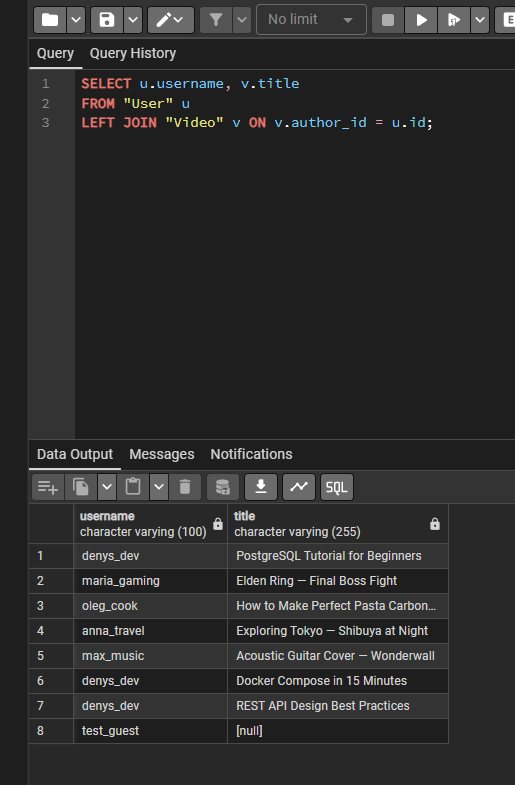
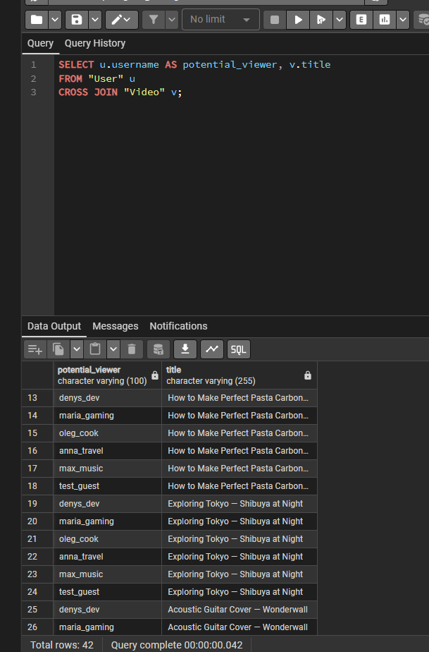
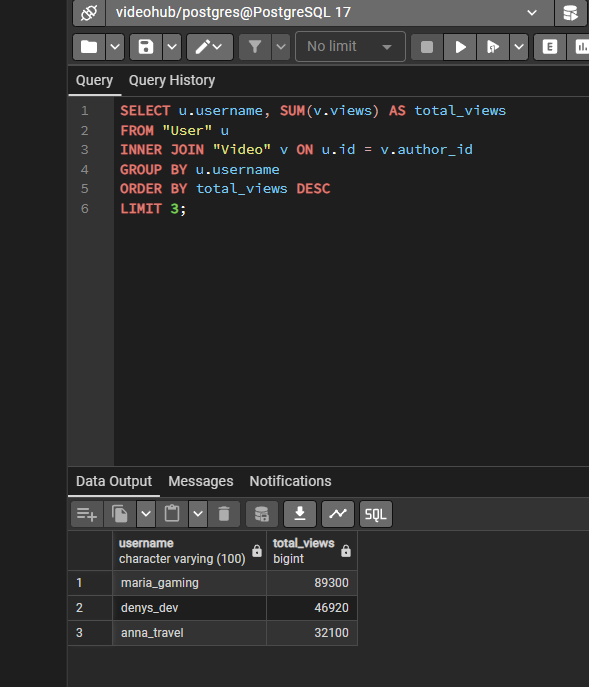
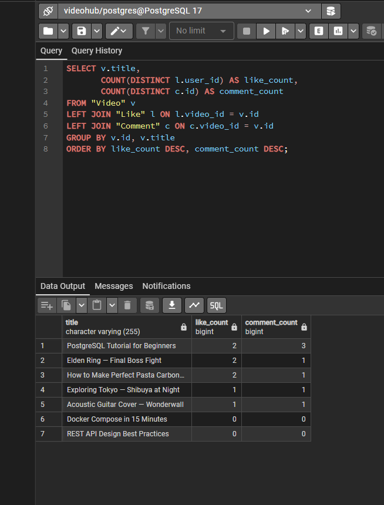
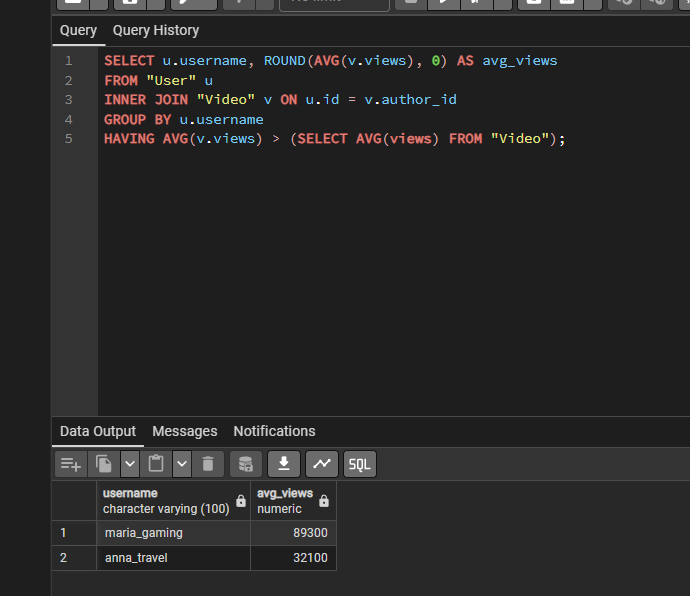

<div style="text-align: center; font-size: 22px; margin-top: 60px;">

Міністерство освіти і науки України

Національний технічний університет України

«Київський політехнічний інститут імені Ігоря Сікорського»

Факультет інформатики та обчислювальної техніки

Кафедра обчислювальної техніки

</div>

<div style="text-align: center; margin-top: 120px;">

<h1 style="font-size: 30px;">Лабораторна робота №4</h1>

<h2 style="font-size: 24px;">з дисципліни «Бази даних»</h2>

</div>

<div style="text-align: right; margin-top: 120px; font-size: 18px;">

<strong>Виконав:</strong><br>
Степаненко Денис<br>
студент групи ІМ-051<br>
номер у списку групи: 16<br><br>

<strong>Перевірив:</strong><br>
Хмельницький Арсеній Андрійович

</div>

<div style="text-align: center; margin-top: 120px; font-size: 22px;">

Київ 2026

</div>

---

## Короткий виклад вимог

**Завдання:**

Використовуючи базу даних VideoHub з Lab 2, виконати аналітичні запити (OLAP — Online Analytical Processing): агрегацію даних, групування, фільтрування груп та з'єднання таблиць.

**Чим OLAP відрізняється від OLTP (Lab 3):**

У Lab 3 кожна операція працювала з одним рядком (додати користувача, змінити опис) — це транзакційне навантаження. Тут навпаки: запит обробляє **багато рядків і повертає одну підсумкову відповідь** — «скільки всього відео», «сумарні перегляди автора». Це аналітичне навантаження.

**Інструменти лабораторної:**

- **Агрегатні функції** — COUNT, SUM, MIN, MAX, AVG: стискають багато рядків в одне значення
- **GROUP BY** — розбиває рядки на групи за значенням колонки
- **HAVING** — фільтрує ГРУПИ після агрегації (WHERE фільтрує рядки ДО)
- **JOIN** — з'єднує таблиці: INNER, LEFT, FULL OUTER, CROSS
- **Підзапити** — запит всередині запиту

---

## Базова агрегація

Усі п'ять агрегатів виконані **одним запитом** — один прохід по таблиці замість п'яти окремих:

```sql
SELECT COUNT(*)                  AS total_videos,
       COUNT(DISTINCT author_id) AS unique_authors,
       SUM(views)                AS total_views,
       MIN(views)                AS min_views,
       MAX(views)                AS max_views,
       ROUND(AVG(views), 0)      AS avg_views
FROM "Video";
```

**Пояснення:**

- `COUNT(*)` — рахує всі рядки таблиці (7 відео)
- `COUNT(DISTINCT author_id)` — рахує унікальні значення: 5 авторів (у denys_dev 3 відео, тому авторів менше, ніж відео)
- `SUM(views)` — сумарні перегляди всіх відео (186 300)
- `MIN` / `MAX` — найменш і найбільш популярне відео (5 230 та 89 300)
- `AVG(views)` — середнє; `ROUND(..., 0)` округлює до цілого (26 614), бо AVG повертає дробове значення

---

## Групування (GROUP BY)

**1. Статистика кожного автора — кількість відео та сумарні перегляди одним запитом:**

```sql
SELECT u.username,
       COUNT(v.id)  AS video_count,
       SUM(v.views) AS total_views
FROM "User" u
INNER JOIN "Video" v ON u.id = v.author_id
GROUP BY u.username
ORDER BY total_views DESC;
```

`INNER JOIN` з'єднує користувачів з їхніми відео, `GROUP BY u.username` збирає відео одного автора в групу, агрегати рахують статистику групи. `ORDER BY total_views DESC` — найпопулярніші автори зверху. Колонка `username` унікальна (UNIQUE constraint), тому групування за нею коректне.

**2. Кількість коментарів для кожного відео:**

```sql
SELECT v.title, COUNT(c.id) AS comment_count
FROM "Video" v
LEFT JOIN "Comment" c ON v.id = c.video_id
GROUP BY v.id, v.title
ORDER BY comment_count DESC;
```

Тут навмисно **LEFT JOIN**, а не INNER: відео без жодного коментаря теж потрапляють у список з нульовим рахунком. INNER JOIN викинув би їх — і аналітика була б неповною. `GROUP BY v.id, v.title` (а не тільки title) — захист від склеювання відео з однаковими назвами: ідентифікатор гарантує, що кожне відео — окрема група.

---

## Фільтрування груп (HAVING)

**1. Автори з більш ніж 1 відео:**

```sql
SELECT u.username, COUNT(v.id) AS video_count
FROM "User" u
INNER JOIN "Video" v ON u.id = v.author_id
GROUP BY u.username
HAVING COUNT(v.id) > 1;
```

**2. Відео з більш ніж 2 коментарями:**

```sql
SELECT v.title, COUNT(c.id) AS comment_count
FROM "Video" v
INNER JOIN "Comment" c ON v.id = c.video_id
GROUP BY v.id, v.title
HAVING COUNT(c.id) > 2;
```

**3. Автори з сумарними переглядами > 20000:**

```sql
SELECT u.username, SUM(v.views) AS total_views
FROM "User" u
INNER JOIN "Video" v ON u.id = v.author_id
GROUP BY u.username
HAVING SUM(v.views) > 20000;
```

**Чому HAVING, а не WHERE:**

Логічний порядок виконання запиту: `FROM → WHERE → GROUP BY → HAVING → SELECT → ORDER BY`. На етапі WHERE груп ще не існує — агрегат `COUNT(v.id)` там неможливий синтаксично. HAVING виконується ПІСЛЯ групування і бачить готові групи з їхніми агрегатами. WHERE фільтрує рядки, HAVING — групи.

---

## JOIN (різні типи з'єднань)

**1. INNER JOIN — відео з іменами авторів (тільки збіги):**

```sql
SELECT v.title, u.username AS author
FROM "Video" v
INNER JOIN "User" u ON v.author_id = u.id;
```

Повертає лише пари, де збіг є в обох таблицях.

**2. LEFT JOIN — усі користувачі, навіть без відео:**

```sql
SELECT u.username, v.title
FROM "User" u
LEFT JOIN "Video" v ON v.author_id = u.id;
```

Усі рядки лівої таблиці зберігаються; де відео нема — права сторона NULL. Користувач test_guest ще нічого не завантажив — і він у результаті з NULL.

**Анти-джойн — користувачі БЕЗ жодного відео:**

```sql
SELECT u.username
FROM "User" u
LEFT JOIN "Video" v ON v.author_id = u.id
WHERE v.id IS NULL;
```

Класичний патерн «знайти тих, у кого нема зв'язку»: LEFT JOIN залишає всіх, а `WHERE v.id IS NULL` відбирає рядки, де збігу не було.

**3. FULL OUTER JOIN — усі користувачі та всі відео:**

```sql
SELECT u.username, v.title
FROM "User" u
FULL OUTER JOIN "Video" v ON v.author_id = u.id;
```

FULL OUTER зберігає рядки обох таблиць навіть без збігу. У нашій схемі відео без автора **неможливе** (`author_id NOT NULL` + FK), тому «правих-без-лівих» не буває і FULL тут дає той самий результат, що LEFT — додаткові NULL-рядки з'являються лише з боку користувачів без відео.

**4. CROSS JOIN — всі комбінації користувачів та відео:**

```sql
SELECT u.username AS potential_viewer, v.title
FROM "User" u
CROSS JOIN "Video" v;
```

Декартів добуток: кожен користувач × кожне відео = 6 × 7 = 42 рядки. Практичний сенс — «potential audience»: кому яку рекомендацію можна показати, до застосування фільтрів.

---

## Багатотаблична агрегація

**1. Топ-3 автори за сумарними переглядами:**

```sql
SELECT u.username, SUM(v.views) AS total_views
FROM "User" u
INNER JOIN "Video" v ON u.id = v.author_id
GROUP BY u.username
ORDER BY total_views DESC
LIMIT 3;
```

Комбінація JOIN + GROUP BY + ORDER BY + LIMIT: повний рейтинг авторів, обрізаний до трійки лідерів.

**2. Кожне відео з кількістю лайків та коментарів:**

```sql
SELECT v.title,
       COUNT(DISTINCT l.user_id) AS like_count,
       COUNT(DISTINCT c.id) AS comment_count
FROM "Video" v
LEFT JOIN "Like" l ON l.video_id = v.id
LEFT JOIN "Comment" c ON c.video_id = v.id
GROUP BY v.id, v.title
ORDER BY like_count DESC, comment_count DESC;
```

Тут важливий нюанс: подвійний LEFT JOIN **розмножує рядки** — для відео з 2 лайками і 3 коментарями утворюється 2 × 3 = 6 проміжних рядків, і звичайний `COUNT(*)` порахував би 6. `COUNT(DISTINCT ...)` рахує унікальні значення і нейтралізує це розмноження — так отримуємо чесні лічильники.

**3. Підзапит — автори, чий середній перегляд вищий за загальний:**

```sql
SELECT u.username, ROUND(AVG(v.views), 0) AS avg_views
FROM "User" u
INNER JOIN "Video" v ON u.id = v.author_id
GROUP BY u.username
HAVING AVG(v.views) > (SELECT AVG(views) FROM "Video");
```

Підзапит `(SELECT AVG(views) FROM "Video")` обчислює загальний середній по платформі один раз; HAVING порівнює середнє кожного автора з цим порогом. У результаті — автори, чиї відео в середньому популярніші за платформу в цілому.

---

## Скріншоти

Базова агрегація — всі п'ять функцій одним запитом:

<div style="text-align: center;">



</div>

GROUP BY — статистика кожного автора (кількість відео + сумарні перегляди):

<div style="text-align: center;">



</div>

GROUP BY — коментарі кожного відео (LEFT JOIN, відео без коментарів з 0):

<div style="text-align: center;">



</div>

HAVING — автори з більш ніж 1 відео:

<div style="text-align: center;">

 1" style="width: 100%; max-width: 800px;">

</div>

LEFT JOIN — усі користувачі, test_guest без відео:

<div style="text-align: center;">



</div>

CROSS JOIN — всі комбінації користувачів та відео (42 рядки):

<div style="text-align: center;">



</div>

Топ-3 автори за сумарними переглядами:

<div style="text-align: center;">



</div>

Кожне відео з кількістю лайків та коментарів (COUNT DISTINCT проти розмноження рядків):

<div style="text-align: center;">



</div>

Підзапит — автори з середнім переглядом вище загального:

<div style="text-align: center;">

 AVG платформи" style="width: 100%; max-width: 800px;">

</div>

---

## Будь які припущення чи обмеження

**1. Додаткові тестові дані.**

Базові дані з Lab 2 рівномірні: у кожного з 5 авторів рівно одне відео, в кожного відео рівно один коментар. За таких даних запити «автори з більш ніж 1 відео» та «відео з більш ніж 2 коментарями» повертали б порожній результат — аналітику нічого показувати. Тому перед виконанням запитів додано нерівномірні дані: другий користувач без відео (test_guest), ще два відео для denys_dev, ще два коментарі до першого відео, ще три лайки. Це відображає реальність: аналітика осмислена лише на даних з природною варіацією.

**2. Групування за username замість id.**

Колонка `username` має UNIQUE constraint, тому групування за нею коректне — два різні користувачі не можуть мати однаковий username. Загальніший патерн — `GROUP BY u.id, u.username` (за первинним ключем); у запитах з назвами відео (`GROUP BY v.id, v.title`) використано саме його, бо `title` унікальним не є.

**3. FULL OUTER JOIN збігається з LEFT JOIN на цій схемі.**

Відео без автора неможливе за дизайном (`author_id NOT NULL` + зовнішній ключ), тому «непарні» рядки можливі лише з боку користувачів. FULL OUTER JOIN продемонстровано, але його результат тут ідентичний LEFT JOIN — це слідство цілісності схеми, а не обмеження запиту.

**4. COUNT(DISTINCT) у багатотабличній агрегації.**

Подвійний LEFT JOIN до Like та Comment розмножує проміжні рядки (кожен лайк поєднується з кожним коментарем того ж відео). Звичайний COUNT дав би завищені числа; COUNT(DISTINCT) рахує унікальних користувачів-лайкачів та унікальні коментарі.
