<div style="text-align: center; font-size: 22px; margin-top: 60px;">

Міністерство освіти і науки України

Національний технічний університет України

«Київський політехнічний інститут імені Ігоря Сікорського»

Факультет інформатики та обчислювальної техніки

Кафедра обчислювальної техніки

</div>

<div style="text-align: center; margin-top: 120px;">

<h1 style="font-size: 30px;">Лабораторна робота №5</h1>

<h2 style="font-size: 24px;">з дисципліни «Бази даних»</h2>

</div>

<div style="text-align: right; margin-top: 120px; font-size: 18px;">

<strong>Виконав:</strong><br>
Степаненко Денис<br>
студент групи ІМ-051<br>
номер у списку групи: 16<br><br>

<strong>Перевірив:</strong><br>
Хмельницький Арсеній Андрійович

</div>

<div style="text-align: center; margin-top: 120px; font-size: 22px;">

Київ 2026

</div>

---

## Короткий виклад вимог

**Завдання:**

Використовуючи схему VideoHub з Lab 2, провести аналіз нормалізації: перевірити схему на відповідність нормальним формам (1NF, 2NF, 3NF), створити денормалізований приклад з навмисними порушеннями, продемонструвати аномалії та виконати нормалізацію — лікування таблиці структурою.

**Чим ця лаба відрізняється від попередніх:**

Лаби 1–4 щось будували: модель (Lab 1), схему (Lab 2), операції (Lab 3), аналітику (Lab 4). Тут — перевірка якості того, що збудоване. Оскільки головна схема нормалізована за дизайном, порушення створюються навмисно — щоб показати, від чого саме захищає нормальна форма.

**Ключові поняття:**

- **Функціональна залежність (A → B)** — значення A однозначно визначає B
- **1NF** — атомарні значення: у комірці одне значення, не список
- **2NF** — неключові атрибути залежать від усього ключа (актуально для складених PK)
- **3NF** — неключовий атрибут не залежить від іншого неключового (без транзитивних залежностей)
- **Аномалії** — наслідки дублювання: оновлення, вставки, видалення

---

## Аналіз поточної схеми

**Структура та обмеження — база описує сама себе:**

```sql
SELECT table_name, column_name, data_type, is_nullable
FROM information_schema.columns
WHERE table_schema = 'public'
  AND table_name IN ('User', 'Video', 'Comment', 'Like', 'Subscription')
ORDER BY table_name, ordinal_position;

SELECT conrelid::regclass AS table_name, conname, contype, pg_get_constraintdef(oid)
FROM pg_constraint
WHERE connamespace = 'public'::regnamespace
ORDER BY conrelid::regclass::text, contype;
```

Перший запит повертає карту колонок і типів, другий — карту цілісності: первинні ключі (`p`), зовнішні (`f`), перевірки (`c`), унікальність (`u`). Це матеріал для аналізу: нормальні форми перевіряються по структурі, а не «на око».

**Перевірка 1NF — атомарність:**

```sql
SELECT table_name, column_name, data_type
FROM information_schema.columns
WHERE table_schema = 'public'
  AND data_type = 'ARRAY'
  AND table_name IN ('User', 'Video', 'Comment', 'Like', 'Subscription');
```

Шукаємо колонки-масиви — єдиний тип, який фізично порушує атомарність. Результат: **0 рядків**. Порожній результат тут і є доказом: у схемі немає списків у комірках — теги, телефони, ролі зберігаються окремими рядками пов'язаних таблиць.

**Перевірка 2NF — часткові залежності:**

2NF стосується лише таблиць зі складеним ключем: `Like(user_id, video_id)` та `Subscription(subscriber_id, channel_id)`. Єдиний неключовий атрибут цих таблиць — `created_at` — залежить від **пари**: факт лайка існує саме для пари юзер+відео, не для юзера окремо і не для відео окремо. Часткових залежностей немає — 2NF виконано.

**Перевірка 3NF — транзитивні залежності:**

```sql
SELECT column_name
FROM information_schema.columns
WHERE table_name = 'Video'
  AND column_name LIKE 'author_%';
```

Результат: **тільки `author_id`**. У Video немає `author_email` чи `author_name` — атрибути автора живуть у User, де змінюються в одному місці. Транзитивний ланцюжок `video_id → author_id → email` розірваний на межі таблиць: в межах Video його немає — 3NF виконано.

**Висновок аналізу:** всі 5 таблиць схеми відповідають 3NF за дизайном.

---

## «Хвора» таблиця — денормалізований приклад

Оскільки головна схема чиста, порушення створюються навмисно — три діагнози в одній таблиці:

```sql
CREATE TABLE "VideoDenormalized" (
    id                       UUID PRIMARY KEY,
    title                    VARCHAR(255) NOT NULL,
    url                      VARCHAR(500) NOT NULL,
    views                    INTEGER NOT NULL DEFAULT 0,
    author_id                UUID,
    author_username          VARCHAR(100) NOT NULL,
    author_email             VARCHAR(255) NOT NULL,
    tags                     TEXT NOT NULL,
    category_and_subcategory VARCHAR(100) NOT NULL
);
```

**Три діагнози:**

1. **`tags` списком через кому** — порушення 1NF: у комірці список, а не одне значення
2. **`category_and_subcategory` = 'Tech/Databases'** — порушення 1NF: два факти в одній комірці
3. **`author_username`, `author_email`** — порушення 3NF: транзитивна залежність `id → author_id → username/email` — атрибути автора залежать не від ключа відео, а через автора

Зверніть увагу: у таблиці **немає жодних обмежень** (FK, CHECK) — це частина «хвороби»: денормалізовані копії нічого не захищають.

**Наповнення даними** (ті самі відео та автори, що в головній схемі — денорм-копія існуючих даних):

```sql
INSERT INTO "VideoDenormalized" (...) VALUES
    ('b2c3d4e5-0001-...', 'PostgreSQL Tutorial for Beginners', ..., 'denys_dev', 'denys@example.com',
     'postgresql,database,tutorial,beginners', 'Tech/Databases'),
    ... -- 5 рядків
```

---

## Діагностика — запити-діагнози

**Діагноз 1: пошук по списку — LIKE-хак:**

```sql
SELECT title, tags FROM "VideoDenormalized"
WHERE tags LIKE '%database%';
```

Запит працює, але крихкий: підрядковий збіг знайде і `database` всередині `databases`; індекс неможливий; унікальність тега не забезпечити; порядок тегів у списку ламає точне порівняння.

**Діагноз 2: дублі довідника автора:**

```sql
SELECT author_username, author_email, COUNT(*) AS videos
FROM "VideoDenormalized"
GROUP BY author_username, author_email;
```

Email кожного автора повторюється в кожному його відео. Зміна email = оновлення всіх рядків автора; пропустив один (збій, паралельна вставка) — у базі два email одного автора, і нічого про це не повідомить: constraint-ів немає. Це **аномалія оновлення** наживо.

**Діагноз 3: два факти в комірці:**

```sql
SELECT title, split_part(category_and_subcategory, '/', 1) AS category
FROM "VideoDenormalized"
WHERE split_part(category_and_subcategory, '/', 1) = 'Tech';
```

Запит «усі відео категорії Tech» змушений **різати рядок щоразу** — симптом того, що дані не атомарні.

---

## Нормалізація — лікування

**Крок 1: зв'язок багато-до-багатьох для тегів.**

```sql
CREATE TABLE "Tag" (
    id   UUID PRIMARY KEY DEFAULT uuid_generate_v4(),
    name VARCHAR(50) UNIQUE NOT NULL
);

CREATE TABLE "VideoTag" (
    video_id UUID NOT NULL REFERENCES "Video"(id) ON DELETE CASCADE,
    tag_id   UUID NOT NULL REFERENCES "Tag"(id) ON DELETE CASCADE,
    PRIMARY KEY (video_id, tag_id)
);
```

`Tag` — довідник: ім'я тега унікальне і живе один раз. `VideoTag` — junction-таблиця зі складеним первинним ключем: пара (video_id, tag_id) і є ідентичність зв'язку — окремий id не потрібен. CASCADE з обох боків — сиріт не буває.

**Крок 2: ALTER-хірургія на живій таблиці.**

Золоте правило міграції: **спочатку ADD нового, потім перенесення даних, і лише потім DROP старого** — порушиш порядок, втратиш дані.

```sql
-- 2a. ADD атомарних колонок (спочатку нове)
ALTER TABLE "VideoDenormalized" ADD COLUMN category    VARCHAR(50);
ALTER TABLE "VideoDenormalized" ADD COLUMN subcategory VARCHAR(50);

-- 2b. Перенесення даних: split_part ріже 'Tech/Databases'
UPDATE "VideoDenormalized"
SET category    = split_part(category_and_subcategory, '/', 1),
    subcategory = split_part(category_and_subcategory, '/', 2);

-- 2c. DROP старого (лише після перевірки перенесення)
ALTER TABLE "VideoDenormalized" DROP COLUMN category_and_subcategory;
ALTER TABLE "VideoDenormalized" DROP COLUMN author_username;
ALTER TABLE "VideoDenormalized" DROP COLUMN author_email;
ALTER TABLE "VideoDenormalized" DROP COLUMN tags;

-- 2d. Таблиця здорова
ALTER TABLE "VideoDenormalized" RENAME TO "VideoFixed";
```

`split_part('Tech/Databases', '/', 1)` = 'Tech' — функція розрізає рядок за роздільником і бере N-ту частину. Транзитивні атрибути автора видаляються — вони живуть у User. Складена колонка категорії розрізана на дві атомарні.

**Крок 3: наповнення M:N.**

```sql
INSERT INTO "Tag" (name) VALUES
    ('postgresql'), ('database'), ('tutorial'), ('beginners'),
    ('gaming'), ('eldenring'), ('rpg'), ('bossfight'),
    ('cooking'), ('pasta'), ('italian'), ('recipe'),
    ('travel'), ('tokyo'), ('japan'), ('nightwalk'),
    ('music'), ('guitar'), ('cover')
ON CONFLICT (name) DO NOTHING;

INSERT INTO "VideoTag" (video_id, tag_id)
SELECT v.id, t.id
FROM "Video" v
CROSS JOIN "Tag" t
WHERE (v.title = 'PostgreSQL Tutorial for Beginners'
       AND t.name IN ('postgresql', 'database', 'tutorial', 'beginners'))
   OR (...)
ON CONFLICT DO NOTHING;
```

19 тегів у довідник; зв'язки — через `CROSS JOIN` з умовою: він дає всі пари відео×тег, `WHERE` залишає правильні 19 зв'язків — один запит замість ручного перебору. `ON CONFLICT DO NOTHING` робить скрипт **ідемпотентним**: повторний прогін не падає і не створює дублів.

---

## Верифікація — дані не втрачені, переупаковані

**1. Відео з тегами — чесний JOIN замість LIKE-хака:**

```sql
SELECT v.title, t.name AS tag
FROM "Video" v
INNER JOIN "VideoTag" vt ON v.id = vt.video_id
INNER JOIN "Tag" t ON vt.tag_id = t.id
ORDER BY v.title, t.name;
```

19 рядків — той самий інформаційний контент, що був у списках через кому, тепер через індексований JOIN.

**2. Атомарні категорія/підкатегорія:**

```sql
SELECT title, category, subcategory FROM "VideoFixed"
ORDER BY category, subcategory;
```

Без розрізання рядків: 'Tech' і 'Databases' — окремі колонки.

**3. Email автора — з першоджерела:**

```sql
SELECT v.title, u.username, u.email
FROM "VideoFixed" v
JOIN "User" u ON u.id = v.author_id;
```

Email живе в одному місці — у User; JOIN повертає завжди актуальне значення.

**4. Топ тегів — чесний COUNT по junction:**

```sql
SELECT t.name, COUNT(vt.video_id) AS video_count
FROM "Tag" t
LEFT JOIN "VideoTag" vt ON vt.tag_id = t.id
GROUP BY t.name
ORDER BY video_count DESC, t.name;
```

---

## Скріншоти

Карта обмежень схеми (PK, FK, CHECK, UNIQUE всіх таблиць):

<div style="text-align: center;">

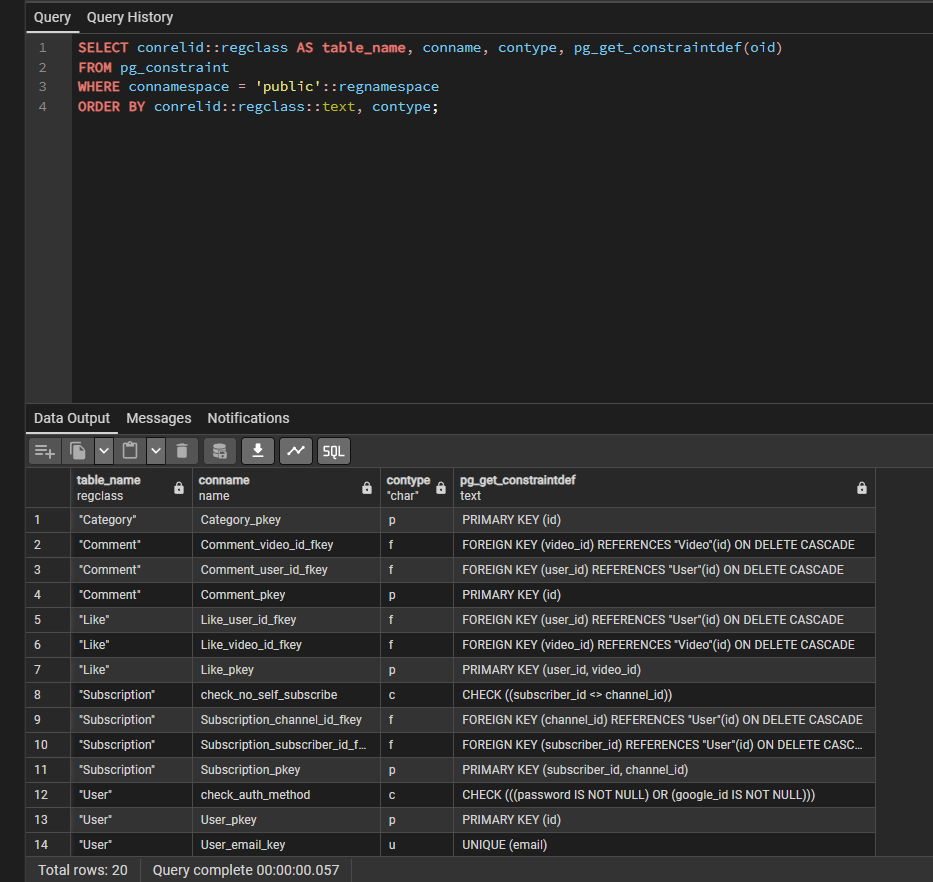

</div>

Перевірка 1NF — колонок-масивів немає (порожній результат = доказ):

<div style="text-align: center;">

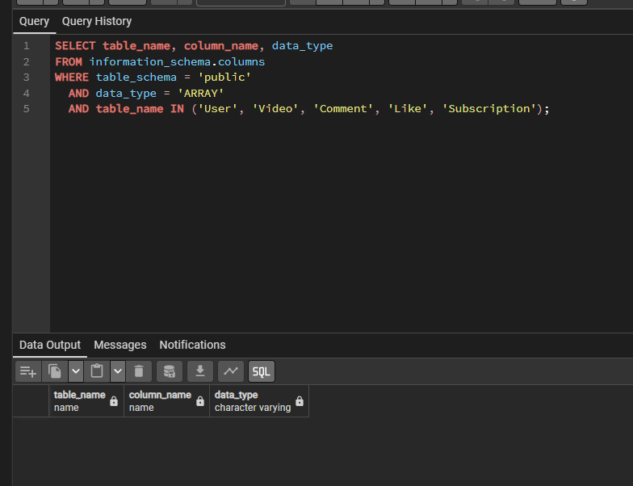

</div>

Перевірка 3NF — у Video тільки author_id:

<div style="text-align: center;">

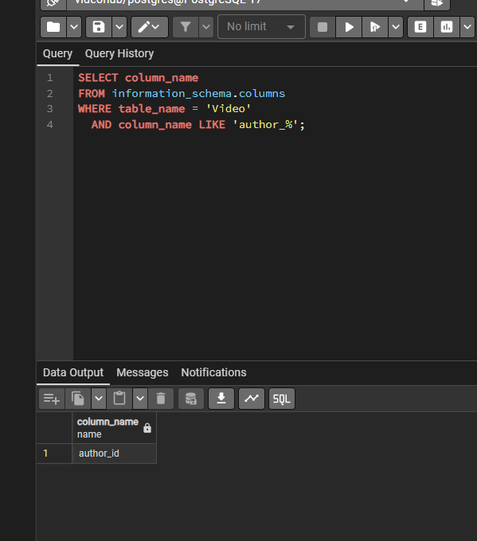

</div>

«Хвора» таблиця — три діагнози в одній таблиці:

<div style="text-align: center;">

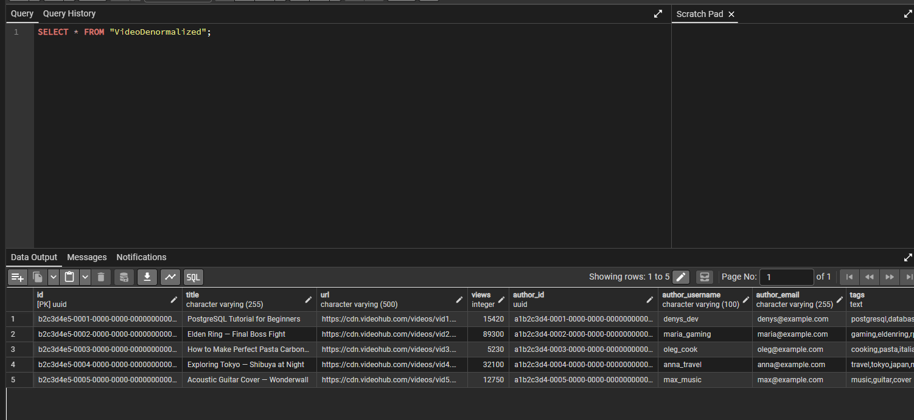

</div>

Діагностика — LIKE-хак по списку тегів:

<div style="text-align: center;">

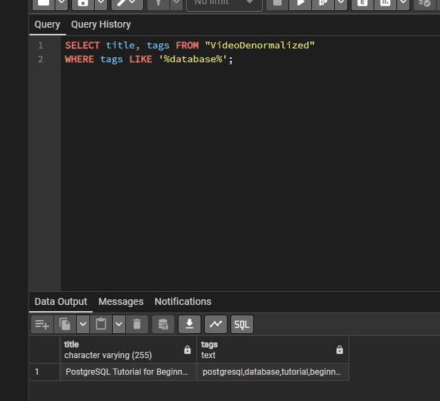

</div>

Діагностика — дублі довідника автора (аномалія оновлення):

<div style="text-align: center;">

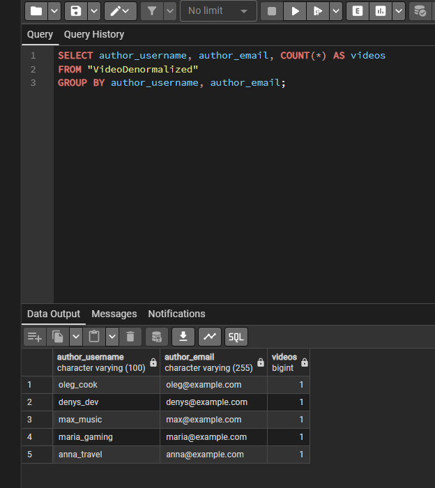

</div>

Перенесення даних — split_part розрізав категорію (дані в обох формах):

<div style="text-align: center;">

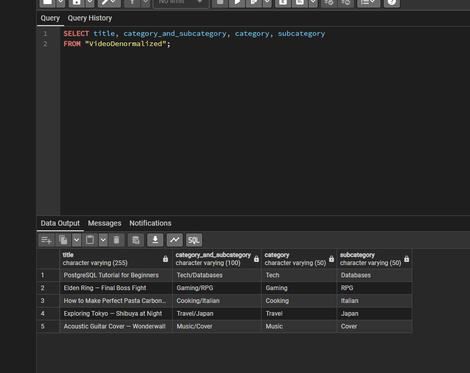

</div>

Здорова таблиця після RENAME — атомарні колонки, без транзитивних дублів:

<div style="text-align: center;">

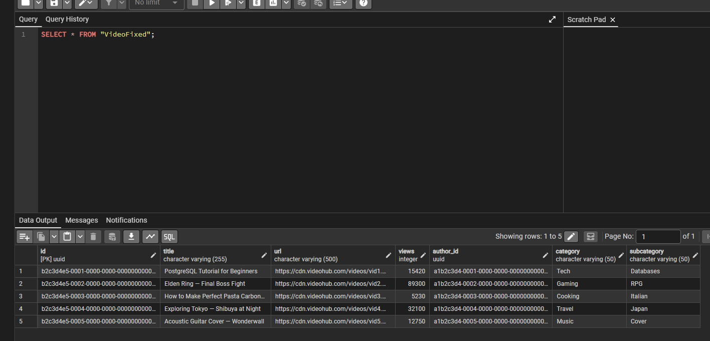

</div>

Контроль наповнення M:N — рівно 19 зв'язків:

<div style="text-align: center;">

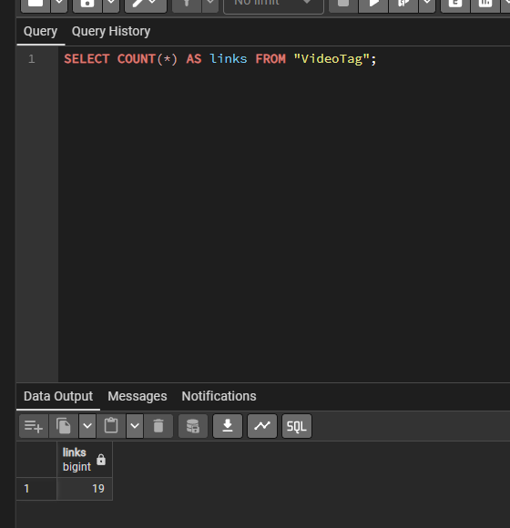

</div>

Верифікація — відео з тегами через JOIN (той самий контент):

<div style="text-align: center;">

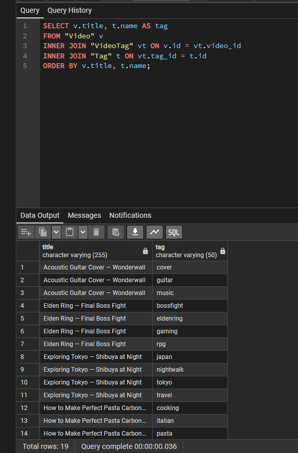

</div>

Верифікація — email автора з першоджерела:

<div style="text-align: center;">

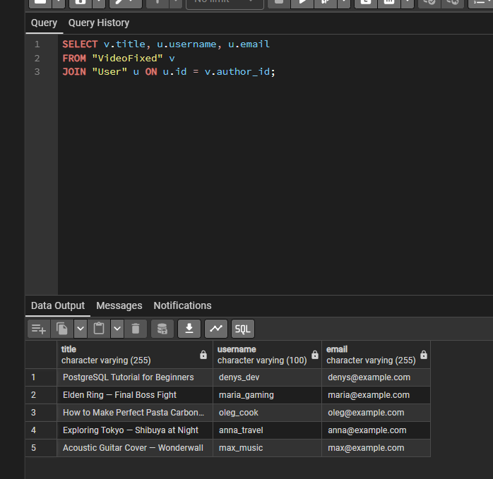

</div>

---

## Будь які припущення чи обмеження

**1. Порушення створені навмисно.**

Головна схема VideoHub нормалізована за дизайном (перевірено запитами). Щоб продемонструвати, від чого захищають нормальні форми, створено «хвору» таблицю з трьома порушеннями: два порушення 1NF (теги списком, категорія з підкатегорією в комірці) та одне порушення 3NF (атрибути автора транзитивно через автора). Це навчальний приклад, а не частина робочої схеми.

**2. «Хвора» таблиця без обмежень.**

VideoDenormalized не має FK та CHECK — це частина демонстрації: денормалізовані копії нічого не захищають, цілісність тримається лише на дисципліні коду. Нормальна форма + обмеження = цілісність структурою.

**3. Порядок ALTER-міграції.**

Золоте правило застосовано буквально: ADD нових колонок → перенесення даних через split_part → перевірка перенесення → DROP старих → RENAME. Порушення порядку (DROP до перенесення) знищило б джерело даних — тому порядок не стилістика, а вимога безпеки.

**4. Ідемпотентність наповнення.**

ON CONFLICT DO NOTHING у вставці тегів і зв'язків робить скрипт повторюваним: повторний прогін не падає на унікальності і не створює дублів.

**5. VideoTag посилається на головний Video.**

Junction-таблиця побудована на справжніх відео головної схеми (FK → "Video"), а не на копіях — зв'язки живуть на першоджерелі. Після демонстрації таблиця VideoFixed видалена; Tag та VideoTag лишились як легітимне розширення схеми (теги тепер змодельовані правильно).
