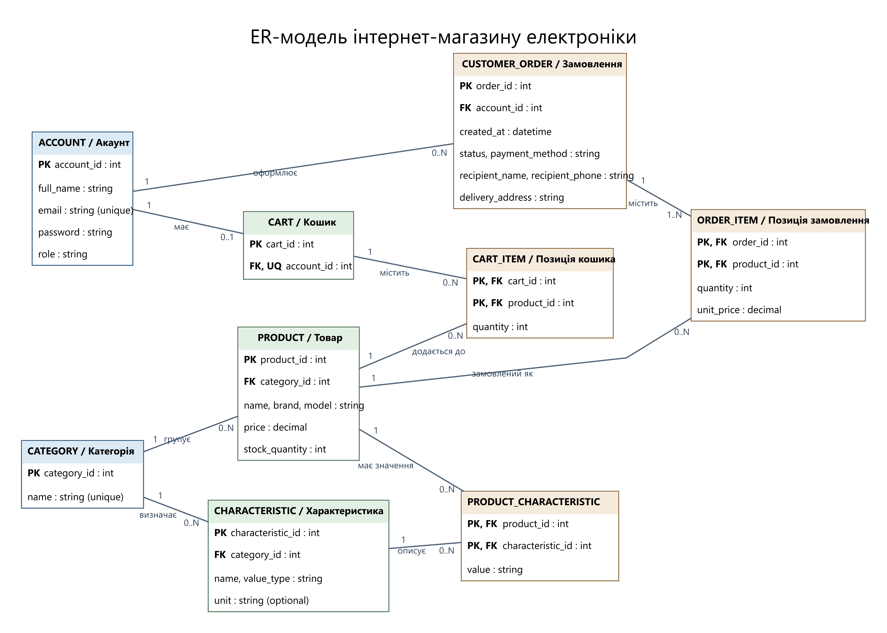

# Лабораторна робота №1: збір вимог та розробка ER-моделі

**Виконав:** Єремов Дмитро Миколайович, ІМ-51  
**Предметна область:** інтернет-магазин електроніки  
**Формат виконання:** індивідуально

## 1. Призначення системи

Інтернет-магазин електроніки дає покупцям змогу переглядати каталог, знаходити товари за категорією або назвою, порівнювати ціну й характеристики товарів однієї категорії, зберігати товари в кошику та оформлювати замовлення. Працівники магазину підтримують каталог і змінюють статуси замовлень.

## 2. Вимоги зацікавлених сторін

### Потреби покупця

- Створити акаунт, щоб оформити замовлення.
- Переглядати товари за категоріями та шукати їх за назвою.
- Переглядати бренд, модель, ціну, характеристики й наявність товару.
- Тимчасово порівнювати ціни та характеристики товарів однієї категорії. Список порівняння не зберігається після завершення перегляду.
- Зберігати кошик в акаунті між відвідуваннями магазину.
- Додавати до кошика кілька різних товарів і вказувати кількість кожного.
- Створити замовлення з одним або кількома товарами, указати отримувача, телефон і адресу доставки.
- Обрати оплату карткою онлайн або при отриманні та переглядати поточний статус замовлення.

### Потреби працівника

- Додавати й оновлювати товари каталогу.
- Змінювати статус замовлення.

### Дані, які зберігає система

Система зберігає акаунти та їхні ролі; категорії й товари; визначення характеристик для категорій і значення цих характеристик для товарів; кошики та їхні позиції; замовлення, позиції замовлень, спосіб оплати, поточний статус і дані отримувача.

## 3. ER-діаграма

[Відкрити SVG-версію](model/electronics-er.svg) · [Відкрити редаговане джерело DOT](model/electronics-er.dot).

## 4. Сутності та атрибути

| Сутність | Атрибути | Призначення |
|---|---|---|
| **Account (Акаунт)** | `account_id` — PK; `full_name`; `email` — унікальний; `password`; `role` | Обліковий запис покупця або працівника. Роль визначає доступні дії. |
| **Category (Категорія)** | `category_id` — PK; `name` — унікальна назва | Групує товари й визначає набір характеристик, за якими їх можна порівнювати. |
| **Product (Товар)** | `product_id` — PK; `category_id` — FK; `name`; `brand`; `model`; `price`; `stock_quantity` | Товар каталогу. Характеристики товару задаються через `ProductCharacteristic`. |
| **Characteristic (Характеристика)** | `characteristic_id` — PK; `category_id` — FK; `name`; `value_type`; `unit` | Визначає спільну для категорії характеристику, тип її значення та одиницю вимірювання, якщо вона потрібна. |
| **ProductCharacteristic (Характеристика товару)** | `product_id` і `characteristic_id` — складений PK та FK; `value` | Зберігає значення конкретної характеристики для конкретного товару. |
| **Cart (Кошик)** | `cart_id` — PK; `account_id` — унікальний FK | Активний кошик покупця, збережений між відвідуваннями. Унікальний `account_id` обмежує акаунт одним активним кошиком. |
| **CartItem (Позиція кошика)** | `cart_id` і `product_id` — складений PK та FK; `quantity` | Зберігає товар і його кількість у кошику. |
| **CustomerOrder (Замовлення)** | `order_id` — PK; `account_id` — FK; `created_at`; `status`; `payment_method`; `recipient_name`; `recipient_phone`; `delivery_address` | Зберігає замовлення покупця, його поточний статус, спосіб оплати та дані доставки. |
| **OrderItem (Позиція замовлення)** | `order_id` і `product_id` — складений PK та FK; `quantity`; `unit_price` | Зберігає товар у замовленні, кількість і ціну на момент оформлення. |

**Позначення:** PK — первинний ключ; FK — зовнішній ключ.

## 5. Пояснення зв’язків

- **Акаунт — кошик (1 : 0..1).** Акаунт покупця може мати один активний кошик або ще не мати його. Кожен кошик належить одному акаунту. Працівникам кошик не потрібен.
- **Акаунт — замовлення (1 : 0..N).** Покупець може оформити багато замовлень; кожне замовлення оформлене одним покупцем.
- **Категорія — товар (1 : 0..N).** Категорія може містити багато товарів, кожен товар належить рівно до однієї категорії.
- **Категорія — характеристика (1 : 0..N).** Кожна характеристика визначена для однієї категорії. В одній категорії може бути багато характеристик.
- **Товар — характеристика (багато-до-багатьох через `ProductCharacteristic`).** Товар може мати багато характеристик; характеристика застосовується до багатьох товарів своєї категорії. Асоціативна сутність зберігає значення характеристики для товару.
- **Кошик — товар (багато-до-багатьох через `CartItem`).** Кошик може містити багато товарів, а товар може бути в багатьох кошиках. `CartItem` зберігає кількість кожного товару.
- **Замовлення — товар (багато-до-багатьох через `OrderItem`).** Замовлення містить один або більше товарів, а товар може входити до багатьох замовлень. `OrderItem` зберігає кількість і ціну на момент оформлення.

## 6. Бізнес-правила та обмеження

- Email акаунта унікальний.
- Один акаунт має одну роль: «покупець» або «працівник».
- Кожен товар належить рівно до однієї категорії.
- Для кожної категорії визначено спільний набір характеристик її товарів. Значення в `ProductCharacteristic` має відповідати категорії товару.
- Порівнювати можна лише товари однієї категорії; порівняння тимчасове й не зберігається.
- У покупця не більше одного активного кошика; кошик може бути порожнім.
- Оформлене замовлення містить принаймні одну позицію.
- Кількість товару в кошику чи замовленні — додатне ціле число.
- Ціна товару та залишок на складі не можуть бути від’ємними.
- Для позиції замовлення фіксується ціна на момент оформлення, щоб зміна каталожної ціни не змінювала вже створене замовлення.
- Спосіб оплати має значення «картка онлайн» або «оплата при отриманні».
- Поточний статус замовлення має одне зі значень: «нове», «оплачене», «відправлене», «доставлене», «скасоване». Статус може змінювати працівник.

## 7. Перевірка моделі на сценаріях

1. **Пошук і порівняння.** Покупець відкриває категорію «Смартфони», шукає товар за назвою й тимчасово порівнює кілька товарів цієї категорії за ціною та значеннями характеристик.
2. **Кошик.** Покупець додає два товари й задає кількість кожного. Після наступного входу система відновлює кошик за акаунтом.
3. **Замовлення.** Покупець оформлює замовлення з кількох позицій, вказує дані отримувача та обирає спосіб оплати. Кількість і ціна кожної позиції зберігаються у `OrderItem`.
4. **Зміна ціни каталогу.** Після оформлення замовлення працівник змінює ціну товару. Ціна в уже створеному замовленні залишається тією, що була зафіксована у `OrderItem`.
5. **Оновлення статусу.** Працівник змінює статус замовлення, а покупець бачить актуальний статус у своєму акаунті.

## 8. Припущення та межі моделі

- У системі зберігається один поточний активний кошик покупця, а не історія кошиків.
- Порівняння виконується лише в межах однієї категорії, бо її товари мають спільний набір характеристик.
- Зберігається лише поточний статус замовлення; історія всіх змін статусу не ведеться.
- Спосіб оплати та статус належать до замовлення; окрема історія платіжних транзакцій не моделюється.
- Дані доставки зберігаються в замовленні як стан на момент оформлення; адреси в профілі покупця окремо не зберігаються.
- Залишок на складі є поточним числом. Резервування та історія руху товарів не входять до обсягу моделі.
- ER-модель є концептуальною. Створення таблиць PostgreSQL і реалізація пошуку заплановані для наступних лабораторних.

## 9. Відповідність вимог моделі

| Вимога | Сутність або правило |
|---|---|
| Реєстрація та ролі покупця/працівника | `Account` (`email`, `password`, `role`) |
| Перегляд і пошук товарів за назвою та категорією | `Product`, `Category` |
| Бренд, модель, ціна й наявність | `Product` |
| Характеристики для порівняння всередині категорії | `Characteristic`, `ProductCharacteristic`, правило однієї категорії |
| Збережений кошик і кількість товарів | `Cart`, `CartItem` |
| Замовлення з кількома товарами, кількістю та ціною | `CustomerOrder`, `OrderItem` |
| Оплата та відстеження статусу | `CustomerOrder` |
| Дані отримувача та доставки | `CustomerOrder` |
| Керування каталогом і статусами працівником | `Account.role` та операції над `Product` і `CustomerOrder` |
