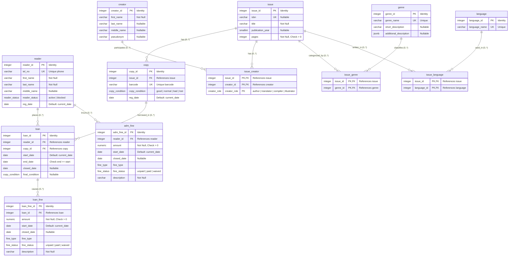

# Лабораторна робота 5: Нормалізація бази даних

## Мета

Провести перевірку початкової схеми бази даних бібліотеки з Лабораторної роботи 2, виявити функціональні залежності, приховану надмірність та порушення нормальних форм, переробити проблемні сутності до рівня 3НФ, розробити скрипти міграції даних без втрати інформації

## Перевірка початкової схеми

### Таблиця Читач (reader)
```sql
create table if not exists reader (
    reader_id integer generated always as identity primary key,
    tel_no varchar(32) not null unique,
    first_name varchar(32) not null,
    last_name varchar(32) not null,
    middle_name varchar(32),
    reader_status reader_status not null default 'active',
    reg_date date not null default current_date
);
```

Функціональні залежності:

reader_id -> tel_no
reader_id -> first_name
reader_id -> last_name
reader_id -> middle_name
reader_id -> reader_status
reader_id -> reg_date
tel_no -> reader_id
tel_no -> first_name
tel_no -> last_name
tel_no -> middle_name
tel_no -> reader_status
tel_no -> reg_date

Результат: Усі поля атомарні, обидва кандидат-ключі є простими, тому часткові залежності неможливі, транзитивних залежностей немає. Таблиця перебуває у 3НФ

### Таблиця Творець (creator)
```sql
create table if not exists creator (
    creator_id integer generated always as identity primary key,
    first_name varchar(64) not null,
    last_name varchar(64),
    middle_name varchar(32),
    pseudonym varchar(64)
);
```

Функціональні залежності:
creator_id -> first_name
creator_id -> last_name
creator_id -> middle_name
creator_id -> pseudonym

Результат: Усі поля атомарні, первинний ключ простий, часткові залежності неможливі, усі неключові атрибути залежать безпосередньо від creator_id. Таблиця перебуває у 3НФ

### Таблиця Видання-Творець (issue_creator)
```sql
create table if not exists issue_creator (
    issue_id integer not null references issue(issue_id) on delete cascade,
    creator_id integer not null references creator(creator_id) on delete cascade,
    creator_role creator_role not null,
    primary key (issue_id, creator_id, creator_role)
);
```
Функціональні залежності:
{issue_id, creator_id, creator_role} -> {issue_id, creator_id, creator_role}
Результат: Усі поля атомарні, первинний ключ є складеним, але таблиця не містить жодного неключового атрибута, тому часткові та транзитивні залежності неключових атрибутів відсутні. Таблиця перебуває у 3НФ

### Таблиця Примірник (copy)
```sql
create table if not exists copy (
    copy_id integer generated always as identity primary key,
    issue_id integer not null references issue(issue_id),
    barcode varchar(32) not null unique,
    copy_condition copy_condition not null default 'good',
    reg_date date not null default current_date
);
```

Функціональні залежності:
copy_id -> issue_id
copy_id -> barcode
copy_id -> copy_condition
copy_id -> reg_date
barcode -> copy_id
barcode -> issue_id
barcode -> copy_condition
barcode -> reg_date

Результат: Дані в усіх колонках атомарні, обидва кандидат-ключі є простими, тому часткові залежності неможливі, неключові атрибути залежать виключно від ключів, транзитивних залежностей немає. Таблиця перебуває у 3НФ.

## Таблиця Видача (loan)
```sql
create table if not exists loan (
    loan_id integer generated always as identity primary key,
    reader_id integer not null references reader(reader_id),
    copy_id integer not null references copy(copy_id),
    start_date date not null default current_date,
    end_date date not null check(end_date >= start_date),
    closed_date date check(closed_date is null or closed_date >= start_date),
    final_condition copy_condition,
    check((closed_date is null) = (final_condition is null)),
    unique(loan_id, reader_id)
);
```
Функціональні залежності:
loan_id -> reader_id
loan_id -> copy_id
loan_id -> start_date
loan_id -> end_date
loan_id -> closed_date
loan_id -> final_condition

Результат: Усі атрибути атомарні, первинний ключ простий, часткові залежності неможливі, усі неключові атрибути залежать безпосередньо від loan_id, транзитивні залежності відсутні. Таблиця перебуває у 3НФ.

## Ненормалізовані таблиці

### Таблиця Видання (issue)

```sql
create table if not exists issue (
    issue_id integer generated always as identity primary key,
    isbn varchar(32) unique,
    title varchar(256) not null check(length(trim(both ' ' from title)) > 0),
    publication_year smallint,
    language varchar(32),
    pages integer not null check(pages > 0),
    genre varchar(32)
);
```
Функціональні залежності:
issue_id -> isbn
issue_id -> title
issue_id -> publication_year
issue_id -> pages
isbn -> issue_id
isbn -> title
isbn -> publication_year
isbn -> pages
Багатозначні залежності: 
issue_id ->-> genre
issue_id ->-> language

Проблема:
Значення в полях genre та language не є атомарними, бо видання може мати множину жанрів та мов, що порушує 1НФ.

### Таблиця Штрафи (fine)

```sql
create table if not exists fine (
    fine_id integer generated always as identity primary key,
    reader_id integer not null references reader(reader_id),
    loan_id integer,
    amount numeric(10, 2) not null check(amount > 0),
    start_date date not null default current_date,
    closed_date date check(closed_date is null or closed_date >= start_date),
    fine_type fine_type not null,
    fine_status fine_status not null default 'unpaid',
    description varchar(256) not null check(length(trim(both ' ' from description)) > 0),
    check((closed_date is null) = (fine_status = 'unpaid')),
    foreign key (loan_id, reader_id) references loan (loan_id, reader_id)
);
```

Початкові залежності:
fine_id -> amount
fine_id -> start_date
fine_id -> closed_date
fine_id -> fine_type
fine_id -> fine_status
fine_id -> description
fine_id -> loan_id
fine_id -> reader_id
Зовнішня залежність з таблиці loan:
loan_id -> reader_id

Проблема:
Порушується 3НФ для рядків, де loan_id is not null, бо діє залежність fine_id -> loan_id -> reader_id, тобто атрибут reader_id залежить від неключового атрибуту loan_id, що створює ризик аномалії оновлення, через що у лабораторній роботі 2 довелось надати складений FK(loan_id, reader_id), і що створює надлишкові null, коли штраф не пов'язаний з видачею.

## Нормалізація таблиці

### Таблиця Видання (issue)

Виносимо атрибути genre та language в окремі таблиці, зв'язані з виданнями через асоціативні таблиці відношенням M:N

Створюємо сутності:
genre (genre_id PK, genre_name UNIQUE, short_description, additional_description)
language (language_id PK, language_name UNIQUE)

Створюємо таблиці зв'язку зі складеними ключами:
issue_genre (issue_id FK, genre_id FK, PRIMARY KEY (issue_id, genre_id))
issue_language (issue_id FK, language_id FK, PRIMARY KEY (issue_id, language_id))

Видаляємо денормалізовані стовпчики genre та language з таблиці issue.

Фінальні функціональні залежності:
issue_id -> isbn
issue_id -> title
issue_id -> publication_year
issue_id -> pages
genre_id -> genre_name
genre_id -> short_description
genre_id -> additional_description
language_id -> language_name

### Таблиця Штрафи (fine)

Розділяємо єдину таблицю fine на дві незалежні сутності за типом походження штрафу

adm_fine - адміністративні штрафи
Первинний ключ: adm_fine_id
Зовнішній ключ: reader_id -> reader(reader_id)
ФЗ: adm_fine_id -> {reader_id, amount, start_date, closed_date, fine_type, fine_status, description}

loan_fine - штрафи за видачами
Первинний ключ: loan_fine_id
Зовнішній ключ: loan_id -> loan(loan_id)
ФЗ: loan_fine_id -> {loan_id, amount, start_date, closed_date, fine_type, fine_status, description}
Колонка reader_id видалена, що усунуло транзитивну залежність.

## SQL-скрипти міграції

### Міграція issue -> genre та language

```sql
begin;

create table genre(
    genre_id integer generated always as identity primary key,
    genre_name varchar(64) not null unique,
    short_description varchar(2056),
    additional_description jsonb
);

create table issue_genre(
    issue_id integer not null references issue(issue_id) on delete cascade,
    genre_id integer not null references genre(genre_id) on delete cascade,
    primary key(issue_id, genre_id)
);

insert into genre(genre_name)
select distinct
    string_to_table(genre, ' ')
from issue
where genre is not null;

with issue_genres_names as(
    select
        issue_id,
        string_to_table(genre, ' ') as genre_name
    from issue
    where genre is not null
)
insert into issue_genre (issue_id, genre_id)
select distinct
    ign.issue_id,
    g.genre_id
from issue_genres_names ign
join genre g on ign.genre_name = g.genre_name;

alter table issue drop column genre;

commit;

begin;

create table language(
    language_id integer generated always as identity primary key,
    language_name varchar(64) not null unique
);

create table issue_language(
    issue_id integer not null references issue(issue_id) on delete cascade,
    language_id integer not null references language(language_id) on delete cascade,
    primary key(issue_id, language_id)
);

insert into language(language_name)
select distinct
    trim(regexp_split_to_table(language, '[, ]+')) as language_name
from issue
where language is not null;

with issue_languages_names as(
    select
        issue_id,
        trim(regexp_split_to_table(language, '[, ]+')) as language_name
    from issue
    where language is not null
)
insert into issue_language (issue_id, language_id)
select distinct
    ign.issue_id,
    l.language_id
from issue_languages_names ign
join language l on ign.language_name = l.language_name;

alter table issue drop column language;

commit;
```

### Міграція fine -> adm_fine та loan_fine

```sql
begin;

create table adm_fine(
    adm_fine_id integer generated always as identity primary key,
    reader_id integer not null references reader(reader_id),
    amount numeric(10, 2) not null check(amount > 0),
    start_date date not null default current_date,
    closed_date date check(closed_date is null or closed_date >= start_date),
    fine_type fine_type not null,
    fine_status fine_status not null default 'unpaid',
    description varchar(256) not null check(length(trim(both ' ' from description)) > 0),
    check((closed_date is null) = (fine_status = 'unpaid'))
);

create table loan_fine(
    loan_fine_id integer generated always as identity primary key,
    loan_id integer not null references loan(loan_id),
    amount numeric(10, 2) not null check(amount > 0),
    start_date date not null default current_date,
    closed_date date check(closed_date is null or closed_date >= start_date),
    fine_type fine_type not null,
    fine_status fine_status not null default 'unpaid',
    description varchar(256) not null check(length(trim(both ' ' from description)) > 0),
    check((closed_date is null) = (fine_status = 'unpaid'))
);

insert into adm_fine(reader_id, amount, start_date, closed_date, fine_type, fine_status, description)
select reader_id, amount, start_date, closed_date, fine_type, fine_status, description
from fine
where loan_id is null;

insert into loan_fine(loan_id, amount, start_date, closed_date, fine_type, fine_status, description)
select loan_id, amount, start_date, closed_date, fine_type, fine_status, description
from fine
where loan_id is not null;

drop table fine;

alter table loan drop constraint loan_loan_id_reader_id_key;

commit;
```

## Оновлена ER-діаграма



## Висновки
У ході лабораторної роботи було проведено аналіз схеми бібліотеки, усунуто неатомарність даних та транзитивну залежність у сутності штрафів, були отримані навички знаходження надлишковостей та аномалій, а також таблиць реорганізації таблиць за допомогою alter та drop.


