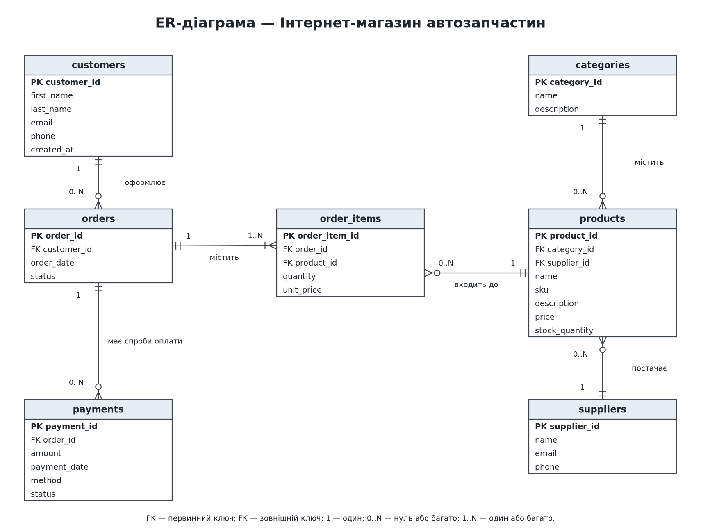

# Лабораторна робота №1 — ER Diagram

**Предмет:** Бази даних

**Виконав:** Роман Биченко

**Предметна область:** Інтернет-магазин автозапчастин.

## Мета роботи

Визначити вимоги до майбутньої бази даних, основні сутності, їхні атрибути та зв'язки. Побудувати ER-діаграму.

## Структура роботи

| Файл | Призначення |
|---|---|
| [requirements.md](requirements.md) | Вимоги та бізнес-правила |
| [REPORT.md](REPORT.md) | Звіт про виконання роботи |
| [er-diagram.drawio](diagrams/er-diagram.drawio) | Вихідний файл ER-діаграми |
| [er-diagram.png](diagrams/er-diagram.png) | Зображення ER-діаграми |

## Порядок перевірки

1. Відкрити requirements.md та ознайомитися з вимогами.
2. Відкрити REPORT.md та переглянути опис сутностей і зв'язків.
3. Переглянути зображення ER-діаграми.
4. За необхідності відкрити er-diagram.drawio у редакторі diagrams.net.
5. Переглянути сценарії перевірки моделі у звіті.

Встановлення додаткових бібліотек та запуск програмного коду не потрібні, оскільки ця лабораторна робота присвячена проєктуванню бази даних.

## Результат

Розроблено ER-модель інтернет-магазину автозапчастин, яка містить сім сутностей та шість зв'язків.

Модель буде використана для створення бази даних PostgreSQL у лабораторній роботі №2.