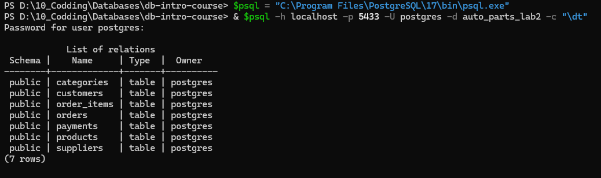
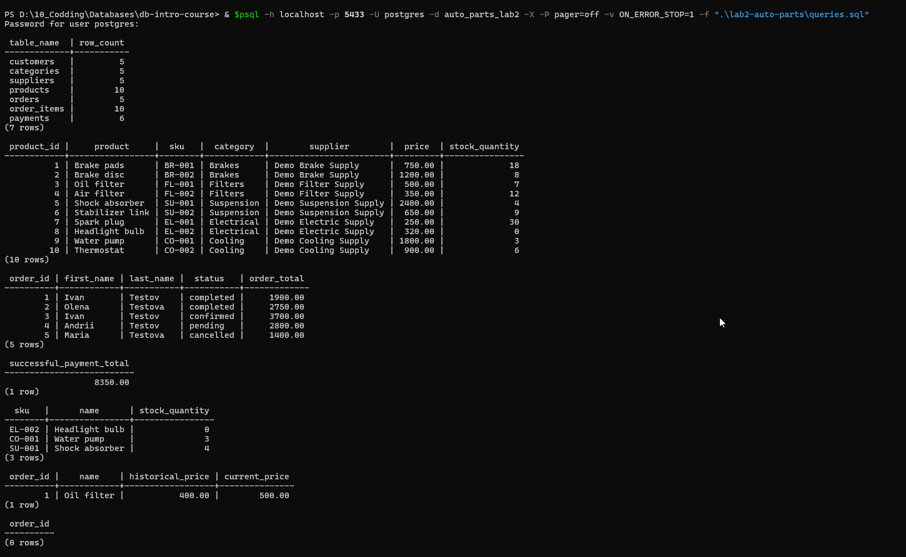
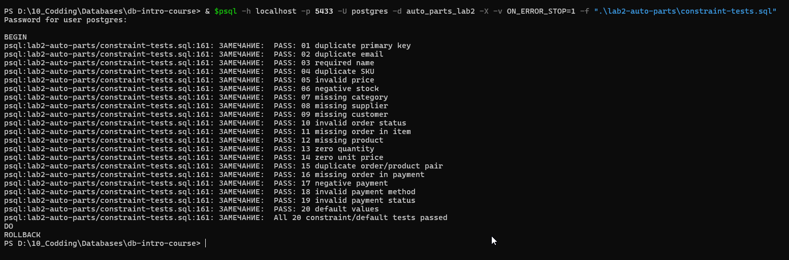

# Лабораторна робота №2

**Предмет:** Бази даних
**Тема:** Перетворення ER-діаграми на схему PostgreSQL (DDL).
**Виконав:** Биченко Роман В'ячеславович, ІМ-54.

## 1. Мета роботи

Навчитися створювати таблиці у PostgreSQL на основі ER-діаграми, визначати типи даних, ключі та обмеження, заповнювати таблиці і перевіряти правильність роботи бази даних.

## 2. Початкова модель та порядок виконання

За основу взято інтернет-магазин автозапчастин з [лабораторної роботи №1](https://github.com/ZheniaTrochun/db-intro-course/pull/335). Усі сім сутностей та назви їхніх атрибутів збережено. На етапі DDL додано типи даних, конкретні значення статусів та обмеження.

Спочатку створено таблиці, на які посилаються інші таблиці, а потім — залежні таблиці. Для заповнення даними використано той самий принцип, щоб не порушувати зовнішні ключі.

Повний SQL-код знаходиться в окремих файлах. Порядок виконання:

1. [schema.sql](schema.sql) — усі оператори CREATE TABLE.
2. [data.sql](data.sql) — усі оператори INSERT INTO.
3. [queries.sql](queries.sql) — перевірочні SELECT-запити.
4. [constraint-tests.sql](constraint-tests.sql) — тести обмежень.

Команди запуску через psql наведено в [README.md](README.md). Перші два файли потрібно запускати один раз у новій порожній базі даних.

## 3. Структура таблиць

У всіх таблицях первинний ключ має тип INTEGER GENERATED BY DEFAULT AS IDENTITY. Це дає можливість автоматично отримувати ідентифікатори нових записів. PK означає первинний ключ, FK — зовнішній ключ.

### 3.1. customers — покупці

| Стовпець | Тип | Ключі та обмеження |
|---|---|---|
| customer_id | INTEGER | PK, IDENTITY |
| first_name | VARCHAR(60) | NOT NULL |
| last_name | VARCHAR(60) | NOT NULL |
| email | VARCHAR(150) | NOT NULL, UNIQUE |
| phone | VARCHAR(30) | необов'язковий |
| created_at | TIMESTAMP | NOT NULL, DEFAULT CURRENT_TIMESTAMP |

### 3.2. categories — категорії товарів

| Стовпець | Тип | Ключі та обмеження |
|---|---|---|
| category_id | INTEGER | PK, IDENTITY |
| name | VARCHAR(100) | NOT NULL |
| description | TEXT | необов'язковий |

### 3.3. suppliers — постачальники

| Стовпець | Тип | Ключі та обмеження |
|---|---|---|
| supplier_id | INTEGER | PK, IDENTITY |
| name | VARCHAR(120) | NOT NULL |
| email | VARCHAR(150) | необов'язковий |
| phone | VARCHAR(30) | необов'язковий |

### 3.4. products — автозапчастини

| Стовпець | Тип | Ключі та обмеження |
|---|---|---|
| product_id | INTEGER | PK, IDENTITY |
| category_id | INTEGER | FK → categories(category_id), NOT NULL |
| supplier_id | INTEGER | FK → suppliers(supplier_id), NOT NULL |
| name | VARCHAR(150) | NOT NULL |
| sku | VARCHAR(50) | NOT NULL, UNIQUE |
| description | TEXT | необов'язковий |
| price | NUMERIC(12,2) | NOT NULL, CHECK (price > 0) |
| stock_quantity | INTEGER | NOT NULL, DEFAULT 0, CHECK (stock_quantity >= 0) |

### 3.5. orders — замовлення

| Стовпець | Тип | Ключі та обмеження |
|---|---|---|
| order_id | INTEGER | PK, IDENTITY |
| customer_id | INTEGER | FK → customers(customer_id), NOT NULL |
| order_date | TIMESTAMP | NOT NULL, DEFAULT CURRENT_TIMESTAMP |
| status | VARCHAR(20) | NOT NULL, DEFAULT 'pending', CHECK допустимих статусів |

### 3.6. order_items — позиції замовлення

| Стовпець | Тип | Ключі та обмеження |
|---|---|---|
| order_item_id | INTEGER | PK, IDENTITY |
| order_id | INTEGER | FK → orders(order_id), NOT NULL |
| product_id | INTEGER | FK → products(product_id), NOT NULL |
| quantity | INTEGER | NOT NULL, CHECK (quantity > 0) |
| unit_price | NUMERIC(12,2) | NOT NULL, CHECK (unit_price > 0) |

Додатково встановлено UNIQUE (order_id, product_id), щоб товар не повторювався в одному замовленні окремими позиціями. Збережено окремий первинний ключ order_item_id з першої лабораторної. Пара зовнішніх ключів при цьому залишається унікальною.

### 3.7. payments — оплати

| Стовпець | Тип | Ключі та обмеження |
|---|---|---|
| payment_id | INTEGER | PK, IDENTITY |
| order_id | INTEGER | FK → orders(order_id), NOT NULL |
| amount | NUMERIC(12,2) | NOT NULL, CHECK (amount > 0) |
| payment_date | TIMESTAMP | NOT NULL, DEFAULT CURRENT_TIMESTAMP |
| method | VARCHAR(20) | NOT NULL, CHECK допустимих способів оплати |
| status | VARCHAR(20) | NOT NULL, DEFAULT 'pending', CHECK допустимих статусів |

## 4. Зв'язки та основні рішення

| Батьківська таблиця | Залежна таблиця | Зовнішній ключ |
|---|---|---|
| customers | orders | customer_id |
| categories | products | category_id |
| suppliers | products | supplier_id |
| orders | order_items | order_id |
| products | order_items | product_id |
| orders | payments | order_id |

Усі шість зв'язків 1:N реалізовані зовнішніми ключами. Таблиця order_items розділяє зв'язок M:N між orders та products.

Для цін та сум оплат використано NUMERIC(12,2), щоб зберігати грошові значення з точністю до копійок. Телефон і артикул зберігаються як текст, оскільки вони можуть містити літери, знаки та початкові нулі. Ціна товару на момент купівлі зберігається окремо в unit_price.

Для замовлень встановлено статуси pending, confirmed, completed, cancelled. Для оплат — pending, successful, failed. Способи оплати: card, cash, bank_transfer. Значення за замовчуванням для обох статусів — pending, для залишку товару — 0. Дати за замовчуванням беруться з CURRENT_TIMESTAMP.

## 5. Заповнення таблиць та перевірка даних

Для перевірки використано окрему локальну базу auto_parts_lab2. Підключення через psql виконувалося до localhost:5433; встановлена версія клієнта — 17.12. Дані є тестовими.

| Таблиця | Кількість рядків за результатом SELECT |
|---|---:|
| customers | 5 |
| categories | 5 |
| suppliers | 5 |
| products | 10 |
| orders | 5 |
| order_items | 10 |
| payments | 6 |
| Разом | 46 |

У queries.sql виконано сім запитів: підрахунок рядків, каталог товарів з категоріями і постачальниками, суми замовлень, сума успішних оплат, товари з малим залишком, порівняння історичної та поточної ціни, перевірка замовлень без позицій.

| order_id | Статус | order_total, грн |
|---|---|---:|
| 1 | completed | 1900,00 |
| 2 | completed | 2750,00 |
| 3 | confirmed | 3700,00 |
| 4 | pending | 2800,00 |
| 5 | cancelled | 1400,00 |

Загальна сума успішних оплат — 8350 грн. Неуспішні та незавершені оплати в цю суму не входять. Залишок менше 5 мають Headlight bulb (0), Water pump (3) і Shock absorber (4).

Окремо перевірено масляний фільтр у замовленні №1: історична ціна становить 400 грн, а поточна — 500 грн. Це показує, що сума попереднього замовлення не залежить від поточної ціни. Запит на пошук порожніх замовлень повернув 0 рядків.

## 6. Тестування обмежень

У файлі constraint-tests.sql виконано негативні перевірки, які навмисно намагаються порушити правила таблиць, та перевірку DEFAULT. Очікувані помилки перехоплюються всередині тестів, після чого виводиться PASS. Якщо порушення не буде відхилено, тест завершиться помилкою.

| № | Що перевірялося | Результат |
|---:|---|---|
| 1 | Повторення первинного ключа | PASS |
| 2 | Повторення email покупця | PASS |
| 3 | Відсутність обов'язкового імені | PASS |
| 4 | Повторення SKU | PASS |
| 5 | Некоректна ціна | PASS |
| 6 | Від'ємний залишок | PASS |
| 7 | Неіснуюча категорія товару | PASS |
| 8 | Неіснуючий постачальник | PASS |
| 9 | Неіснуючий покупець замовлення | PASS |
| 10 | Недопустимий статус замовлення | PASS |
| 11 | Неіснуюче замовлення в позиції | PASS |
| 12 | Неіснуючий товар у позиції | PASS |
| 13 | Нульова кількість товару | PASS |
| 14 | Нульова ціна одиниці | PASS |
| 15 | Повторення пари замовлення і товару | PASS |
| 16 | Неіснуюче замовлення в оплаті | PASS |
| 17 | Від'ємна сума оплати | PASS |
| 18 | Недопустимий спосіб оплати | PASS |
| 19 | Недопустимий статус оплати | PASS |
| 20 | DEFAULT для статусів та залишку | PASS |

Усі 20 тестів пройшли успішно. Наприкінці виконано ROLLBACK, щоб відкотити тестові зміни в таблицях.

## 7. Обмеження поточної реалізації

Зовнішні ключі гарантують, що кожна позиція належить існуючому замовленню, але не гарантують, що кожне замовлення має хоча б одну позицію. У цій роботі це перевіряється окремим SELECT-запитом. Автоматичне списання залишків при підтвердженні замовлення, перевірка достатнього залишку та контроль загальної суми успішних оплат щодо вартості замовлення поки не реалізовані як автоматичні правила бази. Для цього надалі знадобиться транзакційна логіка або інший механізм, який працює з кількома таблицями.

Як і в першій лабораторній, кожен товар має одну категорію та одного основного постачальника. Доставка, повернення, знижки і сумісність з моделями автомобілів не входять до цієї схеми.

## 8. Висновок

У цій лабораторній ER-модель інтернет-магазину автозапчастин перетворено на схему PostgreSQL. Створено 7 таблиць з первинними та зовнішніми ключами, додано обмеження і 46 тестових записів. Під час локального запуску перевірено результати SELECT-запитів та проходження 20 тестів. Отриману схему можна використовувати в наступних лабораторних роботах.

SQL-файли та чернетка документації підготовлені за допомогою ШІ; локальне виконання, перевірка результатів і скриншоти зроблені на моєму комп'ютері.
