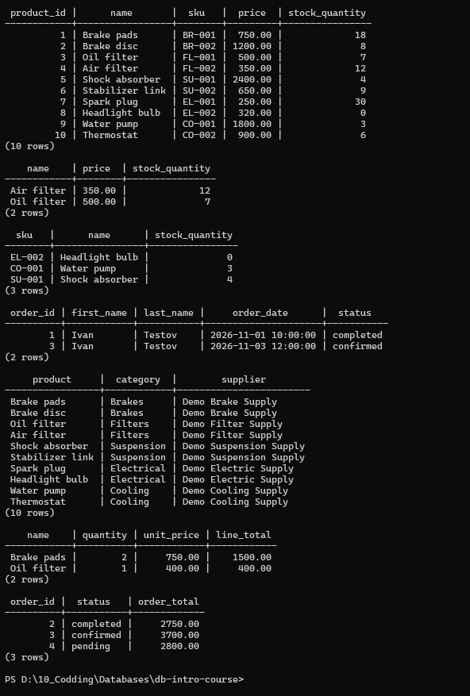
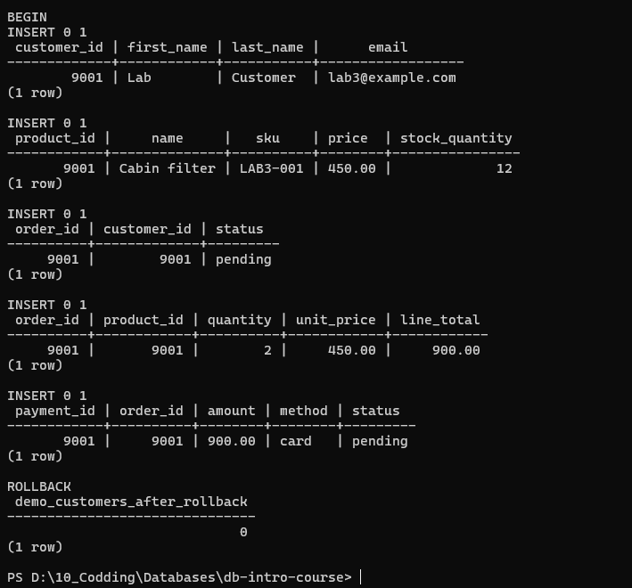
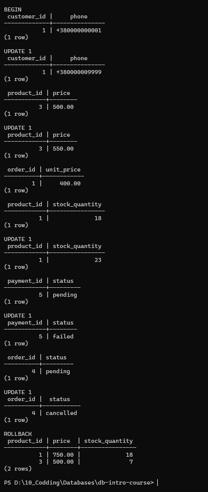
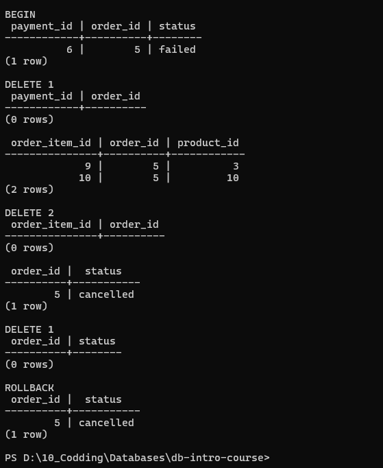
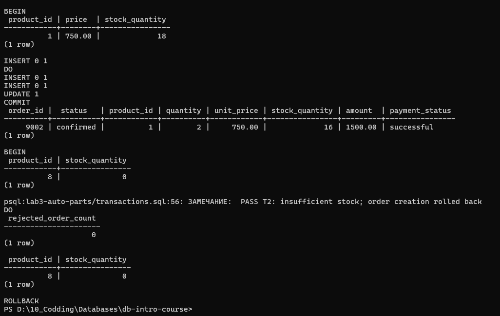
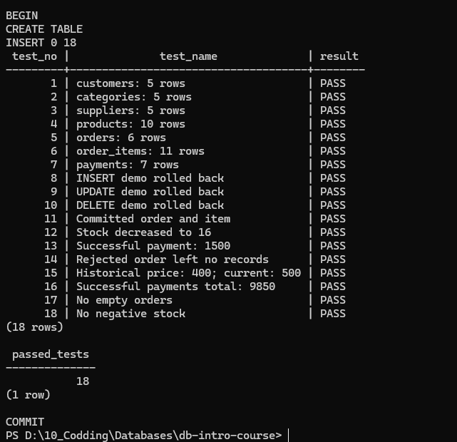

# Лабораторна робота №3

**Предмет:** Бази даних

**Тема:** Маніпулювання даними SQL (OLTP).

**Виконав:** Биченко Роман В'ячеславович, ІМ-54

## 1. Мета роботи

Навчитися працювати з даними в PostgreSQL за допомогою SELECT, INSERT, UPDATE та DELETE. Перевірити, як транзакції допомагають зберігати узгодженість даних під час оформлення замовлення.

## 2. Підготовка бази даних

Для роботи використано схему інтернет-магазину автозапчастин із [лабораторної №2](https://github.com/ZheniaTrochun/db-intro-course/pull/339). Створено окрему базу `auto_parts_lab3`, у яку завантажено початкову структуру і дані. Основну базу другої лабораторної не потрібно змінювати.

Запуск виконувався через psql на локальному сервері PostgreSQL, порт 5433. Порядок запуску та команди підготовки наведено у [README.md](README.md).

| Таблиця | Початкова кількість рядків | Після виконання роботи |
|---|---:|---:|
| customers | 5 | 5 |
| categories | 5 | 5 |
| suppliers | 5 | 5 |
| products | 10 | 10 |
| orders | 5 | 6 |
| order_items | 10 | 11 |
| payments | 6 | 7 |
| **Разом** | **46** | **49** |

## 3. SELECT — отримання даних

Файл: [select.sql](select.sql). Усі сім запитів виконано послідовно на початковому стані бази.

| № | Мета запиту | Очікуваний результат | Фактичний результат |
|---|---|---|---|
| S1 | Переглянути каталог товарів, ціни та залишки | 10 товарів | 10 рядків, успішно |
| S2 | Знайти наявні фільтри ціною до 600 грн включно | Air filter і Oil filter | 2 рядки: 350 та 500 грн |
| S3 | Знайти товари із залишком менше 5 | Три товари | Headlight bulb — 0, Water pump — 3, Shock absorber — 4 |
| S4 | Переглянути історію покупця №1 | Два замовлення | №1 та №3 |
| S5 | Показати категорії та постачальників товарів через JOIN | 10 рядків | 10 рядків |
| S6 | Переглянути позиції замовлення №1 за історичною ціною | 2 позиції, загальна сума 1900 грн | Brake pads — 1500 грн, Oil filter — 400 грн |
| S7 | Знайти замовлення із сумою понад 2500 грн | Замовлення №2, №3, №4 | 2750, 3700 та 2800 грн відповідно |

У запитах вибрано потрібні стовпці, а не всі дані таблиці. Для пошуку використано WHERE, для зв'язків між таблицями — JOIN, для розрахунку суми замовлення — SUM, GROUP BY та HAVING.

## 4. INSERT — додавання даних

Файл: [insert.sql](insert.sql). Для демонстраційних записів використано ідентифікатор 9001. Після кожного INSERT виконано SELECT для перевірки.

| № | Мета | Очікуваний результат | Фактичний результат |
|---|---|---|---|
| I1 | Додати покупця | Покупець №9001 | Lab Customer, lab3@example.com, додано 1 рядок |
| I2 | Додати товар | Cabin filter, артикул LAB3-001 | Ціна 450 грн, залишок 12, додано 1 рядок |
| I3 | Створити замовлення покупця | №9001, статус pending | Додано 1 рядок, статус pending |
| I4 | Додати позицію замовлення | 2 фільтри по 450 грн | Додано 1 рядок, сума 900 грн |
| I5 | Зареєструвати оплату | 900 грн, card, pending | Додано 1 рядок, дані відповідають очікуваним |

Усі п'ять записів створено в межах однієї демонстраційної транзакції. Після ROLLBACK запит показав 0 демонстраційних покупців. Відсутність інших чотирьох записів підтверджена тестом №8.

## 5. UPDATE — оновлення даних

Файл: [update.sql](update.sql). Перед кожним оновленням перевірено потрібний запис через SELECT. Після UPDATE виконано повторний SELECT. В усіх п'яти операціях є умова WHERE.

| № | Мета | Початкове значення | Очікуване значення | Фактичний результат |
|---|---|---|---|---|
| U1 | Змінити телефон покупця №1 | +380000000001 | +380000009999 | Новий номер, UPDATE 1 |
| U2 | Змінити ціну товару №3 | 500 грн | 550 грн | 550 грн, UPDATE 1; історична ціна 400 грн |
| U3 | Поповнити залишок товару №1 на 5 | 18 | 23 | 23, UPDATE 1 |
| U4 | Змінити статус оплати №5 | pending | failed | failed, UPDATE 1 |
| U5 | Скасувати замовлення №4 | pending | cancelled | cancelled, UPDATE 1 |

Після ROLLBACK ціна товару №3 знову становила 500 грн, а залишок товару №1 — 18. Відновлення телефону та статусів підтверджене тестом №9. Ці операції є окремими демонстраціями, а не повним процесом обробки реального замовлення.

## 6. DELETE — видалення даних

Файл: [delete.sql](delete.sql). Для перевірки вибрано скасоване замовлення №5. Спочатку видаляються залежні записи, а потім саме замовлення, оскільки між таблицями є зовнішні ключі.

| № | Мета | Очікуваний результат | Фактичний результат |
|---|---|---|---|
| D1 | Видалити невдалу оплату замовлення №5 | 1 видалений рядок | DELETE 1, після перевірки 0 рядків |
| D2 | Видалити позиції замовлення №5 | 2 видалені рядки | DELETE 2, після перевірки 0 рядків |
| D3 | Видалити скасоване замовлення №5 | 1 видалений рядок | DELETE 1, після перевірки 0 рядків |

Після ROLLBACK замовлення №5 знову відображається зі статусом cancelled. Тест №10 підтвердив відновлення замовлення, двох позицій і оплати. У реальному магазині історію скасованих замовлень доцільно зберігати; тут видалення використано лише для демонстрації SQL.

## 7. Транзакції

Файл: [transactions.sql](transactions.sql).

### T1. Успішне оформлення замовлення

Покупець №5 замовляє дві одиниці Brake pads по 750 грн. Очікувана сума — 1500 грн, залишок має зменшитися з 18 до 16.

Послідовність операцій: створити замовлення №9002; перевірити наявність та зменшити залишок через умовний UPDATE; додати позицію із поточною ціною; записати успішну оплату; підтвердити замовлення; виконати COMMIT. Умовний UPDATE не дозволяє списати більше товару, ніж є на складі.

Фактично отримано замовлення №9002 зі статусом confirmed, кількістю 2, ціною 750 грн, залишком 16 та успішною оплатою 1500 грн. Зміни збережено.

### T2. Недостатня кількість товару

Для товару Headlight bulb (№8) залишок становить 0. Спроба замовити одну одиницю має завершитися без створення замовлення №9003.

У вкладеному блоці PL/pgSQL створюється замовлення і виконується умовний UPDATE. Якщо товару недостатньо, виникає контрольований виняток. Обробка винятку скасовує зміни вкладеного блоку; зовнішня демонстраційна транзакція завершується ROLLBACK.

Фактично виведено повідомлення PASS T2, кількість відхилених замовлень у базі — 0, залишок товару №8 — 0. Замовлення, його позиції та оплати відсутні, що додатково підтверджено тестом №14.

## 8. Автоматичні перевірки

Файл: [tests.sql](tests.sql). Перевірки записуються у тимчасову таблицю з обмеженням CHECK (passed). Якщо умова хибна, виконання завершиться помилкою. Таблиця автоматично видаляється після COMMIT.

| № | Перевірка | Фактичний результат |
|---|---|---|
| 1 | customers: 5 рядків | PASS |
| 2 | categories: 5 рядків | PASS |
| 3 | suppliers: 5 рядків | PASS |
| 4 | products: 10 рядків | PASS |
| 5 | orders: 6 рядків | PASS |
| 6 | order_items: 11 рядків | PASS |
| 7 | payments: 7 рядків | PASS |
| 8 | Демонстраційні INSERT скасовані | PASS |
| 9 | Демонстраційні UPDATE скасовані | PASS |
| 10 | Демонстраційні DELETE скасовані | PASS |
| 11 | Замовлення №9002 та позиція збережені | PASS |
| 12 | Залишок товару №1 дорівнює 16 | PASS |
| 13 | Успішна оплата 1500 грн | PASS |
| 14 | Відхилене замовлення не залишило записів | PASS |
| 15 | Історична ціна 400, поточна 500 грн | PASS |
| 16 | Сума успішних оплат 9850 грн | PASS |
| 17 | Немає замовлень без позицій | PASS |
| 18 | Немає від'ємних залишків | PASS |

Усі 18 перевірок пройдено. Результати зафіксовано в терміналі після виконання SQL-файлів.

## 9. Обмеження та висновок

У цій роботі продемонстровано 20 основних CRUD-операцій і два сценарії транзакцій. Перевірки прив'язані до конкретного набору тестових даних, тому це не універсальні тести для довільної бази. Транзакція оформлення замовлення працює з одним товаром і не є повною реалізацією всіх бізнес-процесів магазину. Відсутність порожніх замовлень перевіряється на кінцевих даних, а не гарантується для всіх можливих SQL-операцій.

Під час роботи я запустив SQL-файли у PostgreSQL і перевірив результати у терміналі. Побачив, як WHERE обмежує зміни, як зовнішні ключі впливають на порядок видалення записів і як ROLLBACK скасовує зміни. Успішне замовлення збереглося, а замовлення на відсутній товар не створилося. Після виконання всіх скриптів у базі залишилося 49 записів, а всі 18 перевірок пройшли успішно.

Для підготовки SQL-коду та документації використано допомогу ШІ. Локальний запуск, тестування та скриншоти виконано студентом.
