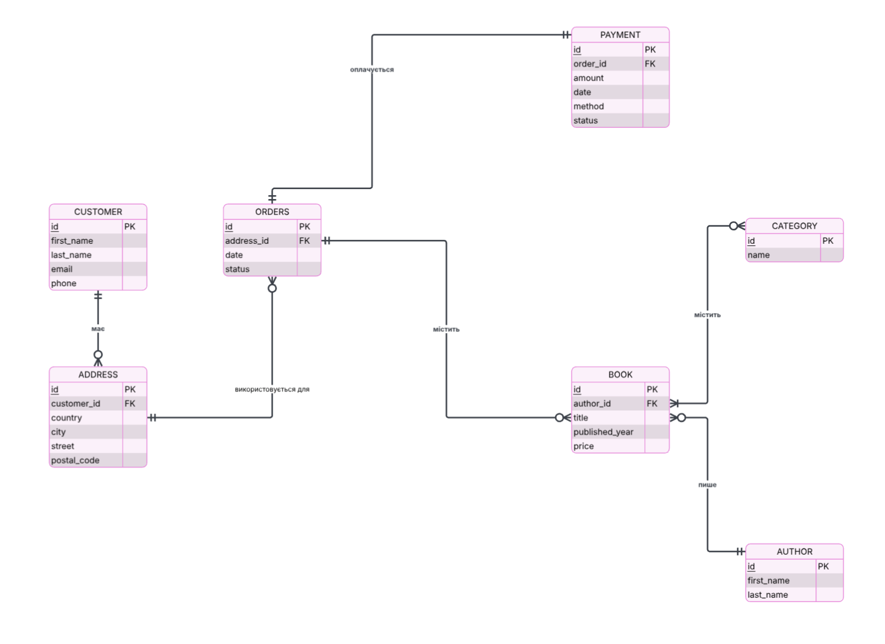

# Лабораторна робота 5: Нормалізація бази даних Bookly

**Команда:** Варенко Катерина (customer, address), Поліщук Анна (category, book, book_category), Лобода Аліна (author, orders), Сітковська Аліна (order_item, payment)

## 1. Початкова схема та функціональні залежності

| Таблиця       | Атрибути                                            | Ключі                  | ФЗ                                                                        |
| ------------- | --------------------------------------------------- | ---------------------- | ------------------------------------------------------------------------- |
| author        | id, first_name, last_name                           | id                     | id -> first_name, last_name                                               |
| customer      | id, first_name, last_name, email, phone             | id, email, phone       | id -> first_name, last_name, email, phone;<br>email -> id;<br>phone -> id |
| category      | id, category_name                                   | id, category_name      | id -> category_name;<br>category_name -> id                               |
| address       | id, customer_id, country, city, street, postal_code | id                     | id -> customer_id, country, city, street, postal_code                     |
| book          | id, author_id, title, published_year, price         | id                     | id -> author_id, title, published_year, price                             |
| book_category | book_id, category_id                                | (book_id, category_id) | нетривіальних ФЗ немає                                                    |
| orders        | id, customer_id, address_id, date, status           | id                     | id -> address_id, date, status;<br>address_id -> customer_id              |
| order_item    | order_id, book_id, quantity, unit_price             | (order_id, book_id)    | order_id, book_id -> quantity, unit_price                                 |
| payment       | id, order_id, amount, date, method, status          | id, order_id           | id -> order_id, amount, date, method, status;<br>order_id -> id           |

## 2. Нормальні форми початкової схеми

| Таблиця                | 1NF | 2NF | 3NF | Чому                                                     |
| ---------------------- | --- | --- | --- | -------------------------------------------------------- |
| author, category, book | +   | +   | +   | усі атрибути залежать лише від ключа                     |
| customer               | +   | +   | +   | `email` і `phone` - потенційні ключі                     |
| address                | +   | +   | +   | `country` і `city` залежать лише від `id`                |
| book_category          | +   | +   | +   | неключових атрибутів немає                               |
| order_item             | +   | +   | +   | атрибути залежать від усього складеного ключа            |
| payment                | +   | +   | +   | `order_id` - потенційний ключ                            |
| orders                 | +   | +   | -   | транзитивна залежність `id -> address_id -> customer_id` |

**Найвища нормальна форма початкової схеми - 2NF**<br>3NF порушує лише таблиця `orders`: неключовий атрибут `customer_id` залежить від іншого неключового атрибута, `address_id`. Одна адреса може використовуватися в кількох замовленнях, тому факт, що адреса належить клієнту, повторюється в кожному з них. Через це база дозволяє записати замовлення на адресу іншого клієнта (наприклад, `customer_id = 1`, `address_id = 3`, хоча адреса 3 належить клієнту 2), а зміна власника адреси не оновить її замовлення.

## 3. Пояснення рішень

- У `customer` є ланцюжок `id -> email -> phone`, а в `payment` - `id -> order_id -> amount`. Це не порушення 3NF, бо `email` і `order_id` унікальні, тобто самі є ключами (потенційні ключі), і їхні значення в таблиці не повторюються;
- З `address` країну й місто не виносимо в окрему таблицю, оскільки назва міста не визначає країну однозначно (Одеса є як в Україні так і в США), тому ФЗ `city -> country` немає. Повтор "Україна" в різних адресах - це однакові значення, а не надлишковість через залежність. Окремі таблиці для міст і країн були б зайвою декомпозицією;
- `order_item.unit_price` не дублює `book.price`, оскільки це є ціною на момент замовлення, вона може відрізнятися від поточної ціни книги, тому залежить від усього ключа `(order_id, book_id)`.

## 4. Нормалізація

**Крок 1 - 1NF**

Перевіряємо атомарність: у кожній клітинці має бути одне значення і не має бути повторюваних груп. У схемі так і є: кілька книг одного замовлення вже винесено в окрему таблицю `order_item`, а кілька категорій однієї книги - в `book_category`. Змін не потрібно.

Схема після кроку 1 (у 1NF):

| Таблиця       | Атрибути                                            | PK                     | FK                                             |
| ------------- | --------------------------------------------------- | ---------------------- | ---------------------------------------------- |
| author        | id, first_name, last_name                           | id                     | -                                              |
| customer      | id, first_name, last_name, email, phone             | id                     | -                                              |
| category      | id, category_name                                   | id                     | -                                              |
| address       | id, customer_id, country, city, street, postal_code | id                     | customer_id -> customer                        |
| book          | id, author_id, title, published_year, price         | id                     | author_id -> author                            |
| book_category | book_id, category_id                                | (book_id, category_id) | book_id -> book, category_id -> category       |
| orders        | id, customer_id, address_id, date, status           | id                     | customer_id -> customer, address_id -> address |
| order_item    | order_id, book_id, quantity, unit_price             | (order_id, book_id)    | order_id -> orders, book_id -> book            |
| payment       | id, order_id, amount, date, method, status          | id                     | order_id -> orders                             |

**Крок 2 - 2NF**

2NF стосується лише таблиць зі складеним ключем, бо тільки там атрибут може залежати від частини ключа. Таких таблиць дві:

- `order_item (order_id, book_id)`: `quantity` і `unit_price` залежать від обох частин ключа. Від одного `book_id` ціну не визначити, бо одна книга в різних замовленнях може мати різну ціну, а від одного `order_id` - бо в замовленні може бути кілька книг;
- `book_category (book_id, category_id)`: неключових атрибутів немає, тому часткової залежності бути не може.
  В інших таблицях ключ простий (`id`), тож часткових залежностей у них теж немає. Змін не потрібно.

Схема після кроку 2 (у 2NF) збігається зі схемою після кроку 1:

| Таблиця       | Атрибути                                            | PK                     | FK                                             |
| ------------- | --------------------------------------------------- | ---------------------- | ---------------------------------------------- |
| author        | id, first_name, last_name                           | id                     | -                                              |
| customer      | id, first_name, last_name, email, phone             | id                     | -                                              |
| category      | id, category_name                                   | id                     | -                                              |
| address       | id, customer_id, country, city, street, postal_code | id                     | customer_id -> customer                        |
| book          | id, author_id, title, published_year, price         | id                     | author_id -> author                            |
| book_category | book_id, category_id                                | (book_id, category_id) | book_id -> book, category_id -> category       |
| orders        | id, customer_id, address_id, date, status           | id                     | customer_id -> customer, address_id -> address |
| order_item    | order_id, book_id, quantity, unit_price             | (order_id, book_id)    | order_id -> orders, book_id -> book            |
| payment       | id, order_id, amount, date, method, status          | id                     | order_id -> orders                             |

**Крок 3 - 3NF**

Шукаємо транзитивні залежності, тобто залежність неключового атрибута від іншого неключового. Вона є лише в `orders`: `id -> address_id -> customer_id`. Прибираємо її, видаливши `customer_id`:

|       | Таблиця                                                                          | Ключі                             |
| ----- | -------------------------------------------------------------------------------- | --------------------------------- |
| Було  | orders (<u>id</u>, customer_id -> customer, address_id -> address, date, status) | PK (id)                           |
| Стало | orders (<u>id</u>, address_id -> address, date, status)                          | PK (id), FK address_id -> address |

```sql
ALTER TABLE orders DROP COLUMN customer_id;
```

Нову таблицю створювати не потрібно: залежність "адреса -> клієнт" уже зберігається в `address` (`id -> customer_id`). Клієнта замовлення тепер знаходимо через адресу: `orders -> address -> customer`. Після зміни ФЗ `orders` - лише `id -> address_id, date, status`, тому таблиця в 3NF, а записати замовлення на чужу адресу більше неможливо.

Схема після кроку 3 (у 3NF, змінений рядок виділено):

| Таблиця       | Атрибути                                            | PK                     | FK                                       |
| ------------- | --------------------------------------------------- | ---------------------- | ---------------------------------------- |
| author        | id, first_name, last_name                           | id                     | -                                        |
| customer      | id, first_name, last_name, email, phone             | id                     | -                                        |
| category      | id, category_name                                   | id                     | -                                        |
| address       | id, customer_id, country, city, street, postal_code | id                     | customer_id -> customer                  |
| book          | id, author_id, title, published_year, price         | id                     | author_id -> author                      |
| book_category | book_id, category_id                                | (book_id, category_id) | book_id -> book, category_id -> category |
| **orders**    | **id, address_id, date, status**                    | **id**                 | **address_id -> address**                |
| order_item    | order_id, book_id, quantity, unit_price             | (order_id, book_id)    | order_id -> orders, book_id -> book      |
| payment       | id, order_id, amount, date, method, status          | id                     | order_id -> orders                       |

## 5. Фінальна схема в 3NF

Повний DDL усіх таблиць із PK та FK: `normalization.sql`. Змінилася лише `orders`:

```sql
CREATE TABLE orders (
    id INT GENERATED ALWAYS AS IDENTITY PRIMARY KEY,
    address_id INT NOT NULL REFERENCES address(id) ON DELETE RESTRICT,
    date DATE NOT NULL DEFAULT CURRENT_DATE,
    status VARCHAR(20) NOT NULL DEFAULT 'нове' CHECK (status IN ('нове', 'збирається', 'відправлено', 'отримано', 'скасовано'))
);
```



## 6. Перевірка

Скрипт перевірено в PostgreSQL: він виконується без помилок, у тому числі повторно. `ALTER TABLE` на базі з лаб2 дає ті самі дані: клієнт кожного замовлення, знайдений через адресу, збігається з колишнім `orders.customer_id`.

Запити лаб3–4, що використовували `orders.customer_id` (`INSERT`, `UPDATE` і `DELETE` замовлень із лаб3, запити 1.4, 3.3, 3.4 з лаб4), переписано: замість `o.customer_id` тепер `JOIN address a ON a.id = o.address_id` і `a.customer_id`. Їхні результати збігаються з оригінальними, решта запитів працює без змін.
