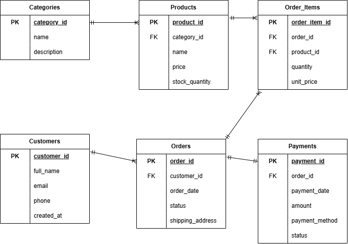

# Лабораторна робота №1. Збір вимог та проєктування ER-діаграми

**Виконав:** Кузьменко Артур, група ІМ-55  
**Предметна область:** Інтернет-магазин (E-commerce)

---

## 1. Короткий виклад вимог

### Зацікавлені сторони та їхні потреби
* **Покупці (`Customers`):** можливість реєструватися в системі, переглядати товари за категоріями, формувати замовлення з кількох позицій та оплачувати їх.
* **Адміністратори та менеджери магазину:** ведення каталогу категорій і товарів, контроль залишків на складі, відстеження статусів замовлень та підтвердження оплат.

### Дані для зберігання та бізнес-правила
* Система зберігає інформацію про категорії товарів, картки товарів (ціна, залишок на складі), облікові записи клієнтів, замовлення, склад кожного замовлення та платіжні транзакції.
* Кожен товар належить до однієї категорії, а одна категорія може об'єднувати багато товарів.
* Один зареєстрований покупець може оформити багато замовлень, але кожне замовлення прив'язане лише до одного покупця.
* Одне замовлення може містити багато різних товарів, а один товар може входити до різних замовлень (зв'язок `M:N`, розкритий через сутність `Order_Items`).
* Кожному замовленню відповідає рівно один запис про оплату.

---

## 2. Припущення та обмеження

* **Фіксація ціни на момент покупки:** ціна товару в каталозі (`Products.price`) може змінюватися з часом, тому в позиції замовлення (`Order_Items.unit_price`) зберігається ціна, за якою товар було фактично придбано.
* **Один платіж на замовлення:** вважається, що замовлення оплачується одним платежем (`1:1` між `Orders` та `Payments`), без розбиття суми на кілька транзакцій.
* **Одна категорія для товару:** для спрощення моделі кожен товар відноситься лише до однієї основної категорії (`1:N` між `Categories` та `Products`).
* **Оформлення лише зареєстрованими користувачами:** створення замовлення без облікового запису в таблиці `Customers` не передбачене (поле `customer_id` у `Orders` є обов'язковим).
* **Унікальність контактних даних:** кожен клієнт реєструється з унікальною електронною адресою (`email`).

---

## 3. Сутності та їхні атрибути

1. **`Categories` (Категорії товарів)**
   * `category_id` (PK) — унікальний ідентифікатор категорії.
   * `name` — назва категорії.
   * `description` — текстовий опис категорії.

2. **`Products` (Товари)**
   * `product_id` (PK) — унікальний ідентифікатор товару.
   * `category_id` (FK) — посилання на категорію (`Categories.category_id`).
   * `name` — найменування товару.
   * `price` — поточна ціна одиниці товару.
   * `stock_quantity` — доступна кількість товару на складі.

3. **`Customers` (Покупці)**
   * `customer_id` (PK) — унікальний ідентифікатор покупця.
   * `full_name` — прізвище та ім'я клієнта.
   * `email` — електронна пошта клієнта.
   * `phone` — контактний номер телефону.
   * `created_at` — дата та час реєстрації облікового запису.

4. **`Orders` (Замовлення)**
   * `order_id` (PK) — унікальний ідентифікатор замовлення.
   * `customer_id` (FK) — посилання на покупця (`Customers.customer_id`).
   * `order_date` — дата та час оформлення замовлення.
   * `status` — статус виконання замовлення (*new*, *paid*, *shipped*, *delivered*).
   * `shipping_address` — адреса доставки замовлення.

5. **`Order_Items` (Позиції замовлення)**
   * `order_item_id` (PK) — унікальний ідентифікатор позиції у замовленні.
   * `order_id` (FK) — посилання на замовлення (`Orders.order_id`).
   * `product_id` (FK) — посилання на товар (`Products.product_id`).
   * `quantity` — кількість одиниць обраного товару.
   * `unit_price` — ціна за одиницю товару на момент створення замовлення.

6. **`Payments` (Оплати)**
   * `payment_id` (PK) — унікальний ідентифікатор платежу.
   * `order_id` (FK) — посилання на оплачене замовлення (`Orders.order_id`).
   * `payment_date` — дата та час проведення платежу.
   * `amount` — загальна сума оплати.
   * `payment_method` — спосіб оплати (банківська картка, переказ тощо).
   * `status` — статус платіжної транзакції (*pending*, *completed*, *failed*).

---

## 4. Пояснення зв'язків між сутностями

* **`Categories` (1) — (N) `Products`:** один-до-багатьох. Одна категорія містить багато товарів, але кожен товар належить лише до однієї категорії.
* **`Customers` (1) — (N) `Orders`:** один-до-багатьох. Один зареєстрований покупець може оформити багато замовлень, тоді як кожне замовлення належить конкретному покупцю.
* **`Orders` (1) — (N) `Order_Items`:** один-до-багатьох. Одне замовлення складається з однієї або кількох товарних позицій, а кожна позиція належить лише одному замовленню.
* **`Products` (1) — (N) `Order_Items`:** один-до-багатьох. Один і той самий товар може фігурувати в багатьох позиціях різних замовлень.
* **`Orders` (1) — (1) `Payments`:** один-до-одного. Кожному замовленню відповідає один запис про оплату, і кожен платіж прив'язаний до одного конкретного замовлення.

---

## 5. ER-діаграма

