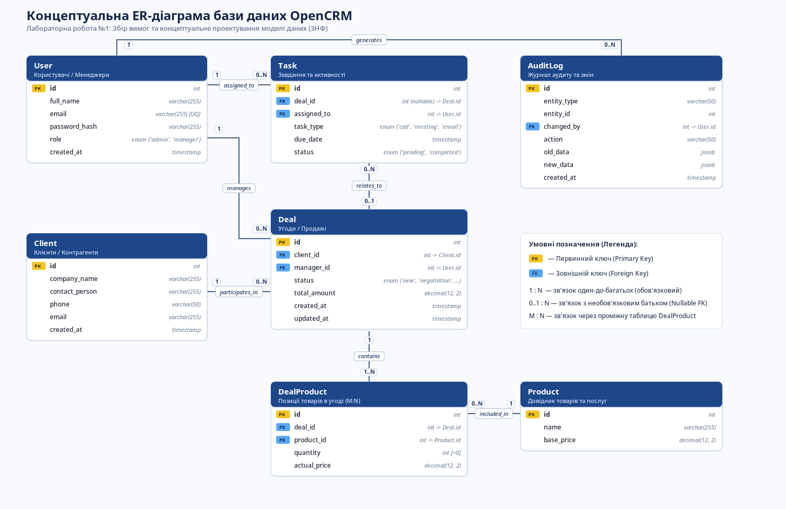
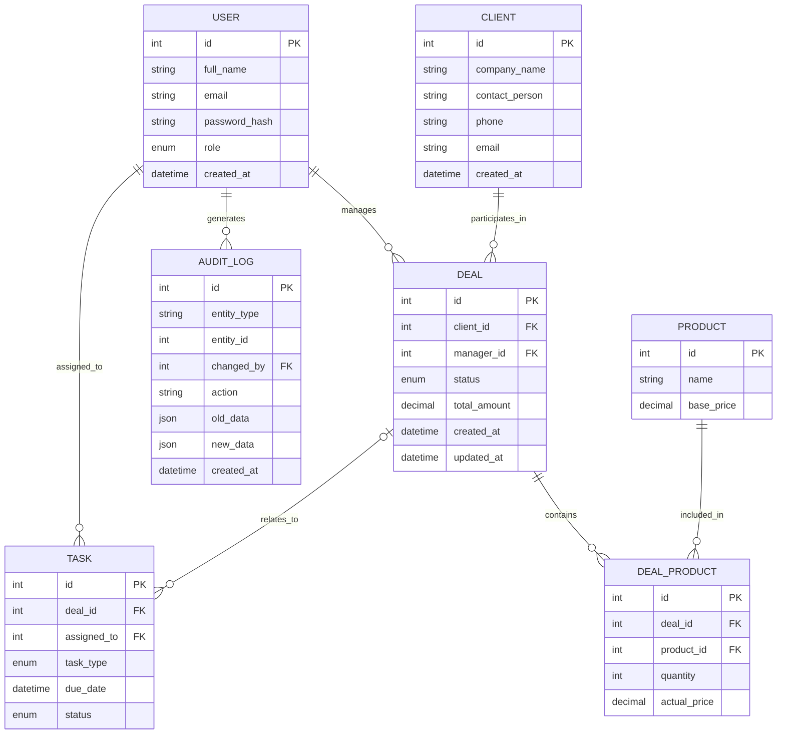

# Лабораторна робота №1: Збір вимог та розробка схеми ER

**Тема:** Проєктування концептуальної ER-моделі для CRM-системи OpenCRM  
**Виконали студенти групи ІМ-54:**
- Рубан Олексій
- Гладченко Віталій
- Симоненко Поліна
- Грищенко Ілля

---

## 1. Мета роботи
Ознайомитися з основами збору та аналізу вимог користувачів, ідентифікації ключових сутностей, їхніх атрибутів і зв'язків та побудувати концептуальну ER-діаграму для реляційної бази даних.

## 2. Файли роботи
- [erDiagram.png](./erDiagram.png) — графічна ER-діаграма системи.
- [schema.sql](./schema.sql) — попередня чернетка реляційної схеми.

## 3. Опис предметної області (OpenCRM)
OpenCRM — система управління взаємовідносинами з клієнтами для комерційного відділу. Система забезпечує:
- Ведення бази контрагентів (компаній та контактних осіб);
- Управління угодами через воронку продажів (`new` → `negotiation` → `contract` → `won` / `lost`);
- Каталог товарів та послуг із фіксацією індивідуальних цін на момент укладання угоди;
- Планування завдань для менеджерів (дзвінки, зустрічі, пошта) із прив'язкою до угод або без неї;
- Журналювання дій співробітників (аудит) для прозорості операцій.

## 4. Вимоги та бізнес-правила

### Дані для зберігання:
1. **Користувачі (`User`):** співробітники системи (менеджери, адміністратори) — ПІБ, унікальний корпоративний email, хеш пароля, роль (`admin`, `manager`), дата створення.
2. **Клієнти (`Client`):** компанії та контактні особи — назва компанії, контактна особа, телефон, email, дата реєстрації.
3. **Угоди (`Deal`):** угоди у воронці — посилання на клієнта, відповідального менеджера, статус у воронці, загальна сума, часові мітки створення й оновлення.
4. **Каталог товарів (`Product`):** найменування позиції та базова прайсова ціна.
5. **Позиції угоди (`DealProduct`):** проміжна асоціативна сутність зв'язку M:N між угодами та товарами з фіксацією кількості (`quantity > 0`) та фактичної ціни продажу (`actual_price`).
6. **Завдання (`Task`):** активності співробітників — виконавець, тип (`call`, `meeting`, `email`), дата дедлайну, статус виконання (`pending`, `completed`), опціональне посилання на угоду.
7. **Аудит (`AuditLog`):** незмінний журнал дій — тип сутності, ідентифікатор цільового запису, виконавець, дія, зліпки стану (`old_data`, `new_data`), час операції.

### Бізнес-правила:
- Кожна угода обов'язково закріплюється за одним клієнтом та одним відповідальним менеджером.
- Зв'язок між угодами й товарами реалізовано як «багато-до-багатьох» (M:N) через сутність `DealProduct`.
- Зміна базової вартості товару в каталозі не змінює історичні ціни в уже укладених угодах.
- Кількість товару в позиції угоди є строго додатним числом (`> 0`), а ціни — невід'ємними (`>= 0`).
- Завдання обов'язково призначається конкретному менеджеру, але може існувати як у прив'язці до угоди, так і окремо.
- Журнал аудиту працює тільки на додавання нових записів (append-only).
- Видалення клієнта або менеджера, які мають зв'язані угоди, блокується обмеженням цілісності (RESTRICT).

## 5. ER-діаграма

## 6. Зв'язки між сутностями
- **User — Deal (1:N):** один менеджер може вести багато угод, але за кожною угодою закріплений один відповідальний.
- **Client — Deal (1:N):** один клієнт може мати кілька угод, угода оформлюється на одного контрагента.
- **Deal — Product (M:N через DealProduct):** в одній угоді може бути багато товарів, а товар може продаватися в багатьох угодах.
- **User — Task (1:N):** завдання призначається конкретному менеджеру, менеджер може мати кілька завдань.
- **Deal — Task (1:N, опціонально):** завдання може стосуватися конкретної угоди або плануватися без прив'язки до неї.
- **User — AuditLog (1:N):** будь-які зміни в системі протоколюються із зазначенням автора дії.
