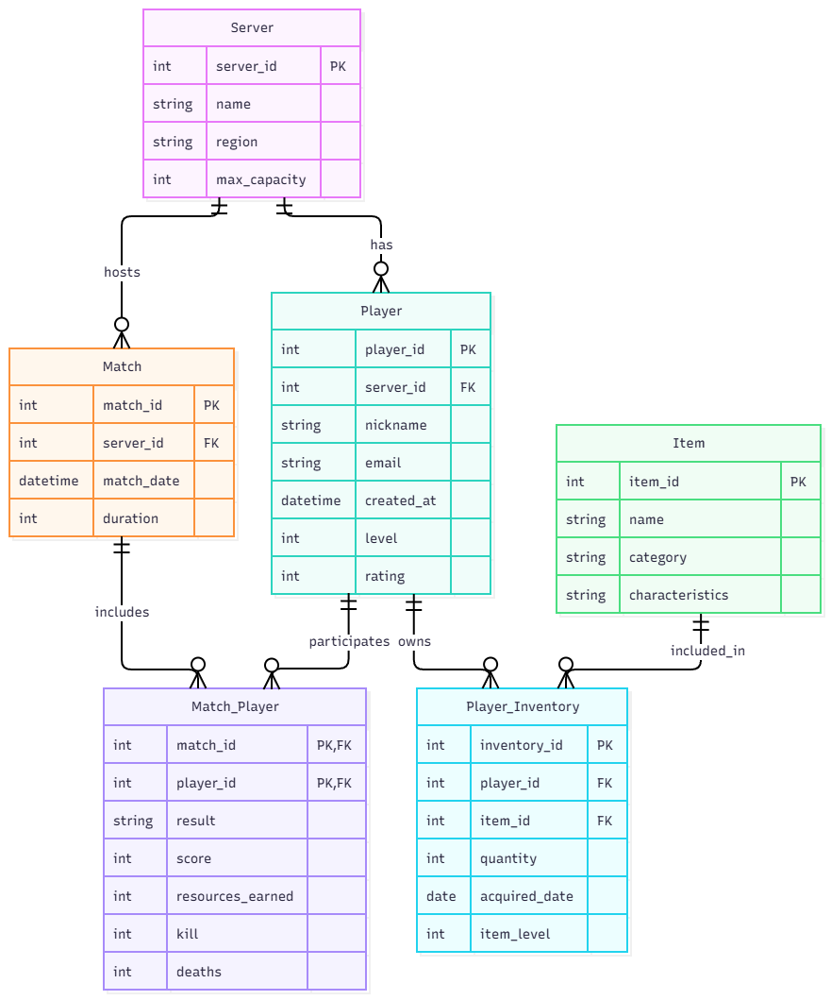

# Лабораторна робота №1: Платформа для ігрової статистики та інвентарю

## 1. Бізнес-вимоги (Заповнює Замовник)

Як замовник (розробник багатокористувацької гри), я хочу створити базу даних для відстеження профілів гравців, їхнього ігрового майна, серверів та результатів матчів. Система має відповідати таким бізнес-правилам:

**1. Профіль гравця:**

- База повинна зберігати базову інформацію про користувача: унікальний ідентифікатор, нікнейм, електронну пошту та дату створення акаунта.
- Кожен гравець за замовчуванням прив'язаний до певного регіонального сервера (наприклад, Europe, North America, Asia) для оптимізації пінгу.
- Також необхідно відстежувати поточний рівень гравця та його загальний рейтинг.

**2. Ігровий інвентар:**

- Система повинна зберігати інформацію про всі предмети, якими володіє гравець.
- В інвентарі лежать предмети різних категорій:
  - **Персонажі:** розблоковані герої, якими може грати користувач.
  - **Кораблі (Транспорт):** доступна техніка, її рівень та характеристики.
  - **Ресурси:** внутрішньоігрова валюта та матеріали (потрібно відстежувати їхню точну кількість для кожного гравця).
- Для кожного предмета в інвентарі має зберігатися дата його отримання.

**3. Сервери:**

- Потрібно вести облік ігрових серверів. Для кожного сервера зберігається його назва, географічний регіон та максимальна місткість гравців.

**4. Статистика матчів:**

- Система повинна реєструвати кожен зіграний матч. Про матч ми збираємо такі дані: ідентифікатор матчу, на якому сервері він проходив, дата проведення та загальна тривалість.
- Також ми збираємо детальну статистику для кожного гравця у конкретному матчі:
  - Результат (Перемога / Поразка).
  - Кількість набраних очок, а також кількість вбивств та смертей.
  - Ресурси, здобуті під час цього матчу (які потім мають поповнити його інвентар).

**5. Основні операції системи (завдання користувачів):**

- Реєстрація гравця, прив'язка до основного сервера та оновлення його рівня і рейтингу.
- Поповнення інвентарю гравця новими предметами, зміна їхньої кількості та підвищення рівня (`item_level`).
- Створення запису матчу на обраному сервері та збереження індивідуальної статистики кожного учасника після завершення гри.

## 2. Сутності та атрибути (Аналітика)

Нижче наведено сутності майбутньої бази даних, призначення їхніх атрибутів і концептуальні обмеження:

1. **Server (Сервер)** — довідник ігрових серверів.
   - `server_id` — первинний ключ (`PK`), унікальний ідентифікатор.
   - `name` — обов’язкова назва сервера (наприклад, Europe).
   - `region` — обов’язковий географічний регіон.
   - `max_capacity` — максимальна кількість гравців; додатне ціле число.

2. **Player (Гравець)** — інформація про користувачів.
   - `player_id` — первинний ключ (`PK`).
   - `server_id` — обов’язковий зовнішній ключ (`FK`) на `Server`; основний сервер гравця.
   - `nickname` — обов’язковий нікнейм, унікальний у системі.
   - `email` — обов’язкова електронна пошта, унікальна; має відповідати формату email.
   - `created_at` — обов’язкова дата й час створення акаунта.
   - `level` — поточний рівень; ціле число, не менше нуля.
   - `rating` — загальний рейтинг; ціле число, не менше нуля.

3. **Item (Предмет)** — загальний каталог предметів гри (персонажі, кораблі, ресурси).
   - `item_id` — первинний ключ (`PK`).
   - `name` — обов’язкова назва предмета (наприклад, "Napoli", "Клорінда", "Золото").
   - `category` — обов’язкова категорія з переліку: `Character`, `Ship`, `Resource`.
   - `characteristics` — текстовий опис характеристик предмета; може бути порожнім або `NULL`, якщо характеристики не задані.

4. **Player_Inventory (Інвентар)** — асоціативна сутність для зберігання майна конкретного гравця.
   - `inventory_id` — первинний ключ (`PK`).
   - `player_id` — обов’язковий зовнішній ключ (`FK`) на `Player`.
   - `item_id` — обов’язковий зовнішній ключ (`FK`) на `Item`.
   - `quantity` — кількість; додатне ціле число (для предметів, які не є ресурсами, за замовчуванням дорівнює 1).
   - `item_level` — рівень конкретного предмета у цього гравця; ціле число, не менше нуля (для предметів без рівнів може бути `NULL`).
   - `acquired_date` — обов’язкова дата отримання предмета.
   - Пара `(player_id, item_id)` унікальна: один рядок інвентарю представляє володіння гравцем одним видом предмета.

5. **Match (Матч)** — інформація про саму ігрову сесію.
   - `match_id` — первинний ключ (`PK`).
   - `server_id` — обов’язковий зовнішній ключ (`FK`) на `Server`, де відбувся матч.
   - `match_date` — обов’язкова дата й час проведення матчу.
   - `duration` — тривалість матчу; додатне ціле число (у секундах).

6. **Match_Player (Статистика гравця в матчі)** — асоціативна сутність для запису результатів конкретних гравців у матчах.
   - `match_id` — частина складеного первинного ключа (`PK`) та зовнішній ключ (`FK`) на `Match`.
   - `player_id` — частина складеного первинного ключа (`PK`) та зовнішній ключ (`FK`) на `Player`.
   - `result` — результат участі; одне зі значень `Victory` або `Defeat`.
   - `score` — набрані очки; ціле число, не менше нуля.
   - `resources_earned` — кількість здобутих ресурсів; ціле число, не менше нуля.
   - `kills` — кількість убивств гравця в матчі; ціле число, не менше нуля.
   - `deaths` — кількість смертей гравця в матчі; ціле число, не менше нуля.

Для кожної сутності первинний ключ має бути унікальним і не може бути `NULL`. Зовнішні ключі мають посилатися на наявні записи.

## 3. Зв’язки між сутностями

- **Server -> Player (1:M, роль `has`):** на одному сервері може бути багато гравців (`0..*`), але кожен гравець має рівно один основний домашній сервер (`1..1`).
- **Server -> Match (1:M, роль `hosts`):** на одному сервері може проходити багато матчів (`0..*`), кожен матч проходить рівно на одному сервері (`1..1`).
- **Player -> Item (M:N):** гравець може мати багато предметів, а один тип предмета може належати багатьом гравцям. Зв’язок реалізовано через асоціативну таблицю `Player_Inventory` (`owns` та `included_in`).
- **Player -> Match (M:N):** гравець може брати участь у багатьох матчах, а в матчі може брати участь багато гравців. Зв’язок реалізовано через асоціативну таблицю `Match_Player` (`participates` та `includes`).

## 4. Припущення та обмеження

- Категорії предметів обмежені персонажами (`Character`), кораблями (`Ship`) та ресурсами (`Resource`). Нові категорії потребуватимуть зміни правил або схеми.
- `characteristics` — довільний текстовий опис базових параметрів предмета в каталозі, а не набір окремих типізованих колонок.
- `item_level` зберігається на рівні володіння предметом у `Player_Inventory` (оскільки різні гравці прокачують свої кораблі чи героїв до різного рівня), а не в каталозі `Item`. Для ресурсів значення не застосовується (`NULL`).
- Модель передбачає не більше одного запису на пару `(player_id, item_id)`. Кількість однакових ресурсів або предметів акумулюється в полі `quantity`.
- `resources_earned` фіксує нагороду за конкретний матч, але автоматичне нарахування цієї нагороди до `Player_Inventory` тригером на концептуальному рівні не описується.
- Участь у матчі не обмежена домашнім сервером гравця: гравець із `Player.server_id` може грати в матчі на іншому `Match.server_id`.
- Модель не охоплює команди, раунди, журнали змін рейтингу чи причини дострокового виходу з матчу.

