# Лабораторна робота 1 - Збір вимог та розробка ER-діаграми

**Проєкт:** Student Manager

**Виконали:** студенти групи ІМ-о51 - Кузнецов Кирило, Тараєв Олексій, Машута Олександр, Конкус Андрій

## 1. Вимоги

Ми розробили ER-діаграму для системи StudentManager, яка призначена для організації навчальної діяльності студентів. Вона дозволяє переглядати розклад занять, відстежувати домашні завдання, контролювати терміни їх виконання та створювати особисті нотатки.

Система має зберігати такі дані:

- студенти (ПІБ, група, email);
- викладачі (ПІБ, кафедра);
- предмети (назва, викладач);
- заняття розкладу (день тижня, час початку і кінця);
- домашні завдання (назва, дата видачі, дедлайн, статус);
- нотатки (заголовок, текст).

Основні операції системи: перегляд розкладу на тиждень, облік домашніх завдань та їх виконання, ведення нотаток по предметах.

Бізнес-правила, які ми виділили під час збору вимог:

1. Email студента має бути унікальним, він потрібен для входу в акаунт.
2. Один викладач може вести кілька предметів, але кожен предмет веде один викладач.
3. Розклад у кожного студента свій, тому що предмети за вибором.
4. Дедлайн домашнього завдання не може бути раніше дати видачі.
5. Заняття не може закінчуватись раніше, ніж починається.
6. Статус домашнього завдання - один з трьох: not started, in progress, done.

## 2. ER-діаграма

## 3. Сутності та атрибути

База даних складається з шести таблиць.

**students** - зберігає основну інформацію про студентів: id (первинний ключ), full_name (ПІБ), group_name (група), email (унікальне поле, потрібне для входу).

**teachers** - список викладачів: id (первинний ключ), full_name (ПІБ), department (кафедра). Викладачі винесені в окрему таблицю, щоб не дублювати ПІБ в кожному предметі - це застосування нормалізації.

**subjects** - навчальні предмети: id (первинний ключ), name (назва), teacher_id (зовнішній ключ на teachers - кожен предмет закріплений за одним викладачем).

**lessons** - розклад занять: id (первинний ключ), student_id (зовнішній ключ на students), subject_id (зовнішній ключ на subjects), day_of_week (день тижня), start_time і end_time (час початку і кінця пари).

**homeworks** - домашні завдання: id (первинний ключ), student_id (зовнішній ключ), subject_id (зовнішній ключ), title (назва), start_date (дата видачі), due_date (дедлайн), status (статус виконання).

**notes** - особисті нотатки: id (первинний ключ), student_id (зовнішній ключ), subject_id (зовнішній ключ), title (заголовок), content (текст нотатки).

## 4. Зв'язки між таблицями

Усі зв'язки мають тип один-до-багатьох (1:N):

- students - lessons: у одного студента багато занять у розкладі. Заняття прив'язане до студента, а не до групи, бо розклад індивідуальний;
- students - homeworks: у одного студента багато домашніх завдань;
- students - notes: один студент створює багато нотаток;
- teachers - subjects: один викладач веде кілька предметів, але кожен предмет закріплений тільки за одним викладачем;
- subjects - lessons: один предмет зустрічається в багатьох заняттях;
- subjects - homeworks: з одного предмета буває багато домашніх завдань. Завдання прив'язане до предмету, а не до конкретної пари;
- subjects - notes: по одному предмету багато нотаток, це дозволяє фільтрувати конспекти по предмету.

Зв'язків багато-до-багатьох у нашій моделі немає, тому таблиці сполучення не потрібні. Усі зв'язки мають тип 1:N.

## 5. Припущення та обмеження

1. Викладачі зберігаються в окремій таблиці, щоб не дублювати ПІБ у предметах.
2. День тижня зберігається як текст ("Понеділок" тощо), бо розклад тижневий.
3. База даних підтримує кількох студентів, хоча застосунок особистий.
4. Нотатка може бути без тексту, але заголовок обов'язковий.
