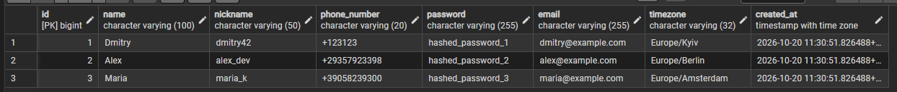
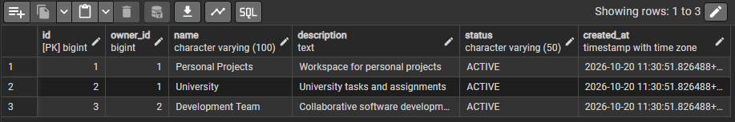
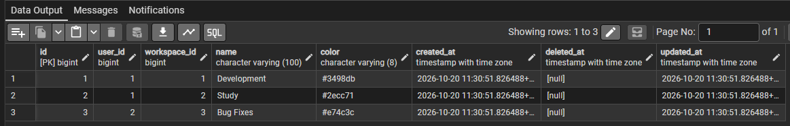
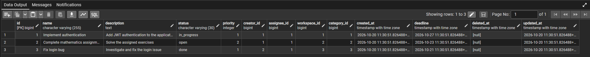
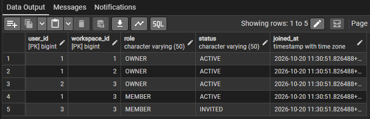
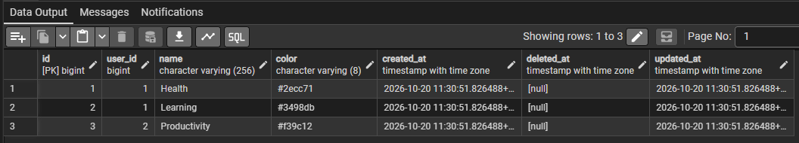
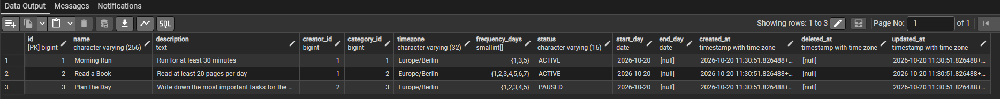
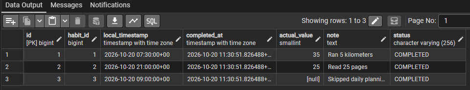

# Лабораторна робота 2: Перетворення ER-діаграми на схему PostgreSQL

### Посилання на комміти та Pull Requests

| Комміт / PR | Автор | Створені таблиці |
| :--- | :--- | :--- |
| [PR](https://github.com/cyjiky/Trackly-db/commit/328b5952a34df2a2f0c8ffe6a3a532fd3fb1a5f7) | `habits`, `habits_categories`, `habit_completions` | Єгор Романов |
| [PR](https://github.com/cyjiky/Trackly-db/commit/855f4733806f59bbdb43e740e1d5f228ab47ec66) | `users`, `tasks`, `task_categories`                | Вікторія Уманець |
| [PR](https://github.com/cyjiky/Trackly-db/commit/e69e3f7666b05f3fd20d7517d491e0aa2d9e5646) | `workspaces`, `workspace_members`                  | Кірілл Прокопцов |

---

### Звіт та опис виконаної роботи

#### 1. Таблиці та DDL-запити

> **Пов'язана діаграма сутностей та зв'язків (ERD):**  
> Детальна схема доступна у файлі [`./diagramm.mmd`](../1%20-%20ER%20Diagram/diagramm.mmd).

Усі DDL-інструкції структуровано та об'єднано в єдиному скрипті [`./Lab2.sql`](./Lab2.sql)

1. **`users`** - базова сутність користувачів платформи
2. **`workspaces`** - робочі простори для командної співпраці
3. **`task_categories`** - категорії завдань
4. **`tasks`** - завдання
5. **`workspace_members`** - таблиця-зв'язка між користувачами та просторами
6. **`habits_categories`** - персональні категорії звичок 
7. **`habits`** - звички з графіками виконання
8. **`habit_completions`** - журнал відміток виконання звичок

##### Розподіл модулів у команді

| Комміт / PR | Таблиці | Aвтор |
| :--- | :--- | :--- |
| [PR](https://github.com/cyjiky/Trackly-db/commit/328b5952a34df2a2f0c8ffe6a3a532fd3fb1a5f7) | `habits`, `habits_categories`, `habit_completions` | Єгор Романов |
| [PR](https://github.com/cyjiky/Trackly-db/commit/855f4733806f59bbdb43e740e1d5f228ab47ec66) | `users`, `tasks`, `task_categories` | Вікторія Уманець |
| [PR](https://github.com/cyjiky/Trackly-db/commit/e69e3f7666b05f3fd20d7517d491e0aa2d9e5646) | `workspaces`, `workspace_members` | Кірілл Прокопцов |
---

#### 2. Основні рішення та огляд

1. **Первинні ключі (Primary Keys - PK):**
  - Для всіх регулярних таблиць обрано сурогатний первинний ключ `id BIGINT GENERATED ALWAYS AS IDENTITY PRIMARY KEY`. Тобто сучасний стандарт SQL, що є надійнішою заміною застарілого псевдотипу `SERIAL

3. **Зовнішні ключі (Foreign Keys - FK)**
  - Практично кожна таблиця містить зовнішні ключі для забезпечення зв'язності моделі
  - **`CHECK` замість статичних типів `ENUM`:** Для забезпечення гнучкості майбутніх міграцій без блокування таблиць, усі фіксовані набори статусів реалізовано за допомогою `CHECK`
  - У `tasks` обмеження `CHECK (deadline IS NULL OR deadline >= created_at)` гарантує, що дедлайн не може передувати моменту створення завдання
  - Валідація пріоритету задач: `CHECK (priority > 0)`
  - **Валідація масивів у `habits`:**
    - Дні повторення звички зберігаються у полі `frequency_days SMALLINT[]` з обов'язковою перевіркою коректності:
      ```sql
      CHECK (
          array_ndims(frequency_days) = 1 AND
          cardinality(frequency_days) BETWEEN 1 AND 7
      )
      ```
  - Поля `email`, `nickname` та `phone_number` користувача мають обмеження `UNIQUE`

5. **Вибір типів даних:**
   - **`BIGINT`** - виключає ризик переповнення 32-бітного `INTEGER` у таблицях завдань та відміток звичок
   - **`TIMESTAMPTZ`** - Timestamp with time zone
---

#### 3. SQL-запити та верифікація заповнення

Для перевірки коректності схеми та накладених обмежень було складено скрипт вставки тестових даних:
> **Скрипт наповнення даними:** [`./Lab-2-inserts.sql`](./Lab-2-inserts.sql)

Скрипт містить зразки реалістичних записів (по 3–5 рядків для кожної таблиці):
- Зареєстровано користувачів із валідними контактами та часовими поясами
- Створено робочі простори та зафіксовано членство користувачів із відповідними ролями і статусами
- Додано категорії завдань і самі завдання з пріоритетами, дедлайнами та статусами
- Сформовано категорії звичок, самі звички з масивами днів тижня та відмітки про їх виконання

---

#### Результати виконання

Всі скріншоти підтвердження успішного виконання запитів збережено в папці [`./img`](./img/):

| Таблиця | Скріншот | Короткий опис |
| :--- | :---: | :--- |
| **`users`** |  | 3 облікові записи користувачів |
| **`workspaces`** |  | 3 робочі простори |
| **`task_categories`** |  | Категорії завдань з HEX-кольорами |
| **`tasks`** |  | Завдання з пріоритетами, статусами, виконавцями та валідними дедлайнами |
| **`workspace_members`** |  | Учасники робочих просторів із розподілом прав та статусів участі |
| **`habits_categories`** |  | Категорії звичок користувачів |
| **`habits`** |  | Звички з налаштованою регулярністю |
| **`habit_completions`** |  | Журнал виконань звичок |

---

### Висновок

У ході виконання лабораторної роботи:
1. Концептуальну ER-модель проєкту Trackly було трансформовано у схему PostgreSQL
2. Реалізовано DDL-скрипт [`./Lab2.sql`](./Lab2.sql)
3. Впроваджено комплекс обмежень цілісності (`CHECK`, `UNIQUE`, `NOT NULL`, `DEFAULT`)
4. Проведено верифікацію схеми шляхом наповнення тестовими даними за допомогою [`./Lab-2-inserts.sql`](./Lab-2-inserts.sql)

