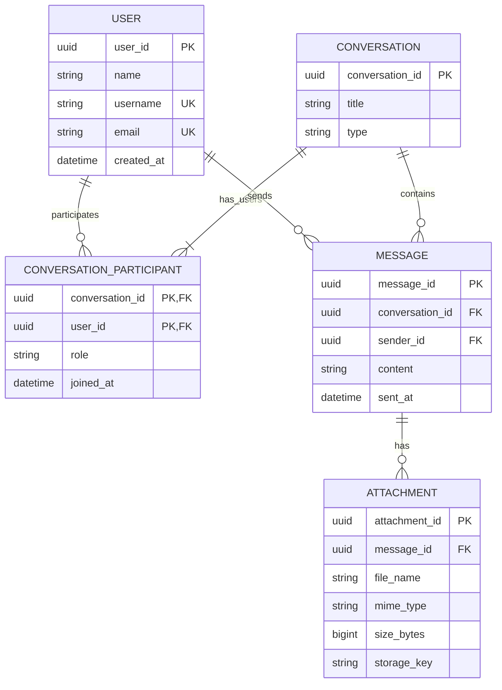

# Лабораторна робота 2: Перетворення ER-діаграми на схему PostgreSQL

**Мета:** перетворити концептуальну ER-діаграму месенджера з лабораторної 1 на фізичну реляційну схему в PostgreSQL, визначивши типи даних, первинні та зовнішні ключі, обмеження цілісності та заповнивши таблиці тестовими даними.

---

## Файли лабораторної роботи

- [`schema.sql`](./schema.sql) - DDL-скрипт для створення таблиць, первинних і зовнішніх ключів та обмежень (`NOT NULL`, `UNIQUE`, `CHECK`, `DEFAULT`).
- [`seed.sql`](./seed.sql) - DML-скрипт із тестовими даними та перевірочними `SELECT`-запитами.

---

## Реляційна схема (ERD)

---

## Опис таблиць, ключів та обмежень

### 1. `users` (відповідає сутності `USER`)
Зберігає облікові записи користувачів месенджера.  
*Примітка:* у PostgreSQL використано назву `users`, оскільки `user` є зарезервованим ключовим словом SQL.

| Стовпець | Тип даних | Ключі та обмеження | Опис |
|---|---|---|---|
| `user_id` | `UUID` | `PRIMARY KEY`, `DEFAULT gen_random_uuid()` | Унікальний ідентифікатор користувача |
| `name` | `STRING` | `NOT NULL`, `CHECK (char_length(btrim(name)) > 0)` | Відображуване ім'я (не може бути порожнім або з самих пробілів) |
| `username` | `STRING` | `NOT NULL`, `UNIQUE`, `CHECK (username ~ '^[a-zA-Z0-9_]{3,50}$')` | Унікальний нікнейм (3–50 символів: латиниця, цифри, `_`) |
| `email` | `STRING` | `NOT NULL`, `UNIQUE`, `CHECK (email ~* '^[^@\s]+@[^@\s]+\.[^@\s]+$')` | Унікальна електронна пошта у коректному форматі |
| `created_at` | `TIMESTAMPTZ` | `NOT NULL`, `DEFAULT CURRENT_TIMESTAMP` | Дата й час створення облікового запису (з часовим поясом) |

---

### 2. `conversations` (відповідає сутності `CONVERSATION`)
Зберігає особисті (`direct`) та групові (`group`) чати.

| Стовпець | Тип даних | Ключі та обмеження | Опис |
|---|---|---|---|
| `conversation_id` | `UUID` | `PRIMARY KEY`, `DEFAULT gen_random_uuid()` | Унікальний ідентифікатор бесіди |
| `title` | `STRING` | `NULL` дозволено для `direct` | Назва бесіди |
| `type` | `STRING` | `NOT NULL`, `CHECK (type IN ('direct', 'group'))` | Тип бесіди |

**Табличне обмеження:**
- `chk_conversations_group_title`: `CHECK (type <> 'group' OR (title IS NOT NULL AND char_length(btrim(title)) > 0))` — гарантує, що груповий чат обов'язково має непорожню назву, тоді як особистий чат може бути без назви (`NULL`).

---

### 3. `conversation_participants` (відповідає асоціативній сутності `CONVERSATION_PARTICIPANT`)
Реалізує зв'язок «багато до багатьох» (`M:N`) між `users` та `conversations`.

| Стовпець | Тип даних | Ключі та обмеження | Опис |
|---|---|---|---|
| `conversation_id` | `UUID` | `PRIMARY KEY (1)`, `FOREIGN KEY` `conversations(conversation_id) ON DELETE CASCADE`, `NOT NULL` | Ідентифікатор бесіди |
| `user_id` | `UUID` | `PRIMARY KEY (2)`, `FOREIGN KEY` `users(user_id) ON DELETE CASCADE`, `NOT NULL` | Ідентифікатор користувача |
| `role` | `STRING` | `NOT NULL`, `DEFAULT 'member'`, `CHECK (role IN ('owner', 'admin', 'member'))` | Роль учасника в бесіді |
| `joined_at` | `TIMESTAMPTZ` | `NOT NULL`, `DEFAULT CURRENT_TIMESTAMP` | Дата й час приєднання до бесіди |

**Ключі та каскадування:**
- Складений первинний ключ `pk_conversation_participants (conversation_id, user_id)` унеможливлює повторне додавання одного й того ж користувача в ту саму бесіду.
- `ON DELETE CASCADE` автоматично видаляє записи участі при видаленні бесіди або користувача.

---

### 4. `messages` (відповідає сутності `MESSAGE`)
Зберігає повідомлення, надіслані користувачами в бесідах.

| Стовпець | Тип даних | Ключі та обмеження | Опис |
|---|---|---|---|
| `message_id` | `UUID` | `PRIMARY KEY`, `DEFAULT gen_random_uuid()` | Унікальний ідентифікатор повідомлення |
| `conversation_id` | `UUID` | `FOREIGN KEY` `conversations(conversation_id) ON DELETE CASCADE`, `NOT NULL` | Бесіда, до якої належить повідомлення |
| `sender_id` | `UUID` | `FOREIGN KEY` `users(user_id) ON DELETE CASCADE`, `NOT NULL` | Користувач-відправник |
| `content` | `TEXT` | `NULL` дозволено | Текст повідомлення (може бути `NULL`, якщо повідомлення містить лише вкладення) |
| `sent_at` | `TIMESTAMPTZ` | `NOT NULL`, `DEFAULT CURRENT_TIMESTAMP` | Час відправлення повідомлення |

---

### 5. `attachments` (відповідає сутності `ATTACHMENT`)
Зберігає метадані файлів, прикріплених до повідомлень.

| Стовпець | Тип даних | Ключі та обмеження | Опис |
|---|---|---|---|
| `attachment_id` | `UUID` | `PRIMARY KEY`, `DEFAULT gen_random_uuid()` | Унікальний ідентифікатор вкладення |
| `message_id` | `UUID` | `FOREIGN KEY` → `messages(message_id) ON DELETE CASCADE`, `NOT NULL` | Повідомлення, до якого прикріплено файл |
| `file_name` | `STRING` | `NOT NULL`, `CHECK (char_length(btrim(file_name)) > 0)` | Оригінальна назва файлу |
| `mime_type` | `STRING` | `NOT NULL`, `CHECK (mime_type ~ '^[^/\s]+/[^/\s]+$')` | MIME-тип файлу (наприклад, `image/png`) |
| `size_bytes` | `BIGINT` | `NOT NULL`, `CHECK (size_bytes > 0)` | Розмір файлу в байтах (строго додатний) |
| `storage_key` | `STRING` | `NOT NULL`, `UNIQUE`, `CHECK (char_length(btrim(storage_key)) > 0)` | Унікальний ключ/шлях у об'єктному сховищі |

---

## Припущення та проєктні рішення

*  **Генерація UUID:** використано вбудовану функцію `gen_random_uuid()`. 
*  **Часові мітки (`TIMESTAMPTZ`):** для `created_at`, `joined_at` та `sent_at` обрано `TIMESTAMPTZ` замість `TIMESTAMP`, щоб коректно зберігати час незалежно від часового поясу клієнта.
*  **Порядок вставлення даних:** у [`seed.sql`](./seed.sql) спершу заповнюються незалежні батьківські таблиці (`users`, `conversations`), потім `conversation_participants`, далі `messages` і наостанок `attachments` — це забезпечує дотримання всіх обмежень `FOREIGN KEY`.

---

**Висновок:** під час виконання лабораторної роботи 2 було перетворено концептуальну ER-діаграму месенджера на фізичну схему PostgreSQL, реалізовано первинні, складені та зовнішні ключі, обмеження `NOT NULL`, `UNIQUE`, `CHECK` і `DEFAULT`, а також підготовлено набір тестових даних для перевірки цілісності схеми.
