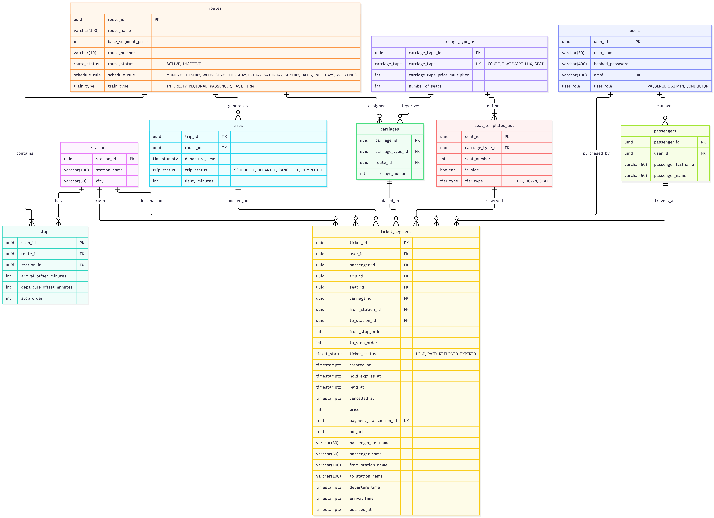
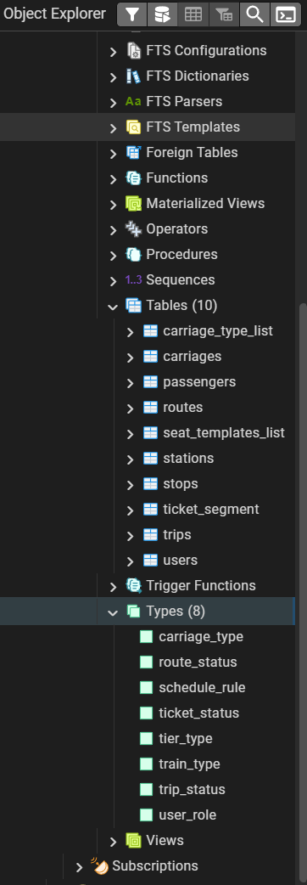
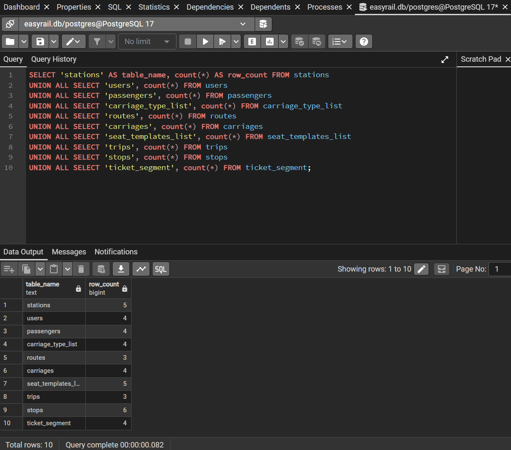

# Звіт з Лабораторної роботи №2

**Дисципліна:** Бази даних  
**Тема:** Перетворення ER-діаграми на реляційну схему PostgreSQL (SQL DDL)  
**Предметна область:** Високонадійна система бронювання залізничних квитків (EasyRail / Укрзалізниця)  
**СУБД:** PostgreSQL 16.x | **Клієнт:** pgAdmin 4  (Docker Alpine)

---

## 1. Мета та завдання лабораторної роботи

**Мета роботи:** практичне засвоєння методів проектування та реалізації фізичних схем реляційних баз даних за допомогою декларативної мови SQL DDL у середовищі PostgreSQL. Трансляція концептуальної ER-моделі залізничного бронювання EasyRail у нормалізовану (3NF) реляційну схему із суворим дотриманням посилальної цілісності, оптимізацією типів даних під високі навантаження та впровадженням системних бізнес-обмежень предметної області на рівні СКБД.

**Основні завдання:**
1. Сформувати SQL DDL-скрипт створення користувацьких перелічуваних типів (`ENUM`) та реляційних таблиць згідно з нормалізацією 3NF.
2. Реалізувати концептуальну схему первинних ключів (`PRIMARY KEY`) на базі криптографічно безпечного та часово-впорядкованого стандарту `UUID` (із використанням функції `gen_random_uuid()`).
3. Визначити зовнішні ключі (`FOREIGN KEY`) із коректними політиками посилальної цілісності (`ON DELETE CASCADE` для залежних композицій та `ON DELETE RESTRICT` для критичних довідників і фінансових сутностей).
4. Сформулювати змістовні предикатні обмеження атрибутів (`NOT NULL`, `UNIQUE`, `CHECK`, `DEFAULT`) для апаратного запобігання логічним помилкам (рух поїзда назад, нульові або від'ємні ціни, перетин часових меж, повторні оплати).
5. Розробити узгоджений скрипт тестового заповнення бази (`INSERT INTO`, від 3 до 7 рядків на таблицю) на реальних маршрутах залізничної мережі України («Інтерсіті+ Київ — Львів», вагони, місця, рейси, пасажири, транзакції).
6. Верифікувати працездатність схеми, цілісність зв'язків та реакцію констрейнтів на некоректні дані засобами PostgreSQL.

---

## 2. Оновлена фізична реляційна схема (Physical Schema Diagram)

Під час фізичної імплементації концептуальну модель даних було адаптовано до реляційної моделі PostgreSQL з урахуванням вимог високої доступності, захисту від стану гонитви (*Race Condition*) та аудитопридатності фінансових транзакцій.



### Ключові зміни та вдосконалення порівняно з концептуальною моделлю:
- **Lazy Evaluation місць (ADR 001):** Замість генерації мільйонів порожніх рядків під кожне фізичне крісло на пів року вперед реалізовано статичний довідник топології `seat_templates_list`. Стан зайнятості фіксується виключно динамічним створенням запису в `ticket_segment`, що унеможливлює роздування сховища.
- **Впровадження Snapshot Pattern (ADR 003):** Для забезпечення юридичної достовірності електронного квитка сутність `ticket_segment` денормалізована полями-зліпками: `passenger_lastname`, `passenger_name`, `from_station_name`, `to_station_name`, `departure_time`, `arrival_time` та `price`. Зміна тарифу чи перейменування станції в довідниках не впливає на архівні квитки.
- **Топологічне моделювання маршруту через зміщення часу:** Проміжну сутність `stops` оптимізовано атрибутами `arrival_offset_minutes` та `departure_offset_minutes` відносно часу старту рейсу. Це дозволило одному маршруту генерувати щоденні рейси (`trips`) простим додаванням інтервалів без дублювання розкладу.
- **Абсолютна числова точність фінансів (ADR 004 / ADR 011):** Усі фінансові показники (`base_segment_price`, `price`) переведено у цілочисельний тип `INT` (суми зберігаються у копійках: $100\text{ грн} = 10000$). Множник вагона `carriage_type_price_multiplier` зберігається як відсотковий коефіцієнт (`100 = 1.0x`, `150 = 1.5x`, `200 = 2.0x`), що повністю виключає похибки двійкового дробу стандарту IEEE 754.
- **Суворе використання єдиного часового простору UTC (ADR 006):** Усі часові мітки життєвого циклу оголошено як `TIMESTAMPTZ`, що виключає колізії при сезонному переході годинників та забезпечує надійність правила 2 годин до відправлення.
- **Ідемпотентність платежів та модуль провідника:** Додано атрибут `payment_transaction_id TEXT UNIQUE DEFAULT NULL` (дозволяє множинні `NULL` для неоплачених броней і гарантує унікальність реальних транзакцій) та поле фіксації посадки пасажира `boarded_at TIMESTAMPTZ`.

---

## 3. Специфікація таблиць та типів даних (Data Dictionary)

### 3.1. Користувацькі перелічувані типи даних (ENUM)
Для виключення невалідних текстових значень та економії дискового простору (4 байти на значення) у схемі оголошено 8 користувацьких типів `ENUM`:
1. `carriage_type`: `'COUPE'`, `'PLATZKART'`, `'LUX'`, `'SEAT'`.
2. `route_status`: `'ACTIVE'`, `'INACTIVE'`.
3. `schedule_rule`: `'MONDAY'`, `'TUESDAY'`, `'WEDNESDAY'`, `'THURSDAY'`, `'FRIDAY'`, `'SATURDAY'`, `'SUNDAY'`, `'DAILY'`, `'WEEKDAYS'`, `'WEEKENDS'`.
4. `train_type`: `'INTERCITY'`, `'REGIONAL'`, `'PASSENGER'`, `'FAST'`, `'FIRM'`.
5. `tier_type`: `'TOP'`, `'DOWN'`, `'SEAT'`.
6. `trip_status`: `'SCHEDULED'`, `'DEPARTED'`, `'CANCELLED'`, `'COMPLETED'`.
7. `ticket_status`: `'HELD'`, `'PAID'`, `'RETURNED'`, `'EXPIRED'`.
8. `user_role`: `'PASSENGER'`, `'ADMIN'`, `'CONDUCTOR'`.

---

### 3.2. Детальний опис реляційних таблиць

#### 1. `stations` (Залізничні станції / вокзали)
Довідник міст і станцій мережі сполучення.
* `station_id` (`UUID`, PK, `DEFAULT gen_random_uuid()`): унікальний системний ідентифікатор.
* `station_name` (`VARCHAR(100)`, `NOT NULL`): офіційна назва вокзалу/станції.
* `city` (`VARCHAR(50)`, `NOT NULL`): місто розташування.
* *Обмеження:* `uq_stations_name_city UNIQUE (station_name, city)`.

#### 2. `users` (Користувачі та персонал)
Центральна таблиця аутентифікації клієнтів, адміністраторів та провідників.
* `user_id` (`UUID`, PK, `DEFAULT gen_random_uuid()`): первинний ключ.
* `user_name` (`VARCHAR(50)`, `NOT NULL`): ім'я/нікнейм профілю.
* `hashed_password` (`VARCHAR(400)`, `NOT NULL`): криптографічний хеш пароля (Argon2id).
* `email` (`VARCHAR(100)`, `NOT NULL`, `UNIQUE`): адреса пошти для входу та квитків.
* `user_role` (`user_role`, `NOT NULL`, `DEFAULT 'PASSENGER'`): рівень доступу в системі.

#### 3. `passengers` (Збережені попутники)
Сутність знайомих/родичів пасажира для швидкого оформлення квитків в один клік.
* `passenger_id` (`UUID`, PK, `DEFAULT gen_random_uuid()`): ідентифікатор попутника.
* `user_id` (`UUID`, `NOT NULL`, FK $\to$ `users(user_id) ON DELETE CASCADE`): власник запису.
* `passenger_lastname` (`VARCHAR(50)`, `NOT NULL`): прізвище особи.
* `passenger_name` (`VARCHAR(50)`, `NOT NULL`): ім'я особи.

#### 4. `carriage_type_list` (Класи вагонів та тарифні коефіцієнти)
Статичний довідник типів рухомого складу та їхньої базової місткості.
* `carriage_type_id` (`UUID`, PK, `DEFAULT gen_random_uuid()`): первинний ключ класу.
* `carriage_type` (`carriage_type`, `NOT NULL`, `UNIQUE`): категорія комфорту.
* `carriage_type_price_multiplier` (`INT`, `NOT NULL`, `DEFAULT 100`, `CHECK > 0`): коефіцієнт націнки ($100 = 1.0\times$, $150 = 1.5\times$).
* `number_of_seats` (`INT`, `NOT NULL`, `CHECK > 0`): максимальна кількість місць у вагоні.

#### 5. `routes` (Маршрути курсування)
Генеральні залізничні напрямки сполучення.
* `route_id` (`UUID`, PK, `DEFAULT gen_random_uuid()`): ідентифікатор маршруту.
* `route_name` (`VARCHAR(100)`, `NOT NULL`): найменування (наприклад, «Київ — Львів»).
* `base_segment_price` (`INT`, `NOT NULL`, `DEFAULT 50`, `CHECK > 0`): ціна перегону в копійках.
* `route_number` (`VARCHAR(10)`, `NOT NULL`, `UNIQUE`): літерно-цифровий номер поїзда (наприклад, `'705К'`).
* `route_status` (`route_status`, `NOT NULL`, `DEFAULT 'INACTIVE'`): стан активності маршруту.
* `schedule_rule` (`schedule_rule`, `NOT NULL`): регулярність курсування.
* `train_type` (`train_type`, `NOT NULL`, `DEFAULT 'INTERCITY'`): категорія рухомого складу.

#### 6. `carriages` (Фізичні вагони поїзда)
Склад поїзда, закріплений за конкретним маршрутом.
* `carriage_id` (`UUID`, PK, `DEFAULT gen_random_uuid()`): первинний ключ вагона.
* `carriage_type_id` (`UUID`, `NOT NULL`, FK $\to$ `carriage_type_list(carriage_type_id) ON DELETE RESTRICT`): клас вагона.
* `route_id` (`UUID`, `NOT NULL`, FK $\to$ `routes(route_id) ON DELETE CASCADE`): прив'язка до маршруту.
* `carriage_number` (`INT`, `NOT NULL`, `CHECK > 0`): порядковий номер вагона в составі.
* *Обмеження:* `uq_carriages_route_number UNIQUE (route_id, carriage_number)`.

#### 7. `seat_templates_list` (Геометрія та конфігурація полиць)
Статична топологія розміщення крісел і полиць у розрізі класів вагонів.
* `seat_id` (`UUID`, PK, `DEFAULT gen_random_uuid()`): ідентифікатор полиці.
* `carriage_type_id` (`UUID`, `NOT NULL`, FK $\to$ `carriage_type_list(carriage_type_id) ON DELETE CASCADE`): тип вагона.
* `seat_number` (`INT`, `NOT NULL`, `CHECK > 0`): фізичний номер полиці.
* `is_side` (`BOOLEAN`, `NOT NULL`): ознака бокового місця.
* `tier_type` (`tier_type`, `NOT NULL`, `DEFAULT 'DOWN'`): ярус (верхня, нижня, сидяче).
* *Обмеження:* `uq_seat_templates_type_number UNIQUE (carriage_type_id, seat_number)`.

#### 8. `trips` (Календарні рейси)
Фактичні виходи поїздів на колію з прив'язкою до дати і часу.
* `trip_id` (`UUID`, PK, `DEFAULT gen_random_uuid()`): унікальний ідентифікатор рейсу.
* `route_id` (`UUID`, `NOT NULL`, FK $\to$ `routes(route_id) ON DELETE RESTRICT`): маршрут сполучення.
* `departure_time` (`TIMESTAMPTZ`, `NOT NULL`): точний час відправлення з початкової станції (UTC).
* `trip_status` (`trip_status`, `NOT NULL`, `DEFAULT 'SCHEDULED'`): оперативний стан рейсу.
* `delay_minutes` (`INT`, `NOT NULL`, `DEFAULT 0`, `CHECK >= 0`): оперативне запізнення у хвилинах.
* *Обмеження:* `uq_trips_route_departure UNIQUE (route_id, departure_time)`.

#### 9. `stops` (Зупинки маршруту — проміжна сутність $M:N$)
Топологічний граф залізничного маршруту з фіксацією черговості станцій.
* `stop_id` (`UUID`, PK, `DEFAULT gen_random_uuid()`): ідентифікатор зупинки.
* `route_id` (`UUID`, `NOT NULL`, FK $\to$ `routes(route_id) ON DELETE CASCADE`): посилання на маршрут.
* `station_id` (`UUID`, `NOT NULL`, FK $\to$ `stations(station_id) ON DELETE RESTRICT`): проміжна станція.
* `arrival_offset_minutes` (`INT`, `NOT NULL`, `CHECK >= 0`): час прибуття (зміщення від старту поїзда).
* `departure_offset_minutes` (`INT`, `NOT NULL`): час відправлення (зміщення від старту поїзда).
* `stop_order` (`INT`, `NOT NULL`, `CHECK > 0`): строго зростаючий порядковий номер зупинки ($1, 2, 3 \dots$).
* *Обмеження:* 
  - `chk_stops_offsets CHECK (departure_offset_minutes >= arrival_offset_minutes)`;
  - `uq_stops_route_order UNIQUE (route_id, stop_order)`;
  - `uq_stops_route_station UNIQUE (route_id, station_id)`.

#### 10. `ticket_segment` (Квитки / Бронювання сегментів)
Центральна транзакційна сутність, що фіксує продаж віртуальних інтервалів перегонів.
* `ticket_id` (`UUID`, PK, `DEFAULT gen_random_uuid()`): номер квитка.
* `user_id` (`UUID`, `NOT NULL`, FK $\to$ `users(user_id) ON DELETE RESTRICT`): покупець замовлення.
* `passenger_id` (`UUID`, `NOT NULL`, FK $\to$ `passengers(passenger_id) ON DELETE RESTRICT`): пасажир.
* `trip_id` (`UUID`, `NOT NULL`, FK $\to$ `trips(trip_id) ON DELETE RESTRICT`): рейс.
* `carriage_id` (`UUID`, `NOT NULL`, FK $\to$ `carriages(carriage_id) ON DELETE RESTRICT`): вагон.
* `seat_id` (`UUID`, `NOT NULL`, FK $\to$ `seat_templates_list(seat_id) ON DELETE RESTRICT`): полиця.
* `from_station_id` / `to_station_id` (`UUID`, `NOT NULL`, FK $\to$ `stations(station_id) ON DELETE RESTRICT`).
* `from_stop_order` / `to_stop_order` (`INT`, `NOT NULL`): числові межі зайнятого відрізка.
* `ticket_status` (`ticket_status`, `NOT NULL`, `DEFAULT 'HELD'`): стан машини замовлення.
* `created_at` (`TIMESTAMPTZ`, `NOT NULL`, `DEFAULT NOW()`): створення замовлення.
* `hold_expires_at` (`TIMESTAMPTZ`, `DEFAULT (NOW() + INTERVAL '10 minutes')`): дедлайн оплати броні.
* `paid_at` (`TIMESTAMPTZ`, `NULL`): момент підтвердження оплати.
* `cancelled_at` (`TIMESTAMPTZ`, `NULL`): момент скасування / добровільного повернення.
* `price` (`INT`, `NOT NULL`, `CHECK (price > 0)`): фінальна вартість у копійках.
* `payment_transaction_id` (`TEXT`, `UNIQUE`, `DEFAULT NULL`): фіскальний ID платіжного шлюзу.
* `pdf_url` (`TEXT`, `NULL`): захищене сховище згенерованого бланка.
* *Поля зліпка (Snapshot):* `passenger_lastname`, `passenger_name`, `from_station_name`, `to_station_name`, `departure_time`, `arrival_time`.
* *Аудит провідника:* `boarded_at` (`TIMESTAMPTZ`, `NULL`, `DEFAULT NULL`): відмітка про фактичну посадку.
* *Обмеження:*
  - `chk_ticket_stop_order CHECK (from_stop_order < to_stop_order)`;
  - `chk_ticket_times CHECK (arrival_time > departure_time)`;
  - `chk_ticket_stations CHECK (from_station_id <> to_station_id)`.

---

## 4. Обґрунтування обмежень цілісності (Constraints & Business Logic)

- **Апаратний захист від руху поїзда назад:** Констрейнт `chk_ticket_stop_order CHECK (from_stop_order < to_stop_order)` на рівні ядра СКБД виключає покупку квитка у зворотному напрямку або на нульову відстань.
- **Хронологічна послідовність стоянки:** Обмеження `chk_stops_offsets CHECK (departure_offset_minutes >= arrival_offset_minutes)` гарантує, що час відправлення поїзда зі станції не може бути ранішим за час його прибуття на перон.
- **Виключення фіктивних поїздок:** Констрейнт `chk_ticket_stations CHECK (from_station_id <> to_station_id)` блокує оформлення замовлення, де станція відправлення та прибуття є однією й тією самою сутністю.
- **Запобігання колізіям розкладу:** Складений індекс `uq_trips_route_departure UNIQUE (route_id, departure_time)` не дозволяє диспетчеру запустити два однакові поїзди за одним маршрутом в одну й ту саму мілісекунду.
- **Унікальність черговості та відсутність петель:** Обмеження `uq_stops_route_order UNIQUE (route_id, stop_order)` та `uq_stops_route_station UNIQUE (route_id, station_id)` забороняють дублювання станцій у межах одного маршруту та колізії порядкових номерів.
- **Фінансова та ідемпотентна надійність:** Обмеження `price > 0`, `base_segment_price > 0` та `carriage_type_price_multiplier > 0` унеможливлюють безкоштовні або від'ємні квитки. Накладання `payment_transaction_id TEXT UNIQUE` захищає від атаки типу *Double Spending* при збоях мережі.
- **Каскадне керування цілісністю (Referential Integrity):**
  - Видалення маршруту автоматично видаляє його вагони та зупинки (`ON DELETE CASCADE`);
  - Видалення міст, станцій, користувачів та рейсів, на які вже оформлено квитки, суворо блокується (`ON DELETE RESTRICT`), що забезпечує збереження фінансової звітності.

---

## 5. Опис тестових даних (Seed Data)

Для тестування фізичної схеми розроблено набір даних, що відтворює кілька реальних напрямків пасажирського сполучення України. Дані нижче відповідають скрипту `02_seed.sql`.

### 5.1. Географія та станції (5 вузлів)
* **Київ-Пасажирський** (Київ), **Львів** (Львів), **Вінниця** (Вінниця), **Одеса-Головна** (Одеса), **Дніпро-Головний** (Дніпро).

### 5.2. Типи вагонів та шаблони полиць (4 типи, 5 шаблонів)
* **Купе (`COUPE`):** 36 місць, множник вартості $150$ ($1.5\times$); у seed додано місця 1 (`DOWN`) і 2 (`TOP`).
* **Плацкарт (`PLATZKART`):** 54 місця, базовий множник $100$ ($1.0\times$); додано бокове місце 37 (`is_side = true`, `DOWN`).
* **Люкс (`LUX`):** 18 місць, множник $250$ ($2.5\times$); шаблони місць у seed не додавалися.
* **Сидячий (`SEAT`):** 68 місць, множник $120$ ($1.2\times$); додано місця 1 і 2 (`SEAT`).

### 5.3. Маршрути та проміжні зупинки
Створено 3 маршрути:
* **№705К «Київ — Львів»** (`ACTIVE`, `DAILY`, `INTERCITY`), базова ціна перегону — 12000 копійок. Зупинки: Київ-Пасажирський (0–0 хв), Вінниця (140–145 хв), Львів (360–360 хв).
* **№105О «Київ — Одеса»** (`ACTIVE`, `DAILY`, `FAST`), базова ціна перегону — 15000 копійок. Зупинки: Київ-Пасажирський (0–0 хв), Вінниця (180–185 хв), Одеса-Головна (540–540 хв).
* **№734П «Київ — Дніпро»** (`ACTIVE`, `WEEKDAYS`, `INTERCITY`), базова ціна перегону — 13500 копійок. У seed рейси та зупинки для цього маршруту не створювалися.

### 5.4. Користувачі, ролі та попутники
Створено 4 користувачі:
* `vlad@example.com` (`vlad_kov`) і `olena@example.com` (`olena_k`) — пасажири;
* `admin@easyrail.com` (`admin_uz`) — адміністратор;
* `petro.cond@easyrail.com` (`conductor_petro`) — провідник.

Для двох пасажирських облікових записів створено 4 попутники: Владислав і Марія Коваленко для `vlad@example.com`, Олена і Тарас Коваленко для `olena@example.com`.

### 5.5. Рейси та квитки в різних станах життєвого циклу
Створено 3 рейси та 4 квитки:
* рейси №705К: `2026-11-01 06:00:00+02` без затримки та `2026-11-02 06:00:00+02` із затримкою 15 хв;
* рейс №105О: `2026-11-01 21:15:00+02` без затримки;
* **Квиток 1 (`PAID`):** Владислав Коваленко, рейс №705К, місце 1 вагона 1 типу `SEAT`, маршрут «Київ-Пасажирський → Львів», зупинки 1 → 3, ціна 24000 копійок, транзакція `txn_liqpay_982347102`;
* **Квиток 2 (`HELD`):** Марія Коваленко, рейс №705К, місце 2 вагона 1 типу `SEAT`, маршрут «Київ-Пасажирський → Вінниця», зупинки 1 → 2, `paid_at = NULL`, холд спливає через 8 хвилин відносно часу виконання seed;
* **Квиток 3 (`PAID`):** Олена Коваленко, рейс №105О, місце 1 вагона 1 типу `COUPE`, маршрут «Київ-Пасажирський → Одеса-Головна», ціна 45000 копійок, транзакція `txn_mono_483726190`, посадку зафіксовано в `boarded_at`;
* **Квиток 4 (`RETURNED`):** Тарас Коваленко, рейс №105О, місце 2 вагона 1 типу `COUPE`, із заповненими `cancelled_at`, `paid_at` та транзакцією `txn_mono_112233445`.

---

## 6. Результати верифікації в СУБД PostgreSQL / DBeaver

### 6.1. Дерево об'єктів схеми (Object Explorer)
Усі 10 таблиць, 8 перелічуваних типів ENUM, первинні ключі та обмеження успішно скомпільовані в схемі `public`.



---

### 6.2. Зведена верифікація заповнення таблиць
Контрольний перелік записів у системі виконано уніфікованим діагностичним SQL-запитом:


```sql
SELECT 'stations' AS table_name, COUNT(*) AS total_rows FROM stations
UNION ALL
SELECT 'users', COUNT(*) FROM users
UNION ALL
SELECT 'passengers', COUNT(*) FROM passengers
UNION ALL
SELECT 'carriage_type_list', COUNT(*) FROM carriage_type_list
UNION ALL
SELECT 'routes', COUNT(*) FROM routes
UNION ALL
SELECT 'carriages', COUNT(*) FROM carriages
UNION ALL
SELECT 'seat_templates_list', COUNT(*) FROM seat_templates_list
UNION ALL
SELECT 'trips', COUNT(*) FROM trips
UNION ALL
SELECT 'stops', COUNT(*) FROM stops
UNION ALL
SELECT 'ticket_segment', COUNT(*) FROM ticket_segment;