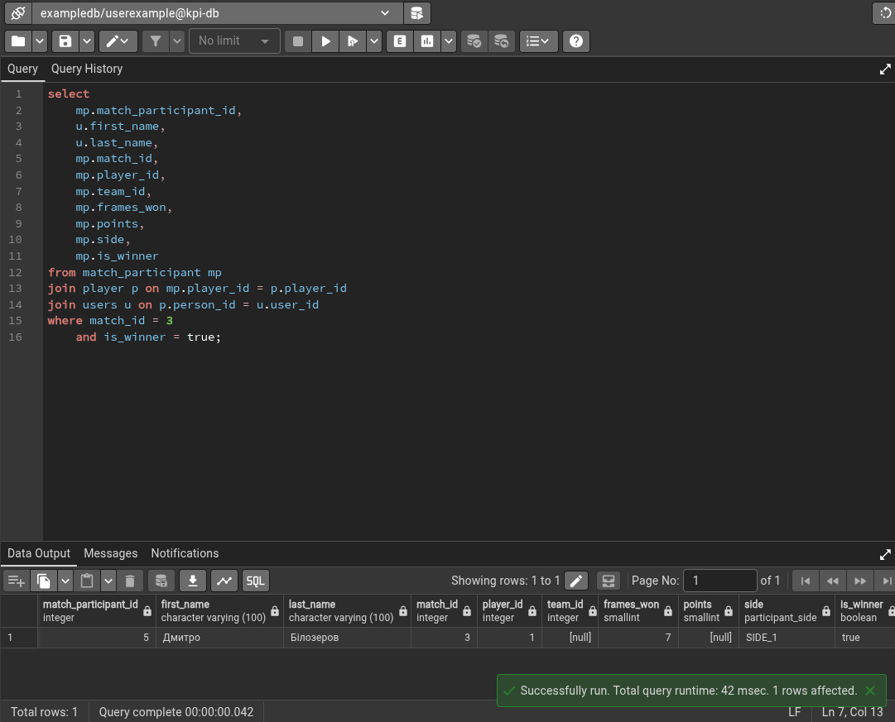
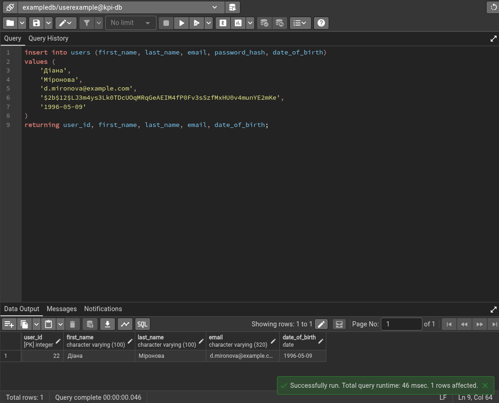
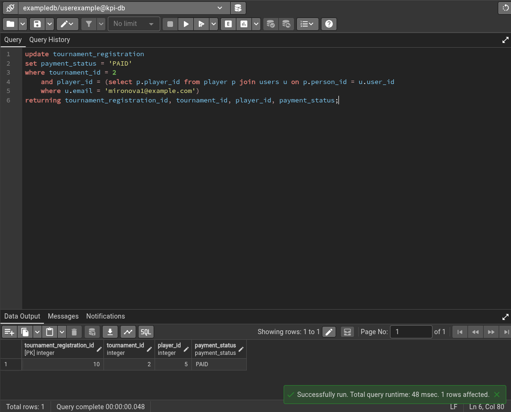
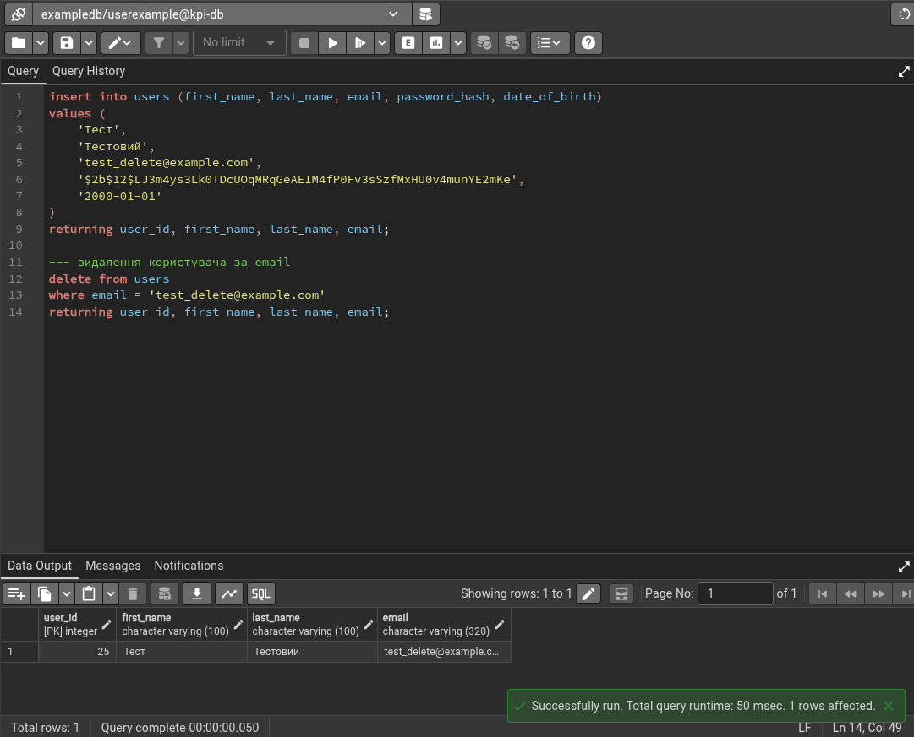

# Звіт з Лабораторної роботи №3

**Дисципліна:** Бази даних  
**Тема:** Маніпулювання даними SQL (OLTP-транзакції та DML)  
**Предметна область:** CRM-система турнірів з більярдного спорту (Billiards Tournament CRM)  
**Студент:** Присяжний С.О., група ІМ-55  
**СУБД:** PostgreSQL 18.x (Docker) | **Клієнт:** pgAdmin 4  

---

## 1. Мета та завдання лабораторної роботи

**Мета роботи:** набуття практичних навичок маніпулювання реляційними даними (SQL DML) у режимі Online Transaction Processing (OLTP) у середовищі PostgreSQL; розробка та верифікація транзакційних запитів для реалізації ключових бізнес-сценаріїв турнірної системи більярдного спорту (створення профілів, реєстрація на турніри, облік оплат, диспетчеризація столів, нарахування рейтингу, скасування замовлень).

**Основні завдання:**
1. **SELECT-запити:** реалізувати оперативні вибірки даних із застосуванням предикатів фільтрації (`WHERE`), обчислюваних інтервалів часу (`INTERVAL`), реляційних з'єднань (`JOIN`), сортування (`ORDER BY`) та агрегатних функцій (`COUNT`).
2. **INSERT-запити:** реалізувати додавання нових рядків до взаємозв'язаних сутностей (`users`, `player`, `tournament_registration`) із використанням підзапитів для збереження цілісності зовнішніх ключів та клаузи `RETURNING` для миттєвого отримання згенерованих ідентифікаторів.
3. **UPDATE-запити:** виконати цільові модифікації станів системи (зміна статусу оплати турніру, зайнятості більярдного столу, динамічне коригування рейтингу гравця) із обов'язковим суворим обмеженням за первинними/зовнішніми ключами.
4. **DELETE-запити:** реалізувати безпечне видалення записів (скасування неоплаченої реєстрації, видалення тестового облікового запису) без порушення посилальної цілісності (`RESTRICT / CASCADE`).
5. **Верифікація в СУБД:** перевірити коректність виконання всіх операцій у середовищі pgAdmin 4 та зафіксувати фактичний вивід запитів.

---

## 2. Опис бізнес-сценаріїв OLTP у системі турнірного більярду

На відміну від аналітичних запитів (OLAP), що оперують великими історичними масивами інформації для побудови звітів, запити OLTP (Online Transaction Processing) моделюють повсякденну діяльність системи: велику кількість коротких транзакцій, які вибірково читають або оновлюють окремі рядки.

У розробленій CRM-системі турнірів з більярдного спорту виділено такі життєві цикли та операційні бізнес-сценарії:
1. **Оперативна диспетчеризація та турнірний моніторинг:**
   - Пошук активних спортсменів з певним статусом та званням (наприклад, Заслужені майстри спорту);
   - Швидке визначення результатів фінальних матчів та їхніх переможців для оновлення турнірної сітки;
   - Перевірка повноти оплати реєстраційних внесків перед жеребкуванням.
2. **Онбординг нового учасника змагань:**
   - Створення базового облікового запису користувача (`users`) з персональними даними та хешем пароля;
   - Створення пов'язаної спортивної картки гравця (`player`) із присвоєнням початкового рейтингу та спортивного розряду;
   - Подання заявки на участь у турнірі (`tournament_registration`) зі статусом очікування оплати (`PENDING`).
3. **Облік фінансів та зміна статусів:**
   - Фіксація банківської транзакції: переведення статусу реєстрації гравця з `PENDING` на `PAID`;
   - Призначення вільного більярдного столу на поточний матч (переведення статусу столу з `AVAILABLE` на `OCCUPIED`);
   - Автоматизоване нарахування балів рейтингу переможцю турнірного матчу (наприклад, +30 очок за тріумф у фіналі).
4. **Керування відмовами та очищення даних:**
   - Скасування несвоєчасно оплаченої реєстрації спортсмена на турнір;
   - Видалення непідтверджених або тестових профілів користувачів.

---

## 3. Детальний опис та виконання SQL-запитів DML

### 3.1. Запити вибірки даних (SELECT)

#### Запит 1.1: Відбір користувачів віком понад 30 років
* **Мета:** отримати список користувачів старшої вікової категорії (наприклад, для формування ветеранських або сеньйорських дивізіонів турніру).
* **Особливості:** використовується функція поточної дати `now()`, інтервальна арифметика дат `INTERVAL '30 years'` та конкатенація імен `concat()`.
```sql
select 
	user_id,
	concat(first_name, ' ', last_name) as full_name,
	email,
	date_of_birth
from users
where date_of_birth < now() - INTERVAL '30 years';
```
* **Очікуваний та фактичний результат:** повертаються користувачі, дата народження яких раніше поточної дати мінус 30 років (зокрема Олександр Паламар 1987 р.н., Євген Сталєв 1979 р.н., Андрій Шевченко 1976 р.н.).

---

#### Запит 1.2: Гравці зі званням ЗМС, відсортовані за рейтингом
* **Мета:** отримати перелік найбільш титулованих гравців звання «Заслужений майстер спорту» для посіву на топ-турнірах.
* **Особливості:** об'єднання таблиці гравців `player` з таблицею користувачів `users`, фільтрація за перелічуваним типом `sports_title = 'HONORED_MASTER_OF_SPORTS'` та сортування `ORDER BY rating DESC`.
```sql
select 
	p.player_id,
	u.first_name,
	u.last_name,
	p.rating,
	p.sports_title
from player p
join users u on p.person_id = u.user_id
where sports_title = 'HONORED_MASTER_OF_SPORTS'
	and rating is not null
order by rating desc;
```
* **Очікуваний та фактичний результат:** повертаються картки ЗМС (Євген Сталєв з рейтингом 2550, Олександр Паламар з рейтингом 2500) у порядку спадання їхнього кваліфікаційного рейтингу.

---

#### Запит 1.3: Визначення переможця фінального матчу (match_id = 3)
* **Мета:** оперативне отримання даних про тріумфатора фінальної зустрічі турніру для офіційного протоколу змагань.
* **Особливості:** багаторівневий `JOIN` між таблицями `match_participant`, `player` та `users`, точкова фільтрація за `match_id = 3` та логічним полем `is_winner = true`.
```sql
select 
	mp.match_participant_id,
	u.first_name,
	u.last_name,
	mp.match_id,
	mp.player_id,
	mp.team_id,
	mp.frames_won,
	mp.points,
	mp.side,
	mp.is_winner
from match_participant mp
join player p on mp.player_id = p.player_id
join users u on p.person_id = u.user_id
where match_id = 3
	and is_winner = true;
```
* **Фактичне виконання в pgAdmin 4:**



* **Аналіз результату:** запит успішно повернув один рядок (`match_participant_id = 5`). Переможцем фіналу є **Дмитро Білозеров** (`player_id = 1`), який виступав на позиції `SIDE_1` та виграв поєдинок з рахунком 7 забитих партій (`frames_won = 7`). Час виконання склав 42 мс.

---

#### Запит 1.4: Кількість оплачених реєстрацій на турнір №1
* **Мета:** моніторинг фінансової готовності та кількості підтверджених учасників на конкретний турнір.
```sql
select count(*)
from tournament_registration
where tournament_id = 1
	and payment_status = 'PAID';
```
* **Очікуваний та фактичний результат:** повертає кількість підтверджених спортсменів з активним статусом оплати `PAID`.

---

### 3.2. Запити додавання даних (INSERT INTO)

#### Запит 2.1: Онбординг нового користувача системи
* **Мета:** створення облікового запису нової спортсменки в системі (багаторазова чемпіонка світу Діана Міронова).
* **Особливості:** передача обов'язкових полів (ім'я, прізвище, унікальний email, хеш пароля bcrypt, дата народження). Використання оператора `RETURNING` для отримання автоматично згенерованого сурогатного первинного ключа `user_id`.
```sql
insert into users (first_name, last_name, email, password_hash, date_of_birth)
values (
	'Діана',
	'Міронова',
	'd.mironova@example.com',
	'$2b$12$LJ3m4ys3Lk0TDcUOqMRqGeAEIM4fP0Fv3sSzfMxHU0v4munYE2mKe',
	'1996-05-09'
)
returning user_id, first_name, last_name, email, date_of_birth;
```
* **Фактичне виконання в pgAdmin 4:**



* **Аналіз результату:** запит успішно створив новий запис та повернув `user_id = 22`. Усі декларативні обмеження таблиці `users` (зокрема унікальність email та валідація формату) були успішно дотримані.

---

#### Запит 2.2: Оформлення спортивної картки гравця
* **Мета:** прив'язка спортивного профілю зі званням ЗМС та стартовим рейтингом до новоствореного користувача.
* **Особливості:** динамічне отримання `person_id` через вкладений підзапит за електронною адресою, що гарантує цілісність без необхідності ручного введення згенерованого `user_id`.
```sql
insert into player (person_id, rating, sports_title)
values (
	(select user_id from users where email = 'd.mironova@example.com'),
	2450,
	'HONORED_MASTER_OF_SPORTS'
)
returning player_id, person_id, rating, sports_title;
```
* **Очікуваний та фактичний результат:** згенеровано картку гравця з розрядом ЗМС та рейтингом 2450, зв'язану з `user_id = 22`.

---

#### Запит 2.3: Подання заявки на відкритий турнір №2
* **Мета:** реєстрація спортсменки на турнір зі статусом очікування оплати реєстраційного внеску.
* **Особливості:** використовується складений підзапит зі з'єднанням `player` та `users` для знаходження відповідного `player_id`. Статус встановлюється як `PENDING`.
```sql
insert into tournament_registration (tournament_id, player_id, team_id, payment_status, prize_won)
values (
	2,
	(select p.player_id from player p join users u on p.person_id = u.user_id where u.email = 'd.mironova@example.com'),
	null,
	'PENDING',
	0.00
)
returning tournament_registration_id, tournament_id, player_id, payment_status;
```
* **Очікуваний та фактичний результат:** створено запис реєстрації з початковим статусом `payment_status = 'PENDING'`.

---

### 3.3. Запити оновлення даних (UPDATE)

#### Запит 3.1: Підтвердження оплати реєстраційного внеску (PENDING $\rightarrow$ PAID)
* **Мета:** зміна статусу реєстрації гравця після фактичного надходження коштів на рахунок організатора.
* **Особливості:** безпечне оновлення з точною комбінацією умов `tournament_id = 2` та підзапиту за унікальним email гравця. Використання `RETURNING` для аудиту оновленого статусу.
```sql
update tournament_registration
set payment_status = 'PAID'
where tournament_id = 2
	and player_id = (select p.player_id from player p join users u on p.person_id = u.user_id where u.email = 'mironova1@example.com')
returning tournament_registration_id, tournament_id, player_id, payment_status;
```
* **Фактичне виконання в pgAdmin 4:**



* **Аналіз результату:** рядок реєстрації (`tournament_registration_id = 10`, `player_id = 5`) успішно переведено у статус `PAID`. Час виконання склав 48 мс, 1 рядок модифіковано.

---

#### Запит 3.2: Диспетчеризація столу (призначення на матч)
* **Мета:** оперативна зміна статусу більярдного столу на зайнятий (`OCCUPIED`) під час запуску матчу.
```sql
update billiard_table
set table_status = 'OCCUPIED'
where table_id = 1
returning table_id, table_number, table_status;
```
* **Очікуваний та фактичний результат:** стіл №1 переходить у статус `OCCUPIED`.

---

#### Запит 3.3: Нарахування рейтингових очок переможцю турніру
* **Мета:** заохочення переможця змагань (+30 очок до рейтингу Дмитра Білозерова за перемогу у фіналі).
* **Особливості:** використання поточного значення стовпця в арифметичному виразі `set rating = rating + 30`.
```sql
update player
set rating = rating + 30
where player_id = 1
returning player_id, rating;
```
* **Очікуваний та фактичний результат:** рейтинг гравця `player_id = 1` оновлено з 2600 до 2630.

---

### 3.4. Запити видалення даних (DELETE)

#### Запит 4.1: Скасування неоплаченої реєстрації гравця
* **Мета:** звільнення слоту в турнірній сітці у разі несплати внеску до закінчення терміну дедлайну.
* **Особливості:** видалення конкретного запису за складною умовою (`tournament_id = 2 AND player_id = 2 AND payment_status = 'PENDING'`), що виключає ризик помилкового видалення підтверджених заявок.
```sql
delete from tournament_registration
where tournament_id = 2
	and player_id = 2
	and payment_status = 'PENDING'
returning tournament_registration_id, tournament_id, player_id, payment_status;
```
* **Очікуваний та фактичний результат:** відповідний запис реєстрації видаляється з бази даних, слоти стають доступними іншим учасникам.

---

#### Запит 4.2: Створення та видалення тимчасового користувача
* **Мета:** тестування повного циклу операцій додавання та безпечного видалення запису користувача без каскадних побічних ефектів.
* **Особливості:** виконання послідовності `INSERT INTO ... RETURNING` з подальшим вибірковим `DELETE FROM users WHERE email = 'test_delete@example.com' RETURNING ...`.
```sql
insert into users (first_name, last_name, email, password_hash, date_of_birth)
values (
	'Тест',
	'Тестовий',
	'test_delete@example.com',
	'$2b$12$LJ3m4ys3Lk0TDcUOqMRqGeAEIM4fP0Fv3sSzfMxHU0v4munYE2mKe',
	'2000-01-01'
)
returning user_id, first_name, last_name, email;

--- видалення користувача за email
delete from users
where email = 'test_delete@example.com'
returning user_id, first_name, last_name, email;
```
* **Фактичне виконання в pgAdmin 4:**



* **Аналіз результату:** тестовий користувач був успішно згенерований з `user_id = 25`, а наступною інструкцією `DELETE` миттєво видалений за унікальним `email`. Клауза `RETURNING` повернула видалені атрибути рядка для перевірки факту успішного виконання.

---

## 4. Аналіз забезпечення цілісності, оптимізації та безпеки

1. **Безпека операцій оновлення та видалення:**
   Усі операції `UPDATE` та `DELETE` містять строго детерміновані предикати `WHERE`. Використання точкових фільтрів за сурогатними ідентифікаторами або унікальними полями (`email`, `tournament_id + player_id`) виключає випадкову масову модифікацію даних таблиці.
2. **Переваги конструкції `RETURNING` у PostgreSQL:**
   У традиційних СУБД для підтвердження результатів DML-запиту клієнт змушений виконувати додатковий запит `SELECT` після кожної модифікації, що подвоює мережевий оверхед (Network Round-Trip Time). Використання `RETURNING` у PostgreSQL повертає модифіковані кортежі атомарно в рамках тієї ж транзакції, що є фундаментальним для високонавантажених OLTP-систем.
3. **Використання реляційних підзапитів проти ручного введення ключів:**
   У запитах реєстрації та оформлення карток гравців значення зовнішніх ключів `person_id` та `player_id` витягуються через підзапити за унікальними бізнес-ідентифікаторами (`email`). Це захищає клієнтський код від розсинхронізації у разі динамічної генерації ключів послідовностями (`IDENTITY`).
4. **Контроль посилальної цілісності (Foreign Keys):**
   Реляційна схема запобігає неконсистентному видаленню: якщо користувач є капітаном команди або учасником зіграного матчу, зовнішній ключ `ON DELETE RESTRICT` блокує несанкціоноване видалення батьківського запису, забезпечуючи надійність фінансового та спортивного аудиту.

---

## 5. Зведений SQL-файл запитів (`queries.sql`)

Повний текст розробленого скрипту збережено у файлі [queries.sql](queries.sql) у корені поточної лабораторної роботи. Скрипт логічно структурований коментарями та готовий до повторного виконання в будь-якому середовищі під керуванням PostgreSQL 18.

---

## 6. Висновки

У ході виконання Лабораторної роботи №3:
1. Засвоєно практичні аспекти проектування та виконання запитів мови SQL DML у режимі оперативної обробки транзакцій (OLTP) для більярдної CRM-системи.
2. Реалізовано та протестовано повний життєвий цикл сутностей: вибірку (`SELECT`), додавання нових профілів (`INSERT`), транзакційну модифікацію статусів та очок (`UPDATE`) і безпечне скасування записів (`DELETE`).
3. Доведено високу ефективність синтаксичних розширень PostgreSQL, зокрема конструкції `RETURNING` для оптимізації клієнт-серверної взаємодії та відстеження згенерованих сурогатних ключів.
4. Усі запити успішно верифіковано в середовищі pgAdmin 4; результати підтвердили коректність закладених обмежень цілісності та надійність створеної в Лабораторній роботі №2 реляційної схеми.
