# Лабораторна робота №3
# EasyRail (OLTP)

## Мета роботи
Ознайомлення з основними операторами маніпулювання даними в PostgreSQL (`SELECT`, `INSERT`, `UPDATE`, `DELETE`) та використанням транзакцій (`BEGIN`, `COMMIT`, `ROLLBACK`) для безпечної роботи з даними.

SQL-скрипт: [queries.sql](queries.sql)

---

## Влад

### SELECT
Пошук активних запланованих рейсів між станціями «Ковель» та «Київ-Пасажирський» на `2026-11-01` з підрахунком загальної кількості місць за типом вагона та кількості зайнятих місць (оплачених або з активним утриманням).

```sql
WITH matched_trips AS MATERIALIZED (
    SELECT
        t.trip_id,
        r.route_id,
        r.route_number,
        r.route_name,
        r.train_type,
        r.base_segment_price,
        from_s.station_name AS from_station,
        to_s.station_name AS to_station,
        from_st.stop_order AS from_stop_order,
        to_st.stop_order AS to_stop_order,
        t.departure_time + make_interval(mins => from_st.departure_offset_minutes) AS segment_departure,
        t.departure_time + make_interval(mins => to_st.arrival_offset_minutes) AS segment_arrival
    FROM routes r
    INNER JOIN trips t ON t.route_id = r.route_id
    INNER JOIN stops from_st ON from_st.route_id = r.route_id
    INNER JOIN stations from_s ON from_s.station_id = from_st.station_id
    INNER JOIN stops to_st ON to_st.route_id = r.route_id
    INNER JOIN stations to_s ON to_s.station_id = to_st.station_id
    WHERE r.route_status = 'ACTIVE'
      AND t.trip_status = 'SCHEDULED'
      AND from_s.station_name = 'Ковель'
      AND to_s.station_name = 'Київ-Пасажирський'
      AND from_st.stop_order < to_st.stop_order
      AND (t.departure_time + make_interval(mins => from_st.departure_offset_minutes))::date = '2026-11-01'
),

route_carriages AS (
    SELECT 
        c.route_id,
        c_type.carriage_type_id,
        c_type.carriage_type,
        c_type.carriage_type_price_multiplier,
        COUNT(s_type.seat_id) AS total_seats
    FROM (SELECT DISTINCT route_id FROM matched_trips) r
    INNER JOIN carriages c ON c.route_id = r.route_id
    INNER JOIN carriage_type_list c_type ON c_type.carriage_type_id = c.carriage_type_id
    INNER JOIN seat_templates_list s_type ON s_type.carriage_type_id = c_type.carriage_type_id
    GROUP BY
        c.route_id,
        c_type.carriage_type_id,
        c_type.carriage_type,
        c_type.carriage_type_price_multiplier
),

count_occupied_seats AS (
    SELECT
        COUNT(DISTINCT (ticket.carriage_id, ticket.seat_id)) AS booked_seats_count,
        ctl.carriage_type,
        trip.trip_id
    FROM matched_trips trip
    INNER JOIN ticket_segment ticket ON ticket.trip_id = trip.trip_id
    INNER JOIN carriages c ON c.carriage_id = ticket.carriage_id
    INNER JOIN carriage_type_list ctl ON ctl.carriage_type_id = c.carriage_type_id
    WHERE trip.to_stop_order > ticket.from_stop_order
      AND trip.from_stop_order < ticket.to_stop_order
      AND (ticket.ticket_status = 'PAID' 
           OR (ticket.ticket_status = 'HELD' AND ticket.hold_expires_at > NOW()))
    GROUP BY ctl.carriage_type, trip.trip_id
)

SELECT 
    trip.trip_id,
    trip.route_number,
    trip.route_name,
    trip.train_type,
    trip.base_segment_price,
    trip.from_station,
    trip.to_station,
    trip.segment_departure,
    trip.segment_arrival,
    trip.from_stop_order,
    trip.to_stop_order,
    route.carriage_type_id,
    route.carriage_type,
    route.carriage_type_price_multiplier,
    route.total_seats,
    COALESCE(seat.booked_seats_count, 0) AS booked_seats_count
FROM matched_trips trip
INNER JOIN route_carriages route ON route.route_id = trip.route_id
LEFT JOIN count_occupied_seats seat 
    ON seat.trip_id = trip.trip_id 
    AND seat.carriage_type = route.carriage_type 
ORDER BY trip.segment_departure ASC;
```

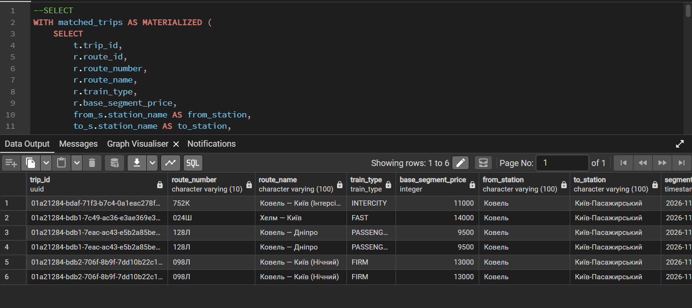

### INSERT
Додавання нового тестового пасажира (`Тимчасовий Тест`) до профілю користувача `vlad_kov` у межах транзакції.

```sql
BEGIN;
INSERT INTO passengers (user_id, passenger_lastname, passenger_name)
VALUES (
    (SELECT user_id FROM users WHERE user_name = 'vlad_kov'),
    'Тимчасовий',
    'Тест'
);
ROLLBACK;
COMMIT;
```

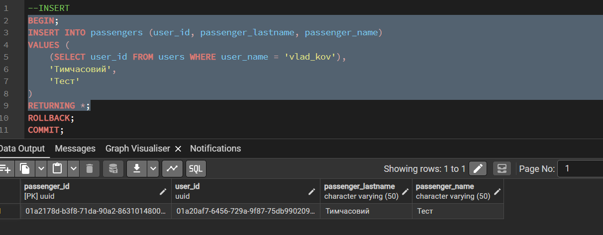

### UPDATE
Оновлення статусу утриманого квитка (`HELD`) на оплачений (`PAID`) із фіксацією часу оплати, ID транзакції та посилання на PDF у межах транзакції, підтвердження через `COMMIT` та перевірка змін через `SELECT`.

```sql
BEGIN;

UPDATE ticket_segment
SET 
    ticket_status = 'PAID', 
    paid_at = NOW(),
    payment_transaction_id = 'txn_mono_566_01',
    pdf_url = 'https://s3.easyrail.ua/tickets/mono_566_01.pdf'
WHERE ticket_id = '01a20af7-64b5-7c2a-bfb4-7fece27f2399' 
  AND user_id = '01a20af7-6456-729a-9f87-75db9902091c'
  AND hold_expires_at > NOW()
  AND ticket_status = 'HELD'
RETURNING
    ticket_id,
    ticket_status,
    paid_at,
    payment_transaction_id,
    pdf_url;

ROLLBACK;
COMMIT;

SELECT * FROM ticket_segment 
WHERE user_id = (SELECT user_id FROM users WHERE user_name = 'vlad_kov')
  AND trip_id = '01a20af7-6489-7b7d-92ea-c36ed5d9124e' 
  AND passenger_id = '01a20af7-6464-7152-8fe8-ba2f010ac2d8';
```

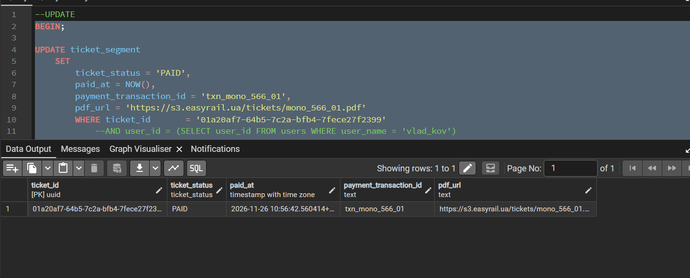
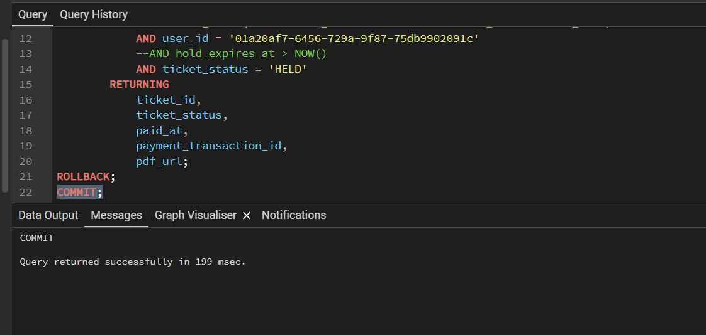
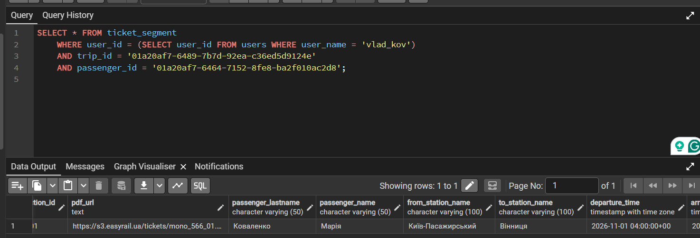

### DELETE
Видалення тестового пасажира (`Тимчасовий Тест`) користувача `vlad_kov` у межах транзакції з поверненням видаленого запису.

```sql
BEGIN;
DELETE FROM passengers p
WHERE user_id = (SELECT user_id FROM users WHERE user_name = 'vlad_kov')
  AND passenger_lastname = 'Тимчасовий'
  AND passenger_name = 'Тест'
RETURNING *;
ROLLBACK;
COMMIT;
```

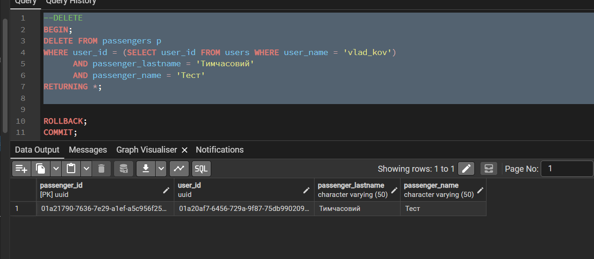

---

## Діма

### SELECT
Показ вільних місць у 1-му вагоні поїзда `705К` на відрізку «Вінниця» — «Львів» з розрахунком вартості поїздки та виключенням місць, які перетинаються з уже оплаченими або утриманими квитками (`NOT EXISTS`).

```sql
SELECT
    stl.seat_id,
    stl.seat_number,
    stl.tier_type,
    stl.is_side,
    ((s_to.stop_order - s_from.stop_order) * r.base_segment_price * ctl.carriage_type_price_multiplier / 100) AS price
FROM trips t
JOIN routes r ON r.route_id = t.route_id
JOIN carriages c ON c.route_id = r.route_id
JOIN carriage_type_list ctl ON ctl.carriage_type_id = c.carriage_type_id
JOIN seat_templates_list stl ON stl.carriage_type_id = ctl.carriage_type_id
JOIN stops s_from ON s_from.route_id = r.route_id
JOIN stations st_from ON st_from.station_id = s_from.station_id
JOIN stops s_to ON s_to.route_id = r.route_id
JOIN stations st_to ON st_to.station_id = s_to.station_id
WHERE r.route_number = '705К'
  AND t.departure_time = '2026-11-01 06:00:00+02'
  AND c.carriage_number = 1
  AND st_from.station_name = 'Вінниця'
  AND st_to.station_name = 'Львів'
  AND s_from.stop_order < s_to.stop_order
  AND t.trip_status = 'SCHEDULED'
  AND r.route_status = 'ACTIVE'
  AND NOT EXISTS (
      SELECT 1
      FROM ticket_segment ts
      WHERE ts.trip_id = t.trip_id
        AND ts.carriage_id = c.carriage_id
        AND ts.seat_id = stl.seat_id
        AND ts.from_stop_order < s_to.stop_order
        AND ts.to_stop_order > s_from.stop_order
        AND (ts.ticket_status = 'PAID' OR ts.ticket_status = 'HELD')
  )
ORDER BY stl.seat_number;
```

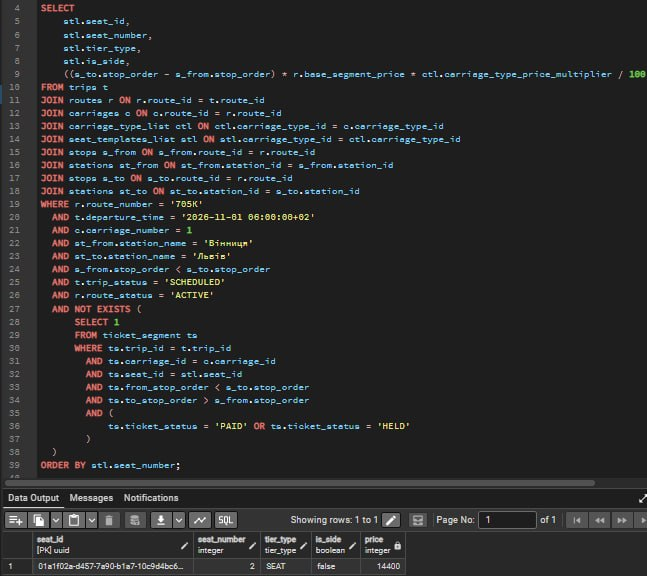

### INSERT
Додавання нової станції «Ігнатпіль-Кар’єр» (місто «Млини») із захистом від дублювання (`ON CONFLICT DO NOTHING`) та перевіркою через `SELECT`.

```sql
INSERT INTO stations (station_name, city) VALUES
    ('Ігнатпіль-Кар’єр', 'Млини')
ON CONFLICT (station_name, city) DO NOTHING;

SELECT * FROM stations s
WHERE s.city = 'Млини';
```

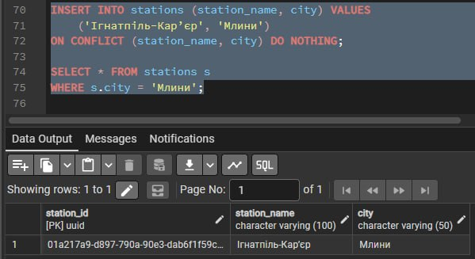

### UPDATE
Скасування активного бронювання (`HELD`) для пасажира «Марія» користувача `vlad@example.com` — зміна статусу на `RETURNED` із записом часу скасування.

```sql
UPDATE ticket_segment ts
SET ticket_status = 'RETURNED',
    cancelled_at = NOW(),
    hold_expires_at = NOW()
FROM users u, trips t
WHERE ts.user_id = u.user_id
  AND ts.trip_id = t.trip_id
  AND u.email = 'vlad@example.com'
  AND ts.passenger_name = 'Марія'
  AND ts.ticket_status = 'HELD'
  AND ts.boarded_at IS NULL
  AND t.trip_status = 'SCHEDULED'
RETURNING ts.ticket_id, ts.ticket_status, ts.cancelled_at;
```

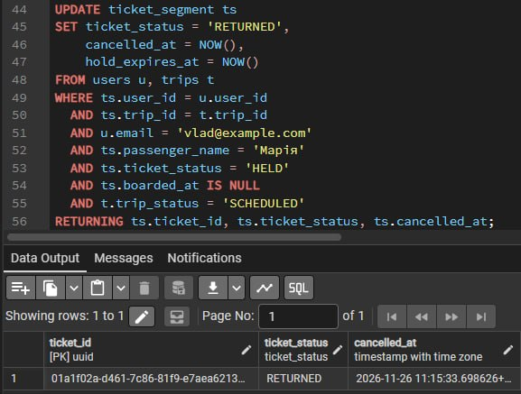

### DELETE
Видалення користувача `petro.cond@easyrail.com` за його `email` та `user_id` з поверненням даних видаленого запису та перевіркою через `SELECT`.

```sql
DELETE FROM users u
WHERE u.email = 'petro.cond@easyrail.com'
  AND u.user_id = '01a1f02a-d44b-7816-8222-c12b4304f01f'
RETURNING u.user_id, u.user_name, u.email;

SELECT * FROM users u
WHERE u.email = 'petro.cond@easyrail.com';
```

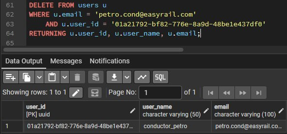

---

## Хашім

### SELECT
Пошук пасажирів користувача `vlad@example.com`, прізвище яких починається на «Ковал» (`ILIKE`), із сортуванням та пагінацією (`LIMIT 10 OFFSET 0`).

```sql
SELECT p.passenger_id, p.passenger_lastname, p.passenger_name, u.email
FROM passengers p
INNER JOIN users u ON p.user_id = u.user_id
WHERE u.email = 'vlad@example.com' AND p.passenger_lastname ILIKE 'Ковал%'
ORDER BY p.passenger_lastname, p.passenger_name, p.passenger_id
LIMIT 10 OFFSET 0;
```

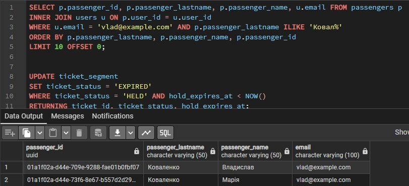

### INSERT
Додавання нового неактивного маршруту `754П` («Київ — Житомир») з `ON CONFLICT DO NOTHING` та перевіркою доданого рядка через `SELECT`.

```sql
INSERT INTO routes (route_name, base_segment_price, route_number, route_status, schedule_rule, train_type) VALUES
    ('Київ — Житомир', 13500, '754П', 'INACTIVE', 'WEEKDAYS', 'INTERCITY')
ON CONFLICT (route_number) DO NOTHING;

SELECT * FROM routes
WHERE route_number = '754П';
```

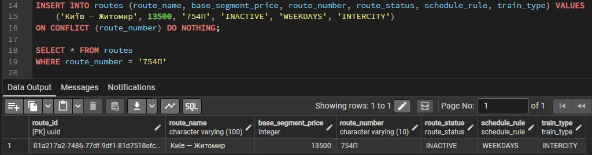

### UPDATE
Оновлення статусу всіх прострочених бронювань (`ticket_status = 'HELD'` та `hold_expires_at < NOW()`) на `EXPIRED` з поверненням оновлених квитків.

```sql
UPDATE ticket_segment
SET ticket_status = 'EXPIRED'
WHERE ticket_status = 'HELD' AND hold_expires_at < NOW()
RETURNING ticket_id, ticket_status, hold_expires_at;
```

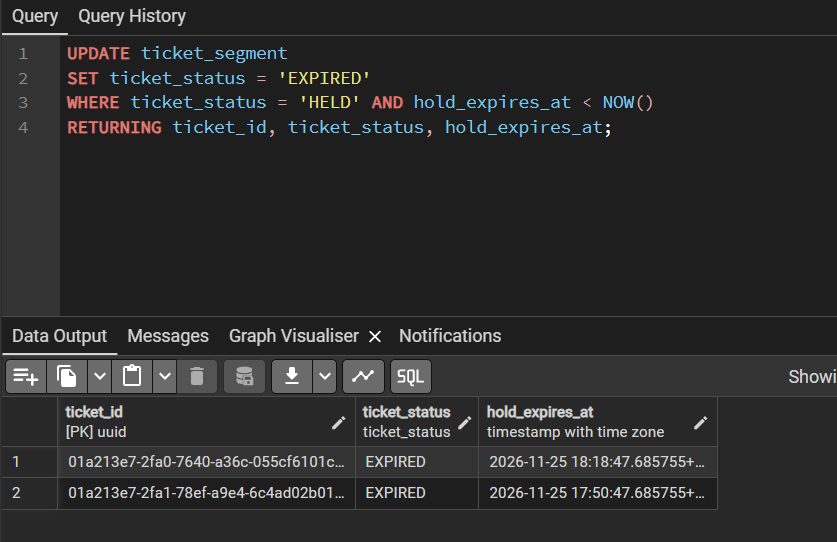

### DELETE
Безпечне видалення неактивних маршрутів (`INACTIVE`), які не мають жодних пов'язаних рейсів у `trips` та квитків у `ticket_segment`.

```sql
DELETE FROM routes
WHERE route_status = 'INACTIVE' AND NOT EXISTS (
    SELECT 1 FROM trips WHERE trips.route_id = routes.route_id
) AND NOT EXISTS (
    SELECT 1 FROM ticket_segment ts 
    INNER JOIN carriages c ON c.carriage_id = ts.carriage_id 
    WHERE c.route_id = routes.route_id
)
RETURNING route_id, route_number, route_name;
```

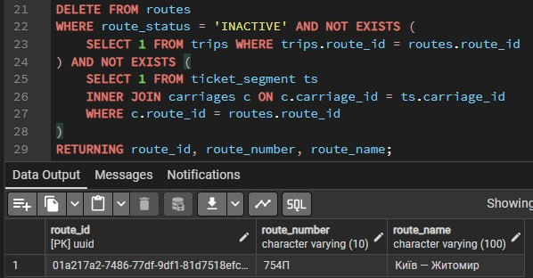
