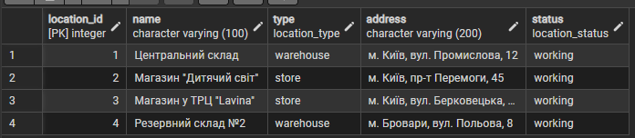
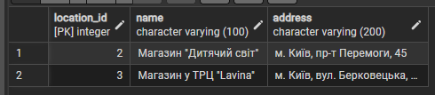
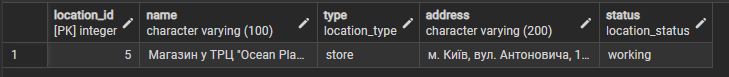
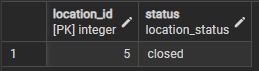
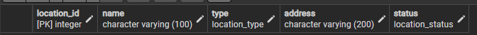

# <center> Лабораторна робота №3 
### <center> Маніпулювання даними SQL (OLTP) </center>

### Завдання:
Протестувати базу даних, яку створили в лабораторних роботах 1–2, виконуючи запити в стилі транзакцій у PostgreSQL (за допомогою pgAdmin). Ми зосереджуємося на запитах OLTP (онлайн-обробка транзакцій) - великій кількості коротких транзакцій, які отримують або оновлюють окремі записи. На практиці це означає написання ручних SQL-інструкцій для вибору даних та вставки, оновлення або видалення рядків. Це імітує реальні операції (наприклад, отримання реєстрацій студентів на курси або обробку замовлень електронної комерції) та перевіряє, чи ваша схема та дані поводяться належним чином.

### Цілі
* Написати запити SELECT для отримання даних (включаючи фільтрацію за допомогою WHERE та вибір певних стовпців).
* Практикувати використання операторів INSERT для додавання нових рядків до таблиць.
* Практикувати використання оператора UPDATE для зміни існуючих рядків (використовуючи SET та WHERE).
* Практикувати використання операторів DELETE для безпечного видалення рядків (за допомогою WHERE).
* Вивчити основні операції маніпулювання даними (DML) у PostgreSQL та спостерігати за їхнім впливом.

---
## Опис SQL - запитів

### 1) 
```sql 
SELECT * FROM location;
```

**Мета:** Перегляд всіх записів в таблиці на самому початку щоб підтвердити факт її заповненості 

**Пояснення:** * тут означає вибір всіх колонок кожного запису

**Результат/очікування:** очікувались якісь дані в таблиці, оскільки, я не пам'ятаю, що саме там має бути і я отримав якісь дані в таблиці  



### 2)
```sql
SELECT location_id, name, address 
FROM location 
WHERE type = 'store' AND status = 'working';
````

**Мета:** Отримати id, назву та адресу працюючих магазинів

**Пояснення:** WHERE додає перевірку завдяки чому ми отримуємо лише записи з типом магазин, а AND дозволяє додати ще одну перевірку тому ці магазини також мають бути працюючими

**Результат/очікування:** оскільки я вже бачив як виглядає таблиця після попереднього запиту і знав, що я має отримати то як і очікувалось я отримав 2 записи з відповідними колонками


### 3)

```sql
INSERT INTO location (name, type, address, status) 
VALUES ('Магазин у ТРЦ "Ocean Plaza"', 'store', 'м. Київ, вул. Антоновича, 176', 'working');

SELECT * FROM location WHERE name LIKE '%Ocean Plaza%';
```

**Мета:** додати до таблиці новий запис і вивести його обравши його по назві

**Пояснення:** Вставка в таблицю location, нового поля зі значеннями переліченими в VALUES, причому id тут не вказується оскільки він інкрементний і СУБД створить його самостійно

Далі йде SELECT який обирає всі записи де ім'я LIKE (оператор який дозволяє пошук строк по шаблону) %Ocean Plaza%, % - з 2 сторін тут означає, що як зліва так і справа від указаної строки може бути будь-яка послідовність символів

**Результат/очікування:** як і очікувалося було отримано один запис який було попередньо додано в цьому запиті



### 4)

```sql
UPDATE location 
SET status = 'closed' 
WHERE name LIKE '%Ocean Plaza%';

SELECT location_id, status FROM location WHERE name LIKE '%Ocean Plaza%';
```
**Мета:** змінити колонку статус останнього доданого (в цьому запиті) запису

**Пояснення:** через UPDATE указуємо таблицю для оновлення а через SET вказуємо значення для поля status, змінюючи лише ті записи де ім'я отримуємо так як і раніше

**Результат/очікування:**очікувалося і було отримано status та id запису який до цього було додано через INSERT, при цьому поле status мало набути значення closed



### 5)

```sql
SELECT * FROM location 
WHERE name LIKE '%Ocean Plaza%' AND status = 'closed';

DELETE FROM location 
WHERE name LIKE '%Ocean Plaza%' AND status = 'closed';

SELECT * FROM location WHERE name LIKE '%Ocean Plaza%';
```
**Мета:** видалити новододаний запис з таблиці

**Пояснення:** для безпеки видалення спочатку створюємо запит з SELECT і відповідними умовами WHERE, щоб запевнитися в тому що ми не видалимо зайвих записів з таблиці, далі запускаємо цей жа зпит вже з DELETE замість SELECT, також треба відмітити, що ми знову шукаємо останній доданий запис по імені, як і раніше але в цей раз для перестрахування також було додано перевірку статусу який було змінено до цього через UPDATE, в кінці отримуємо наш запис по імені

**Результат/очікування:**очікувалося нічого не отримати і ми нічого не отримали



