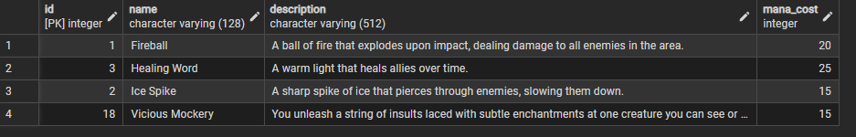
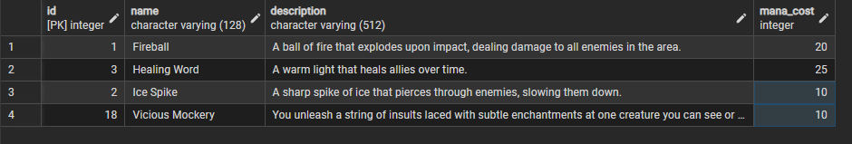

# Laba 3

## Мета: Додати новий чарунок та змінити ціну мани всіх чаруноків з 15 на 10. Видалити чарунок із назвою 'Ice Spike'

## Очікуваний результат: В таблиці з'явився новий чарунок 'Vicious Mockery'. Всі чаруноки з ціною 15 стали 10. Зник чарунок 'Ice Spike'

### Додати чарунок 'Vicious Mockery' з ціною 15

```sql
insert into spell (name, description, mana_cost) values
  ('Vicious Mockery', 'You unleash a string of insults laced with subtle enchantments at one creature you can see or hear', 15);

select * from spell;
```



### Всі чарунки з ціною 15 стали коштувати 10 мани

```sql
update spell 
set mana_cost = 10
where (mana_cost = 15);

select * from spell;
```



### Видалення чарунку 'Ice Spike'

```sql
delete from spell where (name = 'Ice Spike'); -- failes becouse some character has 'Ice Spike' spell prepared 

select * from spell;
```

 

```sql
delete from character_spell 
where spell_id = (select id from spell where name = 'Ice Spike'); -- delete all 'Ice Spike' spell id referenced from character_spell table before deleting the spell itself

delete from spell where (name = 'Ice Spike'); -- works fine now

select * from spell;
```


