# Лабораторна робота №3

## SELECT

Отримання списку турнірів зі статусом 'planned' або 'happeninng':
```SQL
SELECT tournament_id, tournament_name, prize, start_date, status FROM tournament
WHERE status IN ('planned', 'happeninng') ORDER BY start_date ASC;
```
**Очікуваний результат:** таблиця турнірів лише зі статусом `planned` або `happeninng`, відсортована за датою початку від найранішої до найпізнішої.

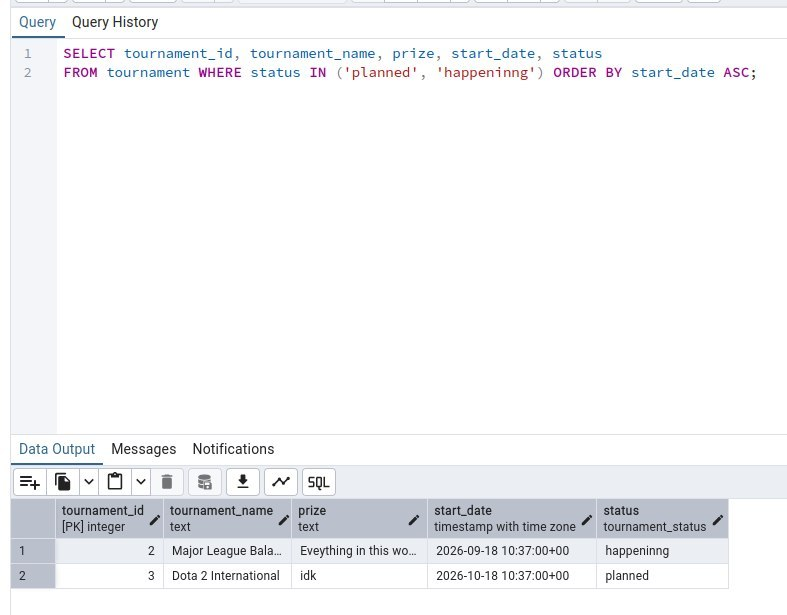

Пошук капітанів команд, які зараз активні:
```SQL
SELECT team_player_id, player_id, game_team_id, team_role, join_date FROM team_player
WHERE team_role = 'Captain' AND leave_date IS NULL;
```
**Очікуваний результат:** список гравців із роллю `Captain`, які ще не залишили команду.

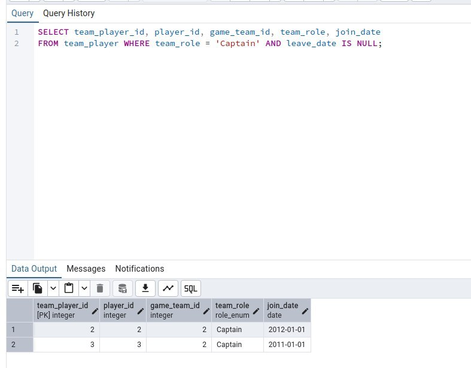

Отримання списку завершених матчів:
```SQL
SELECT game_match_id, tournament_id, match_date, status FROM game_match
WHERE status = 'finished';
```
**Очікуваний результат:** усі матчі зі статусом `finished` із датою та турніром, до якого вони належать.

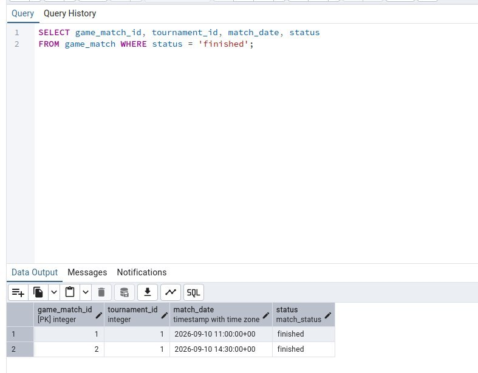


## INSERT

Додавання нового гравця до бази даних:
```SQL
INSERT INTO player (nickname, first_name, last_name, country, date_of_birth)
VALUES ('b1t', 'Valerii', 'Vakhovskyi', 'Ukraine', '2003-01-05');
SELECT * FROM player WHERE nickname = 'b1t';
```
**Очікуваний результат:** повідомлення про успішне додавання 1 рядка, наступний `SELECT` повертає один запис гравця `b1t` із введеними даними та автоматично згенерованим id.

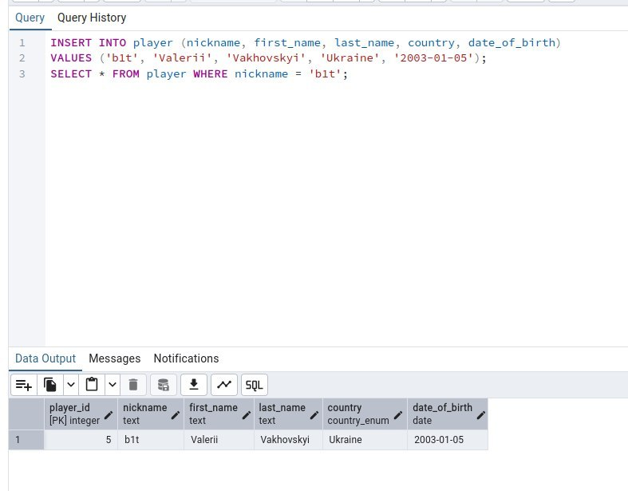

Додавання нового турніру:
```SQL
INSERT INTO tournament (game_id, orginizer_id, prize, tournament_name, start_date, status)
VALUES (1, 1, '$1,000,000', 'BLAST Premier World Final 2026', '2026-12-15 10:00:00+02', 'planned');
SELECT * FROM tournament WHERE tournament_name LIKE 'BLAST Premier%';
```
**Очікуваний результат:** додано 1 рядок, `SELECT` показує новий турнір зі статусом `planned`, призом `$1,000,000` та датою початку 15.12.2026.

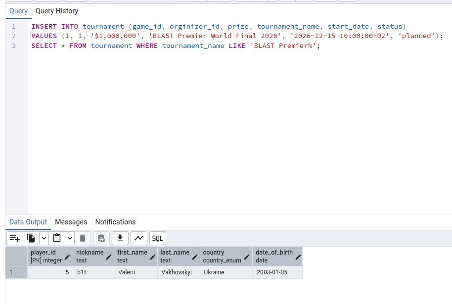


## UPDATE

Фіксація виходу гравця зі складу (заповнення дати закінчення контракту/участі):
```SQL
SELECT * FROM team_player
WHERE player_id = 1 AND leave_date IS NULL;
UPDATE team_player
SET leave_date = CURRENT_DATE
WHERE player_id = 1 AND leave_date IS NULL;
```
**Очікуваний результат:** перший `SELECT` показує активний запис гравця з `leave_date = NULL`, після `UPDATE` оновлюється рядки, і в `leave_date` з'являється поточна дата.

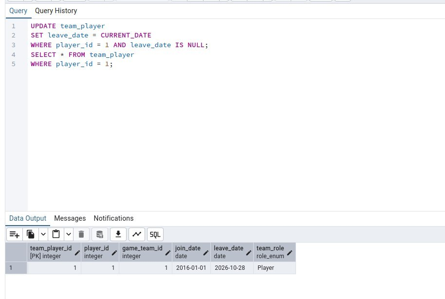

Завершення турніру та фіксація переможця (End tournament):
```SQL
UPDATE tournament SET winner_id = 1, status = 'done' WHERE tournament_id = 2;
SELECT * FROM tournament WHERE tournament_id = 2
```
**Очікуваний результат:** оновлено 1 рядок; `SELECT` показує турнір №2 зі статусом `done` та заповненим `winner_id = 1`.

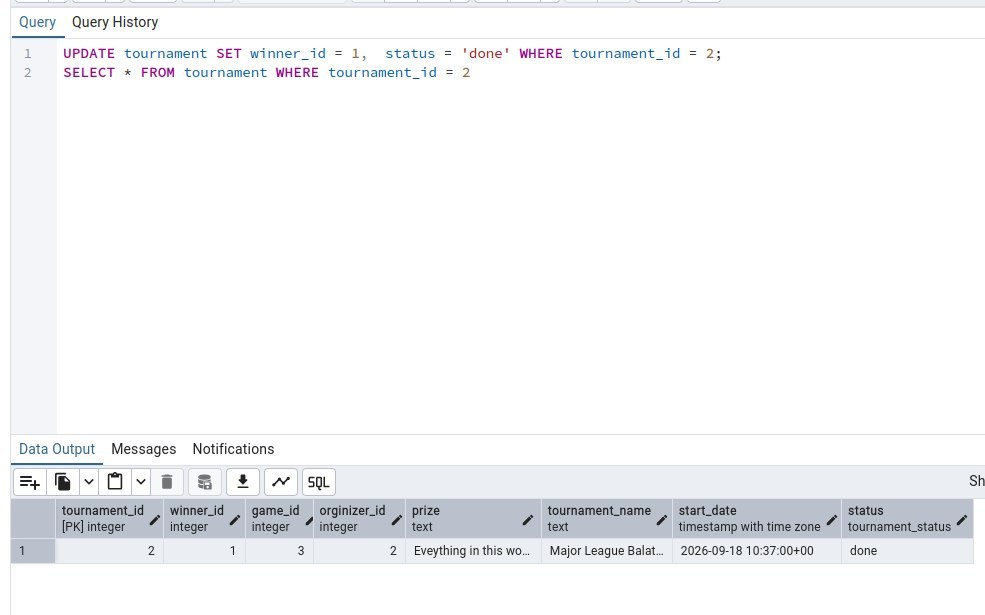


## DELETE

Перевірка запису перед видаленням:
```SQL
SELECT * FROM game_match
WHERE game_match_id = 4 AND status = 'planned';
```
**Очікуваний результат:** один рядок — запланований матч №4, який буде видалено.

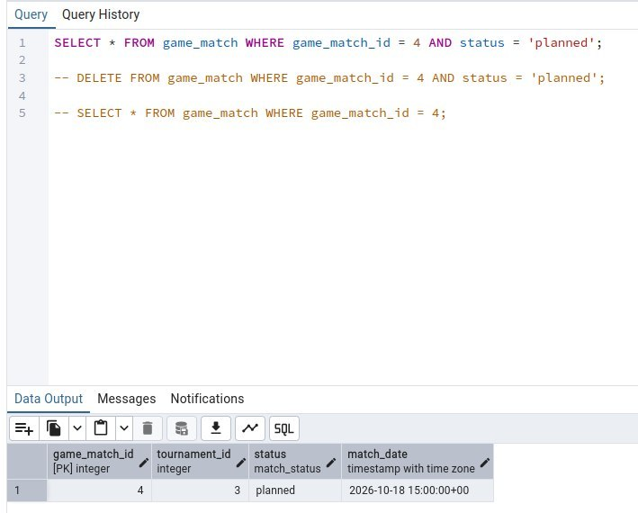

Видалення запису та перевірка, що запис видалено:
```SQL
DELETE FROM game_match
WHERE game_match_id = 4 AND status = 'planned';
SELECT * FROM game_match
WHERE game_match_id = 4;
```
**Очікуваний результат:** видалено 1 рядок, наступний `SELECT` повертає порожню таблицю.

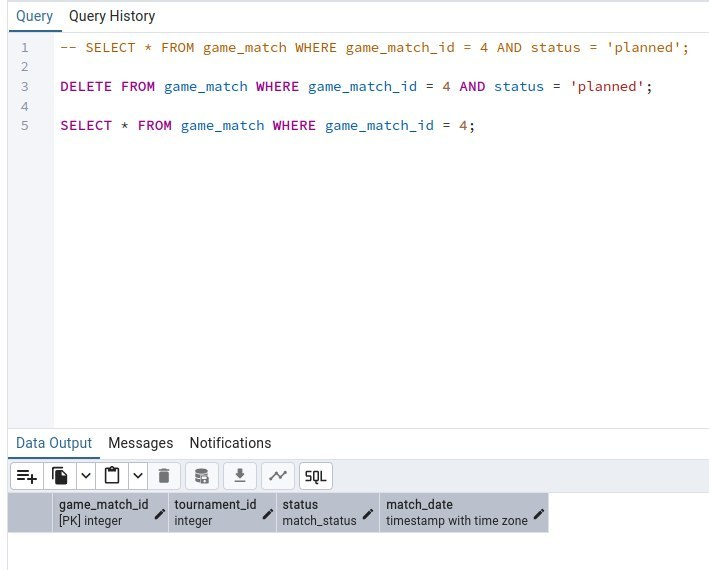

Перевірка запису перед видаленням:
```SQL
SELECT * FROM match_participant 
WHERE game_match_id = 3 AND game_team_id = 4;
```
**Очікуваний результат:** один рядок — участь команди №4 у матчі №3, який буде видалено.

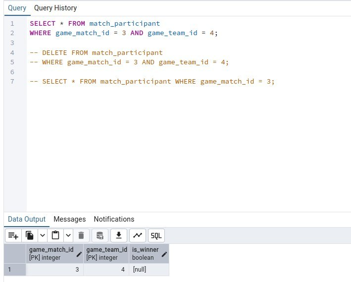

Видалення запису та перевірка, що запис видалено:
```SQL
DELETE FROM match_participant
WHERE game_match_id = 3 AND game_team_id = 4;
SELECT * FROM match_participant
WHERE game_match_id = 3;
```
**Очікуваний результат:** видалено 1 рядок, `SELECT` більше не містить команду №4 для матчу №3.

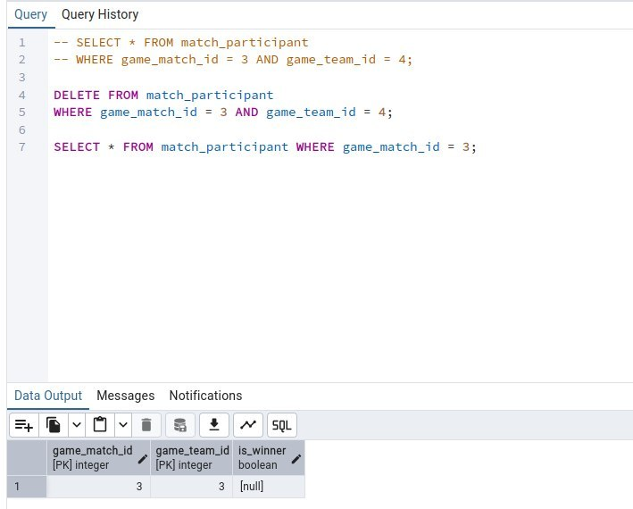