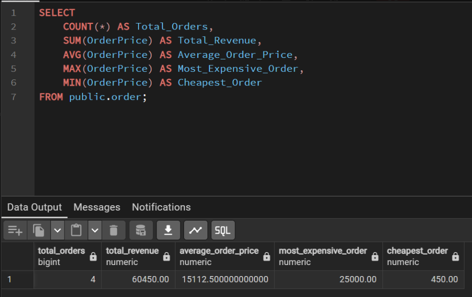
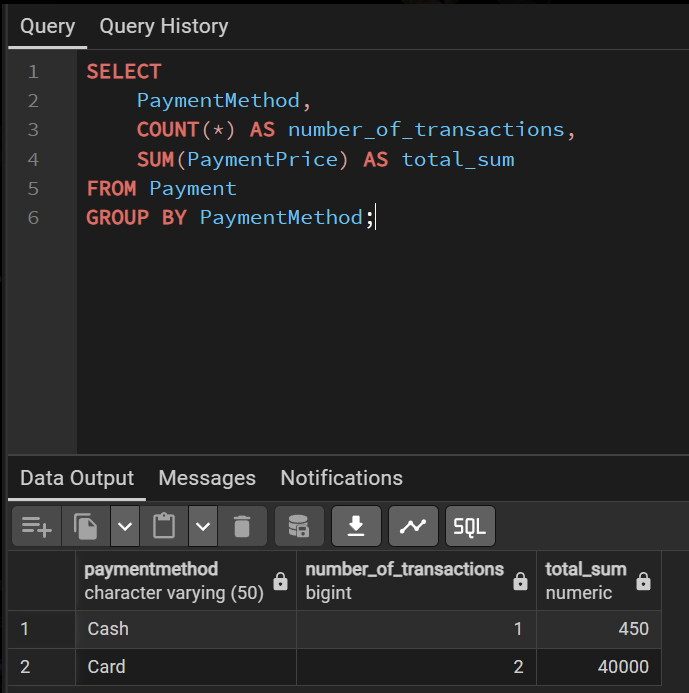
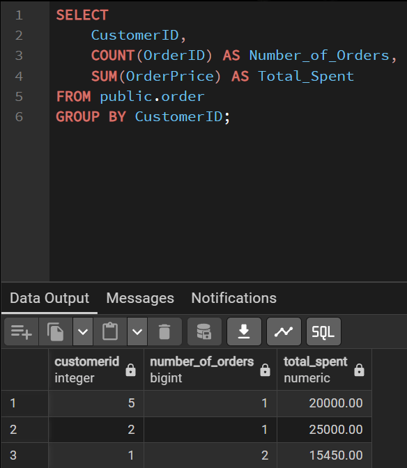
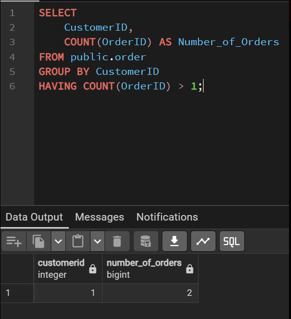
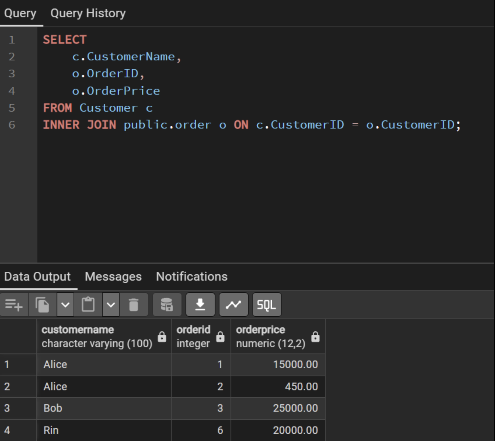
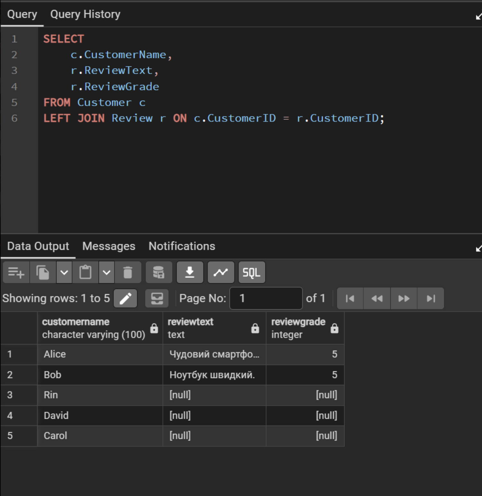
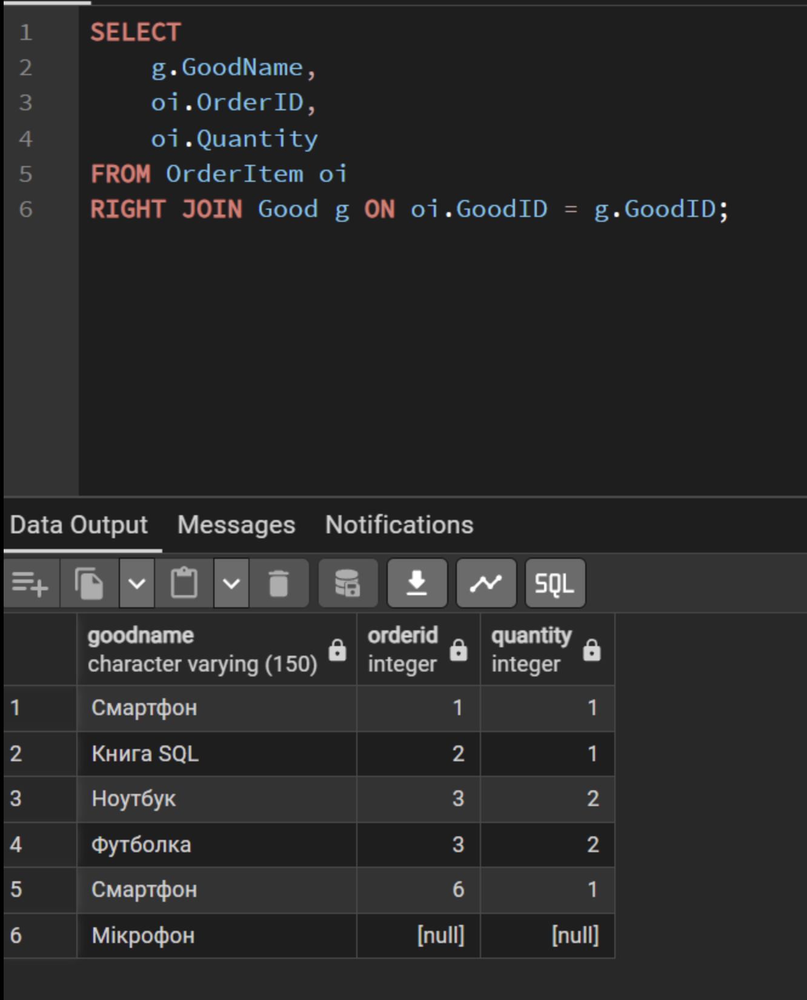
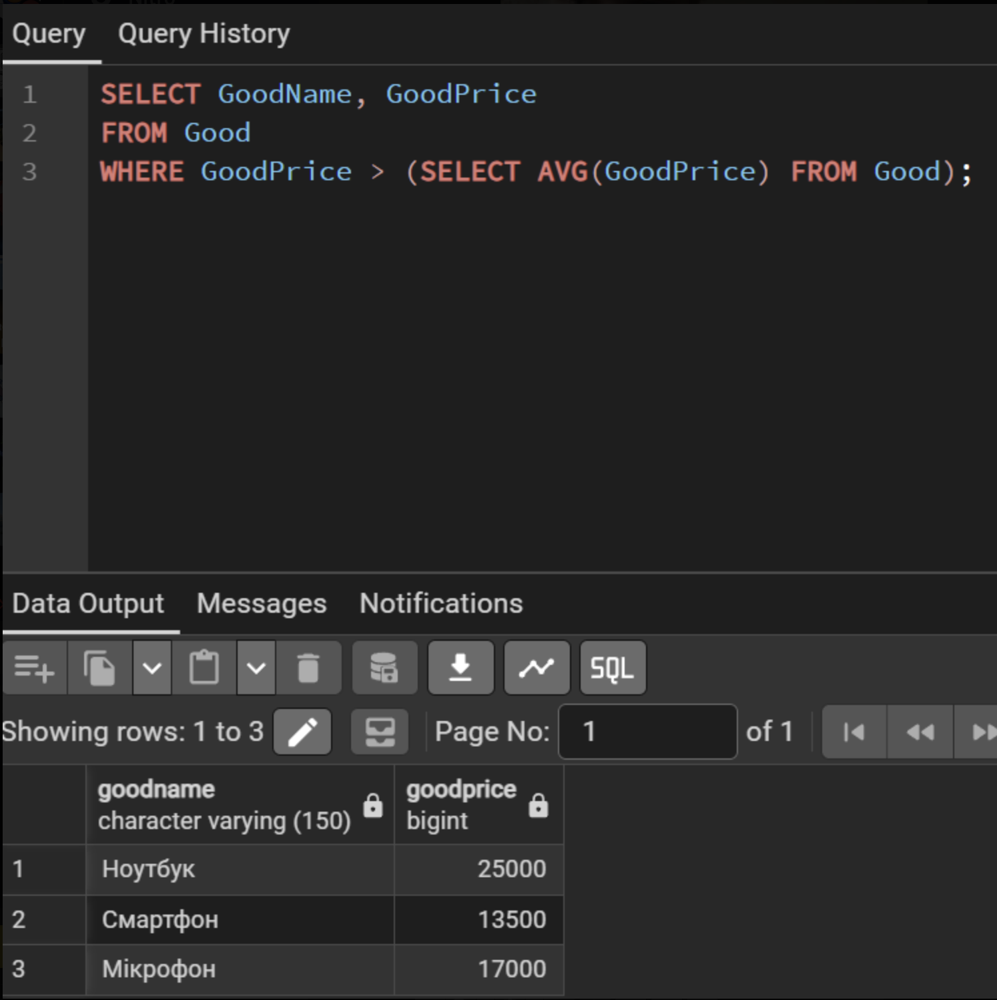
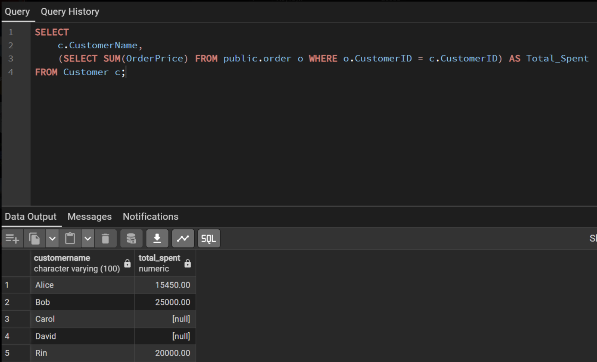
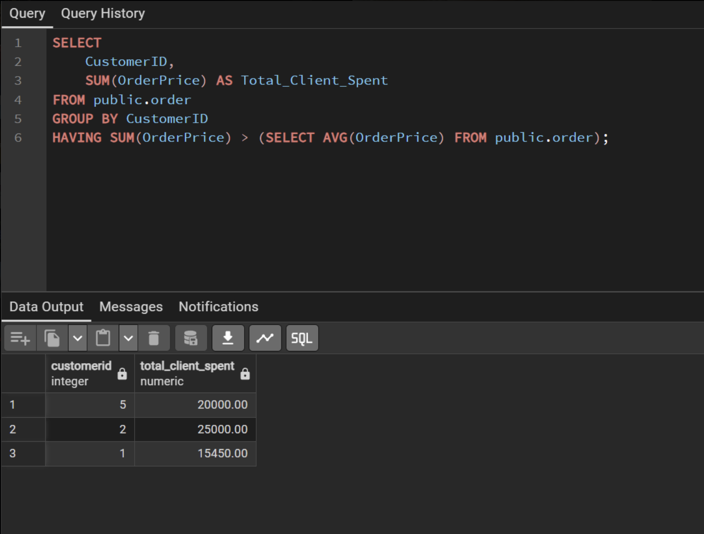

# Лабораторна робота 4: Аналітичні SQL-запити (OLAP)

**Мета:** опанувати написання аналітичних SQL-запитів (OLAP) у СКБД PostgreSQL (середовище pgAdmin) для аналізу даних, виявлення закономірностей та формування зведеної звітності на основі раніше спроєктованої бази даних.

**Цілі:**
- навчитися застосовувати базові агрегатні функції (`COUNT`, `SUM`, `AVG`, `MIN`, `MAX`) для аналізу числових показників;
- освоїти оператор `GROUP BY` для розбиття записів на логічні групи за одним або кількома стовпцями;
- навчитися використовувати речення `HAVING` для відбору груп, що відповідають заданим умовам агрегації;
- закріпити навички роботи з різними типами операцій `JOIN` (`INNER JOIN`, `LEFT JOIN`, `RIGHT JOIN`, `FULL JOIN`, `CROSS JOIN`) для зведення даних із кількох пов'язаних таблиць;
- навчитися комбінувати об'єднання таблиць з агрегацією, а також використовувати вкладені підзапити в конструкціях `SELECT`, `WHERE` та `HAVING`.

## 1. Запити із агрегаційними функціями (`SUM`, `AVG`, `COUNT`, `MIN`, `MAX`, `GROUP BY`)

### Запит 1.1: загальна фінасова статистика

```sql
SELECT 
    COUNT(*) AS Total_Orders,
    SUM(OrderPrice) AS Total_Revenue,
    AVG(OrderPrice) AS Average_Order_Price,
    MAX(OrderPrice) AS Most_Expensive_Order,
    MIN(OrderPrice) AS Cheapest_Order
FROM public.order;
```

**Мета:** дозволяє швидко оцінити загальний обсяг продажів магазину та діапазон цін.

**Що робить:** обчислює зведені фінансові показники по всій таблиці замовлень (public.order) одним рядком: кількість операцій, суму, середнє арефметичне, максимальне та мінімільне значення.

**Результат:** 



### Запит 1.2: розподіл транзакцій за способами оплати

```sql
SELECT 
    PaymentMethod,
    COUNT(*) AS number_of_transactions,
    SUM(PaymentPrice) AS total_sum
FROM Payment
GROUP BY PaymentMethod;
```
**Мета:** проаналізувати популярність різних платіжних методів

**Що робить:** рахує кількість операцій та суму операцій і групує за методом оплати

**Результат:** 



### Запит 1.3: активність та витрати кожного клієнта

```sql
SELECT 
    CustomerID,
    COUNT(OrderID) AS Number_of_Orders,
    SUM(OrderPrice) AS Total_Spent
FROM public.order
GROUP BY CustomerID;
```
**Мета:** формування профілю купівельної активності кожного клієнта

**Що робить:** рахує кількість замоалень клієнта та загальну суму витрат в магазині

**Результат:** 



### Запит 1.4: пошук постійних клієнтів

```sql
SELECT 
    CustomerID,
    COUNT(OrderID) AS Number_of_Orders
FROM public.order
GROUP BY CustomerID
HAVING COUNT(OrderID) > 1;
```
**Мета:** відсіяти одноразових покупців і залишитиі лише тих клієнтів, які повернулися та зробили більше одного замовлення (аналіз повторних покупок).

**Що робить:** рахує кількість замовлень клієнта та обирає клієнтів, які робили більше одного замовлення

**Результат:** 



## 2. Запити із різними типами джоінів (`INNER JOIN`, `LEFT JOIN`, `RIGHT JOIN`, `FULL JOIN`, `CROSS JOIN`)

### Запит 2.1: список клієнтів та їхніх замовлень

```sql
SELECT 
    c.CustomerName,
    o.OrderID,
    o.OrderPrice
FROM Customer c
INNER JOIN public.order o ON c.CustomerID = o.CustomerID;
```

**Мета:** звести імена покупців із деталями їхніх замовлень в одну таблицю

**Що робить:** виводить імена клієнтів та деталі їх замовлень, порівнюючи дані із таблиць `Order` та `Customer`

**Результат:** 



### Запит 2.2: усі клієнти та залишені ними відгуки

```sql
SELECT 
    c.CustomerName,
    r.ReviewText,
    r.ReviewGrade
FROM Customer c
LEFT JOIN Review r ON c.CustomerID = r.CustomerID;
```

**Мета:** звести імена покупців із їх відгуками на товари (якщо вони є)

**Що робить:** виводить імена всіх клієнтів та їх відгуки на товари (якщо вони є), порівнюючи дані із таблиць `Review` та `Customer`

**Результат:** 



### Запит 2.3: усі товари та статистика їхньої наявності в замовленнях

```sql
SELECT 
    g.GoodName,
    oi.OrderID,
    oi.Quantity
FROM OrderItem oi
RIGHT JOIN Good g ON oi.GoodID = g.GoodID;
```

**Мета:** знайти неактуальні товари в магазині

**Що робить:** виводить назви товарів та скільки їх замовляли, порівнюючи дані із таблиць `OrderItem` та `Good`

**Результат:** 



## 3. Запити із використанням підзапитів (`SELECT`, `WHERE`, `HAVING`)

### Запит 3.1: пошук товарів дорожчого сегменту

```sql
SELECT GoodName, GoodPrice
FROM Good
WHERE GoodPrice > (SELECT AVG(GoodPrice) FROM Good);
```

**Мета:** виділити товари вищої цінової категорії для формування акційних пропозицій

**Що робить:** спочатку внутрішній підзапит обчислює середню ціну всіх товарів у магазині та зовнішній запит порівнює ціну кожного товару з цим середнім значенням і залишає лише ті позиції, де ціна є вищою.

**Результат:** 



### Запит 3.2: підрахунок загальних витрат кожного клієнта

```sql
SELECT 
    c.CustomerName,
    (SELECT SUM(OrderPrice) FROM public.order o WHERE o.CustomerID = c.CustomerID) AS Total_Spent
FROM Customer c;
```

**Мета:** сформувати фінансовий рейтинг покупців для нарахування персональних бонусів.

**Що робить:** для кожного окремого клієнта з таблиці Customer запускається підзапит, який знаходить усі його замовлення в таблиці public.order і підсумовує їхню вартість (SUM(OrderPrice)).

**Результат:** 



### Запит 3.3: виявлення клієнтів із витратами вище середнього чека

```sql
SELECT 
    CustomerID, 
    SUM(OrderPrice) AS Total_Client_Spent
FROM public.order
GROUP BY CustomerID
HAVING SUM(OrderPrice) > (SELECT AVG(OrderPrice) FROM public.order);
```

**Мета:** сформувати список покупців для нарахування персональних бонусів.

**Що робить:** групує всі замовлення за ідентифікатором клієнта і рахує загальну суму витрат кожного, потім порівнюєм суму витрат кожного клієнта із середньою вартістю одного замовлення в магазині.

**Результат:** 



## Висновок:
Під час виконання лабораторної роботи було опановано написання аналітичних SQL-запитів (OLAP) у `PostgreSQL` для збору статистики та формування звітів на основі бази даних інтернет-магазину. У ході роботи успішно застосовано агрегатні функції з групуванням і фільтрацією (GROUP BY, HAVING), різні типи об'єднань таблиць (`INNER`, `LEFT`, `RIGHT JOIN`) та вкладені підзапити в блоках `SELECT`, `WHERE` і `HAVING`. Усі запити виконуються синтаксично коректно, підтверджують узгодженість спроєктованої схеми бази даних та дозволяють перетворювати сирі транзакційні дані на зрозумілу бізнес-аналітику.