# Лабораторна робота №4

## Агрегація та групування

Базова агрегація: загальна статистика за віком гравців:
```SQL
SELECT 
    COUNT(*) AS total_players, 
    MIN(date_of_birth) AS oldest_player_birth_date, 
    MAX(date_of_birth) AS youngest_player_birth_date 
FROM player;
```
**Пояснення:** агрегатні функції без `GROUP BY` обробляють усю таблицю й повертають один рядок. `COUNT(*)` рахує всіх гравців, `MIN` за датою народження дає найстаршого, а `MAX` — наймолодшого.

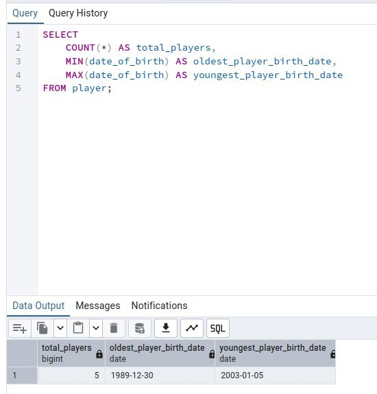

Групування: розподіл гравців за країнами:
```SQL
SELECT 
    country, 
    COUNT(player_id) AS players_count 
FROM player 
GROUP BY country
ORDER BY players_count DESC;
```
**Пояснення:** `GROUP BY country` об'єднує гравців однієї країни в групи, а `COUNT` рахує розмір кожної групи. `ORDER BY ... DESC` виводить країни з найбільшою кількістю гравців першими.

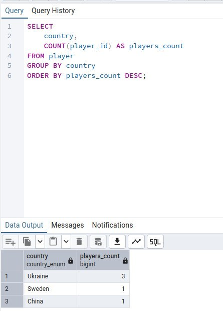

Групування за кількома полями: стан матчів у турнірах:
```SQL
SELECT 
    tournament_id, 
    status AS match_status, 
    COUNT(game_match_id) AS total_matches 
FROM game_match 
GROUP BY tournament_id, status 
ORDER BY tournament_id ASC;
```
**Пояснення:** групи формуються за унікальною парою «турнір + статус», тому для кожного турніру видно, скільки матчів перебуває в кожному статусі.

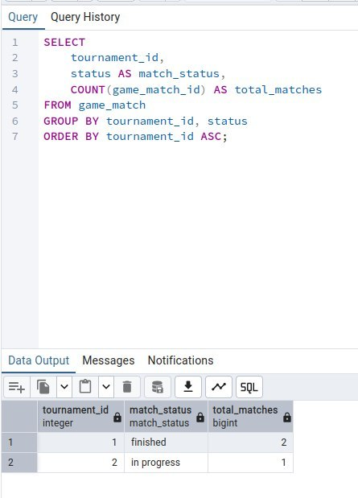

Фільтрація згрупованих даних (HAVING): турніри з кількома матчами:
```SQL
SELECT 
    tournament_id, 
    COUNT(game_match_id) AS matches_count 
FROM game_match
GROUP BY tournament_id 
HAVING COUNT(game_match_id) > 1;
```
**Пояснення:** `WHERE` не може працювати з результатами агрегатних функцій, бо виконується до групування. `HAVING` фільтрує вже сформовані групи, тому залишаються лише турніри більш ніж з одним матчем.

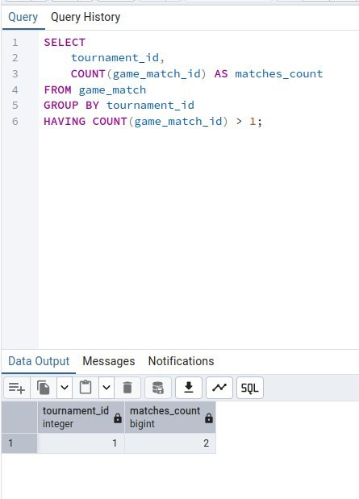


## JOIN

INNER JOIN: розклад матчів із назвами турнірів та ігор:
```SQL
SELECT 
    gm.game_match_id, 
    g.game_name, 
    t.tournament_name, 
    gm.status AS match_status, 
    gm.match_date
FROM game_match gm
INNER JOIN tournament t ON gm.tournament_id = t.tournament_id
INNER JOIN game g ON t.game_id = g.game_id;
```
**Пояснення:** ланцюжок з'єднань «матч → турнір → гра» за зовнішніми ключами додає до кожного матчу назви турніру та гри. `INNER JOIN` залишає лише рядки, для яких знайдено відповідність в усіх таблицях.

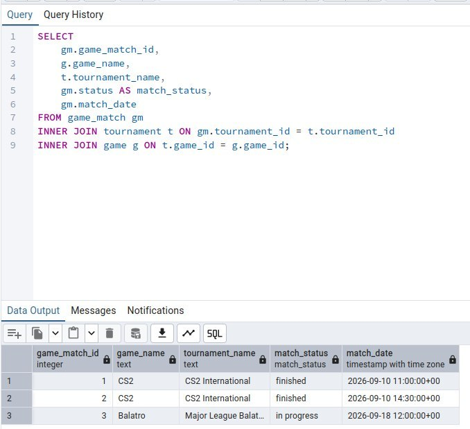

INNER JOIN + агрегація: кількість активних турнірів по дисциплінах:
```SQL
SELECT 
    g.game_name AS game,
    COUNT(*) AS active_tournaments
FROM game g
JOIN tournament t ON g.game_id = t.game_id
WHERE t.status = 'happeninng'
GROUP BY g.game_name
ORDER BY active_tournaments DESC;
```
**Пояснення:** після з'єднання ігор і турнірів `WHERE` залишає лише поточні турніри (`happeninng`), а `GROUP BY` та `COUNT(*)` рахують їх для кожної дисципліни.

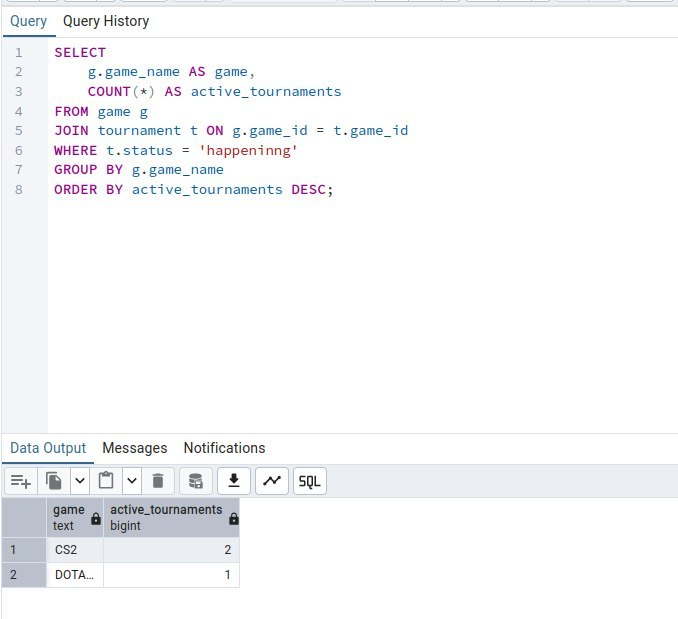

LEFT JOIN: перелік усіх команд та ігрових дисциплін:
```SQL
SELECT 
    tm.team_name,
    g.game_name
FROM team tm
LEFT JOIN game_team gt ON tm.team_id = gt.team_id
LEFT JOIN game g ON gt.game_id = g.game_id
ORDER BY tm.team_name;
```
**Пояснення:** `LEFT JOIN` зберігає всі рядки лівої таблиці `team`. Якщо команда не прив'язана до жодної гри, вона все одно потрапить у результат, а `game_name` буде `NULL`.

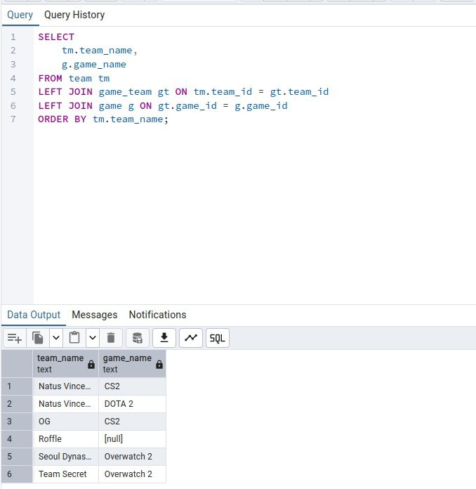

LEFT JOIN + агрегація: перша та остання активність організаторів:
```SQL
SELECT 
    o.orginizer_name,
    MIN(t.start_date) AS first_active,
    MAX(t.start_date) AS last_active
FROM orginizer o
LEFT JOIN tournament t ON o.orginizer_id = t.orginizer_id
WHERE t.start_date <= CURRENT_DATE
   OR t.start_date IS NULL
GROUP BY o.orginizer_name
ORDER BY last_active DESC;
```
**Пояснення:** `LEFT JOIN` залишає й організаторів без турнірів. Умова `OR t.start_date IS NULL` не дає `WHERE` відкинути їх, а `t.start_date <= CURRENT_DATE` відсікає майбутні турніри. `MIN` і `MAX` дають дати першого та останнього турніру.

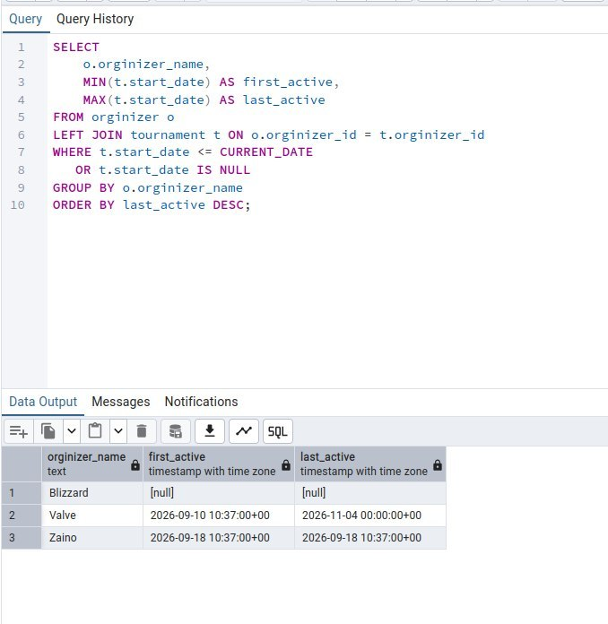

RIGHT JOIN: зіставлення турнірів та організаторів:
```SQL
SELECT 
    o.orginizer_name, 
    t.tournament_name
FROM tournament t 
RIGHT JOIN orginizer o ON t.orginizer_id = o.orginizer_id
ORDER BY o.orginizer_name;
```
**Пояснення:** `RIGHT JOIN` зберігає всі рядки правої таблиці `orginizer`. Організатори без турнірів виводяться з `NULL` у стовпці `tournament_name`.

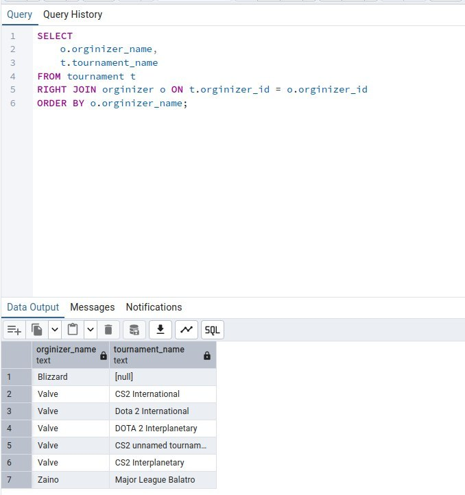

FULL JOIN: повний аналіз переможців у турнірах:
```SQL
SELECT 
    t.tournament_name,
    tm.team_name
FROM tournament t
FULL JOIN game_team gt ON t.winner_id = gt.game_team_id
LEFT JOIN team tm ON gt.team_id = tm.team_id
ORDER BY t.tournament_name;
```
**Пояснення:** `FULL JOIN` повертає рядки з обох боків: і турніри без переможця, і записи `game_team`, які нічого не виграли. Наступний `LEFT JOIN` підтягує назву команди-переможця.

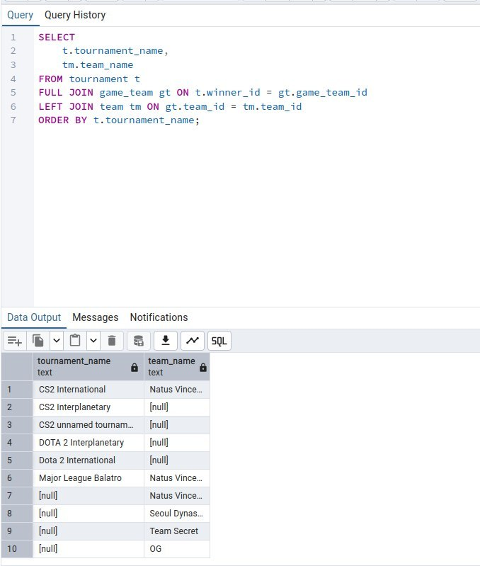


## Підзапити та віконні функції

Підзапит у WHERE (NOT IN): пошук гравців без команди («вільні агенти»):
```SQL
SELECT 
    player_id, 
    nickname, 
    first_name, 
    last_name, 
    country 
FROM player 
WHERE player_id NOT IN (
    SELECT DISTINCT player_id 
    FROM team_player
);
```
**Пояснення:** внутрішній підзапит повертає id усіх гравців, які колись були в команді. `NOT IN` залишає лише тих, кого в цьому списку немає.

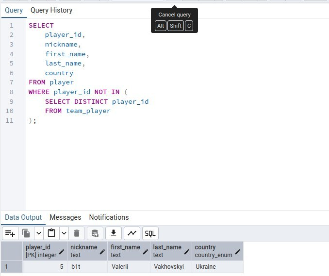

Підзапит у FROM + віконна функція: ранжування найактивніших команд:
```SQL
SELECT 
    team_name,
    DENSE_RANK() OVER (ORDER BY participation_amount DESC NULLS LAST) AS activity_rank
FROM (
    SELECT 
        t.team_name,
        COUNT(mp.game_match_id) AS participation_amount
    FROM team t
    LEFT JOIN game_team gt ON t.team_id = gt.team_id
    LEFT JOIN match_participant mp ON mp.game_team_id = gt.game_team_id
    GROUP BY t.team_name
) sub_activity;
```
**Пояснення:** підзапит рахує участі кожної команди в матчах, а зовнішній запит присвоює ранг за допомогою `DENSE_RANK()`. Команди з однаковою кількістю матчів отримують однаковий ранг без пропусків, а `NULLS LAST` ставить команди без даних в кінець.

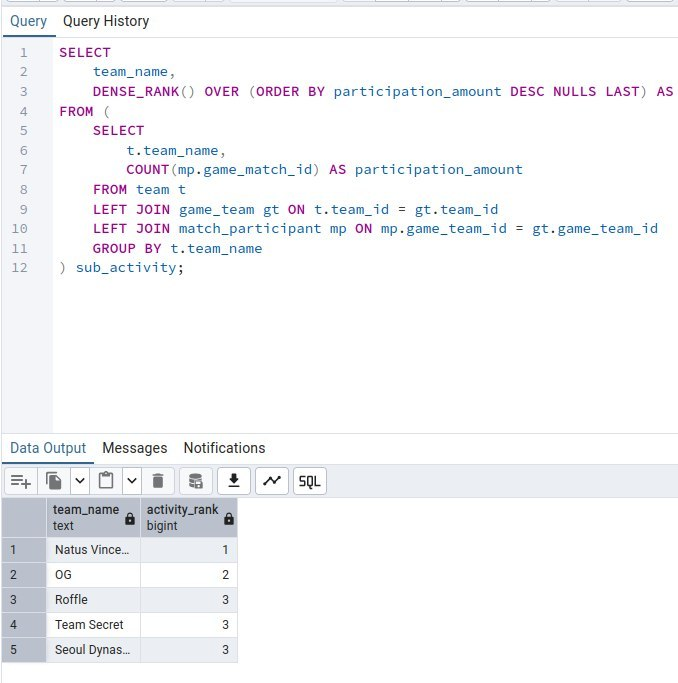

Підзапит у JOIN: наскільки гравці молодші/старші за середній вік по грі:
```SQL
SELECT
  p.nickname,
  g.game_name,
  (CURRENT_DATE - p.date_of_birth)/365 - avg_age.avg_age AS age_difference
FROM player p
  JOIN team_player tp ON tp.player_id = p.player_id
  JOIN game_team gt ON gt.game_team_id = tp.game_team_id
  JOIN game g ON g.game_id = gt.game_id
  JOIN 
    (SELECT 
      g.game_name,
      ROUND (AVG((CURRENT_DATE - p.date_of_birth)/365), 2) AS avg_age
    FROM player p
      JOIN team_player tp ON tp.player_id = p.player_id
      JOIN game_team gt ON gt.game_team_id = tp.game_team_id
      JOIN game g ON g.game_id = gt.game_id
    WHERE tp.leave_date IS NULL
    GROUP BY g.game_name) avg_age ON avg_age.game_name = g.game_name;
```
**Пояснення:** підзапит у `JOIN` обчислює середній вік активних гравців (`leave_date IS NULL`) для кожної гри. Основний запит з'єднує його з гравцями тієї ж гри й віднімає середнє від віку гравця: від'ємне значення означає, що гравець молодший за середній вік, додатне — що старший.

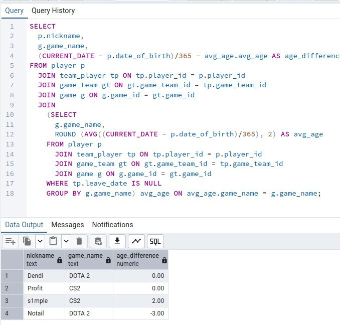
