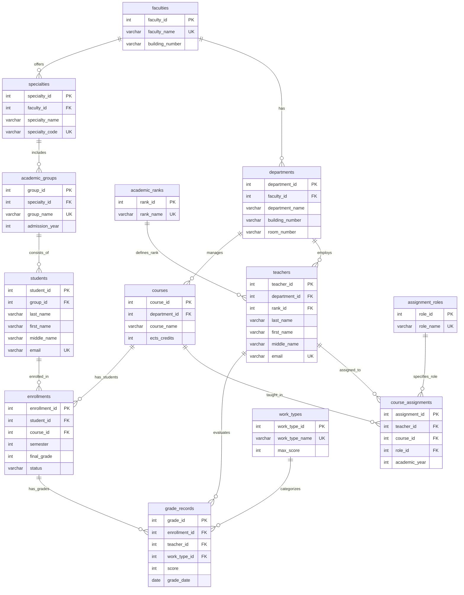

# Лабораторна робота №5: Нормалізація бази даних

## 1. Мета роботи
Проаналізувати початкову схему бази даних університету (з ЛР №2), виявити надлишковість, неатомарні атрибути та аномалії вставки, оновлення й видалення, описати функціональні залежності (ФЗ) та привести всі таблиці до третьої нормальної форми (3НФ).

---

## 2. Аналіз початкової схеми та функціональні залежності (ФЗ)

У початковій схемі виявлено 5 таблиць, які містять структурні недоліки або потенційні аномалії: `students`, `teachers`, `departments`, `course_assignments` та `grade_records`.

### Початкові функціональні залежності (мінімальний набір)

1. **Таблиця `students(student_id, group_id, full_name, email)`**
   - `student_id -> group_id, full_name, email`
   - `email -> student_id, group_id, full_name` (потенційний ключ)
   - *Порушення:* Атрибут `full_name` є складеним (Прізвище + Ім'я + По батькові), що порушує вимогу атомарності **1НФ**.

2. **Таблиця `teachers(teacher_id, department_id, full_name, email, academic_rank)`**
   - `teacher_id -> department_id, full_name, email, academic_rank`
   - `email -> teacher_id, department_id, full_name, academic_rank`
   - *Порушення:*
     - `full_name` неатомарний (**порушення 1НФ**).
     - `academic_rank` зберігає повторювані текстові назви посад, що створює ризик аномалій оновлення при перейменуванні звань або додаванні їхніх характеристик (**порушення 3НФ**).

3. **Таблиця `departments(department_id, faculty_id, department_name, office_building)`**
   - `department_id -> faculty_id, department_name, office_building`
   - *Порушення:* Поле `office_building` містить два факти одночасно — номер корпусу та номер аудиторії (`"Кн. 18, ауд. 401"`), що порушує **1НФ**.

4. **Таблиця `course_assignments(assignment_id, teacher_id, course_id, academic_year, role_type)`**
   - `assignment_id -> teacher_id, course_id, academic_year, role_type`
   - `(teacher_id, course_id, academic_year, role_type) -> assignment_id`
   - *Порушення:*
     - Значення `"Лекції та практики"` об'єднує два типи навантаження в одному рядку (**порушення 1НФ**).
     - Текстовий атрибут `role_type` дублюється у багатьох записах (**порушення 3НФ**).

5. **Таблиця `grade_records(grade_id, enrollment_id, teacher_id, score, work_type, grade_date)`**
   - `grade_id -> enrollment_id, teacher_id, score, work_type, grade_date`
   - *Порушення:* Назва виду контролю (`work_type`) вводиться вручну текстом, що призводить до дублювання та описок (**порушення 3НФ**).

*Інші таблиці (`faculties`, `specialties`, `academic_groups`, `courses`, `enrollments`) вже мають атомарні атрибути та не містять часткових чи транзитивних залежностей, тому знаходяться у **3НФ**.*

---

## 3. Покроковий процес нормалізації

### Крок 1: Приведення до Першої нормальної форми (1НФ)
**Правило 1НФ:** Усі атрибути мають бути атомарними, без повторюваних груп чи списків в одній клітинці.

1. **Декомпозиція ПІБ у `students` та `teachers`:**
   - Замість `full_name` введено три атомарні стовпці: `last_name`, `first_name`, `middle_name`.
   - *Усунута аномалія:* Спрощено пошук, фільтрацію та сортування за прізвищем без використання регулярних виразів.
2. **Розділення адреси кафедри у `departments`:**
   - Стовпець `office_building` розділено на `building_number` та `room_number`.
   - *Усунута аномалія:* Можливість однозначно групувати кафедри за корпусами.
3. **Атомарність ролей у `course_assignments`:**
   - Комбінований запис `"Лекції та практики"` розділено на два окремі рядки (`"Лекції"` та `"Практичні заняття"`).

---

### Крок 2: Перевірка Другої нормальної форми (2НФ)
**Правило 2НФ:** Таблиця в 1НФ, і жоден неключовий атрибут не залежить лише від частини складеного ключа.

- Усі таблиці використовують сурогатні первинні ключі (`SERIAL PRIMARY KEY`), а також мають природні унікальні ключі (`UNIQUE`).
- У таблиці `enrollments` неключові атрибути `final_grade` та `status` залежать від **повного** складеного ключа `(student_id, course_id, semester)` (оцінка визначається конкретним студентом, конкретною дисципліною та семестром одночасно).
- Часткових залежностей немає — уся схема відповідає **2НФ**.

---

### Крок 3: Приведення до Третьої нормальної форми (3НФ)
**Правило 3НФ:** Таблиця в 2НФ, і жоден неключовий атрибут не залежить від іншого неключового атрибута (усунення транзитивних залежностей та винесення довідників).

1. **Винесення вчених звань (`teachers` $\rightarrow$ `academic_ranks`):**
   - Створено довідник `academic_ranks(rank_id, rank_name)`.
   - У `teachers` текстове поле `academic_rank` замінено на зовнішній ключ `rank_id`.
   - *Нові ФЗ:* `rank_id -> rank_name`; `teacher_id -> department_id, rank_id, last_name, first_name, middle_name, email`.
2. **Винесення типів викладацького навантаження (`course_assignments` $\rightarrow$ `assignment_roles`):**
   - Створено довідник `assignment_roles(role_id, role_name)`.
   - У `course_assignments` поле `role_type` замінено на `role_id`.
   - *Нові ФЗ:* `role_id -> role_name`; `assignment_id -> teacher_id, course_id, role_id, academic_year`.
3. **Винесення типів навчальних робіт (`grade_records` $\rightarrow$ `work_types`):**
   - Створено довідник `work_types(work_type_id, work_type_name, max_score)`.
   - У `grade_records` текстовий `work_type` замінено на зовнішній ключ `work_type_id`.
   - *Усунута транзитивна залежність:* `grade_id -> work_type_id -> max_score`. Тепер максимальний бал за кожен тип роботи зберігається в одному місці.

---

## 4. Команди міграції (`ALTER TABLE`)

Для переведення існуючих таблиць із початкової схеми у 3НФ застосовуються такі зміни структури:

```sql
-- Перетворення таблиці departments (1НФ)
ALTER TABLE departments
    DROP COLUMN office_building,
    ADD COLUMN building_number VARCHAR(20) NOT NULL DEFAULT 'Корпус 18',
    ADD COLUMN room_number VARCHAR(20) NOT NULL DEFAULT '101';

-- Перетворення таблиці students (1НФ)
ALTER TABLE students
    DROP COLUMN full_name,
    ADD COLUMN last_name VARCHAR(50) NOT NULL DEFAULT '',
    ADD COLUMN first_name VARCHAR(50) NOT NULL DEFAULT '',
    ADD COLUMN middle_name VARCHAR(50);

-- Перетворення таблиці teachers (1НФ + 3НФ)
ALTER TABLE teachers
    DROP COLUMN full_name,
    DROP COLUMN academic_rank,
    ADD COLUMN last_name VARCHAR(50) NOT NULL DEFAULT '',
    ADD COLUMN first_name VARCHAR(50) NOT NULL DEFAULT '',
    ADD COLUMN middle_name VARCHAR(50),
    ADD COLUMN rank_id INTEGER NOT NULL REFERENCES academic_ranks(rank_id) ON DELETE RESTRICT;

-- Перетворення таблиці course_assignments (3НФ)
ALTER TABLE course_assignments
    DROP CONSTRAINT unique_teacher_course_assignment,
    DROP COLUMN role_type,
    ADD COLUMN role_id INTEGER NOT NULL REFERENCES assignment_roles(role_id) ON DELETE RESTRICT,
    ADD CONSTRAINT unique_teacher_course_assignment UNIQUE (teacher_id, course_id, academic_year, role_id);

-- Перетворення таблиці grade_records (3НФ)
ALTER TABLE grade_records
    DROP COLUMN work_type,
    ADD COLUMN work_type_id INTEGER NOT NULL REFERENCES work_types(work_type_id) ON DELETE RESTRICT;