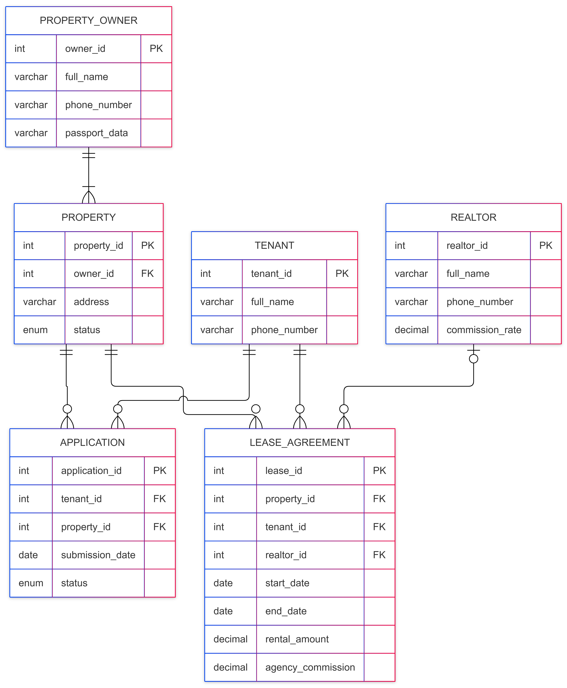

## Стара версія структур таблиць

- **Власник** (`PROPERTY_OWNER`):
  - `INT` | `owner_id` (ID власника) | `PK`, `GENERATED ALWAYS AS IDENTITY`
  - `VARCHAR(100)` | `full_name` (ПІБ) | `NOT NULL`, `UNIQUE`
  - `VARCHAR(20)` | `phone_number` (номер телефону) | `NOT NULL`, `UNIQUE`
  - `VARCHAR(20)` | `passport_data` (паспортні дані) | `NOT NULL`, `UNIQUE`

- **Об'єкт нерухомості** (`PROPERTY`):
  - `INT` | `property_id` (ID об'єкта) | `PK`, `GENERATED ALWAYS AS IDENTITY`
  - `INT` | `owner_id` (ID власника) | `FK` (`PROPERTY_OWNER.owner_id`), `NOT NULL`
  - `VARCHAR(80)` | `adress` (адреса) | `NOT NULL`, `UNIQUE`

- **Орендар** (`TENANT`):
  - `INT` | `tenant_id` (ID орендаря) | `PK`, `GENERATED ALWAYS AS IDENTITY`
  - `VARCHAR(100)` | `full_name` (ПІБ) | `NOT NULL`
  - `VARCHAR(20)` | `phone_number` (номер телефону) | `NOT NULL`, `UNIQUE`

- **Рієлтор** (`REALTOR`):
  - `INT` | `realtor_id` (ID рієлтора) | `PK`, `GENERATED ALWAYS AS IDENTITY`
  - `VARCHAR(100)` | `full_name` (ПІБ) | `NOT NULL`
  - `VARCHAR(20)` | `phone_number` (номер телефону) | `NOT NULL`, `UNIQUE`
  - `DECIMAL(4, 2)` | `commission_rate` (відсоток комісійних) | `NOT NULL`, `CHECK (commission_rate >= 0)`

- **Заявка** (`APPLICATION`):
  - `INT` | `application_id` (ID заявки) | `PK`, `GENERATED ALWAYS AS IDENTITY`
  - `INT` | `tenant_id` (ID орендаря) | `FK` (`TENANT.tenant_id`), `NOT NULL`
  - `INT` | `property_id` (ID об'єкта) | `FK` (`PROPERTY.property_id`), `NOT NULL`
  - `DATE` | `submission_date` (дата подачі) | `NOT NULL`
  - `VARCHAR(20)` | `status` (статус) | `NOT NULL`, `CHECK (status IN ('в обробці', 'схвалено', 'відхилено'))`

- **Угода оренди** (`LEASE_AGREEMENT`):
  - `INT` | `lease_id` (ID угоди) | `PK`, `GENERATED ALWAYS AS IDENTITY`
  - `INT` | `property_id` (ID об'єкта) | `FK` (`PROPERTY.property_id`), `NOT NULL`
  - `INT` | `tenant_id` (ID орендаря) | `FK` (`TENANT.tenant_id`), `NOT NULL`
  - `INT` | `realtor_id` (ID рієлтора) | `FK` (`REALTOR.realtor_id`), `NULLABLE`
  - `DATE` | `start_date` (дата початку) | `NOT NULL`
  - `DATE` | `end_date` (дата закінчення) | `NOT NULL`, `CHECK (end_date > start_date)`
  - `DECIMAL(12, 2)` | `rental_amount` (сума оренди) | `NOT NULL`, `CHECK (rental_amount > 0)`
  - `DECIMAL(12, 2)` | `agency_commission` (комісія агентства) | `NULLABLE`, `CHECK (agency_commission >= 0)`
  - _Обмеження рівня таблиці (`ch_ex_rieltor`):_ `CHECK ((realtor_id IS NOT NULL AND agency_commission IS NOT NULL) OR (realtor_id IS NULL AND agency_commission IS NULL))` — комісія вказується лише за наявності рієлтора.

## ER- діаграма старої бд

- ## 1NF:

- `property` — виконано після розбиття `adress` на `city_id`, `street`, `building_number`, `apartment_number` (кожен атрибут містить одне атомарне значення)[cite: 2, 5].
- `property_owner` — виконано після розбиття `full_name` на `last_name`, `first_name`, `middle_name`[cite: 2].
- `tenant` — виконано після розбиття `full_name` на `last_name`, `first_name`, `middle_name`[cite: 2].
- `realtor` — виконано після розбиття `full_name` на `last_name`, `first_name`, `middle_name`[cite: 2].
- `application` — виконано (усі атрибути атомарні, повторюваних груп немає)[cite: 2, 5].
- `lease_agreement` — виконано (усі атрибути атомарні, повторюваних груп немає)[cite: 2, 5].
- `city`, `application_status` — виконано[cite: 2, 5].

* ## 2NF:

  Усі таблиці перебувають у **1NF** і мають **прості первинні ключі** (`*_id`), тому часткові функціональні залежності від частини складеного ключа відсутні для всіх таблиць (`property`, `property_owner`, `tenant`, `realtor`, `application`, `lease_agreement`, `city`, `application_status`)[cite: 2].

* ## 3NF:
  - `property`- Вимоги порушено :
    - Можливе порушення після розбиття адреси: Якщо виділити city (місто) та street (вулицю), або якщо індекс/район залежить від міста/вулиці, виникає транзитивна залежність property_id -> city_id -> city_name або дублювання назв міст (аномалія оновлення при перейменуванні міста).

  - `property_owner`- Вимоги виконані.
  - `tenant`- Вимоги виконані.
  - `realtor`- Вимоги виконані.

  - `lease_agreement`- Вимоги порушено :
    - Неключовий атрибут agency_commission транзитивно залежить від lease_id через realtor_id (який визначає commission_rate у REALTOR) та rental_amount. Якщо змінити rental_amount (як ти зробив у запиті №7: змінив 15000.00 на 17000.00, але agency_commission залишилася 750.00 замість 850.00!), виникає аномалія оновлення та суперечність даних.
    - Крім того, якщо договір укладається на основі схваленої заявки (APPLICATION), то пара (tenant_id, property_id) дублюється між APPLICATION та LEASE_AGREEMENT (або в LEASE_AGREEMENT варто посилатися на application_id, якщо договір завжди випливає із заявки).

  - `applications`- Вимоги порушено :
    - Текстове поле status ('в обробці', 'схвалено', 'відхилено') повторюється в кожному рядку. Винесення статусів у окрему таблицю-довідник APPLICATION_STATUS(status_id, status_name) усуває дублювання рядкових літералів та аномалії при перейменуванні статусу.

* ## Виправлення:
  - `property`:
    1. Розбити adress на атомарні стовпці: city, street, building_number, apartment_number;
    2.
  - `property_owner`:
    1. Розбити full_name на last_name, first_name, middle_name;
    2.
  - `tenant`:
    1. Розбити full_name на last_name, first_name, middle_name;
    2.
  - `realtor`:
    1. Розбити full_name на last_name, first_name, middle_name;
    2.
  - `lease_agreement`:
    1. прибрати надлишковий стовпець agency_commission (оскільки ставка комісії commission_rate зберігається в REALTOR, а сума комісії однозначно обчислюється як rental_amount \* commission_rate / 100 у VIEW або запиті) — це повністю усуває аномалію розсинхронізації комісії при зміні орендної плати.;
    2.
  - `applications`:
    1. ;
    2.

## Оновлена версія структур таблиць

- **Місто** (`city`):
  - `INT` | `city_id` (ID міста) | `PK`, `GENERATED ALWAYS AS IDENTITY`
  - `VARCHAR(50)` | `city_name` (назва міста) | `NOT NULL`, `UNIQUE`

- **Власник нерухомості** (`property_owner`):
  - `INT` | `owner_id` (ID власника) | `PK`, `GENERATED ALWAYS AS IDENTITY`
  - `VARCHAR(40)` | `last_name` (прізвище) | `NOT NULL`
  - `VARCHAR(40)` | `first_name` (ім'я) | `NOT NULL`
  - `VARCHAR(40)` | `middle_name` (по батькові) | `NOT NULL`
  - `VARCHAR(20)` | `phone_number` (номер телефону) | `NOT NULL`, `UNIQUE`
  - `VARCHAR(20)` | `passport_data` (паспортні дані) | `NOT NULL`, `UNIQUE`
  - _Обмеження рівня таблиці:_ `UNIQUE (last_name, first_name, middle_name)` — заборона повних дублікатів ПІБ.

- **Об'єкт нерухомості** (`property`):
  - `INT` | `property_id` (ID об'єкта) | `PK`, `GENERATED ALWAYS AS IDENTITY`
  - `INT` | `owner_id` (ID власника) | `FK` (`property_owner.owner_id`), `NOT NULL`
  - `INT` | `city_id` (ID міста) | `FK` (`city.city_id`), `NOT NULL`
  - `VARCHAR(80)` | `street` (вулиця) | `NOT NULL`
  - `VARCHAR(15)` | `building_number` (номер будинку) | `NOT NULL`
  - `VARCHAR(15)` | `apartment_number` (номер квартири) | `NULLABLE`
  - _Обмеження рівня таблиці:_ `UNIQUE (city_id, street, building_number, apartment_number)` — унікальність повної адреси об'єкта.

- **Орендар** (`tenant`):
  - `INT` | `tenant_id` (ID орендаря) | `PK`, `GENERATED ALWAYS AS IDENTITY`
  - `VARCHAR(40)` | `last_name` (прізвище) | `NOT NULL`
  - `VARCHAR(40)` | `first_name` (ім'я) | `NOT NULL`
  - `VARCHAR(40)` | `middle_name` (по батькові) | `NOT NULL`
  - `VARCHAR(20)` | `phone_number` (номер телефону) | `NOT NULL`, `UNIQUE`
  - _Обмеження рівня таблиці:_ `UNIQUE (last_name, first_name, middle_name)` — заборона повних дублікатів ПІБ.

- **Рієлтор** (`realtor`):
  - `INT` | `realtor_id` (ID рієлтора) | `PK`, `GENERATED ALWAYS AS IDENTITY`
  - `VARCHAR(40)` | `last_name` (прізвище) | `NOT NULL`
  - `VARCHAR(40)` | `first_name` (ім'я) | `NOT NULL`
  - `VARCHAR(40)` | `middle_name` (по батькові) | `NOT NULL`
  - `VARCHAR(20)` | `phone_number` (номер телефону) | `NOT NULL`, `UNIQUE`
  - `DECIMAL(4, 2)` | `commission_rate` (відсоток комісійних) | `NOT NULL`, `CHECK (commission_rate >= 0)`
  - _Обмеження рівня таблиці:_ `UNIQUE (last_name, first_name, middle_name)` — заборона повних дублікатів ПІБ.

- **Довідник статусів заявок** (`application_status`):
  - `INT` | `status_id` (ID статусу) | `PK`, `GENERATED ALWAYS AS IDENTITY`
  - `VARCHAR(20)` | `status_name` (назва статусу) | `NOT NULL`, `UNIQUE`

- **Заявка на оренду** (`application`):
  - `INT` | `application_id` (ID заявки) | `PK`, `GENERATED ALWAYS AS IDENTITY`
  - `INT` | `tenant_id` (ID орендаря) | `FK` (`tenant.tenant_id`), `NOT NULL`
  - `INT` | `property_id` (ID об'єкта) | `FK` (`property.property_id`), `NOT NULL`
  - `DATE` | `submission_date` (дата подачі) | `NOT NULL`
  - `INT` | `status_id` (ID статусу) | `FK` (`application_status.status_id`), `NOT NULL`

- **Договір оренди** (`lease_agreement`):
  - `INT` | `lease_id` (ID договору) | `PK`, `GENERATED ALWAYS AS IDENTITY`
  - `INT` | `property_id` (ID об'єкта) | `FK` (`property.property_id`), `NOT NULL`
  - `INT` | `tenant_id` (ID орендаря) | `FK` (`tenant.tenant_id`), `NOT NULL`
  - `INT` | `realtor_id` (ID рієлтора) | `FK` (`realtor.realtor_id`), `NULLABLE`
  - `DATE` | `start_date` (дата початку) | `NOT NULL`
  - `DATE` | `end_date` (дата закінчення) | `NOT NULL`, `CHECK (end_date > start_date)`
  - `DECIMAL(12, 2)` | `rental_amount` (сума оренди) | `NOT NULL`, `CHECK (rental_amount > 0)`

## ER- діаграма нової бд

