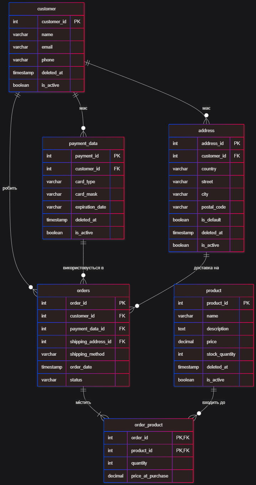
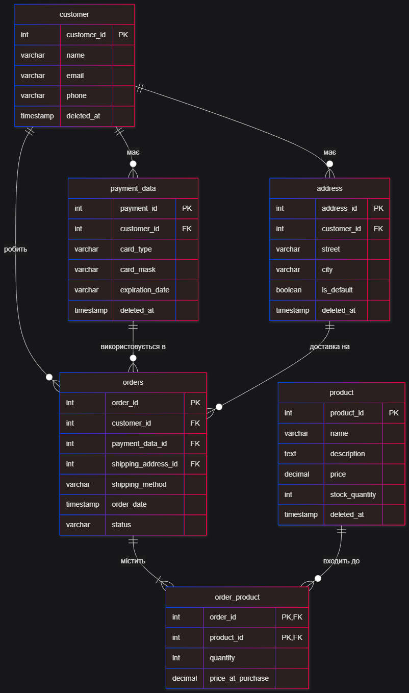

# Звіт про нормалізацію бази даних

## 1. Початкова схема та функціональні залежності



### Таблиці початкової схеми (2NF)

* **customer** (**customer_id**, name, email, password_hash, phone, deleted_at, is_active)
* **address** (**address_id**, *customer_id*, country, street, city, postal_code, is_default, deleted_at, is_active)
* **payment_data** (**payment_data_id**, *customer_id*, card_type, card_mask, expiration_date, is_default, deleted_at, is_active)
* **product** (**product_id**, name, description, price, stock_quantity, deleted_at, is_active)
* **orders** (**order_id**, *customer_id*, *payment_data_id*, *shipping_address_id*, shipping_method, order_date, status)
* **order_product** (**order_id** *(FK)*, **product_id** *(FK)*, quantity, price_at_purchase)

### Функціональні залежності

**Базові залежності від первинних та потенційних ключів:**

* `customer_id` $\rightarrow$ `name, email, password_hash, phone, deleted_at`
* `email` $\rightarrow$ `customer_id`
* `address_id` $\rightarrow$ `customer_id, street, postal_code, is_default, deleted_at`
* `payment_data_id` $\rightarrow$ `customer_id, card_type, card_mask, expiration_date, is_default, deleted_at`
* `product_id` $\rightarrow$ `name, description, price, stock_quantity, deleted_at`
* `order_id` $\rightarrow$ `payment_data_id, shipping_address_id, shipping_method, order_date, status`
* `(order_id, product_id)` $\rightarrow$ `quantity, price_at_purchase`

**Додаткові (транзитивні та надлишкові) залежності:**

* `deleted_at` $\rightarrow$ `is_active` *(у таблицях `customer`, `address`, `payment_data`, `product`)*
* `postal_code` $\rightarrow$ `city, country` *(у таблиці `address`)*
* $\emptyset \rightarrow$ `country` *(у таблиці `address`: атрибут має константне значення `'Україна'` і не залежить від ключа)*
* `payment_data_id` $\rightarrow$ `customer_id` *(у таблиці `orders`)*
* `shipping_address_id` $\rightarrow$ `customer_id` *(у таблиці `orders`)*

---

## 2. Аналіз початкової нормальної форми

* **Поточна найвища нормальна форма:** **2NF**

### Обґрунтування відповідності 1NF та 2NF

* **Відповідність 1NF:** Усі таблиці мають визначені первинні ключі (`PK`), записи є унікальними, усі атрибути містять лише атомарні значення, а повторювані групи стовпців відсутні.
* **Відповідність 2NF:** У схемі відсутні часткові залежності неключових атрибутів від первинного ключа:
  * Таблиці `customer`, `address`, `payment_data`, `product` та `orders` мають простий первинний ключ, тому вони автоматично задовольняють вимоги 2NF.
  * Таблиця `order_product` має складений первинний ключ `(order_id, product_id)`. Усі її неключові атрибути (`quantity` та `price_at_purchase`) функціонально залежать від усього складеного ключа повністю: кількість одиниць і зафіксована ціна на момент оформлення визначаються конкретним товаром у межах конкретного замовлення, а не окремо товаром чи замовленням.

### Порушення 3NF 

1. **Похідний атрибут `is_active` (`customer`, `address`, `payment_data`, `product`):**
   Існує транзитивна залежність PK $\rightarrow$ deleted_at $\rightarrow$ is_active. Стовпець `is_active` є обчислюваним полем для `deleted_at`, тобто повністю залежить від іншого неключового атрибута `deleted_at`.
2. **Атрибути `postal_code` та `country` у таблиці `address`:**
   * Існує транзитивна залежність `address_id` $\rightarrow$ `postal_code` $\rightarrow$ `city` поштовий індекс однозначно визначає населений пункт.
   * Атрибут `country` не залежить від `address_id` ($\emptyset \rightarrow \text{country}$), оскільки система підтримує доставку виключно по Україні (`CHECK (country = 'Україна')`), через що значення дублюється в кожному рядку як константа.
3. **Транзитивна залежність `customer_id` у таблиці `orders`:**
   Існують дві транзитивні залежності:
   * `order_id` $\rightarrow$ `payment_data_id` $\rightarrow$ `customer_id`
   * `order_id` $\rightarrow$ `shipping_address_id` $\rightarrow$ `customer_id`
   
   Поле `customer_id` у таблиці `orders` дублює інформацію про власника, яку вже однозначно визначають обрані адреса доставки та платіжна картка.

---

## 3. Етапи нормалізації

### Етапи 1NF та 2NF

Початкова схема бази даних уже відповідає вимогам 1NF та 2NF, тому на цих етапах декомпозиція не потрібна — структура таблиць залишається без змін:

* **customer** (**customer_id**, name, email, password_hash, phone, deleted_at, is_active)
* **address** (**address_id**, *customer_id*, country, street, city, postal_code, is_default, deleted_at, is_active)
* **payment_data** (**payment_data_id**, *customer_id*, card_type, card_mask, expiration_date, is_default, deleted_at, is_active)
* **product** (**product_id**, name, description, price, stock_quantity, deleted_at, is_active)
* **orders** (**order_id**, *customer_id*, *payment_data_id*, *shipping_address_id*, shipping_method, order_date, status)
* **order_product** (**order_id** *(FK)*, **product_id** *(FK)*, quantity, price_at_purchase)

### Перехід до 3NF

**Що зроблено:**

1. **Видалено атрибут `is_active` з таблиць `customer`, `address`, `payment_data`, `product`:**
   Оскільки `is_active` є похідним від `deleted_at`, його видалення усуває транзитивну залежність і надлишкове зберігання даних. Статус активності запису визначається безпосередньо умовою `deleted_at IS NULL`.
2. **Видалено атрибути `country` та `postal_code` з таблиці `address`:**
   * `country` прибрано, оскільки сервіс працює виключно на території України — атрибут мав фіксоване константне значення і не залежав від ключа.
   * `postal_code` прибрано, що усунуло транзитивну залежність `address_id` $\rightarrow$ `postal_code` $\rightarrow$ `city` без необхідності створювати додатковий довідник поштових індексів.
3. **Обґрунтована контрольована денормалізація в таблиці `orders`:**
   У таблиці `orders` формально залишається транзитивна залежність (`order_id` $\rightarrow$ `payment_data_id` $\rightarrow$ `customer_id` та `order_id` $\rightarrow$ `shipping_address_id` $\rightarrow$ `customer_id`), оскільки `customer_id` дублює інформацію, яку вже визначають адреса й картка.
   **Причина збереження:** це зроблено свідомо для гарантування цілісності даних на рівні СУБД за допомогою складених зовнішніх ключів `(shipping_address_id, customer_id)` та `(payment_data_id, customer_id)`. Таке обмеження технічно унеможливлює оформлення замовлення з чужою адресою доставки або чужою платіжною карткою.

**Фінальна структура таблиць у 3NF:**

* **customer** (**customer_id**, name, email, password_hash, phone, deleted_at)
* **address** (**address_id**, *customer_id*, street, city, is_default, deleted_at)
* **payment_data** (**payment_data_id**, *customer_id*, card_type, card_mask, expiration_date, is_default, deleted_at)
* **product** (**product_id**, name, description, price, stock_quantity, deleted_at)
* **orders** (**order_id**, *customer_id*, *payment_data_id*, *shipping_address_id*, shipping_method, order_date, status)
* **order_product** (**order_id** *(FK)*, **product_id** *(FK)*, quantity, price_at_purchase)

---
## 4. Фінальна схема


## 5. SQL
```sql
drop table if exists order_product, orders, payment_data, address, product, customer cascade;
drop type if exists card_type_enum, shipping_method_enum, order_status_enum cascade;

create type card_type_enum as enum ('Visa', 'Mastercard');
create type shipping_method_enum as enum ('Нова Пошта', 'Укрпошта', 'Самовивіз', 'Кур''єр');
create type order_status_enum as enum ('Pending', 'Processing', 'Shipped', 'Delivered', 'Cancelled');

create table customer (
    customer_id    integer generated always as identity primary key,
    name           varchar(255) not null,
    email          varchar(255) not null
        check (email ~* '^[A-Z0-9._%+-]+@[A-Z0-9.-]+\.[A-Z]{2,}$'),
    password_hash  varchar(255) not null, -- хешування на рівні бекенду
    phone          varchar(20)  not null,
    deleted_at     timestamp null
);

create unique index uq_customer_email on customer (lower(email)) where deleted_at is null;

create table address (
    address_id   integer generated always as identity primary key,
    customer_id  integer not null references customer(customer_id) on delete restrict,
    street       varchar(255) not null,
    city         varchar(100) not null,
    is_default   boolean not null default false,
    deleted_at   timestamp null,
    constraint uq_address_customer unique (address_id, customer_id)
);

create unique index ux_address_one_default
    on address (customer_id) where is_default and deleted_at is null;

create table payment_data (
    payment_data_id  integer generated always as identity primary key,
    customer_id      integer not null references customer(customer_id) on delete restrict,
    card_type        card_type_enum not null,
    card_mask        varchar(20) not null
        check (card_mask ~ '^\*{4} \*{4} \*{4} [0-9]{4}$'),
    expiration_date  varchar(5) not null
        check (expiration_date ~ '^(0[1-9]|1[0-2])/[0-9]{2}$'),
    is_default       boolean not null default false,
    deleted_at       timestamp null,
    constraint uq_payment_customer unique (payment_data_id, customer_id)
);

create unique index ux_payment_one_default
    on payment_data (customer_id) where is_default and deleted_at is null;

create table product (
    product_id      integer generated always as identity primary key,
    name            varchar(255) not null,
    description     text,
    price           numeric(12, 2) not null check (price > 0),
    stock_quantity  integer not null default 0 check (stock_quantity >= 0),
    deleted_at      timestamp null
);

create table orders (
    order_id             integer generated always as identity primary key,
    customer_id          integer not null references customer(customer_id) on delete restrict,
    payment_data_id      integer not null,
    shipping_address_id  integer not null,
    shipping_method      shipping_method_enum not null,
    order_date           timestamp not null default now(),
    status               order_status_enum not null default 'Pending',
    foreign key (shipping_address_id, customer_id)
        references address(address_id, customer_id) on delete restrict,
    foreign key (payment_data_id, customer_id)
        references payment_data(payment_data_id, customer_id) on delete restrict
);

create table order_product (
    order_id           integer not null references orders(order_id) on delete restrict,
    product_id         integer not null references product(product_id) on delete restrict,
    quantity           integer not null check (quantity > 0),
    price_at_purchase  numeric(12, 2) not null check (price_at_purchase > 0),
    primary key (order_id, product_id) -- один товар = один рядок
);
```