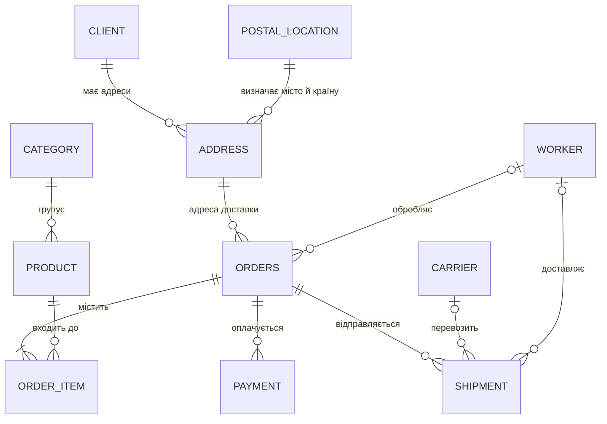

# Лабораторна робота №5. Нормалізація бази даних

## 1. Початкова схема та виявлені аномалії

У схемі з 2-ї лаби є 9 таблиць, у кожній первинний ключ - одне поле `serial`.

| Таблиця | Колонки (Лаб. 2) |
| :--- | :--- |
| `client` | `client_id` PK, `client_name`, `last_name`, `email`, `phone_number` |
| `address` | `address_id` PK, `country`, `city`, `street`, `postal_code`, `client_id` FK |
| `worker` | `worker_id` PK, `worker_role`, `first_name`, `last_name`, `phone_number` (UNIQUE) |
| `orders` | `order_id` PK, `order_date`, `order_price`, `status`, `discount`, `client_id` FK, `address_id` FK, `worker_id` FK |
| `category` | `category_id` PK, `category_name`, `description` |
| `product` | `product_id` PK, `product_name`, `price`, `quantity`, `description`, `stock_status`, `image_url`, `category_id` FK |
| `order_item` | `order_item_id` PK, `quantity`, `order_id` FK, `product_id` FK, UNIQUE(`order_id`, `product_id`) |
| `payment` | `payment_id` PK, `payment_date`, `payment_method`, `payment_status`, `price`, `order_id` FK |
| `shipment` | `shipment_id` PK, `carrier`, `tracking_number` (UNIQUE), `shipment_status`, `shipping_date`, `delivery_address`, `order_id` FK, `worker_id` FK |

### Знайдені проблеми

1. **Дублювання країни й міста в `address`.** `Ukraine` повторюється в більшості рядків. Через це перейменування міста вимагає оновлення багатьох записів (аномалія оновлення), індекс не можна додати без клієнта через `client_id NOT NULL` (аномалія вставки), а видалення останньої адреси стирає дані про місто (аномалія видалення).
2. **Конфлікт `client_id` в `orders` і `address`.** Адреса належить конкретному клієнту (`address.client_id`), але в `orders` зберігаються і `client_id`, і `address_id`. Через це в 3-й лабі запит `UPDATE orders SET address_id = 2 WHERE order_id = 1` прив'язав замовлення 1-го клієнта до адреси 2-го.
3. **Неатомарна і суперечлива адреса в `shipment`.** У `delivery_address` усе записано одним рядком (`м. Київ, вул. Хрещатик, 24, кв. 7`) і дублює `orders.address_id`. У даних через це вже є розбіжності: для замовлення №4 в `orders` вказана Варшава, а в `shipment` - Київ; для №2 в `orders` - Львів, а в `shipment` - Одеса.
4. **Перевізники текстом у `shipment`.** Поле `carrier` зберігає назви рядком (`Нова Пошта`, `УкрПошта`), що створює ризик описок.

## 2. Функціональні залежності (ФЗ)

Бізнес-правила з 1-ї лаби: кожна адреса належить одному клієнту (`Client - Address` 1:N), замовлення оформлюється на одну адресу, а поштовий індекс у межах країни визначає місто.

| Таблиця | Функціональні залежності |
| :--- | :--- |
| `client` | `client_id -> client_name, last_name, email, phone_number` |
| `address` | `address_id -> country, city, street, postal_code, client_id`<br>`(country, postal_code) -> city` (транзитивна) |
| `worker` | `worker_id -> worker_role, first_name, last_name, phone_number`<br>`phone_number -> worker_id` (UNIQUE) |
| `orders` | `order_id -> order_date, order_price, status, discount, client_id, address_id, worker_id`<br>`address_id -> client_id` (транзитивна) |
| `category` | `category_id -> category_name, description` |
| `product` | `product_id -> product_name, price, quantity, description, stock_status, image_url, category_id` |
| `order_item` | `order_item_id -> quantity, order_id, product_id`<br>`(order_id, product_id) -> order_item_id, quantity` |
| `payment` | `payment_id -> payment_date, payment_method, payment_status, price, order_id` |
| `shipment` | `shipment_id -> carrier, tracking_number, shipment_status, shipping_date, delivery_address, order_id, worker_id`<br>`tracking_number -> shipment_id` (UNIQUE)<br>`order_id -> delivery_address` (транзитивна) |

- У `payment` немає ФЗ `order_id -> price`, бо замовлення може оплачуватися частинами, і `price` - це сума конкретного платежу.
- У `product` немає ФЗ `quantity -> stock_status`, бо при `quantity = 0` статус буває і `out of stock`, і `coming soon`.

## 3. Нормальні форми початкової схеми

| Таблиця | 1НФ | 2НФ | 3НФ | Найвища НФ | Пояснення |
| :--- | :---: | :---: | :---: | :---: | :--- |
| `client` | так | так | так | **3НФ** | усі поля залежать тільки від `client_id` |
| `address` | так | так | ні | **2НФ** | транзитивна залежність `(country, postal_code) -> city` |
| `worker` | так | так | так | **3НФ** | порушень немає |
| `orders` | так | так | ні | **2НФ** | транзитивна залежність `order_id -> address_id -> client_id` |
| `category` | так | так | так | **3НФ** | порушень немає |
| `product` | так | так | так | **3НФ** | `stock_status` не залежить від `quantity` |
| `order_item` | так | так | так | **3НФ** | `quantity` залежить від усього ключа `(order_id, product_id)` |
| `payment` | так | так | так | **3НФ** | `price` - сума окремого платежу |
| `shipment` | ні | - | - | **нижче 1НФ** | неатомарне поле `delivery_address`; також є `order_id -> delivery_address` |

Загалом схема не відповідає 1НФ через `shipment.delivery_address`. Після розбиття цього поля вона була б у 2НФ, бо 3НФ порушують `address`, `orders` і `shipment`. Часткових залежностей немає, оскільки всі PK прості.

## 4. Покрокова нормалізація

### Крок 1. Приведення до 1НФ
Розбиваємо неатомарне поле `shipment.delivery_address` на окремі колонки (решта таблиць уже атомарні, повторювані групи винесені в окремі таблиці в 2-й лабі):
- було: `shipment(shipment_id PK, carrier, tracking_number, shipment_status, shipping_date, delivery_address, order_id FK, worker_id FK)`
- стало: `shipment(shipment_id PK, carrier, tracking_number, shipment_status, shipping_date, delivery_city, delivery_street, order_id FK, worker_id FK)`

### Крок 2. Приведення до 2НФ
Усі первинні ключі складаються з одного поля, тому часткових залежностей немає. У складеному кандидатному ключі `(order_id, product_id)` в `order_item` атрибут `quantity` залежить від обох полів одразу. Зміни не потрібні.

### Крок 3. Приведення до 3НФ
1. **`address`:** усуваємо транзитивну залежність `address_id -> (country, postal_code) -> city`. Виносимо країну, місто й індекс у довідник `postal_location` із сурогатним ключем (бо однакові індекси існують у різних країнах, наприклад `65000` в Одесі та французькому Тарбі):
   - `postal_location(location_id PK, country, city, postal_code, UNIQUE(country, postal_code))`
   - `address(address_id PK, street, location_id FK, client_id FK)`
2. **`orders`:** видаляємо `client_id`, бо клієнт визначається через `address_id -> client_id`. Тепер до замовлення неможливо підв'язати чужу адресу. Для старих запитів 3-4 лаб додали представлення `v_orders`:
   - `orders(order_id PK, order_date, order_price, status, discount, address_id FK, worker_id FK)`
3. **`shipment`:** видаляємо `delivery_city` і `delivery_street`, оскільки адреса доставки береться із замовлення (`shipment -> orders -> address -> postal_location`). Зберігати її в `shipment` немає сенсу, бо за правилами 1-ї лаби всі відправлення замовлення йдуть на одну адресу.
4. **Довідник `carrier`:** винесли назви служб доставки в окрему таблицю, щоб уникнути дублювання рядків та описок:
   - `carrier(carrier_id PK, carrier_name UNIQUE)`
   - `shipment(shipment_id PK, carrier_id FK, tracking_number UNIQUE, shipment_status, shipping_date, order_id FK, worker_id FK)`

## 5. Що залишили без змін

- `product.stock_status`: при `quantity = 0` товар може мати статус `out of stock` або `coming soon` (обидва потрібні за 1-ю лабою), а узгодженість контролює `CHECK (stock_status != 'out of stock' OR quantity = 0)`.
- `payment.price`: замовлення можна оплачувати частинами (`Order - Payment` 0..N), тому це сума окремого платежу, потрібна для запиту 3 з 4-ї лаби (`SUM(price)`).
- `orders.order_price`: фіксує суму на момент оформлення, щоб зміна цін у каталозі (`UPDATE product SET price = 50000` у 3-й лабі) не змінювала історичні замовлення.

## 6. Було / Стало та міграція `ALTER TABLE`

| Таблиця | Було (Лаб. 2) | Стало (3НФ, Лаб. 5) |
| :--- | :--- | :--- |
| `address` | `address(address_id PK, country, city, street, postal_code, client_id FK)` | `address(address_id PK, street, location_id FK, client_id FK)` + `postal_location(location_id PK, country, city, postal_code)` |
| `orders` | `orders(order_id PK, order_date, order_price, status, discount, client_id FK, address_id FK, worker_id FK)` | `orders(order_id PK, order_date, order_price, status, discount, address_id FK, worker_id FK)` |
| `shipment` | `shipment(shipment_id PK, carrier, tracking_number, shipment_status, shipping_date, delivery_address, order_id FK, worker_id FK)` | `shipment(shipment_id PK, carrier_id FK, tracking_number, shipment_status, shipping_date, order_id FK, worker_id FK)` + `carrier(carrier_id PK, carrier_name)` |
| `client`, `worker`, `category`, `product`, `order_item`, `payment` | - | без змін |

Перед міграцією перевіряємо наявність замовлень із чужою адресою і виправляємо їх:

```sql
SELECT o.order_id, o.client_id AS client_in_order, a.client_id AS owner_of_address
FROM orders o
JOIN address a ON a.address_id = o.address_id
WHERE o.client_id <> a.client_id;
```

```sql
BEGIN;

CREATE TABLE postal_location (
    location_id serial PRIMARY KEY,
    country     varchar(32) NOT NULL,
    city        varchar(32) NOT NULL,
    postal_code varchar(32) NOT NULL,
    CONSTRAINT uq_postal_location UNIQUE (country, postal_code)
);

INSERT INTO postal_location (country, city, postal_code)
SELECT DISTINCT ON (country, postal_code) country, city, postal_code
FROM address
ORDER BY country, postal_code, city;

ALTER TABLE address ADD COLUMN location_id integer;

UPDATE address a
SET location_id = pl.location_id
FROM postal_location pl
WHERE pl.country = a.country AND pl.postal_code = a.postal_code;

ALTER TABLE address ALTER COLUMN location_id SET NOT NULL;
ALTER TABLE address ADD CONSTRAINT fk_address_location
    FOREIGN KEY (location_id) REFERENCES postal_location(location_id);
ALTER TABLE address DROP COLUMN country, DROP COLUMN city, DROP COLUMN postal_code;

ALTER TABLE orders DROP COLUMN client_id;

CREATE TABLE carrier (
    carrier_id   serial PRIMARY KEY,
    carrier_name varchar(64) NOT NULL UNIQUE
);

INSERT INTO carrier (carrier_name)
SELECT DISTINCT carrier FROM shipment WHERE carrier IS NOT NULL;

ALTER TABLE shipment ADD COLUMN carrier_id integer REFERENCES carrier(carrier_id);

UPDATE shipment s
SET carrier_id = c.carrier_id
FROM carrier c
WHERE c.carrier_name = s.carrier;

ALTER TABLE shipment DROP COLUMN carrier, DROP COLUMN delivery_address;

CREATE VIEW v_address AS
SELECT a.address_id, a.client_id, pl.country, pl.city, a.street, pl.postal_code
FROM address a
JOIN postal_location pl ON pl.location_id = a.location_id;

CREATE VIEW v_orders AS
SELECT o.*, a.client_id
FROM orders o
JOIN address a ON a.address_id = o.address_id;

COMMIT;
```

## 7. Нові та змінені таблиці (DDL у 3НФ)

Повний скрипт створення БД, тестових даних і представлень міститься в `normalization.sql`.

```sql
CREATE TABLE postal_location (
    location_id serial PRIMARY KEY,
    country     varchar(32) NOT NULL,
    city        varchar(32) NOT NULL,
    postal_code varchar(32) NOT NULL,
    CONSTRAINT uq_postal_location UNIQUE (country, postal_code)
);

CREATE TABLE address (
    address_id  serial PRIMARY KEY,
    street      varchar(32) NOT NULL,
    location_id integer NOT NULL REFERENCES postal_location(location_id),
    client_id   integer NOT NULL REFERENCES client(client_id)
);

CREATE TABLE orders (
    order_id    serial PRIMARY KEY,
    order_date  date NOT NULL DEFAULT CURRENT_DATE,
    order_price NUMERIC(10, 2) NOT NULL CHECK (order_price >= 0),
    status      status_name NOT NULL,
    discount    integer CHECK (discount >= 0 AND discount <= 100),
    address_id  integer NOT NULL REFERENCES address(address_id),
    worker_id   integer NOT NULL REFERENCES worker(worker_id)
);

CREATE TABLE carrier (
    carrier_id   serial PRIMARY KEY,
    carrier_name varchar(64) NOT NULL UNIQUE
);

CREATE TABLE shipment (
    shipment_id     serial PRIMARY KEY,
    carrier_id      integer REFERENCES carrier(carrier_id),
    tracking_number text UNIQUE,
    shipment_status varchar(50) NOT NULL DEFAULT 'processing'
        CHECK (shipment_status IN ('processing', 'shipped', 'delivered', 'cancelled')),
    shipping_date   date,
    order_id        integer NOT NULL REFERENCES orders(order_id),
    worker_id       integer REFERENCES worker(worker_id)
);
```

## 8. Оновлена ER-діаграма

Діаграму збережено в `er_diagram_normalized.png`. Зв'язок `CLIENT` та `ORDERS` проходить через `ADDRESS`, додано довідники `POSTAL_LOCATION` і `CARRIER`.



## 9. Перевірка схеми 3НФ

```sql
-- 1) Перевірка FK на довідник (має видати помилку зовнішнього ключа)
INSERT INTO address (street, location_id, client_id) VALUES ('Test 1', 999, 1);

-- 2) Клієнт та місто замовлення через адресу
SELECT o.order_id, c.client_name, pl.city
FROM orders o
JOIN address a ON a.address_id = o.address_id
JOIN client c ON c.client_id = a.client_id
JOIN postal_location pl ON pl.location_id = a.location_id;

-- 3) Адреса доставки відправлення із замовлення (Warsaw, Poland)
SELECT s.shipment_id, s.tracking_number, ca.carrier_name, a.street, pl.city, pl.country
FROM shipment s
JOIN carrier ca ON ca.carrier_id = s.carrier_id
JOIN orders o ON o.order_id = s.order_id
JOIN address a ON a.address_id = o.address_id
JOIN postal_location pl ON pl.location_id = a.location_id;

-- 4) Запит 3 з Лаб. 4 без змін
SELECT payment_method, SUM(price) AS revenue FROM payment GROUP BY payment_method;

-- 5) Запит 5 з Лаб. 4 через представлення v_orders
SELECT c.client_id, c.client_name, SUM(o.order_price) AS total_spent
FROM client c
LEFT JOIN v_orders o ON c.client_id = o.client_id
GROUP BY c.client_id, c.client_name
HAVING SUM(o.order_price) > 5000;
```

Усі 11 таблиць бази приведені до 3НФ: усунуто дублювання міст, перевізників та адрес, а прив'язка замовлення до чужої адреси заблокована на рівні структури.