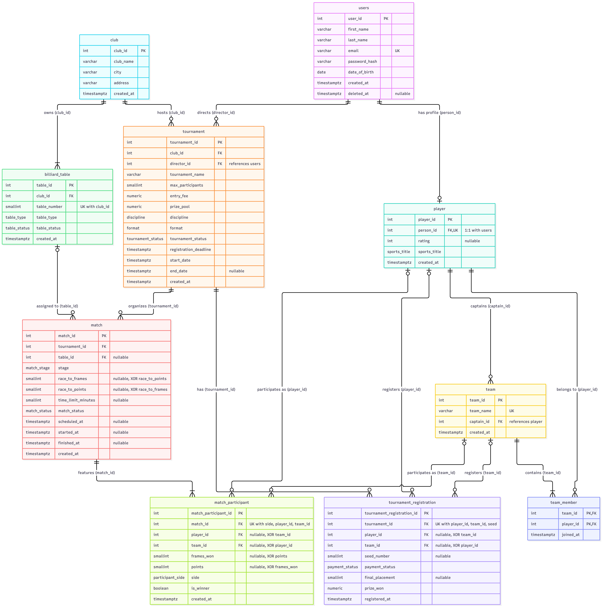

# Lab 5: Normalization Review of the Lab 2 Schema

Overall, the Lab 2 schema already satisfies **1NF, 2NF, 3NF, and BCNF**. Below is the original schema reference, the functional dependencies identified for every table, and the normalization review of the candidate issues examined across the schema.

---

## 1. Original Schema & ER Diagram (from Lab 2)

* **DDL Script:** [`create_tables.sql`](create_tables.sql) *(copied from Lab 2; seed reference: `labs/2 - DDL/seed_data.sql` on branch `feature/add-lab-2`)*

---

## 2. Functional Dependencies by Table

For each table in [`create_tables.sql`](create_tables.sql), every non-trivial functional dependency has a candidate key (superkey) on its left-hand side, so all 10 tables satisfy **1NF, 2NF, 3NF, and BCNF**:

1. **`users`**
   * **Candidate keys:** `{user_id}`, `{email}`
   * **Functional dependencies:**
     * `user_id -> first_name, last_name, email, password_hash, date_of_birth, created_at, deleted_at`
     * `email -> user_id, first_name, last_name, password_hash, date_of_birth, created_at, deleted_at`

2. **`player`**
   * **Candidate keys:** `{player_id}`, `{person_id}`
   * **Functional dependencies:**
     * `player_id -> person_id, rating, sports_title, created_at`
     * `person_id -> player_id, rating, sports_title, created_at`

3. **`club`**
   * **Candidate key:** `{club_id}`
   * **Functional dependencies:**
     * `club_id -> club_name, city, address, created_at`

4. **`billiard_table`**
   * **Candidate keys:** `{table_id}`, `{club_id, table_number}`
   * **Functional dependencies:**
     * `table_id -> club_id, table_number, table_type, table_status, created_at`
     * `(club_id, table_number) -> table_id, table_type, table_status, created_at`

5. **`tournament`**
   * **Candidate key:** `{tournament_id}`
   * **Functional dependencies:**
     * `tournament_id -> club_id, director_id, tournament_name, max_participants, entry_fee, prize_pool, discipline, format, tournament_status, registration_deadline, start_date, end_date, created_at`

6. **`match`**
   * **Candidate key:** `{match_id}`
   * **Functional dependencies:**
     * `match_id -> tournament_id, table_id, stage, race_to_frames, race_to_points, time_limit_minutes, match_status, scheduled_at, started_at, finished_at, created_at`

7. **`team`**
   * **Candidate keys:** `{team_id}`, `{team_name}`
   * **Functional dependencies:**
     * `team_id -> team_name, captain_id, created_at`
     * `team_name -> team_id, captain_id, created_at`

8. **`team_member`**
   * **Candidate key:** `{team_id, player_id}`
   * **Functional dependencies:**
     * `(team_id, player_id) -> joined_at`

9. **`tournament_registration`**
   * **Candidate key:** `{tournament_registration_id}` *(plus unique constraints on `(tournament_id, player_id)`, `(tournament_id, team_id)`, and `(tournament_id, seed_number)` for non-`NULL` values)*
   * **Functional dependencies:**
     * `tournament_registration_id -> tournament_id, player_id, team_id, seed_number, payment_status, final_placement, prize_won, registered_at`
     * `(tournament_id, player_id) -> tournament_registration_id, team_id, seed_number, payment_status, final_placement, prize_won, registered_at` *(when `player_id IS NOT NULL`)*
     * `(tournament_id, team_id) -> tournament_registration_id, player_id, seed_number, payment_status, final_placement, prize_won, registered_at` *(when `team_id IS NOT NULL`)*
     * `(tournament_id, seed_number) -> tournament_registration_id, player_id, team_id, payment_status, final_placement, prize_won, registered_at` *(when `seed_number IS NOT NULL`)*

10. **`match_participant`**
    * **Candidate keys:** `{match_participant_id}`, `{match_id, side}` *(plus unique constraints on `(match_id, player_id)` and `(match_id, team_id)` for non-`NULL` values)*
    * **Functional dependencies:**
      * `match_participant_id -> match_id, player_id, team_id, frames_won, points, side, is_winner, created_at`
      * `(match_id, side) -> match_participant_id, player_id, team_id, frames_won, points, is_winner, created_at`
      * `(match_id, player_id) -> match_participant_id, team_id, frames_won, points, side, is_winner, created_at` *(when `player_id IS NOT NULL`)*
      * `(match_id, team_id) -> match_participant_id, player_id, frames_won, points, side, is_winner, created_at` *(when `team_id IS NOT NULL`)*

---

## 3. Step-by-Step Normalization Verification (1NF → 2NF → 3NF / BCNF)

* **Initial highest normal form:** **BCNF** (satisfies 1NF, 2NF, 3NF, and BCNF)
* **Schema changes (`ALTER TABLE` / decomposition):** **None required** — the original Lab 2 schema in [`create_tables.sql`](create_tables.sql) and [`schema.png`](schema.png) is already the final 3NF/BCNF schema.

### Step 1: First Normal Form (1NF)
* **Criteria:** All attributes are atomic, every table has a primary key, and there are no repeating groups.
* **Verification:**
  * Every table defines an explicit `PRIMARY KEY`.
  * All columns store scalar values (e.g., `users` separates `first_name` and `last_name`; `club` separates `city` and `address`), with no repeating groups, arrays, or numbered multi-value columns.
* **Conclusion:** All 10 tables satisfy **1NF**.

### Step 2: Second Normal Form (2NF)
* **Criteria:** Table is in 1NF, and no non-prime attribute depends on a proper subset of any candidate key (no partial dependencies).
* **Verification:**
  * Tables with single-column primary keys (`users`, `player`, `club`, `billiard_table`, `tournament`, `match`, `team`, `tournament_registration`, `match_participant`) cannot have partial dependencies on their primary key.
  * Table with a composite primary key:
    * `team_member` (`PK (team_id, player_id)`): `joined_at` depends on both `team_id` and `player_id` together (when that specific player joined that specific team).
* **Conclusion:** No partial dependencies exist; all 10 tables satisfy **2NF**.

### Step 3: Third Normal Form (3NF) & BCNF
* **Criteria:** Table is in 2NF with no transitive dependencies of non-prime attributes (3NF), and every non-trivial FD determinant is a superkey (BCNF).
* **Verification:**
  * As listed in Section 2, every non-trivial functional dependency in all 10 tables has a candidate key (superkey) as its determinant.
  * Potential transitive or derived attribute candidates (`club(city, address)`, `match_participant(is_winner)`, `tournament(prize_pool)`, and `tournament_registration(prize_won)`) were analyzed in Section 4 and confirmed not to violate 3NF/BCNF.
* **Conclusion:** All 10 tables satisfy **3NF and BCNF**; no `ALTER TABLE` or table decomposition is necessary.

---

## 4. Normalization Candidates Reviewed & Dismissed

### 4.1. `club(city, address)` — *Dismissed*
* **Why it was reviewed:** If `address` were an atomic full-address string that included the city (e.g., `'Київ, вул. Хрещатик, 22'`), it would create a **3NF transitive dependency** (`club_id -> address -> city`), where the non-key attribute `city` functionally depends on another non-key attribute `address`, causing duplication and update anomalies.
* **Why it is dismissed:** By design (and as shown in `seed_data.sql`, e.g., `city = 'Київ'`, `address = 'вул. Хрещатик, 22'`), `address` stores only the street and building number without the city. Street addresses do not functionally determine a city (the same street name/number can exist in multiple cities), so **3NF holds**.
* **Optional Lab 5 polish (not required for 3NF):** Extract a `city(city_id, city_name)` lookup table if standardized city names are needed to prevent free-text typos (`'Київ'` vs `'Kyiv'`).

---

### 4.2. `match_participant(is_winner)` — *Dismissed*
* **Why it was reviewed:** At first glance, `is_winner` appears derivable by comparing `frames_won` or `points` across participants of the same match.
* **Why it is dismissed:** In this system, `frames_won` and `points` always store the **actual score achieved** rather than an artificial max-score marker, which supports four distinct match outcomes:
  1. **Standard win:** A participant reaches the target `race_to_frames` / `race_to_points` specified on `match`.
  2. **Match abandonment / forfeit:** One participant abandons the match, so the other wins even though their actual recorded score did not reach the target race score (and could even be lower than or equal to the opponent's).
  3. **Time limit exceeded (`time_limit_minutes`):** The match ends on time and the winner is decided by higher score (or tie-breaker rules), while the actual score is preserved as-is.
  4. **`WALKOVER` matches:** Scores are `NULL`, yet a winner must still be recorded.
* Because `is_winner` cannot be reliably derived from `frames_won` / `points` across all valid match outcomes, keeping it is intentional and **not** a redundancy violation.

---

### 4.3. `tournament(entry_fee, max_participants, prize_pool)` — *Dismissed*
* **Why it was reviewed:** `prize_pool` could potentially be a derived attribute if it were strictly calculated as `entry_fee * max_participants`.
* **Why it is dismissed:** Confirmed from `seed_data.sql` that `prize_pool` is independent of `entry_fee * max_participants` (e.g., `16 * 500.00 = 8000.00 ≠ 30000.00`), as prize pools can include sponsor contributions or fixed guarantees. There is no derived or transitive dependency.

---

### 4.4. `tournament_registration(tournament_id, final_placement, prize_won)` — *Dismissed*
* **Why it was reviewed:** If a tournament had a fixed payout mapping per placement (`(tournament_id, final_placement) -> prize_won`), and multiple participants could share the same `final_placement` (e.g., tied 3rd place), storing `prize_won` on every registration row would repeat the same `(tournament_id, final_placement, prize_won)` fact and form a **3NF / BCNF transitive dependency**.
* **Why it is dismissed:** The schema has no separate placement-to-prize payout table; `prize_won` records the actual prize awarded to that specific registration (allowing individual adjustments, splits, or bonuses). Therefore, `prize_won` depends directly on the registration (`tournament_registration_id`), and **3NF / BCNF hold**.

---

### 4.5. Remaining Tables (`users`, `player`, `billiard_table`, `team`, `team_member`, `match`)
* All non-trivial functional dependencies in these tables have superkey determinants, with no partial or transitive dependencies (**1NF, 2NF, 3NF, and BCNF hold**).
