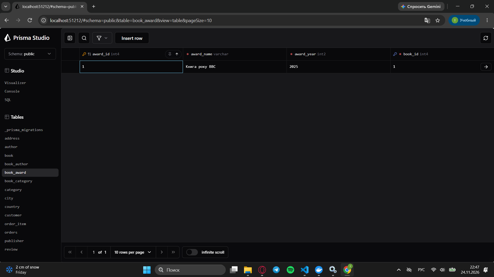
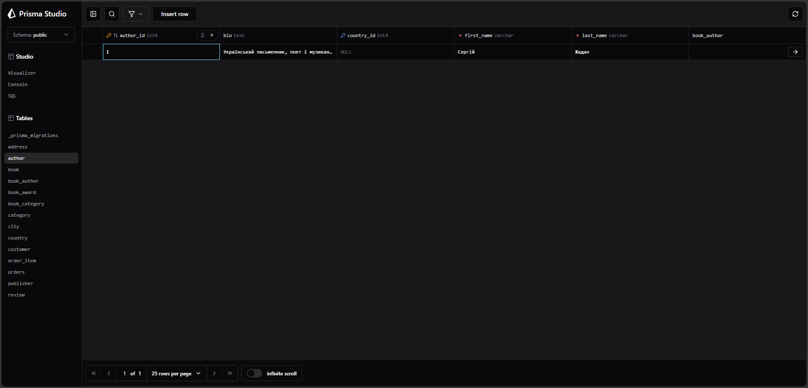

# Лабораторна робота №6: Міграції схем за допомогою Prisma ORM

## Частина 1 (Студент 1) — Додавання нової таблиці зі зв'язком `@relation`

**Назва міграції:** `20261124202512_add_book_award_table`  
**База даних:** PostgreSQL (`postgres`, схема `public`)

### 1. Опис зміни
У межах розвитку схеми бази даних онлайн-книгарні виконано інтроспекцію наявних 13 таблиць з Лабораторної роботи №5 (`npx prisma db pull`), після чого створено та застосовано першу ізольовану міграцію:
- Додано нову модель **`book_award`** для обліку літературних нагород книг (`award_id`, `book_id`, `award_name`, `award_year`).
- Налаштовано зв'язок **«один до багатьох» (`1:N`)** між моделями `book` та `book_award` через атрибут `@relation` із зовнішнім ключем `book_id` та каскадним видаленням (`onDelete: Cascade`).

---

### 2. Зміни у файлі `prisma/schema.prisma` («До» та «Після»)

**До міграції:**
```prisma
model book {
  book_id          Int             @id @default(autoincrement())
  publisher_id     Int
  isbn             String          @unique @db.VarChar(20)
  title            String          @db.VarChar(255)
  publication_year Int             @db.SmallInt
  price            Decimal         @db.Decimal(10, 2)
  stock_quantity   Int             @default(0) @db.SmallInt
  publisher        publisher       @relation(fields: [publisher_id], references: [publisher_id], onUpdate: NoAction)
  book_author      book_author[]
  book_category    book_category[]
  order_item       order_item[]
}
```

**Після міграції:**
```prisma
model book {
  book_id          Int             @id @default(autoincrement())
  publisher_id     Int
  isbn             String          @unique @db.VarChar(20)
  title            String          @db.VarChar(255)
  publication_year Int             @db.SmallInt
  price            Decimal         @db.Decimal(10, 2)
  stock_quantity   Int             @default(0) @db.SmallInt
  publisher        publisher       @relation(fields: [publisher_id], references: [publisher_id], onUpdate: NoAction)
  book_author      book_author[]
  book_category    book_category[]
  order_item       order_item[]
  book_award       book_award[]
}

model book_award {
  award_id   Int    @id @default(autoincrement())
  book_id    Int
  award_name String @db.VarChar(150)
  award_year Int    @db.SmallInt
  book       book   @relation(fields: [book_id], references: [book_id], onDelete: Cascade, onUpdate: NoAction)
}
```

---

### 3. Згенерований SQL-скрипт (`migration.sql`)
Файл: `prisma/migrations/20261124202512_add_book_award_table/migration.sql`

```sql
-- CreateTable
CREATE TABLE "book_award" (
    "award_id" SERIAL NOT NULL,
    "book_id" INTEGER NOT NULL,
    "award_name" VARCHAR(150) NOT NULL,
    "award_year" SMALLINT NOT NULL,

    CONSTRAINT "book_award_pkey" PRIMARY KEY ("award_id")
);

-- AddForeignKey
ALTER TABLE "book_award" ADD CONSTRAINT "book_award_book_id_fkey" FOREIGN KEY ("book_id") REFERENCES "book"("book_id") ON DELETE CASCADE ON UPDATE NO ACTION;
```

---

### 4. Перевірка роботи через Prisma Studio
Для перевірки коректності зв'язку `book_award -> book` через веб-інтерфейс `npx prisma studio` було виконано вставку та вибірку тестового запису про нагороду для існуючої книги (`book_id = 1`, `award_name = "Книга року BBC"`, `award_year = 2025`).




---

## Частина 2 (Студент 2) — Додавання нового поля до існуючої таблиці

**Назва міграції:** `20261124220807_add_bio_to_author`  
**База даних:** PostgreSQL (`postgres`, схема `public`)

### 1. Опис зміни
До існуючої моделі **`author`** додано нове необов'язкове поле **`bio`** (тип `TEXT`) для зберігання короткої біографії автора. Поле є nullable (`String?`), тому наявні записи залишаються валідними, а міграція виконується без втрати даних.

---

### 2. Зміни у файлі `prisma/schema.prisma` («До» та «Після»)

**До міграції:**
```prisma
model author {
  author_id   Int           @id @default(autoincrement())
  first_name  String        @db.VarChar(100)
  last_name   String        @db.VarChar(100)
  country_id  Int?
  country     country?      @relation(fields: [country_id], references: [country_id], onDelete: Restrict, onUpdate: NoAction, map: "fk_author_country")
  book_author book_author[]

  @@index([country_id], map: "idx_author_country")
}
```

**Після міграції:**
```prisma
model author {
  author_id   Int           @id @default(autoincrement())
  first_name  String        @db.VarChar(100)
  last_name   String        @db.VarChar(100)
  bio         String?       @db.Text
  country_id  Int?
  country     country?      @relation(fields: [country_id], references: [country_id], onDelete: Restrict, onUpdate: NoAction, map: "fk_author_country")
  book_author book_author[]

  @@index([country_id], map: "idx_author_country")
}
```

---

### 3. Згенерований SQL-скрипт (`migration.sql`)
Файл: `prisma/migrations/20261124220807_add_bio_to_author/migration.sql`

```sql
-- AlterTable
ALTER TABLE "author" ADD COLUMN "bio" TEXT;
```

---

### 4. Перевірка роботи через Prisma Studio
У веб-інтерфейсі `npx prisma studio` у таблиці `author` з'явилась нова колонка `bio`. Додано тестовий запис (`first_name = "Сергій"`, `last_name = "Жадан"`, `bio = "Український письменник, поет і музикант."`), який успішно збережено та прочитано.

