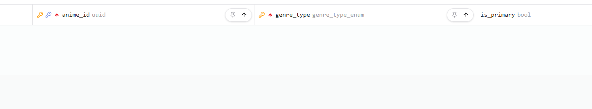

# 1793749059-update-genres-map-and-enum

Додано мапінги `@map`/`@@map` для моделі `Genre` та enum `GenreType`. Додано значення `thriller` та `vampire` до enum `genre_type_enum`. Змінено зовнішній ключ `genres_anime_id_fkey` на `ON DELETE CASCADE`. Додано індекс `idx_genres_genre_type` на колонку `genre_type`.

**Було:**
```prisma
enum GenreType {
  action
  adventure
  avant_garde
  boys_love
  comedy
  demons
  drama
  ecchi
  fantasy
  girls_love
  gourmet
  harem
  hentai
  historical
  horror
  isekai
  josei
  kids
  magic
  martial_arts
  mecha
  military
  music
  mystery
  parody
  psychological
  romance
  samurai
  school
  sci_fi
  seinen
  shoujo
  shoujo_ai
  shounen
  shounen_ai
  slice_of_life
  space
  sports
  supernatural
  super_power
  suspense

  // @@map відсутній
}

model Genre {
  animeId   String
  genreType GenreType
  isPrimary Boolean   @default(false)

  anime     Anime     @relation(fields: [animeId], references: [animeId])

  @@id([animeId, genreType])
  // @@map та @map відсутні
}
```

**Стало:**
```prisma
enum GenreType {
  action
  adventure
  avant_garde
  boys_love
  comedy
  demons
  drama
  ecchi
  fantasy
  girls_love
  gourmet
  harem
  hentai
  historical
  horror
  isekai
  josei
  kids
  magic
  martial_arts
  mecha
  military
  music
  mystery
  parody
  psychological
  romance
  samurai
  school
  sci_fi
  seinen
  shoujo
  shoujo_ai
  shounen
  shounen_ai
  slice_of_life
  space
  sports
  supernatural
  super_power
  suspense
  thriller
  vampire

  @@map("genre_type_enum")
}

model Genre {
  animeId   String     @map("anime_id") @db.Uuid
  genreType GenreType  @map("genre_type")
  isPrimary Boolean    @default(false) @map("is_primary")

  anime     Anime      @relation(fields: [animeId], references: [animeId], onDelete: Cascade)

  @@id([animeId, genreType])
  @@index([genreType], map: "idx_genres_genre_type")
  @@map("genres")
}
```


## Prisma Studio
