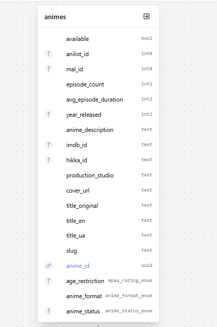

# 20261104110300-sync-animes-with-lab5

Синхронізовано таблицю `animes` зі схемою лаб. 5 (повна синхронізація).

**Зміни:**
- Додано колонку `anime_description TEXT NOT NULL DEFAULT ''`
- `cover_url` та `production_studio` → `NOT NULL DEFAULT ''`
- Типи: `mal_id`, `anilist_id` → `BIGINT`; `year_released`, `avg_episode_duration`, `episodes_count` → `SMALLINT`
- Унікальність: `mal_id`, `anilist_id`, `hikka_id`, `imdb_id`
- CHECK constraints: `year_released >= 1900`, `avg_episode_duration >= 0`, `episodes_count >= 0`
- Enum `anime_status_enum`: `dropped` → `cancelled`

**Було:**
```prisma
model Anime {
  animeId            String       @id @default(uuid()) @map("anime_id")
  slug               String       @unique
  titleUa            String       @default("") @map("title_ua")
  titleEn            String       @default("") @map("title_en")
  titleOriginal      String       @default("") @map("title_original")
  coverUrl           String?      @map("cover_url")
  productionStudio   String?      @map("production_studio")
  malId              Int?         @map("mal_id")
  anilistId          Int?         @map("anilist_id")
  hikkaId            String?      @map("hikka_id")
  imdbId             String?      @map("imdb_id")
  yearReleased       Int?         @map("year_released")
  avgEpisodeDuration Int          @default(0) @map("avg_episode_duration")
  episodeCount       Int          @default(0) @map("episode_count")
  ageRestriction     MpaaRating?  @map("age_restriction")
  animeStatus        AnimeStatus? @map("anime_status")
  animeFormat        AnimeFormat  @default(tv) @map("anime_format")
  available          Boolean      @default(true) @map("available")
}
```

**Стало:**
```prisma
model Anime {
  animeId            String       @id @default(uuid()) @map("anime_id")
  slug               String       @unique
  titleUa            String       @default("") @map("title_ua")
  titleEn            String       @default("") @map("title_en")
  titleOriginal      String       @default("") @map("title_original")
  description        String       @default("") @map("anime_description")
  coverUrl           String       @default("") @map("cover_url")
  productionStudio   String       @default("") @map("production_studio")
  malId              BigInt?      @unique @map("mal_id")
  anilistId          BigInt?      @unique @map("anilist_id")
  hikkaId            String?      @unique @map("hikka_id")
  imdbId             String?      @unique @map("imdb_id")
  yearReleased       Int?         @db.SmallInt @map("year_released")
  avgEpisodeDuration Int          @default(0) @db.SmallInt @map("avg_episode_duration")
  episodeCount       Int          @default(0) @db.SmallInt @map("episode_count")
  ageRestriction     MpaaRating?  @map("age_restriction")
  animeStatus        AnimeStatus? @map("anime_status")
  animeFormat        AnimeFormat  @default(tv) @map("anime_format")
  available          Boolean      @default(true) @map("available")
}
```

## Prisma Studio

