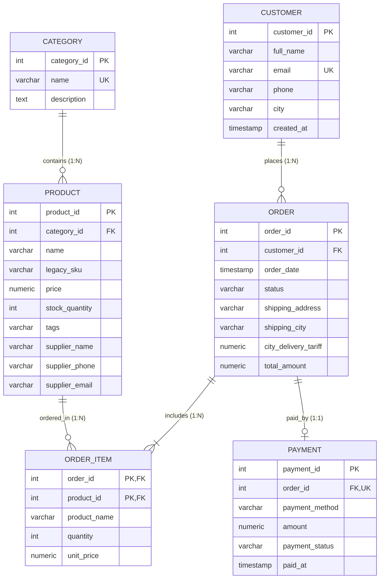

# Лабораторна робота №1: Збір вимог та розробка схеми ER

**Предметна область:** Інтернет-магазин електроніки та гаджетів «TechStore»  
**Виконала:** Лінчевська Анастасія. Група ІМ-о51

---

## 1. Збір та аналіз вимог

Для проєктування бази даних інформаційної системи інтернет-магазину електроніки **«TechStore»** було проведено аналіз потреб зацікавлених сторін: покупців (клієнтів магазину), менеджерів із закупівель та адміністраторів замовлень.

### 1.1. Призначення системи

Система призначена для централізованого обліку каталогу товарів та категорій, реєстрації клієнтів, оформлення й життєвого циклу замовлень, фіксації товарних позицій у кожному замовленні та обліку оплат.

### 1.2. Потреби зацікавлених сторін та завдання користувачів

- **Клієнт (Покупець):**
  - реєструє обліковий запис із контактними даними (ім'я, email, телефон, місто);
  - переглядає каталог товарів за категоріями, ціною та характеристиками/тегами;
  - формує замовлення, яке може містити один або декілька різних товарів у певній кількості;
  - здійснює оплату замовлення обраним методом (банківська картка, Apple Pay / Google Pay, післяплата).
- **Менеджер каталогу:**
  - додає нові категорії та товари, вказує ціну, залишок на складі, теги для пошуку та контактні дані постачальника товару;
  - контролює актуальні залишки товарів на складі.
- **Адміністратор замовлень:**
  - відстежує статус виконання замовлення (`pending`, `paid`, `shipped`, `completed`, `cancelled`);
  - перевіряє надходження платежів та адресу доставки клієнта.

### 1.3. Ключові елементи даних для зберігання

1. Дані про клієнтів (ідентифікатор, ПІБ, електронна пошта, номер телефону, місто проживання, дата реєстрації).
2. Дані про категорії товарів (ідентифікатор, назва категорії, опис).
3. Дані про товари (ідентифікатор, категорія, назва, артикул `legacy_sku`, ціна, кількість на складі, пошукові теги, інформація про постачальника).
4. Дані про замовлення (ідентифікатор, клієнт, дата оформлення, статус, адреса й місто доставки, тариф доставки для міста, загальна сума).
5. Дані про позиції замовлення (який товар, у якому замовленні, назва товару, кількість одиниць, ціна за одиницю на момент покупки).
6. Дані про платежі (ідентифікатор платежу, замовлення, спосіб оплати, сума, статус оплати, час транзакції).

### 1.4. Бізнес-правила

1. Кожен клієнт повинен мати унікальну адресу електронної пошти (`email`).
2. Кожен товар належить рівно до однієї категорії, проте одна категорія може містити багато товарів.
3. Ціна товару (`price`) та ціна фіксації в замовленні (`unit_price`) повинні бути строго більшими за `0`.
4. Кількість товару на складі (`stock_quantity`) не може бути від'ємною (`>= 0`), а кількість одиниць товару в замовленні (`quantity`) має бути не меншою за `1`.
5. Одне замовлення оформлюється одним клієнтом, але клієнт може оформити багато замовлень за весь час.
6. Одне замовлення може містити декілька товарів, і один і той самий товар може входити до складу багатьох різних замовлень (зв'язок «багато-до-багатьох» реалізується через асоціативну сутність `OrderItem`).
7. Кожне замовлення оплачується одним підсумковим платежем (`Payment`), який однозначно прив'язаний до цього замовлення.

---

## 2. Сутності, їхні атрибути та первинні ключі

Сформовано **6 основних сутностей**:

### 1. `Customer` (Клієнт)

- **`customer_id`** _(Primary Key)_ — унікальний ідентифікатор клієнта.
- `full_name` — повне ім'я клієнта (обов'язкове).
- `email` — електронна пошта (унікальна, обов'язкова).
- `phone` — контактний номер телефону.
- `city` — місто клієнта.
- `created_at` — дата та час реєстрації.

### 2. `Category` (Категорія товарів)

- **`category_id`** _(Primary Key)_ — унікальний ідентифікатор категорії.
- `name` — назва категорії (унікальна, обов'язкова).
- `description` — текстовий опис категорії.

### 3. `Product` (Товар)

- **`product_id`** _(Primary Key)_ — унікальний ідентифікатор товару.
- `category_id` _(Foreign Key)_ — посилання на категорію, до якої належить товар.
- `name` — назва моделі товару (обов'язкова).
- `legacy_sku` — внутрішній артикул товару.
- `price` — поточна ціна товару (`> 0`).
- `stock_quantity` — поточний залишок на складі (`>= 0`).
- `tags` — перелік ключових тегів товару.
- `supplier_name` — назва компанії-постачальника.
- `supplier_phone` — контактний телефон постачальника.
- `supplier_email` — електронна пошта постачальника.

### 4. `Order` (Замовлення)

- **`order_id`** _(Primary Key)_ — унікальний ідентифікатор замовлення.
- `customer_id` _(Foreign Key)_ — посилання на клієнта, який зробив замовлення.
- `order_date` — дата та час створення замовлення.
- `status` — поточний статус замовлення (`pending`, `paid`, `shipped`, `completed`, `cancelled`).
- `shipping_address` — вулиця та номер будинку для доставки.
- `shipping_city` — місто доставки.
- `city_delivery_tariff` — базовий тариф доставки у відповідне місто (`>= 0`).
- `total_amount` — підсумкова сума замовлення (`>= 0`).

### 5. `OrderItem` (Позиція замовлення — асоціативна сутність)

- **`order_id`** _(Primary Key, Foreign Key)_ — посилання на замовлення.
- **`product_id`** _(Primary Key, Foreign Key)_ — посилання на товар.
  _(Складений первинний ключ: `(order_id, product_id)`)._
- `product_name` — назва товару у замовленні.
- `quantity` — кількість замовлених одиниць товару (`> 0`).
- `unit_price` — ціна за одиницю товару на момент оформлення (`> 0`).

### 6. `Payment` (Платіж)

- **`payment_id`** _(Primary Key)_ — унікальний ідентифікатор платежу.
- `order_id` _(Foreign Key, Unique)_ — посилання на замовлення, за яке здійснюється оплата.
- `payment_method` — метод оплати (`card`, `apple_pay`, `google_pay`, `cash_on_delivery`).
- `amount` — сума платежу (`> 0`).
- `payment_status` — статус транзакції (`pending`, `completed`, `failed`, `refunded`).
- `paid_at` — дата та час фактичної оплати.

---

## 3. Опис зв'язків між сутностями та кардинальностей

1. **`Category` — `Product` (Один до багатьох / `1 : N`):**
   - _Пояснення_ Кожна категорія може містити багато різних товарів (або тимчасово жодного, якщо категорія щойно створена), але кожен конкретний товар обов'язково належить рівно до однієї основної категорії.
2. **`Customer` — `Order` (Один до багатьох / `1 : N`):**
   - _Пояснення_ Зареєстрований клієнт може оформити нуль, одне або багато замовлень протягом часу користування магазином. Кожне замовлення оформлюється рівно одним конкретним клієнтом.
3. **`Order` — `Product` через асоціативну сутність `OrderItem` (Багато до багатьох / `M : N`, розкладений на два зв'язки `1 : N`):**
   - _Пояснення_ Одне замовлення складається щонайменше з однієї або багатьох товарних позицій (`OrderItem`), а кожен товар може фігурувати у багатьох позиціях різних замовлень (або не бути замовленим ще жодного разу). Асоціативна сутність `OrderItem` зберігає кількість (`quantity`) та фіксовану ціну (`unit_price`) конкретного товару в конкретному замовленні.
4. **`Order` — `Payment` (Один до одного / `1 : 1`):**
   - _Пояснення_ Кожному замовленню відповідає один підсумковий платіж (до моменту оплати запис платежу може перебувати у статусі `pending`), і кожен платіж оплачує рівно одне замовлення.

---

## 4. Концептуальна ER-діаграма

Візуальне представлення сутностей, атрибутів, первинних/зовнішніх ключів та кардинальностей зв'язків:

---

## 5. Припущення та обмеження моделі

1. **Фіксація історичної ціни:** Ціна товару в каталозі (`Product.price`) може змінюватися з часом, тому на момент оформлення замовлення вартість одиниці товару обов'язково копіюється в `OrderItem.unit_price`.
2. **Унікальність позиції в межах замовлення:** Один і той самий товар (`product_id`) не може дублюватися двома окремими рядками в одному замовленні (`order_id`) — замість цього збільшується атрибут `quantity` (забезпечується складеним первинним ключем `(order_id, product_id)`).
3. **Обмеження на кількість та суми:** Усі грошові поля (`price`, `unit_price`, `total_amount`, `amount`) зберігаються з фіксованою точністю до копійок (`NUMERIC(10, 2)`) і не можуть бути від'ємними.
