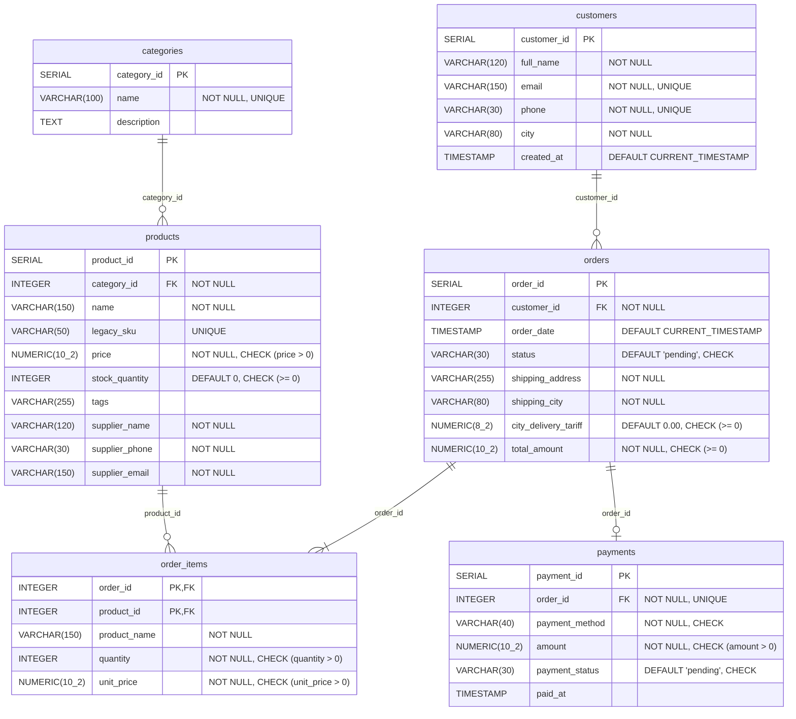
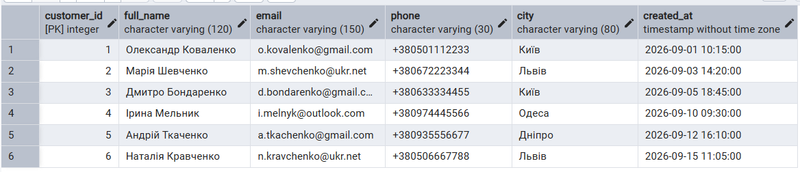
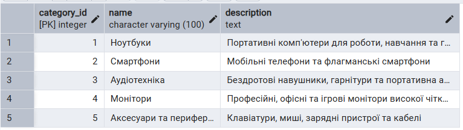
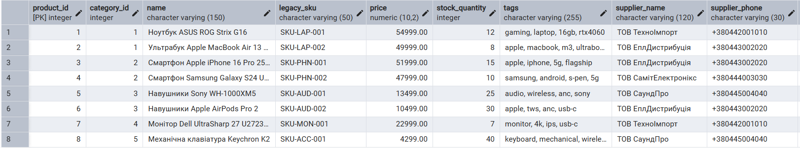
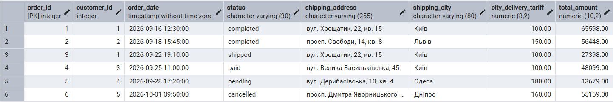
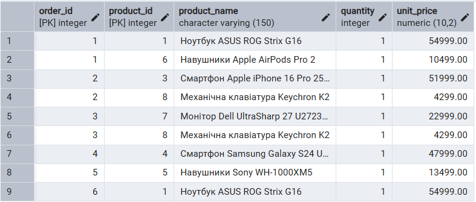
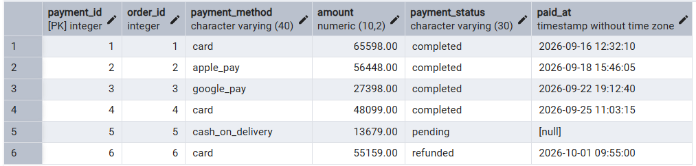

# Лабораторна робота №2: Перетворення ER-діаграми на схему PostgreSQL

**Предметна область:** Інтернет-магазин електроніки та гаджетів «TechStore»  
**Виконала:** Лінчевська Анастасія. Група ІМ-о51

---

## 1. Опис фізичної реляційної схеми

На основі концептуальної ER-діаграми з Лабораторної роботи №1 розроблено фізичну схему бази даних у СУБД **PostgreSQL**. Кожна сутність перетворена на реляційну таблицю з відповідними типами даних, первинними (`PRIMARY KEY`) і зовнішніми (`FOREIGN KEY`) ключами та обмеженнями цілісності (`NOT NULL`, `UNIQUE`, `CHECK`, `DEFAULT`).

### Діаграма реляційної схеми

---

## 2. Характеристика таблиць, ключів та обмежень

### 1. Таблиця `customers` (Клієнти)

- **Первинний ключ:** `customer_id SERIAL PRIMARY KEY`.
- **Обмеження:**
  - `full_name`, `email`, `phone`, `city` — обов'язкові поля (`NOT NULL`).
  - `email` та `phone` мають обмеження `UNIQUE` для запобігання дублюванню облікових записів.
  - `created_at` автоматично заповнюється поточним часом (`DEFAULT CURRENT_TIMESTAMP`).

### 2. Таблиця `categories` (Категорії товарів)

- **Первинний ключ:** `category_id SERIAL PRIMARY KEY`.
- **Обмеження:**
  - `name` — `VARCHAR(100) NOT NULL UNIQUE` (назви категорій не можуть повторюватися).
  - `description` — `TEXT` (необов'язковий розширений опис).

### 3. Таблиця `products` (Товари)

- **Первинний ключ:** `product_id SERIAL PRIMARY KEY`.
- **Зовнішній ключ:** `category_id INTEGER NOT NULL REFERENCES categories(category_id)` — зв'язує кожен товар із відповідною категорією.
- **Обмеження:**
  - `price NUMERIC(10,2) NOT NULL CHECK (price > 0)` — ціна має бути додатною.
  - `stock_quantity INTEGER NOT NULL DEFAULT 0 CHECK (stock_quantity >= 0)` — залишок на складі не може бути від'ємним.
  - `legacy_sku VARCHAR(50) UNIQUE` — унікальний артикул товару.

### 4. Таблиця `orders` (Замовлення)

- **Первинний ключ:** `order_id SERIAL PRIMARY KEY`.
- **Зовнішній ключ:** `customer_id INTEGER NOT NULL REFERENCES customers(customer_id)`.
- **Обмеження:**
  - `status VARCHAR(30) NOT NULL DEFAULT 'pending' CHECK (status IN ('pending', 'paid', 'shipped', 'completed', 'cancelled'))`.
  - `city_delivery_tariff NUMERIC(8,2) NOT NULL DEFAULT 0.00 CHECK (city_delivery_tariff >= 0)`.
  - `total_amount NUMERIC(10,2) NOT NULL CHECK (total_amount >= 0)`.

### 5. Таблиця `order_items` (Позиції замовлення)

- **Складений первинний ключ:** `PRIMARY KEY (order_id, product_id)` — реалізує зв'язок багато-до-багатьох між замовленнями й товарами.
- **Зовнішні ключі:**
  - `order_id INTEGER NOT NULL REFERENCES orders(order_id) ON DELETE CASCADE` — при видаленні замовлення його позиції видаляються каскадно.
  - `product_id INTEGER NOT NULL REFERENCES products(product_id)` — посилання на замовлений товар.
- **Обмеження:** `quantity > 0` та `unit_price > 0`.

### 6. Таблиця `payments` (Платежі)

- **Первинний ключ:** `payment_id SERIAL PRIMARY KEY`.
- **Зовнішній ключ та зв'язок 1:1:** `order_id INTEGER NOT NULL UNIQUE REFERENCES orders(order_id) ON DELETE CASCADE` — обмеження `UNIQUE` на зовнішньому ключі гарантує зв'язок «один до одного» із таблицею `orders`.
- **Обмеження:**
  - `payment_method CHECK (payment_method IN ('card', 'apple_pay', 'google_pay', 'cash_on_delivery'))`.
  - `payment_status CHECK (payment_status IN ('pending', 'completed', 'failed', 'refunded'))`.
  - `amount NUMERIC(10,2) NOT NULL CHECK (amount > 0)`.

---

## 3. SQL-скрипт створення та наповнення бази даних

Повний скрипт знаходиться у файлі [`lab2_schema_and_data.sql`](./lab2_schema_and_data.sql). Нижче наведено повний вміст скрипту з операторами `CREATE TABLE` та `INSERT INTO`

## 4. Результати заповнення таблиць (перевірка `SELECT *`)

Кожна таблиця заповнена тестовими даними (від 5 до 9 рядків на таблицю) у порядку від батьківських до дочірніх таблиць.

### Таблиця `customers` (`SELECT * FROM customers;`)

### Таблиця `categories` (`SELECT * FROM categories;`)

### Таблиця `products` (`SELECT * FROM products;`)

### Таблиця `orders` (`SELECT * FROM orders;`)

### Таблиця `order_items` (`SELECT * FROM order_items;`)

### Таблиця `payments` (`SELECT * FROM payments;`)

