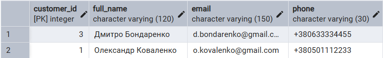
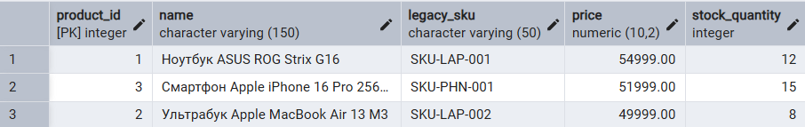
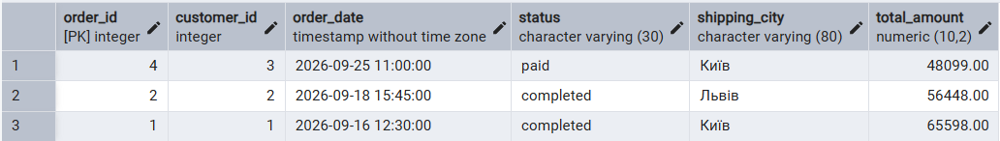
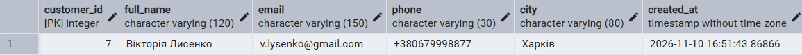
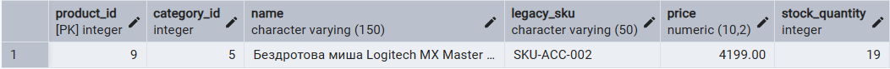
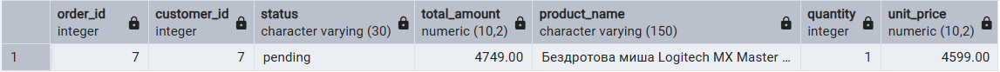
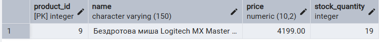
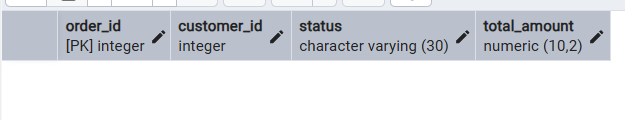

# Лабораторна робота №3: Маніпулювання даними SQL (OLTP)

**Предметна область:** Інтернет-магазин електроніки та гаджетів «TechStore»  
**Виконала:** Лінчевська Анастасія. Група ІМ-о51

---

## 1. Мета роботи

Протестувати створену в Лабораторних роботах №1–2 базу даних інтернет-магазину «TechStore» за допомогою транзакційних запитів **OLTP (Online Transaction Processing)** у СУБД PostgreSQL:

- отримання та фільтрація даних за допомогою `SELECT ... WHERE`;
- додавання нових записів за допомогою `INSERT INTO`;
- модифікація існуючих записів за допомогою `UPDATE ... SET ... WHERE`;
- безпечне видалення записів за допомогою `DELETE FROM ... WHERE`.

Усі SQL-інструкції зібрані у файлі [`oltp_queries.sql`](./oltp_queries.sql).

---

## 2. Опис виконаних OLTP-запитів та їх результатів

### Частина 1. Отримання даних (`SELECT`)

#### Запит 1.1. Вибірка клієнтів із міста Київ

- **Мета:** Отримати контактні дані (`customer_id`, `full_name`, `email`, `phone`) клієнтів, які проживають у місті Київ, відсортовані за алфавітом, без виведення зайвих технічних стовпців.
- **SQL-запит:**
  ```sql
  SELECT customer_id, full_name, email, phone
  FROM customers
  WHERE city = 'Київ'
  ORDER BY full_name;
  ```
- **Очікуваний результат та статус:** Запит виконано успішно (`Query returned successfully`). Отримано 2 записи клієнтів із Києва (Дмитро Бондаренко та Олександр Коваленко).

## 

#### Запит 1.2. Фільтрація преміум-товарів у категоріях «Ноутбуки» та «Смартфони»

- **Мета:** Знайти товари з категорій `1` (Ноутбуки) та `2` (Смартфони), вартість яких перевищує `48 000 грн`, відсортувавши їх за спаданням ціни.
- **SQL-запит:**
  ```sql
  SELECT product_id, name, legacy_sku, price, stock_quantity
  FROM products
  WHERE category_id IN (1, 2)
    AND price > 48000.00
  ORDER BY price DESC;
  ```
- **Очікуваний результат та статус:** Запит виконано успішно. Повернуто 3 флагманські моделі з ціною понад 48 000 грн.



---

#### Запит 1.3. Перегляд активних замовлень на суму понад 30 000 грн

- **Мета:** Відібрати замовлення у статусах `'paid'`, `'shipped'` або `'completed'`, сума яких перевищує `30 000 грн`, у хронологічному порядку (від найновіших).
- **SQL-запит:**
  ```sql
  SELECT order_id, customer_id, order_date, status, shipping_city, total_amount
  FROM orders
  WHERE status IN ('paid', 'shipped', 'completed')
    AND total_amount > 30000.00
  ORDER BY order_date DESC;
  ```
- **Очікуваний результат та статус:** Запит виконано успішно. Відфільтровано 3 замовлення (замовлення №6 на 55 159 грн не увійшло, оскільки має статус `'cancelled'`).



---

### Частина 2. Додавання нових даних (`INSERT INTO`)

#### Запит 2.1. Реєстрація нового клієнта

- **Мета:** Додати до таблиці `customers` нового покупця та перевірити автогенерацію первинного ключа `customer_id`.
- **SQL-запит:**

  ```sql
  INSERT INTO customers (full_name, email, phone, city)
  VALUES ('Вікторія Лисенко', 'v.lysenko@gmail.com', '+380679998877', 'Харків');

  SELECT customer_id, full_name, email, phone, city, created_at
  FROM customers
  WHERE email = 'v.lysenko@gmail.com';
  ```

- **Очікуваний результат та статус:** Успішно вставлено 1 рядок (`INSERT 0 1`). Клієнт отримав `customer_id = 7` та поточну мітку часу `created_at`.
  

#### Запит 2.2. Додавання нового товару до каталогу

- **Мета:** Додати нову позицію «Бездротова миша Logitech MX Master 3S» у категорію `5` (Аксесуари та периферія).
- **SQL-запит:**
  ```sql
  INSERT INTO products (
      category_id, name, legacy_sku, price, stock_quantity,
      tags, supplier_name, supplier_phone, supplier_email
  )
  VALUES (
      5, 'Бездротова миша Logitech MX Master 3S', 'SKU-ACC-002', 4599.00, 20,
      'mouse, wireless, ergonomic, logitech', 'ТОВ СаундПро', '+380445004040', 'sales@soundpro.ua'
  );
  ```
- **Очікуваний результат та статус:** Успішно вставлено 1 рядок (`product_id = 9`). Перевірочний `SELECT` підтвердив коректність збереження всіх полів і дотримання обмежень `CHECK (price > 0)` та `UNIQUE (legacy_sku)`.
  

#### Запит 2.3. Оформлення нового замовлення та додавання позиції замовлення

- **Мета:** Створити нове замовлення для клієнта `customer_id = 7` та прив'язати до нього товар `product_id = 9` у таблиці `order_items`.
- **SQL-запит:**

  ```sql
  INSERT INTO orders (
      order_id, customer_id, order_date, status,
      shipping_address, shipping_city, city_delivery_tariff, total_amount
  )
  VALUES (
      7, 7, '2026-10-05 14:15:00', 'pending',
      'вул. Сумська, 77, кв. 12', 'Харків', 150.00, 4749.00
  );

  INSERT INTO order_items (order_id, product_id, product_name, quantity, unit_price)
  VALUES (7, 9, 'Бездротова миша Logitech MX Master 3S', 1, 4599.00);
  ```

- **Очікуваний результат та статус:** Обидва оператори `INSERT` виконано без порушень зовнішніх ключів. Перевірочний `SELECT` підтвердив зв'язок між `orders` (`order_id = 7`) та `order_items`.
  

---

### Частина 3. Оновлення існуючих даних (`UPDATE`)

#### Запит 3.1. Акційне оновлення ціни та списання одиниці товару зі складу

- **Мета:** Змінити ціну товару з артикулом `'SKU-ACC-002'` на `4199.00 грн` і зменшити залишок `stock_quantity` на 1 одиницю.
- **SQL-запит:**

  ```sql
  UPDATE products
  SET price = 4199.00,
      stock_quantity = stock_quantity - 1
  WHERE legacy_sku = 'SKU-ACC-002';

  SELECT product_id, name, price, stock_quantity
  FROM products
  WHERE legacy_sku = 'SKU-ACC-002';
  ```

- **Очікуваний результат та статус:** Оновлено рівно 1 рядок (`UPDATE 1`). Нова ціна становить `4199.00`, а залишок на складі зменшився з `20` до `19`.



---

#### Запит 3.2. Підтвердження оплати замовлення №5

- **Мета:** Перевести замовлення №5 зі статусу `'pending'` у `'paid'` та оновити відповідний запис у таблиці `payments` (`payment_status = 'completed'`, встановлення часу оплати `paid_at`).
- **SQL-запит:**

  ```sql
  UPDATE orders
  SET status = 'paid'
  WHERE order_id = 5 AND status = 'pending';

  UPDATE payments
  SET payment_status = 'completed',
      paid_at = '2026-10-05 16:30:00'
  WHERE order_id = 5;
  ```

- **Очікуваний результат та статус:** Обидва запити успішно оновили по 1 рядку. Контрольний `SELECT` показав узгоджений стан замовлення та платежу:

## 

### Частина 4. Безпечне видалення даних (`DELETE`)

#### Запит 4.1. Видалення неоплаченого тестового замовлення №7 та його позицій

- **Мета:** Безпечно видалити позицію замовлення №7 із `order_items` та саме замовлення №7 із `orders`, використовуючи точну умову `WHERE`, щоб не зачепити інші записи.
- **SQL-запит:**

  ```sql
  -- Попередня перевірка перед видаленням
  SELECT order_id, product_id, product_name, quantity
  FROM order_items
  WHERE order_id = 7 AND product_id = 9;

  -- Видалення позиції та замовлення
  DELETE FROM order_items
  WHERE order_id = 7 AND product_id = 9;

  DELETE FROM orders
  WHERE order_id = 7 AND status = 'pending';

  -- Перевірка відсутності видаленого замовлення
  SELECT order_id, customer_id, status, total_amount
  FROM orders
  WHERE order_id = 7;
  ```

- **Очікуваний результат та статус:** Видалено 1 позицію з `order_items` та 1 замовлення з `orders` (`DELETE 1`). Контрольний запит `SELECT` повернув `0 рядків` (порожній результат), тоді як усі інші замовлення (`1..6`) залишилися недоторканими.
  
