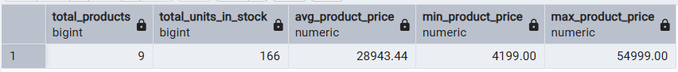
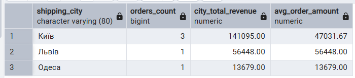
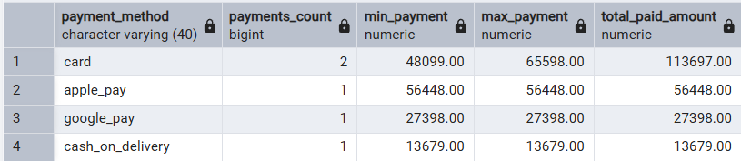
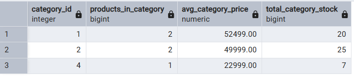
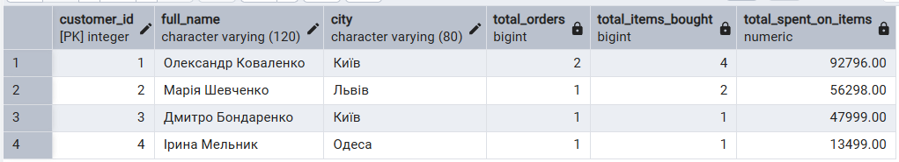
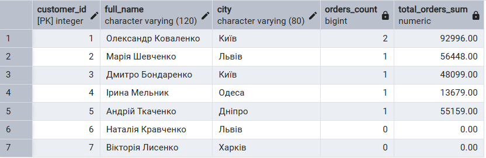
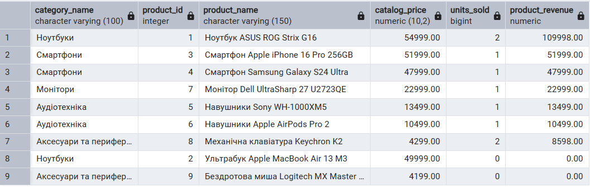
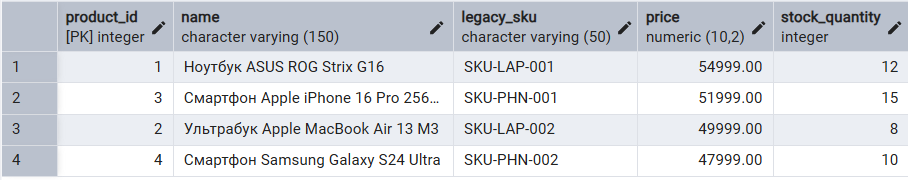
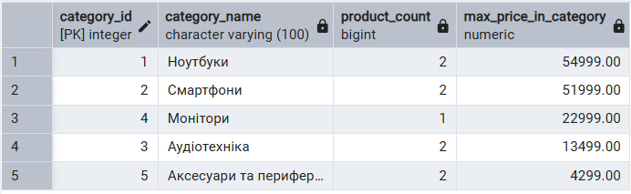
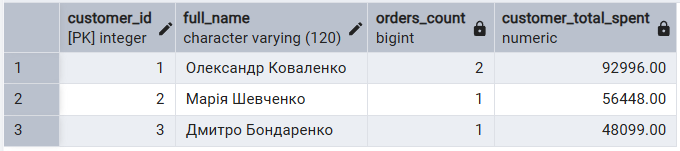

# Лабораторна робота №4: Аналітичні SQL-запити (OLAP)

**Предметна область:** Інтернет-магазин електроніки та гаджетів «TechStore»  
**Виконала:** Лінчевська Анастасія. Група ІМ-о51

---

## 1. Мета роботи

Написати та виконати аналітичні SQL-запити (**OLAP — Online Analytical Processing**) до бази даних інтернет-магазину «TechStore» у PostgreSQL для отримання зведеної статистики та бізнес-звітів з використанням:

- агрегатних функцій (`COUNT`, `SUM`, `AVG`, `MIN`, `MAX`), групування `GROUP BY` та фільтрації груп `HAVING` (4 запити);
- різних типів об'єднання таблиць (`INNER JOIN`, `LEFT JOIN`, `RIGHT JOIN`, `FULL OUTER JOIN`) та багатотабличної агрегації (3 запити);
- вкладених підзапитів у секціях `WHERE`, `SELECT` та `HAVING` (3 запити).

Усі SQL-запити збережено у файлі [`olap_queries.sql`](./olap_queries.sql).

---

## 2. Блок 1: Агрегаційні функції, `GROUP BY` та `HAVING` (4 запити)

### Запит 1.1. Базова агрегація по каталогу товарів

- **Що робить запит і чому:** Обчислює загальну кількість товарних позицій у каталозі (`COUNT`), сумарну кількість одиниць техніки на складі (`SUM`), а також середню (`AVG`), мінімальну (`MIN`) та максимальну (`MAX`) вартість товару. Використовується для швидкої оцінки обсягу та цінового діапазону асортименту магазину.
- **SQL-запит:**
  ```sql
  SELECT
      COUNT(*)                     AS total_products,
      SUM(stock_quantity)          AS total_units_in_stock,
      ROUND(AVG(price), 2)         AS avg_product_price,
      MIN(price)                   AS min_product_price,
      MAX(price)                   AS max_product_price
  FROM products;
  ```
- **Результат виконання:**



---

### Запит 1.2. Групування замовлень за містом доставки (`GROUP BY`)

- **Що робить запит і чому:** Групує всі дійсні (не скасовані) замовлення за містом доставки (`shipping_city`) та підраховує кількість замовлень, загальну виручку і середній чек для кожного регіону. Дозволяє визначити найбільш платоспроможні міста.
- **SQL-запит:**
  ```sql
  SELECT
      shipping_city,
      COUNT(*)                     AS orders_count,
      SUM(total_amount)            AS city_total_revenue,
      ROUND(AVG(total_amount), 2)  AS avg_order_amount
  FROM orders
  WHERE status <> 'cancelled'
  GROUP BY shipping_city
  ORDER BY city_total_revenue DESC;
  ```
- **Результат виконання:**

## 

### Запит 1.3. Аналіз обсягу транзакцій за способами оплати (`GROUP BY`)

- **Що робить запит і чому:** Групує успішно проведені платежі (`payment_status = 'completed'`) за методом оплати (`payment_method`) і визначає кількість транзакцій, мінімальний, максимальний та сумарний обсяг надходжень по кожному платіжному каналу.
- **SQL-запит:**
  ```sql
  SELECT
      payment_method,
      COUNT(*)                     AS payments_count,
      MIN(amount)                  AS min_payment,
      MAX(amount)                  AS max_payment,
      SUM(amount)                  AS total_paid_amount
  FROM payments
  WHERE payment_status = 'completed'
  GROUP BY payment_method
  ORDER BY total_paid_amount DESC;
  ```
- **Результат виконання:**



---

### Запит 1.4. Фільтрація груп за допомогою `HAVING`

- **Що робить запит і чому:** Групує товари за `category_id`, обчислює середню ціну товару в кожній категорії та за допомогою `HAVING AVG(price) > 15000.00` залишає лише високомаржинальні категорії преміум-сегменту.
- **SQL-запит:**
  ```sql
  SELECT
      category_id,
      COUNT(*)                     AS products_in_category,
      ROUND(AVG(price), 2)         AS avg_category_price,
      SUM(stock_quantity)          AS total_category_stock
  FROM products
  GROUP BY category_id
  HAVING AVG(price) > 15000.00
  ORDER BY avg_category_price DESC;
  ```
- **Результат виконання:**



---

## 3. Блок 2: Операції `JOIN` та багатотаблична агрегація (3 запити)

### Запит 2.1. Багатотаблична агрегація через `INNER JOIN`

- **Що робить запит і чому:** Об'єднує таблиці `customers`, `orders` та `order_items` за допомогою `INNER JOIN`, щоб обчислити для кожного активного покупця кількість замовлень, загальну кількість придбаних одиниць товару та суму витрачених коштів на товари (без урахування скасованих замовлень).
- **SQL-запит:**
  ```sql
  SELECT
      c.customer_id,
      c.full_name,
      c.city,
      COUNT(DISTINCT o.order_id)           AS total_orders,
      SUM(oi.quantity)                     AS total_items_bought,
      SUM(oi.quantity * oi.unit_price)     AS total_spent_on_items
  FROM customers c
  INNER JOIN orders o       ON c.customer_id = o.customer_id
  INNER JOIN order_items oi ON o.order_id = oi.order_id
  WHERE o.status <> 'cancelled'
  GROUP BY c.customer_id, c.full_name, c.city
  ORDER BY total_spent_on_items DESC;
  ```
- **Результат виконання:**



---

### Запит 2.2. Пошук клієнтів із замовленнями та без них через `LEFT JOIN`

- **Що робить запит і чому:** Використовує `LEFT JOIN` між `customers` та `orders`, щоб включити у звіт абсолютно всіх зареєстрованих клієнтів — навіть тих, які ще не зробили жодного замовлення (для них `COUNT(o.order_id)` дорівнює `0`, а `COALESCE` перетворює `NULL` суму на `0.00`).
- **SQL-запит:**
  ```sql
  SELECT
      c.customer_id,
      c.full_name,
      c.city,
      COUNT(o.order_id)                    AS orders_count,
      COALESCE(SUM(o.total_amount), 0.00)  AS total_orders_sum
  FROM customers c
  LEFT JOIN orders o ON c.customer_id = o.customer_id
  GROUP BY c.customer_id, c.full_name, c.city
  ORDER BY orders_count DESC, c.customer_id ASC;
  ```
- **Результат виконання:**



---

### Запит 2.3. Комбінація `RIGHT JOIN` та `FULL OUTER JOIN` для аналізу продажів усіх товарів і категорій

- **Що робить запит і чому:** Виконує `RIGHT JOIN` від позицій замовлень (`order_items`) до таблиці `products` та `FULL OUTER JOIN` до таблиці `categories`. Це гарантує, що у звіті відобразяться всі товари та всі категорії каталогу, включно з тими товарами, які ще жодного разу не купувалися (`units_sold = 0`, наприклад MacBook Air M3 та миша Logitech).
- **SQL-запит:**
  ```sql
  SELECT
      cat.name                             AS category_name,
      p.product_id,
      p.name                               AS product_name,
      p.price                              AS catalog_price,
      COALESCE(SUM(oi.quantity), 0)        AS units_sold,
      COALESCE(SUM(oi.quantity * oi.unit_price), 0.00) AS product_revenue
  FROM order_items oi
  RIGHT JOIN products p    ON oi.product_id = p.product_id
  FULL OUTER JOIN categories cat ON p.category_id = cat.category_id
  GROUP BY cat.name, p.product_id, p.name, p.price
  ORDER BY product_revenue DESC, p.price DESC;
  ```
- **Результат виконання:**



---

## 4. Блок 3: Запити з підзапитами у `WHERE`, `SELECT` та `HAVING` (3 запити)

### Запит 3.1. Підзапит у секції `WHERE`

- **Що робить запит і чому:** Відбирає товари, ціна яких перевищує середню вартість товару по всьому магазину, обчислену внутрішнім підзапитом `(SELECT AVG(price) FROM products)`.
- **SQL-запит:**
  ```sql
  SELECT
      product_id,
      name,
      legacy_sku,
      price,
      stock_quantity
  FROM products
  WHERE price > (
      SELECT AVG(price)
      FROM products
  )
  ORDER BY price DESC;
  ```
- **Результат виконання:**



---

### Запит 3.2. Корельовані підзапити у секції `SELECT`

- **Що робить запит і чому:** Для кожного рядка таблиці `categories` виконує два корельовані скалярні підзапити у `SELECT`: перший рахує кількість моделей у цій категорії, а другий знаходить максимальну ціну товару в межах цієї категорії.
- **SQL-запит:**
  ```sql
  SELECT
      c.category_id,
      c.name AS category_name,
      (
          SELECT COUNT(*)
          FROM products p
          WHERE p.category_id = c.category_id
      ) AS product_count,
      (
          SELECT MAX(p.price)
          FROM products p
          WHERE p.category_id = c.category_id
      ) AS max_price_in_category
  FROM categories c
  ORDER BY max_price_in_category DESC;
  ```
- **Результат виконання:**

## 

### Запит 3.3. Підзапит у секції `HAVING`

- **Що робить запит і чому:** Групує дійсні замовлення за клієнтами та за допомогою підзапиту в `HAVING` відбирає лише тих клієнтів, чия сумарна вартість покупок перевищує середній чек одного замовлення по магазину.
- **SQL-запит:**
  ```sql
  SELECT
      c.customer_id,
      c.full_name,
      COUNT(o.order_id) AS orders_count,
      SUM(o.total_amount) AS customer_total_spent
  FROM customers c
  JOIN orders o ON c.customer_id = o.customer_id
  WHERE o.status <> 'cancelled'
  GROUP BY c.customer_id, c.full_name
  HAVING SUM(o.total_amount) > (
      SELECT AVG(total_amount)
      FROM orders
      WHERE status <> 'cancelled'
  )
  ORDER BY customer_total_spent DESC;
  ```
- **Результат виконання:**


