# Лабораторна робота №5: Нормалізація бази даних

**Предметна область:** Інтернет-магазин електроніки та гаджетів «TechStore»  
**Виконала:** Лінчевська Анастасія. Група ІМ-о51

---

## 1. Мета роботи

Проаналізувати початкову схему бази даних інтернет-магазину «TechStore», створену в Лабораторній роботі №2, виявити надмірність даних та потенційні аномалії вставки, оновлення й видалення, визначити функціональні залежності, оцінити поточну нормальну форму кожної таблиці та виконати покрокову нормалізацію схеми від Першої нормальної форми (`1NF`) до Другої (`2NF`) і Третьої нормальної форми (`3NF`).

SQL-скрипт фінальної нормалізованої схеми знаходиться у файлі [`schema_3nf.sql`](./schema_3nf.sql).

---

## 2. Функціональні залежності та оцінка нормальних форм початкової схеми

У Лабораторній роботі №2 схема складалася з 6 таблиць: `customers`, `categories`, `products`, `orders`, ``, `payments`.

Нижче наведено повний мінімальний набір функціональних залежностей для кожної таблиці початкової схеми, а також оцінку їхньої поточної нормальної форми.

### 2.1. Таблиця `customers` (Клієнти)

- **Стовпці:** `customer_id` (первинний ключ `PK`), `full_name`, `email` (`UNIQUE`), `phone` (`UNIQUE`), `city`, `created_at`.
- **Функціональні залежності:**
  - `customer_id -> full_name, email, phone, city, created_at`
  - `email -> customer_id, full_name, phone, city, created_at`
  - `phone -> customer_id, full_name, email, city, created_at`
- **Поточна нормальна форма:** **3NF**.
- **Пояснення:** Усі стовпці містять атомарні значення (`1NF`). Первинний ключ простий (`customer_id`), тому часткових залежностей немає (`2NF`). Жодне неключове поле не залежить від іншого неключового поля (`3NF`). Таблиця не потребує змін.

### 2.2. Таблиця `categories` (Категорії товарів)

- **Стовпці:** `category_id` (первинний ключ `PK`), `name` (`UNIQUE`), `description`.
- **Функціональні залежності:**
  - `category_id -> name, description`
  - `name -> category_id, description`
- **Поточна нормальна форма:** **3NF**.
- **Пояснення:** Усі атрибути атомарні (`1NF`), ключ складається з одного стовпця (`2NF`), транзитивні залежності відсутні (`3NF`). Таблиця не потребує змін.

### 2.3. Таблиця `products` (Товари)

- **Стовпці початкової таблиці:** `product_id` (первинний ключ `PK`), `category_id` (зовнішній ключ `FK`), `name`, `legacy_sku` (`UNIQUE`), `price`, `stock_quantity`, `tags`, `supplier_name`, `supplier_phone`, `supplier_email`.
- **Функціональні залежності:**
  - `product_id -> category_id, name, legacy_sku, price, stock_quantity, tags, supplier_name, supplier_phone, supplier_email`
  - `legacy_sku -> product_id, category_id, name, price, stock_quantity, supplier_name`
  - `supplier_name -> supplier_phone, supplier_email`
- **Поточна нормальна форма:** **Ненормалізована форма (порушує 1NF та 3NF)**.
- **Пояснення порушень та аномалій:**
  1. **Порушення 1NF (повторювана група):** Стовпець `tags` містить список значень через кому в одній комірці (наприклад: `'gaming, laptop, 16gb, rtx4060'`). Значення не є атомарним, що ускладнює пошук і фільтрацію товарів за окремим тегом.
  2. **Порушення 3NF (транзитивна залежність):** Неключові стовпці `supplier_phone` та `supplier_email` залежать від неключового стовпця `supplier_name` (`product_id -> supplier_name -> supplier_phone, supplier_email`). Через це виникають:
     - _аномалія оновлення:_ якщо у постачальника зміниться телефон, його доведеться оновлювати у всіх рядках товарів цього постачальника;
     - _аномалія вставки:_ неможливо додати нового постачальника до бази, поки в магазині немає хоча б одного його товару;
     - _аномалія видалення:_ при видаленні останнього товару постачальника втрачаються всі контактні дані цього постачальника.

### 2.4. Таблиця `order_items` (Позиції замовлення)

- **Стовпці початкової таблиці:** `(order_id, product_id)` (складений первинний ключ `PK`), `product_name`, `quantity`, `unit_price`.
- **Функціональні залежності:**
  - `order_id, product_id -> quantity, unit_price`
  - `product_id -> product_name`
- **Поточна нормальна форма:** **1NF, порушує 2NF**.
- **Пояснення порушень та аномалій:**
  - Усі поля таблиці атомарні, тому вона перебуває в `1NF`.
  - Проте первинний ключ є складеним: `(order_id, product_id)`. Стовпці `quantity` та `unit_price` залежать від усього ключа (від конкретного замовлення і конкретного товару разом), а от стовпець `product_name` (назва товару) залежить лише від частини ключа — `product_id` (`product_id -> product_name`).
  - Це **часткова функціональна залежність**, яка порушує `2NF`. Назва товару дублюється в кожному рядку замовлення, що призводить до надмірності та ризику розбіжності даних при перейменуванні товару в таблиці `products`.

### 2.5. Таблиця `orders` (Замовлення)

- **Стовпці початкової таблиці:** `order_id` (первинний ключ `PK`), `customer_id` (зовнішній ключ `FK`), `order_date`, `status`, `shipping_address`, `shipping_city`, `city_delivery_tariff`, `total_amount`.
- **Функціональні залежності:**
  - `order_id -> customer_id, order_date, status, shipping_address, shipping_city, city_delivery_tariff, total_amount`
  - `shipping_city -> city_delivery_tariff`
- **Поточна нормальна форма:** **2NF, порушує 3NF**.
- **Пояснення порушень та аномалій:**
  - Таблиця знаходиться в `1NF` (усі атрибути атомарні) та в `2NF` (первинний ключ `order_id` складається з одного стовпця, тому часткових залежностей немає).
  - Однак таблиця порушує `3NF`, оскільки неключовий стовпець `city_delivery_tariff` залежить від іншого неключового стовпця `shipping_city` (`order_id -> shipping_city -> city_delivery_tariff`). Це **транзитивна залежність**: тариф доставки для Києва (`100.00`) багаторазово дублюється в кожному замовленні з Києва.

### 2.6. Таблиця `payments` (Платежі)

- **Стовпці:** `payment_id` (первинний ключ `PK`), `order_id` (`FK`, `UNIQUE`), `payment_method`, `amount`, `payment_status`, `paid_at`.
- **Функціональні залежності:**
  - `payment_id -> order_id, payment_method, amount, payment_status, paid_at`
  - `order_id -> payment_id, payment_method, amount, payment_status, paid_at`
- **Поточна нормальна форма:** **3NF**.
- **Пояснення:** Усі стовпці атомарні (`1NF`), ключ простий (`2NF`), транзитивні залежності відсутні (`3NF`). Таблиця не потребує змін.

---

## 3. Покрокове пояснення нормалізації (1NF -> 2NF -> 3NF)

### Крок 1. Приведення схеми до 1NF

**Яку таблицю змінюю:** `products`.

- **Проблема:** Стовпець `tags` містить перелік тегів через кому (`'gaming, laptop, 16gb, rtx4060'`).
- **Рішення:** Видаляю стовпець `tags` із таблиці `products` та створюю нову таблицю `product_tags`, де кожному тегу товару відповідає окремий рядок.
- **Чому це усуває аномалію:** Тепер можна легко додавати, видаляти та шукати окремі теги без розбиття рядків тексту, а кожне поле таблиці є атомарним.

**Стан таблиць на етапі 1NF:**

1. **`customers`** — `customer_id` (`PK`), `full_name`, `email`, `phone`, `city`, `created_at`.
2. **`categories`** — `category_id` (`PK`), `name`, `description`.
3. **`products`** — `product_id` (`PK`), `category_id` (`FK`), `name`, `legacy_sku`, `price`, `stock_quantity`, `supplier_name`, `supplier_phone`, `supplier_email`.
4. **`product_tags`** _(нова таблиця)_ — `(product_id, tag_name)` (складений `PK`, де `product_id` є `FK` на `products`).
5. **`orders`** — `order_id` (`PK`), `customer_id` (`FK`), `order_date`, `status`, `shipping_address`, `shipping_city`, `city_delivery_tariff`, `total_amount`.
6. **`order_items`** — `(order_id, product_id)` (складений `PK`, `FK`), `product_name`, `quantity`, `unit_price`.
7. **`payments`** — `payment_id` (`PK`), `order_id` (`FK`, `UNIQUE`), `payment_method`, `amount`, `payment_status`, `paid_at`.

---

### Крок 2. Приведення схеми до 2NF

**Яку таблицю змінюю:** `order_items`.

- **Проблема:** У таблиці `order_items` складений ключ `(order_id, product_id)`, але поле `product_name` залежить лише від `product_id` (`product_id -> product_name`).
- **Рішення:** Видаляю стовпець `product_name` із таблиці `order_items`, оскільки назва товару вже зберігається в таблиці `products` у полі `name`. У `order_items` залишаються лише стовпці `quantity` та `unit_price`, які повністю залежать від пари `(order_id, product_id)`.
- **Чому це усуває аномалію:** Зникає дублювання назв товарів у позиціях замовлень. Якщо назва товару зміниться в каталозі `products`, вона автоматично буде актуальною при вибірці замовлень через `JOIN`, без необхідності оновлювати тисячі історичних записів у `order_items`.

**Стан таблиць на етапі 2NF:**

1. **`customers`** — `customer_id` (`PK`), `full_name`, `email`, `phone`, `city`, `created_at`.
2. **`categories`** — `category_id` (`PK`), `name`, `description`.
3. **`products`** — `product_id` (`PK`), `category_id` (`FK`), `name`, `legacy_sku`, `price`, `stock_quantity`, `supplier_name`, `supplier_phone`, `supplier_email`.
4. **`product_tags`** — `(product_id, tag_name)` (складений `PK`, `FK`).
5. **`orders`** — `order_id` (`PK`), `customer_id` (`FK`), `order_date`, `status`, `shipping_address`, `shipping_city`, `city_delivery_tariff`, `total_amount`.
6. **`order_items`** _(оновлена до 2NF та 3NF)_ — `(order_id, product_id)` (складений `PK`, `FK`), `quantity`, `unit_price`.
7. **`payments`** — `payment_id` (`PK`), `order_id` (`FK`, `UNIQUE`), `payment_method`, `amount`, `payment_status`, `paid_at`.

---

### Крок 3. Приведення схеми до 3NF

**Які таблиці змінюю:** `products` та `orders`.

1. **Декомпозиція таблиці `products`:**
   - **Проблема:** Транзитивна залежність `product_id -> supplier_name -> supplier_phone, supplier_email`.
   - **Рішення:** Виношу дані про постачальників у нову окрему таблицю `suppliers` (`supplier_id` `PK`, `name`, `phone`, `email`). У таблиці `products` замість трьох стовпців постачальника залишаю лише зовнішній ключ `supplier_id` (`FK` на `suppliers`).
   - **Чому це усуває аномалію:** Інформація про кожного постачальника зберігається рівно один раз. Зміна контактів постачальника виконується в одному рядку таблиці `suppliers`, а нового постачальника можна додати до бази незалежно від наявності товарів.

2. **Декомпозиція таблиці `orders`:**
   - **Проблема:** Транзитивна залежність `order_id -> shipping_city -> city_delivery_tariff`.
   - **Рішення:** Виношу міста та тарифи доставки в нову довідникову таблицю `shipping_cities` (`city_id` `PK`, `city_name`, `delivery_tariff`). У таблиці `orders` замість полів `shipping_city` та `city_delivery_tariff` залишаємо зовнішній ключ `shipping_city_id` (`FK` на `shipping_cities`).
   - **Чому це усуває аномалію:** Тариф доставки для кожного міста зберігається в одному місці й не дублюється в кожному замовленні.

**Фінальний стан таблиць на етапі 3NF:**

1. **`customers`** — `customer_id` (`PK`), `full_name`, `email`, `phone`, `city`, `created_at`.
2. **`categories`** — `category_id` (`PK`), `name`, `description`.
3. **`suppliers`** _(нова таблиця)_ — `supplier_id` (`PK`), `name`, `phone`, `email`.
4. **`products`** _(оновлена до 3NF)_ — `product_id` (`PK`), `category_id` (`FK`), `supplier_id` (`FK`), `name`, `legacy_sku`, `price`, `stock_quantity`.
5. **`product_tags`** _(нова таблиця)_ — `(product_id, tag_name)` (складений `PK`, де `product_id` є `FK`).
6. **`shipping_cities`** _(нова таблиця)_ — `city_id` (`PK`), `city_name`, `delivery_tariff`.
7. **`orders`** _(оновлена до 3NF)_ — `order_id` (`PK`), `customer_id` (`FK`), `shipping_city_id` (`FK`), `order_date`, `status`, `shipping_address`, `total_amount`.
8. **`order_items`** _(оновлена до 3NF)_ — `(order_id, product_id)` (складений `PK`, `FK`), `quantity`, `unit_price`.
9. **`payments`** — `payment_id` (`PK`), `order_id` (`FK`, `UNIQUE`), `payment_method`, `amount`, `payment_status`, `paid_at`.

---

## 4. Оригінальний та перероблений дизайн таблиць

### 4.1. Таблиця `products` (перехід до 1NF та 3NF)

**Оригінальний дизайн (Лабораторна №2):**

```sql
CREATE TABLE products (
    product_id     SERIAL PRIMARY KEY,
    category_id    INTEGER       NOT NULL REFERENCES categories(category_id),
    name           VARCHAR(150)  NOT NULL,
    legacy_sku     VARCHAR(50)   UNIQUE,
    price          NUMERIC(10,2) NOT NULL CHECK (price > 0),
    stock_quantity INTEGER       NOT NULL DEFAULT 0 CHECK (stock_quantity >= 0),
    tags           VARCHAR(255),
    supplier_name  VARCHAR(120)  NOT NULL,
    supplier_phone VARCHAR(30)   NOT NULL,
    supplier_email VARCHAR(150)  NOT NULL
);
```

**Команди `CREATE TABLE` для нових таблиць та `ALTER TABLE` для зміни `products`:**

```sql
CREATE TABLE suppliers (
    supplier_id SERIAL PRIMARY KEY,
    name        VARCHAR(120) NOT NULL UNIQUE,
    phone       VARCHAR(30)  NOT NULL,
    email       VARCHAR(150) NOT NULL UNIQUE
);

CREATE TABLE product_tags (
    product_id INTEGER     NOT NULL REFERENCES products(product_id) ON DELETE CASCADE,
    tag_name   VARCHAR(50) NOT NULL,
    PRIMARY KEY (product_id, tag_name)
);

ALTER TABLE products
    ADD COLUMN supplier_id INTEGER REFERENCES suppliers(supplier_id),
    DROP COLUMN tags,
    DROP COLUMN supplier_name,
    DROP COLUMN supplier_phone,
    DROP COLUMN supplier_email;
```

**Перероблений дизайн `products` у 3NF:**

```sql
CREATE TABLE products (
    product_id     SERIAL PRIMARY KEY,
    category_id    INTEGER       NOT NULL REFERENCES categories(category_id),
    supplier_id    INTEGER       NOT NULL REFERENCES suppliers(supplier_id),
    name           VARCHAR(150)  NOT NULL,
    legacy_sku     VARCHAR(50)   UNIQUE,
    price          NUMERIC(10,2) NOT NULL CHECK (price > 0),
    stock_quantity INTEGER       NOT NULL DEFAULT 0 CHECK (stock_quantity >= 0)
);
```

---

### 4.2. Таблиця `order_items` (перехід до 2NF)

**Оригінальний дизайн (Лабораторна №2):**

```sql
CREATE TABLE order_items (
    order_id     INTEGER       NOT NULL REFERENCES orders(order_id) ON DELETE CASCADE,
    product_id   INTEGER       NOT NULL REFERENCES products(product_id),
    product_name VARCHAR(150)  NOT NULL,
    quantity     INTEGER       NOT NULL CHECK (quantity > 0),
    unit_price   NUMERIC(10,2) NOT NULL CHECK (unit_price > 0),
    PRIMARY KEY (order_id, product_id)
);
```

**Команда `ALTER TABLE` для зміни `order_items`:**

```sql
ALTER TABLE order_items
    DROP COLUMN product_name;
```

**Перероблений дизайн `order_items` у 2NF / 3NF:**

```sql
CREATE TABLE order_items (
    order_id   INTEGER       NOT NULL REFERENCES orders(order_id) ON DELETE CASCADE,
    product_id INTEGER       NOT NULL REFERENCES products(product_id),
    quantity   INTEGER       NOT NULL CHECK (quantity > 0),
    unit_price NUMERIC(10,2) NOT NULL CHECK (unit_price > 0),
    PRIMARY KEY (order_id, product_id)
);
```

---

### 4.3. Таблиця `orders` (перехід до 3NF)

**Оригінальний дизайн (Лабораторна №2):**

```sql
CREATE TABLE orders (
    order_id             SERIAL PRIMARY KEY,
    customer_id          INTEGER       NOT NULL REFERENCES customers(customer_id),
    order_date           TIMESTAMP     NOT NULL DEFAULT CURRENT_TIMESTAMP,
    status               VARCHAR(30)   NOT NULL DEFAULT 'pending'
                         CHECK (status IN ('pending', 'paid', 'shipped', 'completed', 'cancelled')),
    shipping_address     VARCHAR(255)  NOT NULL,
    shipping_city        VARCHAR(80)   NOT NULL,
    city_delivery_tariff NUMERIC(8,2)  NOT NULL DEFAULT 0.00 CHECK (city_delivery_tariff >= 0),
    total_amount         NUMERIC(10,2) NOT NULL CHECK (total_amount >= 0)
);
```

**Команди `CREATE TABLE` та `ALTER TABLE` для зміни `orders`:**

```sql
CREATE TABLE shipping_cities (
    city_id         SERIAL PRIMARY KEY,
    city_name       VARCHAR(80)  NOT NULL UNIQUE,
    delivery_tariff NUMERIC(8,2) NOT NULL DEFAULT 0.00 CHECK (delivery_tariff >= 0)
);

ALTER TABLE orders
    ADD COLUMN shipping_city_id INTEGER REFERENCES shipping_cities(city_id),
    DROP COLUMN shipping_city,
    DROP COLUMN city_delivery_tariff;
```

**Перероблений дизайн `orders` у 3NF:**

```sql
CREATE TABLE orders (
    order_id         SERIAL PRIMARY KEY,
    customer_id      INTEGER       NOT NULL REFERENCES customers(customer_id),
    shipping_city_id INTEGER       NOT NULL REFERENCES shipping_cities(city_id),
    order_date       TIMESTAMP     NOT NULL DEFAULT CURRENT_TIMESTAMP,
    status           VARCHAR(30)   NOT NULL DEFAULT 'pending'
                     CHECK (status IN ('pending', 'paid', 'shipped', 'completed', 'cancelled')),
    shipping_address VARCHAR(255)  NOT NULL,
    total_amount     NUMERIC(10,2) NOT NULL CHECK (total_amount >= 0)
);
```

---

## 5. Оновлена ER-діаграма бази даних після нормалізації (3NF)

Наведена нижче ER-діаграма відображає всі 9 нормалізованих таблиць у `3NF` та зв'язки між ними:

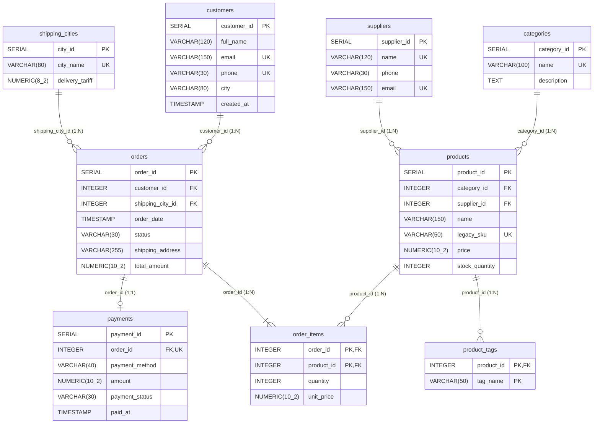

---

## 6. Перевірка завантаження нормалізованої схеми в PostgreSQL

Після виконання скрипту [`schema_3nf.sql`](./schema_3nf.sql) у pgAdmin 4 усі 9 таблиць успішно створені та заповнені тестовими даними без порушень обмежень цілісності.
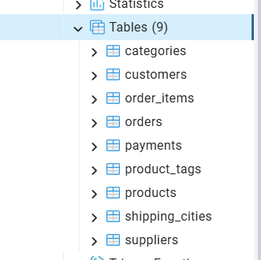

### Таблиця `customers` (`SELECT * FROM customers;`)

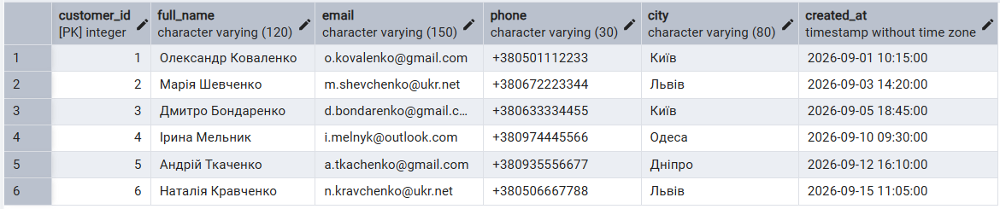

### Таблиця `categories` (`SELECT * FROM categories;`)

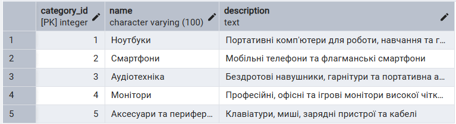

### Таблиця `suppliers` (`SELECT * FROM suppliers;`)

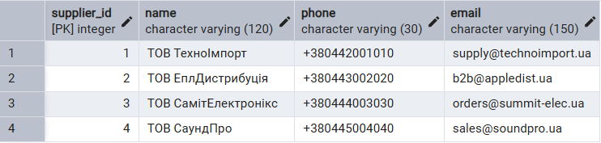

### Таблиця `products` (`SELECT * FROM products;`)

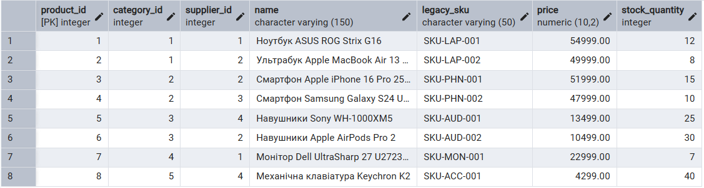

### Таблиця `product_tags` (`SELECT * FROM product_tags;`)

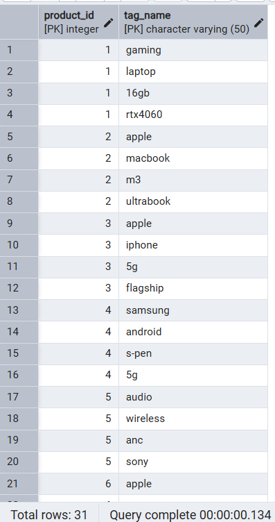

### Таблиця `shipping_cities` (`SELECT * FROM shipping_cities;`)

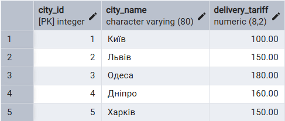

### Таблиця `orders` (`SELECT * FROM orders;`)

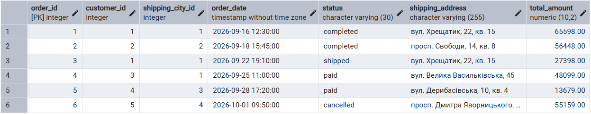

### Таблиця `order_items` (`SELECT * FROM order_items;`)

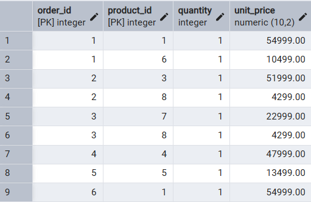

### Таблиця `payments` (`SELECT * FROM payments;`)

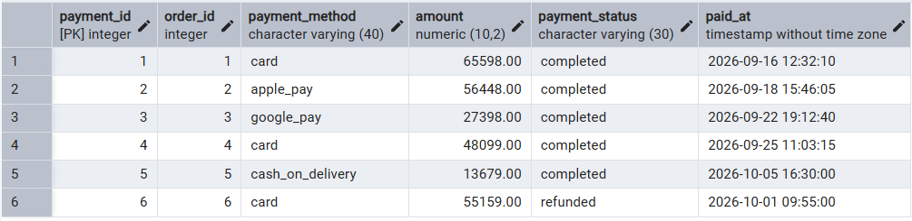
