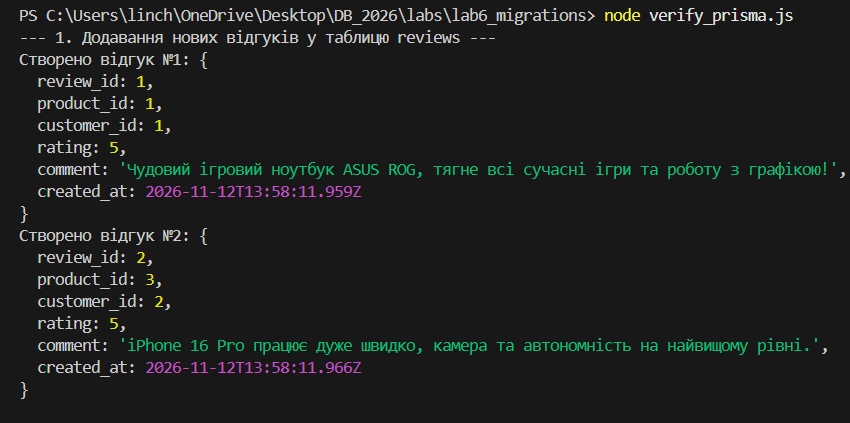
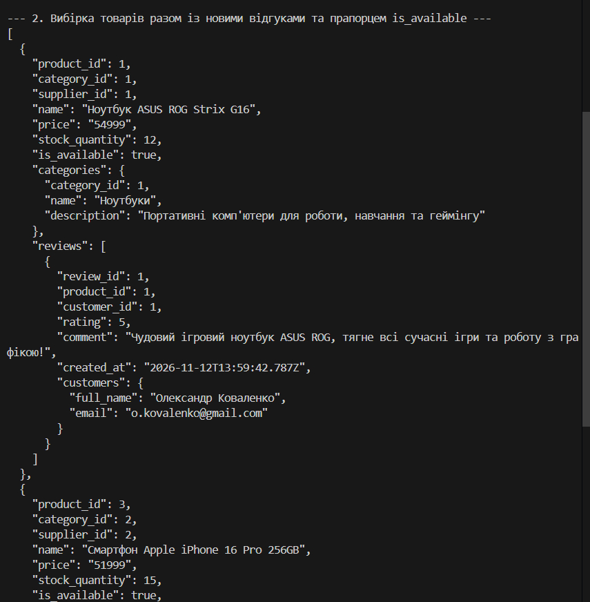
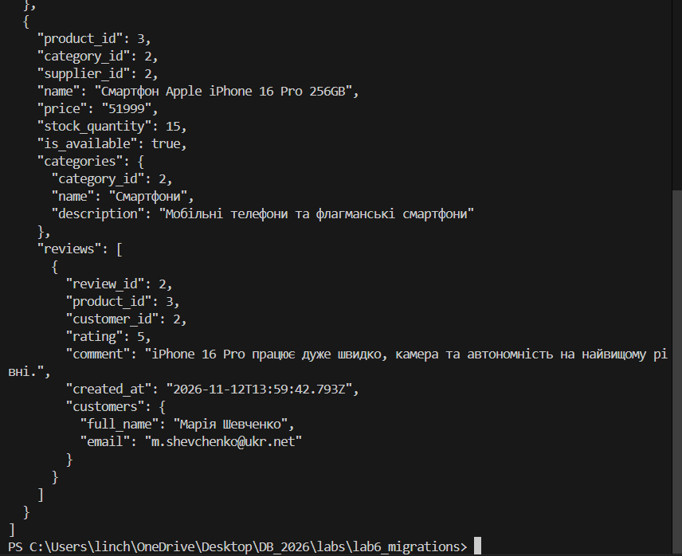

# Лабораторна робота №6: Міграції схем за допомогою Prisma ORM

**Предметна область:** Інтернет-магазин електроніки та гаджетів «TechStore»  
**Виконала:** Лінчевська Анастасія. Група ІМ-о51

---

## 1. Мета роботи

Навчитися керувати версіями та еволюцією схеми бази даних PostgreSQL за допомогою інструментів міграції **Prisma ORM**:

- підключитися до нормалізованої у Лабораторній роботі №5 бази даних та виконати інтроспекцію схеми (`npx prisma db pull`);
- послідовно застосувати 3 ізольовані міграції схеми за допомогою `npx prisma migrate dev` (додавання нової таблиці, додавання нового поля в існуючу таблицю, видалення застарілого стовпця);
- перевірити роботу оновленої схеми через клієнт `@prisma/client` та SQL-запити.

---

## 2. Опис виконаних міграцій (До / Після)

Для безпечної еволюції бази даних було виконано 3 окремі ізольовані міграції. Усі згенеровані SQL-файли збережено в каталозі [`prisma/migrations/`](./prisma/migrations/).

---

### Міграція №1: Додавання нової таблиці відгуків (`20261108151000_add_reviews_table`)

- **Команда запуску:**
  ```bash
  npx prisma migrate dev --name add-reviews-table
  ```
- **Що змінено і чому:** До схеми бази даних додано нову модель `reviews` (відгуки покупців про товари). Кожен відгук містить оцінку `rating` (від 1 до 5), текстовий коментар `comment`, дату створення `created_at` та зовнішні ключі `product_id` (зв'язок із товаром) і `customer_id` (зв'язок із клієнтом).

#### Модель Prisma — ДО міграції №1:

У файлі `schema.prisma` моделі `products` та `customers` не мали зв'язку з відгуками, а модель `reviews` була відсутня:

```prisma
model customers {
  customer_id Int      @id @default(autoincrement())
  full_name   String   @db.VarChar(120)
  email       String   @unique @db.VarChar(150)
  phone       String   @unique @db.VarChar(30)
  city        String   @db.VarChar(80)
  created_at  DateTime @default(now()) @db.Timestamp(6)
  orders      orders[]
}
```

#### Модель Prisma — ПІСЛЯ міграції №1:

Додано модель `reviews` та зворотні зв'язки `reviews[]` у моделях `customers` і `products`:

```prisma
model reviews {
  review_id   Int       @id @default(autoincrement())
  product_id  Int
  customer_id Int
  rating      Int
  comment     String?
  created_at  DateTime  @default(now()) @db.Timestamp(6)
  products    products  @relation(fields: [product_id], references: [product_id], onDelete: Cascade, onUpdate: NoAction)
  customers   customers @relation(fields: [customer_id], references: [customer_id], onDelete: Cascade, onUpdate: NoAction)
}
```

#### Згенерований SQL-код міграції (`migration.sql`):

```sql
-- CreateTable
CREATE TABLE "reviews" (
    "review_id" SERIAL NOT NULL,
    "product_id" INTEGER NOT NULL,
    "customer_id" INTEGER NOT NULL,
    "rating" INTEGER NOT NULL CHECK ("rating" BETWEEN 1 AND 5),
    "comment" TEXT,
    "created_at" TIMESTAMP(6) NOT NULL DEFAULT CURRENT_TIMESTAMP,

    CONSTRAINT "reviews_pkey" PRIMARY KEY ("review_id")
);

-- AddForeignKey
ALTER TABLE "reviews" ADD CONSTRAINT "reviews_product_id_fkey"
    FOREIGN KEY ("product_id") REFERENCES "products"("product_id") ON DELETE CASCADE ON UPDATE NO ACTION;

-- AddForeignKey
ALTER TABLE "reviews" ADD CONSTRAINT "reviews_customer_id_fkey"
    FOREIGN KEY ("customer_id") REFERENCES "customers"("customer_id") ON DELETE CASCADE ON UPDATE NO ACTION;
```

---

### Міграція №2: Додавання нового поля доступності товару (`20261108163000_add_product_availability_field`)

- **Команда запуску:**
  ```bash
  npx prisma migrate dev --name add-product-availability-field
  ```
- **Що змінено і чому:** До таблиці `products` додано логічний прапорець `is_available Boolean @default(true)`, який дозволяє менеджеру тимчасово приховувати товар із вітрини магазину без його видалення з бази даних.

#### Модель `products` у Prisma — ДО міграції №2:

```prisma
model products {
  product_id     Int            @id @default(autoincrement())
  category_id    Int
  supplier_id    Int
  name           String         @db.VarChar(150)
  legacy_sku     String?        @unique @db.VarChar(50)
  price          Decimal        @db.Decimal(10, 2)
  stock_quantity Int            @default(0)
  categories     categories     @relation(fields: [category_id], references: [category_id])
  suppliers      suppliers      @relation(fields: [supplier_id], references: [supplier_id])
  order_items    order_items[]
  product_tags   product_tags[]
  reviews        reviews[]
}
```

#### Модель `products` у Prisma — ПІСЛЯ міграції №2:

```prisma
model products {
  product_id     Int            @id @default(autoincrement())
  category_id    Int
  supplier_id    Int
  name           String         @db.VarChar(150)
  legacy_sku     String?        @unique @db.VarChar(50)
  price          Decimal        @db.Decimal(10, 2)
  stock_quantity Int            @default(0)
  is_available   Boolean        @default(true)
  categories     categories     @relation(fields: [category_id], references: [category_id])
  suppliers      suppliers      @relation(fields: [supplier_id], references: [supplier_id])
  order_items    order_items[]
  product_tags   product_tags[]
  reviews        reviews[]
}
```

#### Згенерований SQL-код міграції (`migration.sql`):

```sql
-- AlterTable
ALTER TABLE "products" ADD COLUMN "is_available" BOOLEAN NOT NULL DEFAULT true;
```

---

### Міграція №3: Видалення застарілого стовпця (`20261108174500_drop_legacy_sku_column`)

- **Команда запуску:**
  ```bash
  npx prisma migrate dev --name drop-legacy-sku-column
  ```
- **Що змінено і чому:** Із моделі `products` видалено застаріле поле внутрішнього артикулу `legacy_sku`, оскільки ідентифікація товарів у новій версії системи повністю переведена на первинний ключ `product_id`.

#### Модель `products` у Prisma — ДО міграції №3:

```prisma
model products {
  product_id     Int            @id @default(autoincrement())
  category_id    Int
  supplier_id    Int
  name           String         @db.VarChar(150)
  legacy_sku     String?        @unique @db.VarChar(50)
  price          Decimal        @db.Decimal(10, 2)
  stock_quantity Int            @default(0)
  is_available   Boolean        @default(true)
  ...
}
```

#### Модель `products` у Prisma — ПІСЛЯ міграції №3:

```prisma
model products {
  product_id     Int            @id @default(autoincrement())
  category_id    Int
  supplier_id    Int
  name           String         @db.VarChar(150)
  price          Decimal        @db.Decimal(10, 2)
  stock_quantity Int            @default(0)
  is_available   Boolean        @default(true)
  ...
}
```

#### Згенерований SQL-код міграції (`migration.sql`):

```sql
-- AlterTable
ALTER TABLE "products" DROP COLUMN "legacy_sku";
```

---

## 4. Перевірка роботи оновленої схеми через Prisma Client

Для перевірки застосованих міграцій було написано скрипт [`verify_prisma.js`](./verify_prisma.js), який використовує `@prisma/client` для створення записів у новій таблиці `reviews` та вибірки товарів разом із пов'язаними відгуками й новим полем `is_available`.

### Результат виконання у терміналі (`node verify_prisma.js`):




