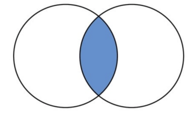
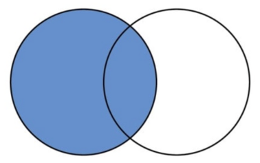
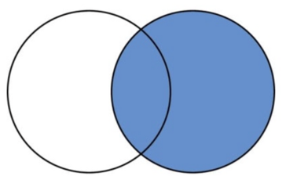
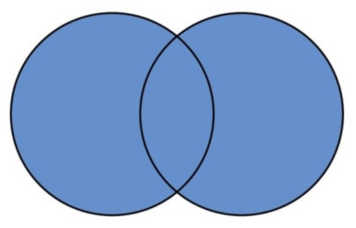
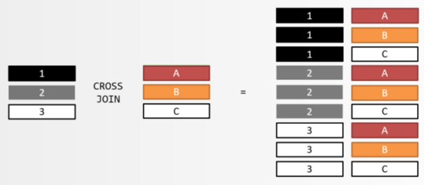
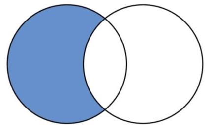

# Лекція 5: JOIN та операції над множинами

## Теми лекції

- Навіщо і як зʼєднувати таблиці: `INNER JOIN`, `LEFT JOIN`, `RIGHT JOIN`, `FULL OUTER JOIN`, `CROSS JOIN`
- Операції над множинами: `UNION`, `INTERSECT`, `EXCEPT`
- Як JOIN виконується насправді: Nested Loop, Hash Join, Merge Join

---

## 1. Навіщо JOIN

У нормалізованій базі один факт зберігається в одному місці. Студент - це рядок у `student`, його імʼя -
у `person`, його група - у `student_group`, а звʼязок "студент належить групі" - у
`student_group_assignment`. Щоб відповісти на просте питання "як звати студентів групи ІМ-21", потрібно
зібрати дані з чотирьох таблиць.

JOIN - інструмент, який робить дві речі:

1. збирає повʼязані рядки різних таблиць в один рядок результату
2. фільтрує рядки однієї таблиці залежно від того, що є (або чого немає) в іншій

Звʼязки, по яких зʼєднують, - це майже завжди зовнішні ключі (`student.person_id -> person.person_id`),
але JOIN не вимагає, щоб FK існував: зʼєднати можна по будь-якій умові.

---

## 2. Як читати JOIN

```sql
SELECT ...
FROM student s                -- ліва таблиця
JOIN person p                 -- права таблиця
ON p.person_id = s.person_id  -- умова
```

- Результат JOIN - це пари рядків (один з лівої, один з правої), для яких умова `ON` істинна.
- `s`, `p` - псевдоніми. Вони не обовʼязкові, але без них запити значно менш читабельні.
- Логічний порядок обробки запиту: `FROM`/`JOIN` -> `WHERE` -> `GROUP BY` -> `HAVING` -> `SELECT` -> `ORDER BY` -> `LIMIT`. 
  Звідси два наслідки: псевдонім колонки з `SELECT` не можна використати в `ON` чи `WHERE`, а `WHERE` застосовується до **вже зʼєднаного** результату.
- Кілька JOIN поспіль читаються згори вниз: кожен наступний `JOIN` приєднується до всього накопиченого результату, а не до попередньої таблиці.

> Примітка: Таблиця - не "множина", яку можна намалювати колом: один лівий рядок може утворити 0, 1 або багато пар.

---

## 3. Види JOIN

| Вид | Що потрапляє в результат | Коли використовувати                              |
|---|---|---------------------------------------------------|
| `INNER JOIN` | Тільки пари, для яких умова істинна | Потрібні лише X, у яких є Y                       |
| `LEFT [OUTER] JOIN` | Усі пари + кожен лівий рядок без пари (праві колонки = `NULL`) | Потрібні всі X, а Y - якщо є                      |
| `RIGHT [OUTER] JOIN` | Дзеркально до LEFT | Практично не використовується                     |
| `FULL [OUTER] JOIN` | Усі пари + ліві без пари + праві без пари | Потрібні всі X і всі Y, спарені де можливо        |
| `CROSS JOIN` | Усі комбінації (декартів добуток) | Згенерувати всі пари, наприклад "група - семестр" |

### 3.1. INNER JOIN

```sql
-- студенти з їхніми іменами
SELECT s.student_id, p.first_name, p.last_name
FROM student s
INNER JOIN person p ON p.person_id = s.person_id;
```

Слово `INNER` можна опускати: `JOIN` = `INNER JOIN`.



### 3.2. `ON` і `USING`

Якщо колонки в обох таблицях називаються однаково і означають одне й те саме, можна писати `USING`:

```sql
SELECT * FROM student s JOIN student_group_assignment sga USING (student_id);
```

Різниця не лише косметична: з `ON` у `SELECT *` колонка `student_id` зʼявиться двічі (6 колонок), з
`USING` - один раз і першою (5 колонок). Тому в довгих ланцюжках з `USING` не потрібно писати
`s.student_id` - колонка одна.

Правило: `USING` - коли назва і сенс збігаються (`person_id`, `course_id`); `ON` - в усіх інших випадках,
зокрема коли колонки називаються по-різному (`student_group.curator_id = professor.professor_id`) або коли
умова не є рівністю.

Існує також і `NATURAL JOIN` - він зʼєднує по всіх однойменних колонках. але його не варто використовувати:
результат зміниться, щойно в обох таблицях зʼявиться ще одна колонка з однаковою назвою (особливо, якщо ці колонки мають однакову назву, але позначають різні речі).

### 3.3. Умова не обовʼязково рівність

В `ON` можна написати будь-який булевий вираз: `a.x < b.y`, `BETWEEN`, `<>`, `LIKE` і тд. 
Семантика не змінюється - у результат потрапляють пари рядків, для яких умова істинна,
а в LEFT JOIN лівий рядок без жодної істинної пари отримує `NULL`-половину.

```sql
-- оцінка -> літера за діапазоном: таблиця шкали з колонками min_grade, max_grade, letter
SELECT e.student_id, e.grade, g.letter
FROM enrolment e
JOIN grade_scale g ON e.grade BETWEEN g.min_grade AND g.max_grade;

-- усі пари студентів однієї групи, без "сам із собою" і без дублікатів
SELECT a.student_id, b.student_id
FROM student_group_assignment a
JOIN student_group_assignment b ON b.group_id = a.group_id
                                AND b.student_id > a.student_id;
```

Нюанс у виконанні: швидкі алгоритми зʼєднання розраховані саме на рівність. Якщо в умові є хоч
одна рівність, СУБД зʼєднує по ній, а решту умов перевіряє як фільтр над парами. Якщо рівності немає
взагалі (`a.x < b.y`, діапазони і тд), лишається лише перебір пар, і вартість зростає. 
Тому в умові зʼєднання варто мати хоча б одну рівність.

### 3.4. LEFT JOIN

```sql
-- усі групи та їхні старости, у двох груп старости ще немає
SELECT sg.group_name, p.first_name, p.last_name
FROM student_group sg
LEFT JOIN student s ON s.student_id = sg.student_lead
LEFT JOIN person  p ON p.person_id  = s.person_id
ORDER BY sg.group_name;
```

З `INNER JOIN` замість `LEFT` ці дві групи просто зникнуть.

Зверніть увагу на другий `LEFT JOIN person`: якщо після `LEFT JOIN` поставити `INNER JOIN` по колонці з
"правої" сторони, рядки з `NULL` знову відріжуться. Після першого `LEFT` зазвичай усі наступні зʼєднання по цій гілці теж `LEFT`.



### 3.5. RIGHT JOIN

`A RIGHT JOIN B ON ...` === `B LEFT JOIN A ON ...`. Різниця лише в порядку колонок у `SELECT *`. У реальному коді
RIGHT JOIN майже не зустрічається, бо запит читають зліва направо: "від чого відштовхуємось" має стояти
першим. Варто завжди надавати перевагу LEFT JOIN.



### 3.6. FULL OUTER JOIN

Має сенс лише тоді, коли рядки без пари можуть бути з обох боків. У нашій схемі: викладач може не вести
жодного курсу, а курс може ще не мати викладача.

```sql
SELECT pe.last_name AS professor, ct.professor_role, c.course_name
FROM professor prof
INNER JOIN person pe USING (person_id)
LEFT JOIN course_teacher ct ON ct.professor_id = prof.professor_id
FULL OUTER JOIN course c ON c.course_id    = ct.course_id
ORDER BY professor NULLS LAST, course_name;
```



### 3.7. CROSS JOIN

```sql
SELECT s.student_id, sg.group_name
FROM student s
CROSS JOIN student_group sg;
```

Те саме старим синтаксисом: `FROM student s, student_group sg`. Кома між таблицями - це неявний CROSS JOIN.

Корисне застосування: згенерувати всі комбінації, а потім anti-join-ом знайти, яких бракує - "які студенти групи не записані на обовʼязковий курс".



---

## 4. Таблиця рішень: яке питання -> який інструмент використовувати

| Питання до даних                               | Інструмент |
|------------------------------------------------|---|
| X разом із повʼязаними Y, X без Y не цікавлять | `INNER JOIN` |
| Усі X, а Y - якщо є                            | `LEFT JOIN` |
| X, у яких немає Y                              | anti-join: `LEFT JOIN ... WHERE y.pk IS NULL` |
| Усі X і всі Y, спарені де можливо              | `FULL OUTER JOIN` |
| Усі комбінації X - Y                           | `CROSS JOIN` |
| Два списки однакової форми поєднати в один     | `UNION ALL` (або `UNION`, якщо треба прибрати дублікати) |
| Що є в обох списках / тільки в першому         | `INTERSECT` / `EXCEPT` |

---

## 5. Умова в `ON` чи у `WHERE` - найпоширеніша помилка з LEFT JOIN

Питання: "усі викладачі, і для кожного - активні групи, які він курує".

```sql
-- умова у WHERE
SELECT pe.last_name, sg.group_name
FROM professor prof
JOIN person pe USING (person_id)
LEFT JOIN student_group sg ON sg.curator_id = prof.professor_id
WHERE sg.group_status = 'active';
-- 5 рядків. Викладачі без груп зникли
```

Чому: `WHERE` виконується після JOIN. У викладача без груп `sg.group_status` дорівнює `NULL`,
`NULL = 'active'` - не істина, рядок відкидається. LEFT JOIN фактично перетворився на INNER.

```sql
-- умова в ON
SELECT pe.last_name, sg.group_name
FROM professor prof
JOIN person pe USING (person_id)
LEFT JOIN student_group sg ON sg.curator_id = prof.professor_id
                          AND sg.group_status = 'active';
-- 11 рядків: усі викладачі, у 6 - NULL замість групи
```

Правило: умови, які обмежують праву таблицю, повинні бути в `ON`. Умови, які обмежують результат, - у `WHERE`. 
Виняток - anti-join, де `WHERE ... IS NULL` на правій таблиці ставиться навмисно.

---

## 6. Ще дві речі, які ламають JOIN

### 6.1. `NULL` ніколи не зʼєднується

`NULL = NULL` - це не `true`, а `NULL`. Тому рядок із `NULL` у колонці зʼєднання ніколи не утворює пари:
в INNER JOIN він зникає, у LEFT JOIN отримує `NULL`-половину.
Якщо `NULL` треба вважати рівними - `ON a.x IS NOT DISTINCT FROM b.x`.

### 6.2. Розмноження рядків (fan-out)

LEFT JOIN повертає не "стільки рядків, скільки в лівій таблиці", а щонайменше по одному рядку на кожен рядок в лівій таблиці.
Якщо в лівого рядка кілька відповідників - він повториться стільки ж разів.

---

## 7. Self-join (Одна таблиця двічі)

Коли таблиця посилається сама на себе або потрібна в двох ролях, її беруть двічі з різними псевдонімами:

```sql
-- курси та їхні пререквізити
SELECT c.course_name, pre.course_name AS prerequisite
FROM course c
LEFT JOIN course_prerequisite cp ON cp.course_id = c.course_id
LEFT JOIN course pre             ON pre.course_id = cp.prerequisite_course_id
ORDER BY c.course_name, prerequisite;
```

---

## 8. Anti-join і semi-join

Anti-join - "X, у яких немає Y". Еквівалентні способи вираження anti-join:

```sql
-- студенти, які не є старостами

-- 1 - LEFT JOIN + IS NULL
SELECT s.student_id FROM student s
LEFT JOIN student_group g ON g.student_lead = s.student_id
WHERE g.group_id IS NULL;                                               -- 36

-- 2 - NOT EXISTS (найчитабельніший)
SELECT s.student_id FROM student s
WHERE NOT EXISTS (SELECT 1 FROM student_group g WHERE g.student_lead = s.student_id);   -- 36
```

У способі 1 колонка в `IS NULL` має бути такою, що не буває NULL у реальному рядку правої таблиці
(її первинний ключ або сама колонка зʼєднання). Інакше в результат потраплять і "справжні" рядки з NULL.



---

## 9. Підтримка в різних СУБД

PostgreSQL підтримує все перелічене.   
MySQL і MariaDB не мають `FULL OUTER JOIN`.  
Емуляція - через операції над множинами з наступного розділу:

```sql
SELECT ... FROM a LEFT  JOIN b ON ...
UNION
SELECT ... FROM a RIGHT JOIN b ON ...;      -- = FULL OUTER JOIN
```

---

## 10. Як JOIN виконується насправді

### 10.1. Логічний опис != фізичний план

Вираз `FROM a JOIN b JOIN c` описує результат, а не порядок дій. Для `INNER JOIN` порядок таблиць у запиті на
результат не впливає - планувальник СУБД сам обирає, що з чим і як зʼєднувати, за статистикою таблиць. 
Для `LEFT/RIGHT/FULL OUTER JOIN` порядок має значення семантично.

### 10.2. Три алгоритми

Будь-який JOIN PostgreSQL виконує одним із трьох способів. Який саме - вирішує планувальник для кожного
запиту окремо.

Nested Loop - найпростіший: для кожного рядка однієї сторони перебираємо рядки другої й перевіряємо
умову. Вартість зростає як добуток розмірів, тому підходить, коли одна зі сторін дуже мала або пошук
відповідників у другій дешевий.

Hash Join - для рівності (`a.x = b.y`): з меншої сторони будується хеш-таблиця в памʼяті за ключем
зʼєднання, більша сторона пробігається один раз, і для кожного рядка пара шукається в хеші. Основний
алгоритм для зʼєднання двох великих таблиць.

Merge Join - обидві сторони відсортовані по ключу зʼєднання й пробігаються паралельно, як злиття двох
відсортованих списків. Вигідний, коли дані вже впорядковані або їх усе одно треба сортувати.

Що робить кожен із них дешевим чи дорогим на реальних даних, як подивитись обраний план і як на нього
вплинути - теми лекцій 11–12.

### 10.3. Скільки JOIN можна робити в одному запиті

Синтаксично - скільки завгодно. Але вичерпний перебір порядків зʼєднання планувальник робить лише до
`join_collapse_limit` = 8 таблиць, а від `geqo_threshold` = 12 переходить на евристичний (генетичний)
алгоритм. Запит на 20 таблиць працюватиме, але план може бути далеким від оптимального - це одна з причин,
чому великі запити зачасту розбивають на CTE або view.

---

## 11. Операції над множинами

JOIN робить результат ширшим - додає колонки з іншої таблиці до кожного рядка. Операції над множинами
роблять його довшим - складають рядки однакової форми з двох запитів.

| Операція          | Результат                           |
|-------------------|-------------------------------------|
| `UNION [ALL]`     | рядки першого та другого запиту     |
| `INTERSECT [ALL]` | рядки, що є в обох                  |
| `EXCEPT [ALL]`    | рядки першого, яких немає в другому |

### 11.1. Правила

- Кількість колонок має збігатись, типи - бути сумісними (PostgreSQL шукає спільний тип, наприклад `text` і `varchar` сумісні, `enum` і `varchar` - ні).
- Імена колонок результату беруться з першого `SELECT`.
- `UNION` без `ALL` - це дедуплікація всього результату. Якщо дублікатів бути не може або вони ролі не грають - варто використовувати `UNION ALL`, це дешевше.
- `ORDER BY` і `LIMIT` в кінці застосовуються до всього результату.
- `INTERSECT` має вищий пріоритет за `UNION`: `SELECT 1 UNION SELECT 2 INTERSECT SELECT 2` -> `{1, 2}`,
  а `(SELECT 1 UNION SELECT 2) INTERSECT SELECT 2` -> `{2}`.
- На відміну від JOIN, операції над множинами вважають `NULL` рівними між собою.

### 11.2. Приклади

```sql
-- викладачі, які і ведуть курси, і курують групи
SELECT professor_id FROM course_teacher
INTERSECT
SELECT curator_id   FROM student_group;

-- викладачі, які ведуть курси, але нічого не курують
SELECT professor_id FROM course_teacher
EXCEPT
SELECT curator_id   FROM student_group;

-- студенти, записані і на "Машинне навчання", і на "Операційні системи"
SELECT student_id FROM enrolment WHERE course_id = 8
INTERSECT
SELECT student_id FROM enrolment WHERE course_id = 6;
```


---

## 12. JOIN проти операцій над множинами

| | JOIN | UNION / INTERSECT / EXCEPT |
|---|---|---|
| Результат | ширший: колонки з кількох таблиць в одному рядку | довший: рядки однакової форми з кількох запитів |
| Звʼязок між частинами | явна умова `ON` | позиційний: 1-ша колонка з 1-ю, 2-га з 2-ю... |
| `NULL` у ключі | ніколи не зʼєднується | вважається рівним `NULL` |
| Дублікати | зберігаються (і множаться) | `UNION`/`INTERSECT`/`EXCEPT` прибирають, `... ALL` зберігають |

Це різні інструменти, а не два способи зробити одне й те саме.

---

## 13. Практична частина лекції

Для демонстрації запитів під час лекції, попередньо було підготовано синтетичні дані, запити знаходяться у [файлі](../../scripts/insert-data.sql).

Під час лекції було розроблено наступні запити:

```sql
-- скласти список груп ІМ-21 та ІМ-22
select sg.group_name, p.first_name || ' ' || p.last_name as student_name
from student_group sg 
inner join student_group_assignment ga using (group_id)
inner join student using (student_id)
inner join person p using (person_id)
where ga.assignment_status = 'active' 
		and sg.group_name IN ('ІМ-21', 'ІМ-22')
order by p.last_name; 

-- для кожної групи знайти старосту та куратора
select 
	sg.group_name, 
	lp.first_name || ' ' || lp.last_name as student_lead, 
	profp.first_name || ' ' || profp.last_name as curator
from student_group sg
left join student s on sg.student_lead = s.student_id
left join professor prof on sg.curator_id = prof.professor_id
left join person lp on s.person_id = lp.person_id
left join person profp on prof.person_id = profp.person_id;


select
  sg.group_name,
  profp.first_name || ' ' || profp.last_name as curator
from student_group sg
       left join professor prof on sg.curator_id = prof.professor_id
       left join person profp on prof.person_id = profp.person_id
where sg.group_status = 'active';

select
  sg.group_name,
  profp.first_name || ' ' || profp.last_name as curator
from student_group sg
       left join professor prof on sg.curator_id = prof.professor_id and sg.group_status = 'active'
       left join person profp on prof.person_id = profp.person_id
```

Всі запити також можна знайти у [файлі](../../scripts/joins.sql).

У [директорії](../../exercises) знаходяться вправи, які можна виконати для отримання додаткових балів.
Виконані вправи потрібно оформити у вигляді `pull request` до даного репозиторію.

## 14. Висновки

- JOIN зʼєднує пари рядків за умовою.
- `INNER` - лише пари, `LEFT` - усі ліві, `FULL` - усі з обох боків, `RIGHT` не варто використовувати, `CROSS` - усі комбінації.
- Умова на праву таблицю у `WHERE` перетворює LEFT JOIN на INNER. Таку умаво потрібно використовувати в `ON`.
- `NULL` не зʼєднується ні з чим, `NOT IN` із `NULL` у підзапиті повертає порожній результат - викоррстовуйте `NOT EXISTS`.
- Перед агрегацією перевіряйте, чи JOIN не розмножив рядки.
- Операції над множинами складають рядки, JOIN - колонки, це не взаємозамінні інструменти.
- Планувальник сам обирає порядок і алгоритм зʼєднання (Nested Loop / Hash / Merge). Текст запиту описує результат, а не спосіб його отримання.

## Додаткові матеріали


Діаграми Венна показують, які ключі потрапляють у результат, але кількість рядків (розмноження рядків) вони не показують.

1. [Візуалізація JOIN-ів та операцій над множинами](https://imgur.com/sql-joins-set-operators-xLTcOGi)
2. [PostgreSQL: Table Expressions - офіційна документація по JOIN](https://www.postgresql.org/docs/current/queries-table-expressions.html)
3. [PostgreSQL: Combining Queries - UNION, INTERSECT, EXCEPT](https://www.postgresql.org/docs/current/queries-union.html)
4. ORM генерують JOIN-и за вас - тому важливо вміти прочитати, що саме вони згенерували (і чому іноді це
   20 запитів замість одного): [Що таке ORM](https://www.freecodecamp.org/news/what-is-an-orm-the-meaning-of-object-relational-mapping-database-tools/),
   [SQL builder libs vs ORMs](https://www.prisma.io/dataguide/types/relational/comparing-sql-query-builders-and-orms)
